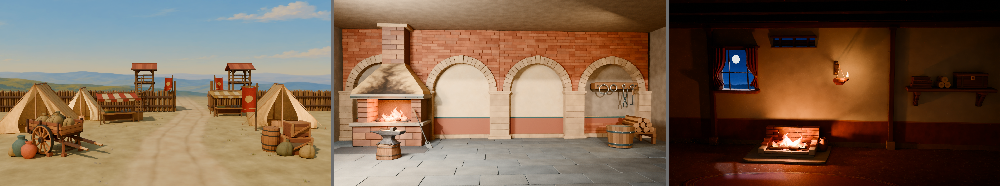

# 三幅基地背景的画风盲评

三位评审分别从空白会话开始，只收到同一份匿名拼图和同一道题。并排保留各自的 1920×1080 原图像素，中间以 16 像素中性灰隔开。采用[集市](../market-new/09-final.png)、[铁匠铺](../smithy/09-final.png)、[基地大厅](../base-hall/09-final.png)的最终美术稿。

> 左、中、右三幅背景的画风是否统一？哪些最接近、哪些差异最明显？结合具体位置的色彩、光影、材质、边缘或造型说明，区分题材照明差异与画法差异。

三位均认为基础画风统一，集市与铁匠铺的整体观感最接近，集市与夜间大厅差异最大。

| 评审 | 支持统一的局部 | 观察到的差异 |
|---|---|---|
| 一 | 车轮、陶罐、铁砧和木桶都以简化轮廓、明暗面和细微斑驳塑形；两处炉火的砖块厚度与火舌概括相近。 | 集市车辐、帐篷折面利落；铁匠铺的砖缝、金属和烟渍刻画更细。大厅把清晰边缘集中在火边。 |
| 二 | 两只木桶都用宽木板、简化桶箍和明暗面交代体积。两处炉砖和火焰也采用相近的块面。 | 集市远山、路缘较软；铁匠铺工具、砖缝较清楚；大厅窗外冷蓝与局部橙光并置，架上货箱融入暗部。 |
| 三 | 近景木车、陶罐与炉台、铁砧都有清楚的体积，受光面内带细碎色差。 | 铁匠铺拱券规整，集市地景松软；大厅以大片暗面和少量亮边引导视线。 |

从整幅的明暗分布看，夜间大厅最突出。缩小到同类物件，木桶和炉砖的造型仍能互相印证。三份意见均为针对这组三幅静帧的模型评审。
