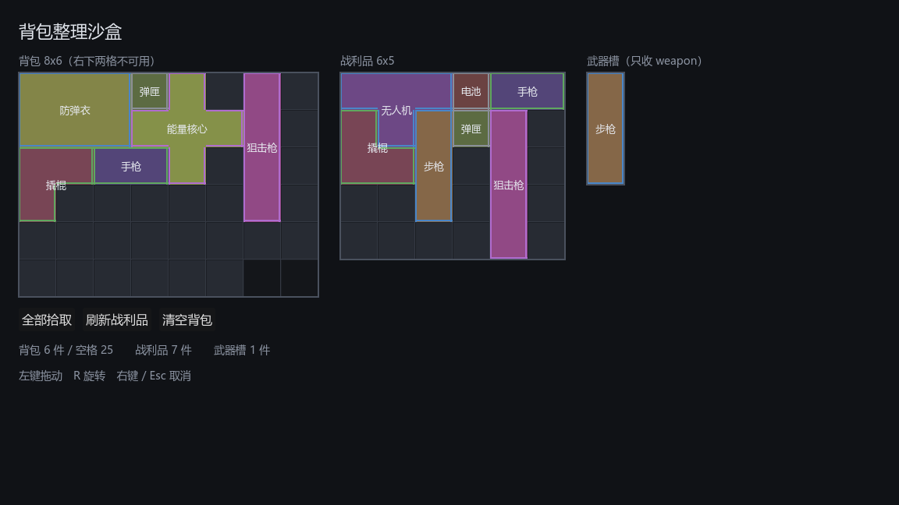

# 005 · 背包表现层与拖拽沙盒

对应架构文档：3.4 节「实现要点与 Godot 特定坑」、3.5 节「验收标准」。**阶段 1（M1）到此完成。**

## 目标

把前四步的纯逻辑接上画面：网格渲染、手写拖拽状态机（跨容器、拖拽中旋转、落点合法性高亮），并产出一个可运行的沙盒场景，达成阶段 1 的验收标准「可玩的整理沙盒」。

## 产出

| 文件 | 职责 |
|---|---|
| `ui/inventory/item_painter.gd` | `ItemPainter`：物品的统一画法，网格内与拖拽残影共用 |
| `ui/inventory/inventory_view.gd` | `InventoryView`：单个容器的可视化与格坐标换算 |
| `ui/inventory/drag_layer.gd` | `DragLayer`：拖拽状态机 |
| `ui/inventory/inventory_sandbox.gd` / `.tscn` | 沙盒场景，已设为 `run/main_scene` |
| `tools/capture_scene.gd` | 渲染若干帧后截图存盘的验证工具 |
| `tests/test_drag_layer.gd` | 拖拽逻辑测试套件 |



截图由 `tools/capture_scene.gd` 实机渲染产出，不是示意图。

## 关键决策

### 1. 视图全部在 `_draw()` 里重画，物品不做成子节点

架构文档 3.4 建议物品作为子 `Control`。实现时改成在 `_draw()` 里一次画完，原因是这直接落实了架构原则 1.2「从状态完整重建视图」：容器发 `changed` 就 `queue_redraw`，不存在任何需要与真实状态对账的增量视图状态。

异形物品本来就没法用一个矩形 `Control` 精确表示（L 形的凹口会挡住下面的格子），做成子节点还得额外处理命中测试，收益为负。

代价：逐物品的悬停高亮、tooltip、动画需要自己实现。到需要时再评估是否局部引入子节点。

### 2. 不用 Godot 内置的拖放 API

`_get_drag_data` / `_can_drop_data` 在拖拽过程中无法响应旋转键，也做不出多格落点高亮，所以按架构文档的建议手写状态机。

### 3. 抓取时立刻把物品从源容器移除

拖拽期间物品不属于任何容器，由 `DragLayer` 持有强引用。好处是渲染逻辑干净（网格里就是没有它），坏处是**每一条退出路径都必须把它安置好**。

因此 `_restore()` 有两级兜底：先放回原位（源容器那几格自抓取后一直空着，必然放得回去），万一放不回就自动找空位，再不行才 `push_error`。物品在任何情况下都不允许凭空消失。

### 4. 鼠标位置改成入参，让拖拽逻辑可测

最初 `_drop()` / `_refresh_preview()` 内部调用 `get_global_mouse_position()`，结果整块逻辑只能靠手工拖拽验证 —— 而这里恰恰是失败路径最多的地方。

改成 `drop_at(global_pos)`、`update_preview(global_pos)`、`view_at(global_pos)`、`target_origin(view, global_pos)`，鼠标位置由调用方给。`_input` 里照常取真实鼠标，测试里给合成坐标。

代价是 `rotate_dragged()` 需要一个 `is_inside_tree()` 判断（测试中视图不进场景树，取不到鼠标），这点噪音换来整条链路可自动验证，值得。

### 5. 描边向内缩 1px

描在格线正中时，相邻两件物品的边会叠成一条，视觉上分不出是一件还是两件。向内缩 1.5px 后每件物品的轮廓完全落在自己的格子内，紧挨着的物品之间能看出明确的分界。

只描外轮廓、不逐格描边：逐格描边会让 L 形看起来像散落的方块，而不是一件物品。

### 6. 中文标签需要系统字体

Godot 内置字体不含 CJK 字形，中文会渲染成方块。沙盒用 `SystemFont` 指定字体链（`Microsoft YaHei UI` → `Noto Sans CJK SC` → `SimHei` → `sans-serif`），通过 `label_font` 注入到视图与拖拽层。

正式接入 UI 主题时这里应改为在 `Theme` 里统一设置，而不是每个控件单独注入。

### 7. 截图作为验证手段

无头运行只能证明脚本能编译，证明不了画面是对的。`tools/capture_scene.gd` 在非 headless 下渲染若干帧后把视口存成 PNG —— headless 用的是空渲染驱动，截出来是黑的，必须用真实渲染后端。

它还支持一个可选钩子：场景若提供 `demo_fill()` 就先调用，避免截到一个空界面。

## 验证

### 自动测试

```bash
bash tools/test.sh
```

```
======================================================
通过  287 项断言，6 个套件，耗时 286 ms
======================================================
EXIT=0
```

新增的 `DragLayer` 套件覆盖：命中测试、抓取即离开源容器、跨容器放手、抓取偏移（抓长条中段时落点相应前移）、放到容器外退回原位、放到非法位置退回、取消拖拽、拖拽中旋转后放入窄容器、标签过滤拒收后退回、落点预览的合法/非法判定与清除、拖拽期间拒绝第二次抓取。

### 实机渲染

```bash
"/e/Godot/Godot_v4.7.1-stable_win64_console.exe" --path . --script res://tools/capture_scene.gd -- <输出.png>
```

截图确认：异形占格（T 形无人机、十字能量核心、L 形撬棍）轮廓清晰可辨；封禁格以更暗的底色与空格区分；自动装填对 1x4 狙击枪做了旋转；武器槽的标签过滤生效（只有步枪进去了）。

### 过程中发现并修掉的三个问题

| 问题 | 原因 |
|---|---|
| `to_local()` 编译失败 | 那是 `Node2D` 的方法，`Control` 没有。改用 `get_local_mouse_position()` |
| `ItemPainter` 的 `inset` 参数是死代码 | 写成了 `Vector2(inset, inset) * 0.0`，恒为零。删掉该参数，改用常量 `INSET` 实现描边内缩 |
| 截图里武器槽始终为空 | `demo_fill()` 的 `break` 位置错了，遇到第一件带 weapon 标签的就跳出，而那件常是放不进 1x3 槽位的 1x4 狙击枪。改为装入成功才跳出 |

第三个是演示代码的问题，不影响系统本身 —— 但它恰好是这个沙盒存在的意义：这类「形状装不进去」的边界情况，看着画面才容易发现。

## 遗留

- **架构文档 2 节画的 `EventBus` autoload 至今没有建。** 容器自带 `changed` 信号已经够用，等出现「非容器来源的逻辑→UI 广播」需求时再建，避免造一个空壳。
- 没有物品交换（拖 A 到 B 上互换位置）、没有悬停 tooltip、没有拖拽动画，这些都等手感测试后再定。
- 拖拽残影是即时跟随光标的，没有缓动。
- 字体在沙盒里逐控件注入，应改为 `Theme` 统一设置。
- `InventoryView.CELL` 是常量 48px，尚不支持缩放或不同容器用不同格子尺寸。

## 阶段 1 验收对照

架构文档 3.5 节的验收标准：

| 标准 | 状态 |
|---|---|
| 能拖 | 达成，跨三个容器 |
| 能转 | 达成，拖拽中按 R |
| 能跨容器 | 达成，且失败必回滚 |
| 非法位置红色高亮 | 达成，合法绿非法红 |
| 序列化成 JSON 再读回来完全一致 | 达成，报告 003 已验证 |

**阶段 1（M1 网格背包系统）完成。**

## 下一步

按架构文档第 10 节，阶段 2 是 **M2 自动战斗**：背包快照编译成 `CombatantSpec`（含邻接加成结算）、`BattleSim` 定步长确定性模拟输出事件日志、以及一个极简的战斗回放视图。

编译阶段所依赖的 `GridInventory.neighbors_of()` 已在报告 003 中实现并测试。
