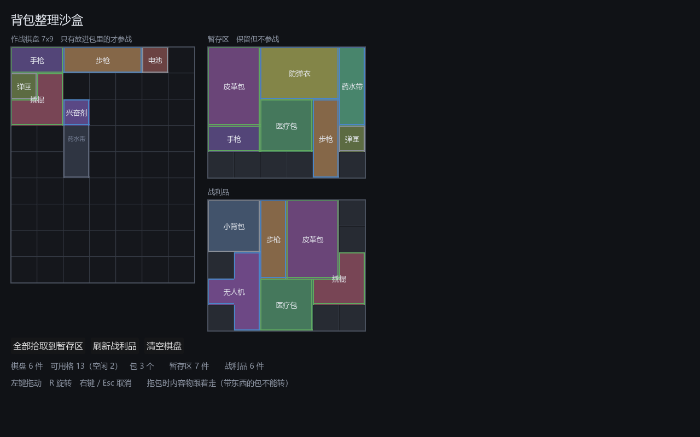

# 007 · 棋盘与包体系统（M1 返工）

对应架构文档 v0.4：3.2 空间模型、3.3 GridInventory、3.4 暂存区与作战区。
执行报告 006 中确认的四项决策。

## 目标

按《背包乱斗》的真实空间模型返工 M1：移除装备栏，把背包从「固定网格 + 设计者挖洞」改成
「棋盘 + 玩家放置包体拼出可用区」，并引入暂存区。

## 决策落实情况

| # | 决策 | 状态 |
|---|---|---|
| 1 | 移除装备栏 | 已移除。`accept_tags` 改作容器级准入，包体级准入用 `ItemDef.bag_accept_tags` |
| 2 | 采用「包作为可放置物品」 | 已实现，含容纳关系与带内容物搬运 |
| 3 | 合成配方暂缓 | 未实现，已登记在架构文档第 12 节的扩展接口表 |
| 4 | 采用 Storage / Inventory 分区 | 已实现，沙盒中即为「暂存区 / 作战棋盘」 |

## 产出

| 文件 | 改动 |
|---|---|
| `docs/architecture.md` | 升至 v0.4，重写 3.1–3.4，补 4.2 插槽配对与 4.3 定点数冷却 |
| `core/inventory/grid_inventory.gd` | 双层占用、容纳关系、`detach_bag` / `attach_bag`，约 +180 行 |
| `core/inventory/item_def.gd` | 新增 `is_bag`、`bag_accept_tags` |
| `core/inventory/inventory_service.gd` | 新增 `_move_bag`，`move()` 自动分流 |
| `ui/inventory/inventory_view.gd` | 画未覆盖格与包体区域；点包的空白处抓包 |
| `ui/inventory/drag_layer.gd` | 拖包时内容物跟随，含残影绘制与整体回滚 |
| `ui/inventory/inventory_sandbox.gd` | 重写为棋盘 + 暂存区 + 战利品，去掉武器槽 |
| `tools/gen_sample_items.gd` | 表格改为字典，新增 4 个包体，共 15 组资产 |
| `tests/test_board_bags.gd` | 新增套件：棋盘、包体、跨容器搬包、棋盘序列化 |
| `tests/test_drag_layer.gd` | 新增 `run_bag_drag` 套件 |
| `tests/test_item_assets.gd` | 覆盖包体资产与棋盘上的完整流程 |



截图说明：棋盘上大片深色是**尚未被任何包覆盖**的不可用区；可用格 13 = 皮革包 6 + 长条包 4 + 药水带 3。
暂存区与战利品里的「皮革包」「小背包」作为普通物品躺着，**不提供格子** —— 包只有放上棋盘才作为包生效。

## 关键决策

### 1. 两张互相独立的占用表

```gdscript
var _bag_owner: PackedInt32Array   # 该格被哪个包覆盖
var _occ: PackedInt32Array         # 该格被哪件普通物品占据
```

一个格子可以同时「被包 B 覆盖」和「被物品 I 占据」。放包看 `_bag_owner`，放物品看两者。
这比「用一张表加标志位」清楚得多，也让 `bag_at()` / `cell_uid()` 各自成为一句话的查询。

### 2. 物品必须整件落在**单个**包内

不允许跨两个相邻的包摆放。理由是**容纳关系必须无歧义** —— 包自带作用于内容物的效果，
拿起包时内容物要跟着走，这两件事都要求每件物品有且只有一个归属包。

副作用是包的形状变得有意义：1x3 的步枪需要某个包里有连续的 1x3 空间。这是设计上想要的。

### 3. 包在自由容器里只是普通物品

`acts_as_bag(def)` 返回 `requires_bag and def.is_bag`。一个包躺在尸体或暂存区里时走普通物品
的占用表，不提供任何格子。

这条规则省掉了容器套容器的递归，实现与心智负担都大幅下降，而且语义上也对：包得先装到身上才有用。

### 4. 有内容物的包：不能直接 remove，不能旋转

- `remove()` 遇到非空的包直接拒绝并告警，连内容物一起摘请用 `detach_bag()`
- `rotate_item()` 拒绝旋转非空的包

旋转包意味着内容物要跟着做坐标变换，边界情况多且玩家难以预期。**这是一条有意的简化**，
已登记在架构文档第 12 节，将来要放开时有明确的接入点。

### 5. `can_attach_bag` 是非破坏性的

拖拽预览每帧都要判断「这一整包能不能放这儿」，不能靠「试着放一下失败再撤销」。
因此 `can_attach_bag` 独立实现：先验包的落点，再逐个验内容物是否仍落在包的轮廓内、
且不与目标容器已有物品冲突。`attach_bag` 调它做前置检查，通过后才动手。

### 6. `from_dict` 必须先放包

内容物的落点合法性依赖包提供的覆盖，所以反序列化时按「包优先」排序后再逐个放置。
测试里专门有一条把存档条目顺序颠倒过来验证这一点。

### 7. 点击语义：先抓物品，点包的空白处才抓包

`InventoryView._gui_input` 先查 `cell_uid`，为空再查 `bag_at`。符合直觉，也不需要额外的模式切换。

## 验证

```bash
bash tools/test.sh
```

```
======================================================
通过  444 项断言，7 个套件，耗时 1560 ms
======================================================
EXIT=0
```

从 M1 初版的 287 项增至 444 项，新增覆盖：

- 空棋盘放不下任何普通物品；放包后可用格数正确
- 包之间不能重叠；物品跨两个相邻包被拒绝
- `bag_of` / `contents_of` 容纳关系；内容物列表按 uid 升序（顺序必须稳定，否则战斗编译结果会抖动）
- 非空的包拒绝 remove、拒绝旋转；空包可旋转且覆盖范围跟着变
- `detach_bag` / `attach_bag` 往返；带内容物时拒绝换朝向
- 跨棋盘搬包，内容物保持相对偏移；目标放不下时整体退回；自由容器拒收带内容物的包
- 包体准入标签（药水带只收 consumable）
- 包在自由容器里作为普通物品，不提供覆盖
- 自动装填认覆盖；包不出现在 `neighbors_of` 结果里
- 棋盘序列化往返，含存档条目顺序颠倒的情形
- 拖包全链路：抓取、内容物跟随、整体回滚、预览合法性、带内容物时禁止旋转

### 过程中被测试抓出的两处断言错误

| 失败断言 | 真相 |
|---|---|
| 「6 格的包里至少应装得下 3 件示例物品」实际只装进 1 件 | 遍历顺序先遇到 3x2 的防弹衣，旋转后正好填满 2x3 的包。**代码行为正确**，是断言写得太天真。改为显式摆放弹匣＋电池＋手枪，并补一条「只剩 2 格时防弹衣放不进」 |
| 拖包落点期望 (2,1) 实际 (2,0) | 我在断言里漏算了抓取偏移。改用统一的 `_grab(cell)` 辅助函数计算抓取点，落点期望随之修正 |

两次都是测试写错，实现未改动。

## 遗留

- **有内容物的包不能旋转**，见决策 4。
- **自由容器收不下带内容物的包**（没有覆盖概念，内容物无处安放）。目前会直接失败并原样退回，
  更好的交互可能是提示玩家先掏空，等 UI 打磨时再定。
- 包体尚无「作用于内容物的效果」（如「包内物品触发快 10%」）。字段位已在架构文档 3.1 预留为
  `ItemDef.bag_effect`，等 M2 编译阶段一起做。
- 星形／菱形插槽尚未建模，同样留到 M2。
- L 形物品的文字标签按包围盒居中，可能落在形状的凹口上（截图里「撬棍」即是）。纯视觉问题。
- `contents_of()` 是 O(n)，`free_cell_count()` 是 O(格数)。当前规模无压力，若 UI 每帧调用需加缓存。

## 下一步

阶段 1 的返工到此结束，验收标准（拖／转／跨容器／非法高亮／序列化往返）在新模型下全部重新达成。

接下来是 **M2 自动战斗**，按架构文档 4.2 / 4.3：
1. 包体效果按 `bag_of()` 聚合到内容物
2. 星／菱形插槽的**确定性**带约束配对
3. 定点数冷却的 `BattleSim`
