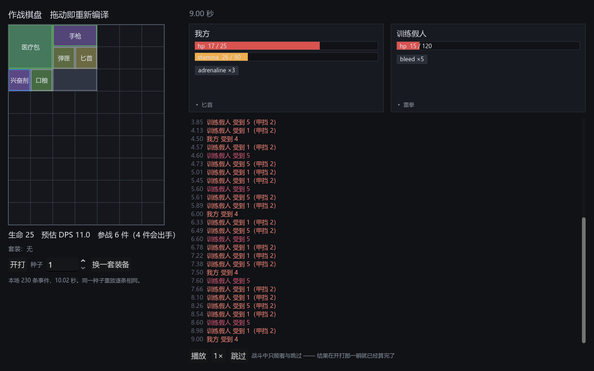

# 022 · 战斗可视化

**阶段**：2 · M2　　**架构文档**：v1.10（4.8 表现层补完，4.5 新增资源回复）
**测试**：855 项断言 / 13 个套件，全绿
**场景**：`ui/battle/battle_sandbox.tscn`



左边摆背包，右边看回放。拖动一件装备就重新编译，预估 DPS 与套装进度实时跟着变。

---

## 做了什么

### 回放只认事件

`BattleView` 持有日志与一个播放游标，`_process` 推进时间、消费到期事件。
它**不认识 `BattleSim`、`CombatantRuntime` 或棋盘**，因此：

- 快进、倍速、跳过、跳转都只是移动游标，不可能改变结果；
- `seek(t)` 就是「从头再快放一遍到那一刻」—— 没有内部状态要倒推，
  所以它不可能和正常播放不一致；
- 同一套面板将来也能放录像、放别人的战斗。

界面上只有**播放 / 倍速 / 跳过**三个按钮 —— 战斗中玩家本来就只有看和跳过。

### 为此让日志自足

表现层需要什么，日志就得带什么。这一步补了三处：

| 补的东西 | 不补会怎样 |
|---|---|
| `resource_changed` 带变化后的 `current` / `max` | 只给增量的话表现层得自己累加；漏掉一次上限变动（强壮之类的 buff）血条的分母就永久失真 |
| `damage` 带 `absorbed` / `armor` | 「这一下为什么只掉 5 点」是看回放时最想知道的事 |
| `BattleResult.initial` 开战快照 | 没有它，表现层就得自己去编译一遍棋盘才知道血条从哪儿开始 —— 那等于让它认识编译器 |

反过来，**不进日志**的也想清楚了：`before_damage` 不进（它没有可观测结果，
结果体现在随后那条 `damage` 上），物品名不进（名字是表现层的事，
塞进日志只会让每条事件都背着一串用不上的字符串，表现层拿 uid 自己查表）。

### 示例道具补上了战斗数据

`tools/gen_sample_combat.gd` 给 13 件道具写入占位数值（取自道具清单）：
手枪 / 步枪 / 狙击枪 / 匕首 / 撬棍、医疗包 / 兴奋剂 / 防弹衣 / 口粮、
弹匣（邻接增益）、电池 / 能量核心（供电）、无人机（耗电武器）。

**这是过渡方案。** 正式做法是第 10 节的导入器（作者写 JSON）。
在那之前先用代码配上，否则血条和伤害数字都没有东西可显示 ——
道具清单里写的「等能看见了再一边看一边填」，现在到了能看见这一步。

---

## 截图之外：三个只有跑起来才发现的问题

写完代码跑第一张截图时，界面是「对」的 —— 有血条、有数字、有事件条。
但仔细看，三处不对：

### 1. 我方血条显示 `0 / 0` 却画成满格

日志载荷是**定点**（`25.0` 存成 `250000`），而 `ResourcePool.snapshot()` 已经取过整（`25`）。
面板把两个来源都当定点处理，于是走快照那条路径的值被再除一次一万，变成 0。

只在其中**一条路径**上出错，所以敌方（全靠事件更新）看着完全正常。
修法是把换算集中到 `BattleView` 一层，面板只收显示值 —— 并写进文档。

### 2. 出手显示「uid 2」

日志里只有 uid。一开始想过把名字塞进事件载荷，但那样每条 `item_fired`
都背着一串表现层之外没人用的字符串。改成 `BattleView.set_item_names(side, {uid: 名字})`，
由沙盒从棋盘取。

### 3. 跳转后事件条的时间戳全挤成同一个

`_log_line` 用的是播放光标而不是事件自己的时刻。正常播放时两者相等，
所以只有 `seek()` 会暴露它。

---

## 跑起来才看见的设计缺口：耐力不回复

第一版截图里 `stamina 0 / 90` —— 摆两把武器（手枪 1.2 秒 6 点、匕首 0.6 秒 3 点）
＝ 每秒 10 点，基线 50 + 口粮 40 = 90 点，**9 秒抽干**，之后整场站着不动。

这不是 bug：系统里从来没有过回复机制，只是在有血条之前谁都没注意到。
**这类缺口正是可视化的价值** —— 单元测试里它只表现为「伤害总量偏低」，
没人会去质疑那个数字。

### 定案：按时间自动回复，懒结算

速率写成 `regen_xxx` 属性，与 `max_xxx` 对称：

```gdscript
const DEFAULT_STATS := {"max_hp": 25.0, "max_stamina": 50.0, "regen_stamina": 4.0}
```

**没有定时器，也没有每秒一次的事件。** 事件驱动的模拟里没有「每秒」这回事，
硬造一个每秒事件等于把帧又请回来了。改成懒结算：推进器每到一个时刻，
按「距上次结算过了多久 × 当刻速率」一次性补上。

三条性质，都有测试：

- **线性，所以勤结算不会算多。** 分三次结算到 8 秒，与一次结算到 8 秒结果相同。
- **勤结算反而更准。** 速率被 buff 改变的那一刻正好是一个时刻点，
  在那里结算，前后两段就各按各的速率算。
- **结算要排在 buff 到期之前。** 到期前那一段时间里 buff 还在，速率就该按它算。

因为速率只是一条普通属性，**「buff 影响回复量」不需要任何新机制** ——
一条作用于 `regen_stamina` 的 `StatModifier` 就够了，走的是和增伤同一条 4.3 公式。
测试里叠两层 +100% 的 buff，速率从 5/秒 变成 15/秒（同乘区相加，不是相乘）。

### 效果

同一套配置，战斗从 16.5 秒缩到 10.02 秒，耐力稳在 `26 / 90` 而不是见底。
基线 4/秒 + 口粮 2/秒 = 6，对上两把武器 10/秒 的消耗仍是净流失 ——
撑得久但撑不住，这个取舍比「无限续航」和「9 秒哑火」都有意思。

数值全是占位。

---

## 验证

```
通过  855 项断言，13 个套件，耗时 874 ms
```

回复相关新增三组：按时间累积与上限截断、buff 改变速率、
以及一条回归对照 —— 同种子同配置下「不回复」只打得出 2 发（10 点伤害），
「回复 10/秒」打出 40 点以上。

没有为表现层写单元测试 —— 它的正确性靠的是「真渲染一张图出来看」，
`tools/capture_scene.gd` 现在可以接第二个参数指定场景。
上面那三个问题，单元测试一个都抓不到，截图三张全抓到了。

核心侧的改动（日志载荷、`BattleResult.initial`、回复结算）有现有断言兜底。

---

## 遗留

- 回复速率、基线数值全是**占位**，等内容定稿。
- 示例道具的战斗数据也是**占位**，等导入器。
- 敌人仍是手搓的训练假人；真正的敌人配置属于 M4。
- 回放没有做「按物品高亮出手」的动效，只在面板底部写了一行「▸ 手枪」。
  等有了图标动画再说，现在够用。
