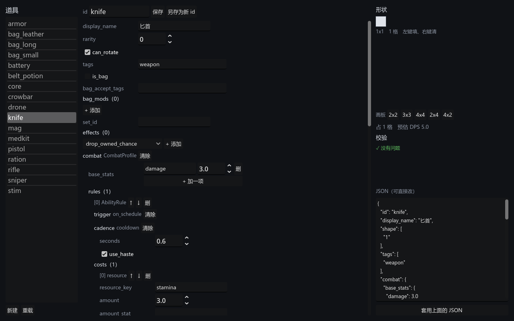

# 023 · 内容管线：导入器、导出器与可视化编辑器

**阶段**：3 · 内容管线　　**架构文档**：v1.11（第 10 节重写 10.4／10.5）
**测试**：927 项断言 / 14 个套件，全绿
**场景**：`ui/editor/content_editor.tscn`



左边选道具，中间是**按反射生成**的表单，右边画形状、看实时校验、看 JSON。

---

## 一条通路，两个入口

```
data/authoring/items/*.json          ← 手写，或编辑器存盘
        │  tools/import_content.gd   ← 命令行，全有或全无
        ▼
data/items/*.tres                    ← 引擎资产，游戏读它
        │  tools/export_content.gd   ← 反向，一次性迁移用
        ▲
```

**GUI 不是另一条通路**，它存的就是同一份 JSON。手写与图形界面产出的数据完全等价，
不存在「GUI 能表达而 JSON 不能」的分裂。

现有 17 件示例资产已经全部倒成了作者数据，跑一遍 `import_content` 能原样还原。

## 地基：三方都不认识具体效果

导入器、导出器、编辑器只会两件事：

1. 问 Godot「这个类有哪些导出属性、各是什么类型」——`get_property_list()`，
   类型化数组还能用 `get_typed_script()` 问出元素类；
2. 碰到抽象基类（`Trigger` / `Cadence` / `Cost` / `Effect`）时，
   按 JSON 里的 `type` 去 `EffectRegistry` 查。

于是**新增一种效果 = 加一个脚本 + 注册表登记一行**，整条工具链自动认得：
命令行导入器接受它、导出器倒得出来、**编辑器的下拉框自动多一项**。

三处例外，都是「JSON 写法与资源结构本来就不同构」：

| 例外 | 为什么 |
|---|---|
| 形状写成 0/1 数字串 | 硬要作者写 `{"cells": [[0,0],[1,0]]}` 是把人当解析器用 |
| 增益可按 id 引用 | 也允许内联 —— 只被一件道具用到的 buff 没必要单开文件 |
| 裸 int 枚举登记表 | 乘区要能用 -1 表示「不加乘区」，声明成枚举反而别扭 |

## 守住这条性质的是往返测试

`导出 → 导入 → 再导出` 必须逐字节相同。

这比任何断言都管用：**新增一种效果如果没走通用路径（比如有人在导入器里写了个 if），
往返立刻就崩。** 测试同时拿 `data/items` 下的真实资产过一遍 ——
手写的测试数据总是碰巧合规，真资产才会暴露漏掉的字段。

## 校验比引擎严格

导入器是内容质量的唯一关口，所以宁可啰嗦：

- **打错字段名报错，不静默取默认值**，并列出可用字段。
  拼错一个名字却悄悄生效为默认值，是内容作者最难自查的一类问题。
- **认不得的 `type` 列出所有可选项**。
- 每条消息带**定位路径**（`rifle.combat.rules[0].cadence.seconds`）——
  MOD 作者手上没有调试器，报错文本就是他们全部的线索。
- **全有或全无**：任何一个文件有错就整批不产出。半套资产比没有资产更难查，
  因为游戏照样跑得起来，只是有几件道具悄悄不对。

## 编辑器

三件事让它对 MOD 作者成立：

- **表单由反射生成**（`PropertyForm`），递归展开嵌套结构。
  截图里匕首那条规则：`rules(1)` → `trigger on_schedule` →
  `cadence cooldown / seconds 0.6` → `costs(1)` → `resource_key stamina`，
  全是自动铺出来的。
- **实时校验走的就是导入器本身**，不是另写一份规则 ——
  那样界面和命令行迟早给出不同答案，而作者会相信先看到的那个。
- **JSON 预览始终可见，且能直接改了套用**。界面覆盖不到的角落不该把人挡在外面。

形状用能点的网格编辑：形状本来就是一张布尔矩阵，让作者去数坐标是在为难人。
顺带显示编译期的预估 DPS（匕首 3 伤害 ÷ 0.6 秒 = 5.0），因为编译是纯函数，
这条读数和真打出来的一致。

---

## 踩到的坑

### 1. 一条警告让整个类静默失败

`ContentSchema` 里有一行 `var script := like.get_typed_script()` ——
从 Variant 推断类型。本项目把警告当错误，于是**整个类加载失败**。

表现极具迷惑性：测试没有报「类加载失败」，而是 `properties_of()` 调用无效、
返回空，导致所有字段都没被赋值，最后以「物品必须有 id」的形式炸出来。
查了一圈字段名、类型转换，最后靠单独跑一个探针脚本才看见真正的报错。

**这个坑直接催生了 `tools/check_scripts.gd`**（见下）。

### 2. Godot 给的枚举名不是源码里的名字

`@export var target: Target` 的 `hint_string` 是 `Opponent:0,Self:1,Both:2` ——
引擎为了检视器好看，把 `OPPONENT` 美化成了 `Opponent`。

作者数据该用源码里的写法，所以两边都归一化成 SCREAMING_SNAKE 再比。

### 3. PackedStringArray 不是 Array

导出形状时用了 `to_bits().split("\n")`，返回 `PackedStringArray`。
它过一趟 JSON 会变成 `Array`，但在内存里直接回灌导入器时不是 ——
于是「导出→导入」在内存里失败、经过 JSON 反而成功。

往返测试正是在内存里做的，所以它抓到了。

---

## 顺带补上的：全项目脚本解析检查

`tools/check_scripts.gd` 把全项目的 `.gd` 都 `load()` 一遍，已接入 `test.sh`。

**为什么需要**：单元测试只加载 `run_tests.gd` 够得着的脚本。`ui/` 与 `tools/`
下的东西改接口时最容易漏，而漏掉的表现是「跑起来才炸」。这一步已经吃过两次亏 ——
`bench_battle.gd` 的类型化数组，和上面那条 `ContentSchema`。

`--import` 抓不到：它只解析被场景引用到的脚本。

做这个检查本身也踩了两下，都写进注释了：

- `load()` 对解析失败的脚本**仍然返回一个空壳对象**，不是 null，所以不能靠返回值判断；
- 改用 `reload()` 又会把**正在执行的这个脚本自己**判成失败；
- 最后靠 grep 引擎自己打的 `Failed to load script` ——
  然后发现我写的提示语里也有这几个字，把干净的一次也判成了失败。

验证过两个方向：干净时 EXIT=0，往 `core/` 或 `ui/` 塞一个坏文件时 EXIT=1 并指名道姓。

---

## 补记：为什么那个探针脚本会一直挂着

上面第 1 条（`ContentSchema` 静默加载失败）我写了个临时探针脚本去查，
结果那个脚本本身跑了两分钟没回来。查清楚了，顺手把整类问题修掉。

**实测出来的两条 GDScript 行为**（不要想当然）：

1. 运行时错误**只中断出错的那一层函数**，调用方会继续往下走。
   验证：`_initialize` 调 `inner()`，`inner` 里对 null 调方法 ——
   `inner` 后面的语句不执行，但 `_initialize` 后面的照常执行。
2. 若出错的正好是 `_initialize` 本身，那一层就被整个中断，
   末尾的 `quit()` 永远执行不到。无头 SceneTree 没有别的事干，
   **进程就一直空转** —— 在 CI 里表现为超时，本地表现为「命令跑了几分钟没回来」。

探针脚本正是第 2 种：`ContentSchema.properties_of()` 在类加载失败时是一个
「调用了不存在的函数」的运行时错误，直接发生在 `_initialize` 里。

### 修法

这个坑 `tests/run_tests.gd` 里早就踩过并加了 `_process` 兜底，
但每个工具各写一份迟早漏掉 —— 收进基类时，七个工具里**六个没有**。

新增 `tools/cli_tool.gd`：`--script` 跑的脚本一律继承它。
只要 `_process` 存在，进程就一定会结束。

判据也踩了一下：最初写的是「在 `run()` 后面放一句 `_completed = true`」，
但由行为 1，那句照样会执行到，判断不出 `run()` 有没有崩。
改成「**run() 自己有没有走到 `finish()`**」才对。

两个方向都验证过：正常工具退出码 0；`run()` 中途崩的工具**0 秒内**退出码 2，
并打印「工具没有正常收尾」。七个工具全部改造完，功能无回归。

---

## 验证

```
通过  927 项断言，14 个套件，耗时 951 ms
导出：17 份作者数据
导入：17 份资产，0 条警告
```

新增套件 `tests/test_content_pipeline.gd`，覆盖：

- 最小物品、形状两种写法等价、标签与包体效果、乘区写名字
- 四层规则从注册表构造、带类型的枚举写名字
- 跨域效果（`Effect` 要在三个作用域里都找一遍）、增益按 id 引用与内联
- 校验：拼错字段名、认不得的 type、缺 id / 缺形状、类型不对、
  抽象基类没写 type、警告不阻断
- **往返一致**：一件把各种字段都用上的「全家桶」道具，逐项比对；
  并断言二次导出与一次导出逐字节相同（否则 git diff 会无限抖）
- **真实资产往返**：`data/items` 下 17 件全过一遍

---

## 遗留

- **只做了道具。** 增益与套装的导入函数写好了也测了，但还没有对应的作者数据目录
  与编辑器页签 —— 现有内容里的 buff 都是内联在道具里的，够用。
- 编辑器**没有删除按钮**：删文件这件事交给文件管理器，免得手滑。
- `bench_battle` 单场 1.646 ms（上次 1.574）。这次没动战斗代码，
  差异在测量噪声与资产重新生成之间，没有深究。
- 数值仍是占位。现在改数值终于不用写 GDScript 了 ——
  道具清单里那 20 多件没落地的，可以直接在编辑器里配。
