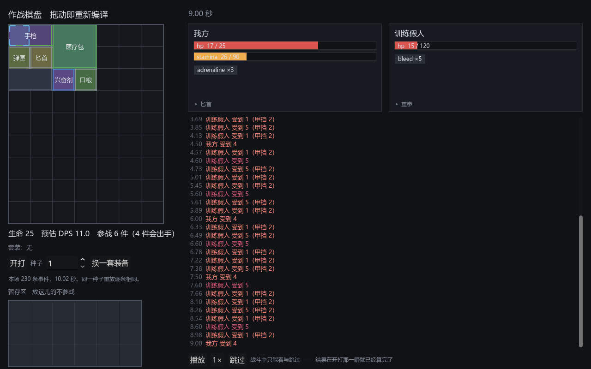
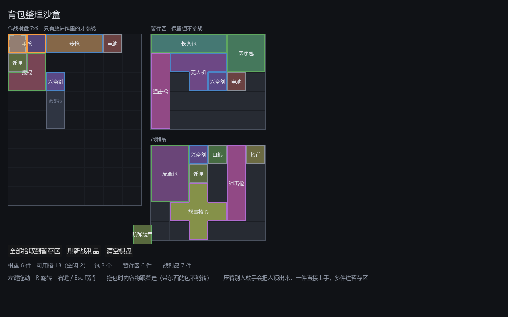

# 024 · 邻接标记可见化、顶替式放置、战斗沙盒暂存区

> 阶段 3 · 背包交互补完 ｜ 架构文档 v1.17（3.3.1、4.8）

三条来自实际试玩的反馈。它们各自不大，但凑在一起是「摆背包」这件事能不能玩的分界线。

---

## 一、邻接标记从来没画在棋盘上过

### 症状

「弹匣的增益格没有被绘制。」

### 实情

不是弹匣的问题 —— **所有物品的邻接标记都没画过**。
`grep -rn "grant" ui/` 只有 `ui/editor/` 命中：标记只在道具编辑器的形状画板上存在，
游戏棋盘上从来是全黑的。

这条缺口比看上去严重。邻接是这类游戏的核心决策：把配件贴在哪件武器旁边，
就是 build 本身。标记不可见意味着玩家要么背下每件道具的标记朝向，
要么在棋盘上试错 —— 而试错也看不出结果，因为点亮与否同样不可见。

### 做法

画成**四个角括号**，叠在标记指向的那一格上。

一开始画的是整圈描边，截图之后否掉了：物品自己的稀有度描边也是一圈线，
蓝框的稀有物品和蓝色的增益标记挨在一起，谁也分不出哪个是哪个。
角括号一看就是「贴在格子上的标注」而不是某件东西的轮廓。

两类标记缩进不同 —— 增益贴着格边、受益缩在里面，同时落在一格上也分得清。
配色沿用 `UiPalette.GRANT` / `RECEIVE`，和编辑器里是同一套。

**点亮状态一并画出来**：这一格确实站着一个符合过滤条件的邻居时填色加粗，
否则只留细线。只画位置不画点亮，等于让玩家对着说明书心算。

弹匣在手枪正下方，增益格 `(0,-1)` 指着手枪那一格，亮着。

### 一处去重

标记格的绝对坐标 = `origin + shape.transform_point(offset, rotation)`。
这行原本只在编译器的 `_lit_neighbors` 里，界面要用就得再抄一遍 ——
抄出来的第二份迟早和第一份错开，表现为「界面画在这一格、实际生效在那一格」，
是最难查的一类错。

提到 `ItemInstance.absolute_cells(offsets)`，两边共用。

### 顺带修的演示布局

战斗沙盒开局用 `try_add` 自动装填。弹匣的增益格朝上，行优先的自动装填很容易
把它摆在第一排 —— 标记指向棋盘外，既不点亮也画不出来，
开局看到的就是一件「好像没有效果」的配件。

改成指定坐标，弹匣固定在手枪正下方。放不下就退回自动装填 ——
内容随时会改形状，布局难看总好过这件东西干脆不上场。

---

## 二、顶替式放置

### 要解决的事

「当一个道具被我选中的道具占位弹出后，默认被抓起；如果大于一个被弹出，就全部进入暂存区。」

在此之前，压在别人身上放手只会失败。换装得先把旧的拖走、再把新的拖进来 ——
每一次微调两次操作，而微调恰恰是这类游戏里做得最频繁的动作。

### 关键是把两种「放不进去」分开

| 情况 | 判据 | 预览 |
|---|---|---|
| 地形不允许 | 出界、禁用格、没被包覆盖、跨了两个包、标签不收 | 红 |
| 地形允许但压着别人 | `terrain_allows` 真而 `can_place` 假 | **黄，会顶掉** |
| 干净落点 | `can_place` 真 | 绿 |

原先 `can_place` 把「地形」和「有人占着」揉在一个循环里。
拆出 `_terrain_ok`，`can_place` 变成「地形 OK ＋ 没人占」。
两条路径**共用同一份地形判断** —— 各写一份的话，顶替迟早绕过某条校验，
出现「直接拖进去不行、顶着别人反而进得去」这种玩家看不懂的事。

黄色是落点，被顶的那件描橙色边。

### 包不参与顶替

包是棋盘的地基。往包上丢东西该落进包里，而不是把包连同一整袋内容物掀掉；
反过来，拖一个包去顶掉另一个包，内容物也没有着落。两个方向都拒绝，
被顶的只可能是 `_occ` 里的普通物品。

这条不需要特判 —— 包记在 `_bag_owner`、物品记在 `_occ`，两张表本来就是分开的。

### 被顶出来的东西归谁

`place_displacing` 只管腾地方，腾出来的实例处于**游离态**，谁也不持有，
交还给调用方安置。表现层的规则：

- **一件** → 直接拿在手上。那几乎总是接下来要挪的东西，顶掉它再去暂存区里翻出来纯属多余。
- **多于一件** → 全部进暂存区。手只有一只。
- **暂存区不存在或塞不下** → 整件事作废，容器原样不动，**预览提前判红**。

最后一条是硬要求。只塞进去一半、另一半留在手上，玩家根本追不过来。
预览提前判红同样重要 —— 不给做不到的承诺，好过等人放了手才失败。

### 测试重点在失败路径

顶替这类操作，成功时一眼看得出对错；出问题的永远是中途放弃的那条路，
而界面上只表现为「这一下好像没反应」。所以
[`tests/test_displacement.gd`](../../tests/test_displacement.gd) 的每条失败用例
都断言容器毫发无损：

- 地形不允许 → 原来那件还在原位，占用表没被动过，没有半途留下的残迹
- 没有暂存区而要顶两件 → 棋盘上两件都在原位，拖着的那件退回源容器
- 暂存区只有一格、要塞两件 → **暂存区一件都没留下**

---

## 三、战斗沙盒的暂存区

M1 整理沙盒一直有暂存区，M2 战斗沙盒没有 —— 于是在战斗场景里，
「把不想要的东西拿下来」根本没有落点，只能拖到棋盘的另一个角落，
而那里的东西照样参战。

补上一个 6×3 的自由容器，`_drag.stash` 指向它。

它**不画邻接标记**：暂存区里的东西不参战，那里的「点亮」什么也不代表，只会误导。
同一条理由也用在 M1 的暂存区与战利品上，那两处之前是画的。

顶替上报走 `items_displaced` 信号，界面据此写一句话：

> 顶出了「匕首」，已经拿在手上。
> 顶出了 3 件（匕首、口粮、兴奋剂），都放进暂存区了。

不说这句的话，东西就是「不见了」—— 玩家不会去暂存区找一件自己都不知道被挤走的物品。

---

## 四、改了什么

| 文件 | 改动 |
|---|---|
| `core/inventory/item_instance.gd` | 新增 `absolute_cells()`，标记格坐标的唯一出处 |
| `core/inventory/grid_inventory.gd` | 拆出 `_terrain_ok`；新增 `terrain_allows` / `displaced_by` / `place_displacing` |
| `core/battle/compiler.gd` | `_lit_neighbors` 改用 `absolute_cells()` |
| `ui/inventory/inventory_view.gd` | 邻接标记绘制；落点预览三档 + 受害者描边；`show_adjacency` 开关 |
| `ui/inventory/drag_layer.gd` | `stash`；顶替放下与回滚；`grab_free` 让游离实例直接上手；回退链补上暂存区 |
| `ui/inventory/inventory_sandbox.gd` | 暂存区／战利品关掉邻接；截图钩子摆出顶替预览 |
| `ui/battle/battle_sandbox.gd` | 暂存区；顶替提示；开局布局改为指定坐标 |
| `tests/test_displacement.gd` | 新增，容器层 + 拖拽层，重点在失败路径 |
| `tests/test_drag_layer.gd` | 「被占位置预览应为非法」已经过时，改成三档判定 |

## 五、状态

测试 **1071 项断言 / 17 个套件**，全绿（此前 1013 / 16）。

## 六、遗留

- 顶替目前**不考虑旋转**：压不进去就是压不进去，不会自动试别的朝向。
  自动旋转会让落点变得不可预测，玩家按 R 的意图会被系统抢走。
- 邻接标记画的是「这一格有没有被点亮」，没画「加成是多少」。
  数值要等悬停信息面板（尚未做）。
- 暂存区在战斗沙盒里是 6×3 的固定尺寸。真实尺寸该由什么决定（角色？关卡？）还没定，
  这和 3.4 里「暂存区跨关是否保留」是同一个悬而未决的问题。
