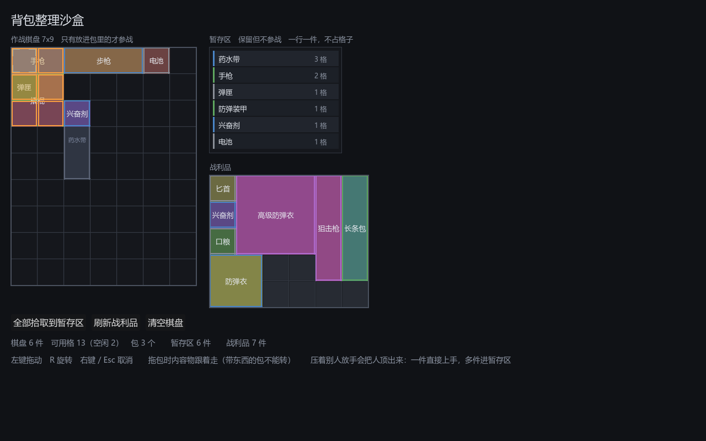

# 025 · 暂存区改成列表容器

> 阶段 3 · 背包交互补完 ｜ 架构文档 v1.18（3.3、3.4）

## 一、为什么

暂存区此前和棋盘共用 `GridInventory`。省下来的实现量是真的，但代价直到实际用起来
才露出来：**往暂存区里放东西也要摆位置，也会「摆不下」。**

那等于凭空发明一套「暂存区也要会整理」的玩法。而这正是这个区域存在的目的所反对的 ——
它是让玩家腾手的地方，不是第二个要动脑子的棋盘。真正的空间取舍只该发生在棋盘上，
那里才是 build；在暂存区里玩俄罗斯方块，既不产生任何决策，又在玩家最想快速腾挪的时候
挡住他。

所以暂存区变成**一个列表**：没有坐标、没有占格、没有旋转。异形物品进来只是一行，
3×1 的长条和 1×1 的钉子占一样的位置。

## 二、两类容器

原先「一个 `GridInventory` 服务所有容器」这条，现在要改口了 ——
但改的只是**空间**那一半：

```
ItemContainer          变更通知 + 按 uid 取放
  GridInventory        空间容器：棋盘、敌人尸体、商店货架 —— 摆在哪儿是有意义的
  ItemStash            列表容器：暂存区 —— 只是「先放着」
```

基类刻意收得很窄：`changed` 与批量合批、`get_item` / `has_item` / `items` /
`item_count` / `remove`，外加两个搬运用的动作。占格、旋转、包体覆盖一个字都不进来。

硬凑一个「格子数为 1」的空间容器来表示列表，是另一条路，也更省事 ——
但那样每一处调用都得去处理一堆没有意义的坐标，而且「暂存区容量」会被偷换成
「暂存区尺寸」，多一件东西就得考虑摆得下摆不下。

### `admit` / `can_admit`

搬运唯一需要的共同动作是「随便给它找个地方放下」：

```gdscript
@abstract func admit(inst) -> bool        # 空间容器扫空位，列表容器直接追加
@abstract func can_admit(def) -> bool     # admit 会不会成功，不改任何状态
```

`can_admit` 不是锦上添花。搬运必须**先问再动**：先 remove 再发现目标收不下，
就得把东西塞回源容器，而「塞回原位」在空间容器里未必还办得到 ——
刚腾出来的格子可能已经被别的东西用了。先问后动，收不下时源容器连碰都不用碰。

`InventoryService.transfer_auto` / `transfer_all` 因此从 `GridInventory`
放宽到 `ItemContainer`。「全部拾取到暂存区」这个最常见的用法，
现在不会再有「装不下」了。

## 三、视图侧同样抽了一层

`ContainerView` 只声明拖拽层真正需要的三件事：**谁被按下了**、**背后是哪个容器**、
**把预览擦掉**。

落点长什么样由子类决定 —— 网格是一片染色的格子加受害者描边，列表是一条插入线。
硬把两种预览统一成一个签名，只会得到一个两边都用不顺的参数表。

于是 `DragLayer` 只在**落点那一处**分叉，抓取、旋转、取消回退、顶替安置全部共用。

### `StashView` 画什么

一行三样：稀有度色条、名字、占格数。

占格数是刻意留的。在暂存区里它不占地方，**放回棋盘可就占了** ——
这是玩家从列表里挑东西时唯一真正关心的信息。



空列表也占出四行的高度。它太小就没法当落点，而「把东西拿下来」恰恰是在
暂存区空着的时候最常做的事。

## 四、一条限制

**带内容物的包收不进列表。** 列表没有坐标，装不下「包 + 各内容物的相对位置」，
放进去就等于把玩家摆好的一袋东西打散。要收起来先掏空 ——
与「带东西的包不能旋转」是同一条简化，理由也一样。

拖拽时预览就不画插入线，放手直接整袋退回棋盘，不会出现「放下了才发现散架」。

## 五、改了什么

| 文件 | 改动 |
|---|---|
| `core/inventory/item_container.gd` | 新增。容器基类 |
| `core/inventory/item_stash.gd` | 新增。列表容器：`insert` / `move` / `capacity` |
| `core/inventory/grid_inventory.gd` | 改为 `extends ItemContainer`，批量合批移到基类；实现 `admit` / `can_admit` |
| `core/inventory/inventory_service.gd` | `transfer_auto` / `transfer_all` 放宽到 `ItemContainer`，并改成先问 `can_admit` 再动手 |
| `ui/inventory/container_view.gd` | 新增。视图基类 |
| `ui/inventory/stash_view.gd` | 新增。一列可拖动的行 |
| `ui/inventory/inventory_view.gd` | 改为 `extends ContainerView` |
| `ui/inventory/drag_layer.gd` | 容器与视图都换成基类；列表落点（插入行号）；从列表抓取；取消时插回原行 |
| 两个沙盒 | 暂存区换成 `ItemStash` + `StashView` |
| `tests/test_item_stash.gd` | 新增。列表语义、上限、标签、搬运、拖拽往返、调序、取消、包的限制 |

## 六、状态

测试 **1132 项断言 / 18 个套件**，全绿（此前 1071 / 17）。

## 七、遗留

- `capacity` 默认 0（不限）。「暂存区能放几件」是个正经的平衡杠杆，
  但该放几件还没定，不在代码里替设计拍板。
- 列表目前不支持多选、不支持一键排序。等真的觉得翻起来费劲了再说 ——
  现在加，是在给一个还没出现的问题写代码。
- 3.4 里「暂存区跨关是否保留」仍未定稿。改成列表不影响那个决定，
  两种方案都只要求各系统坚持「只看棋盘」。
