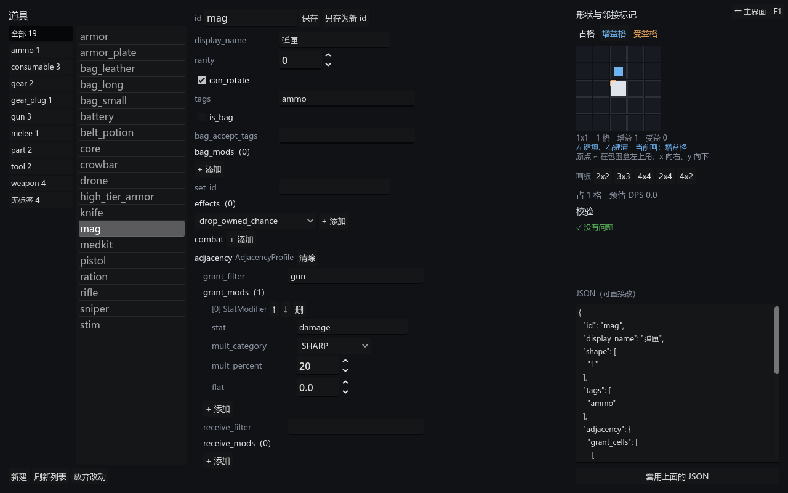

# 026 · 任意场景返回主界面、编辑器按标签分类

> 阶段 3 · 工具打磨 ｜ 架构文档 v1.19（10.5、10.6）

两件开发期便利。都不大，但都在「每天要用很多次」那一档上。

---

## 一、F1 回启动选择器

### 问题

F5 进主界面 → 点进某个沙盒 → **出不来**。`change_scene_to_file` 把主界面整个换掉了，
没有任何东西记得它。只能关掉重开。

### 做成 autoload，不是每个场景加一个按钮

后者看起来更"干净"，但漏装的表现是「F6 直接跑进去就出不来」——
而恰恰是 F6 直接跑某个场景时，没有人替它装那个按钮。
一个开发期便利，做成"每加一个场景都要记得加一行"，迟早有人忘。

`DevNav` 是个 `CanvasLayer` autoload，层号 128 盖在一切之上，
右上角一个「← 主界面　F1」。在启动选择器里它自己隐藏。

判断"场景换了没"用的是 `_process` 里比一下 `current_scene` 的引用。
`SceneTree` 没有现成的场景切换信号，而 `tree_changed` 每加一个节点就响一次 ——
编辑器那种反射生成的表单会把它打爆。

### 为什么不是 Esc

Esc 已经有两个主人：拖拽中的取消、以及输入框可能吃掉它。

而「手一滑回到主界面」在编辑器里意味着草稿全没。这不是"稍微有点烦"，
是一下午的活没了。F1 是空的，也不会被误按。

### 未保存时先拦一下

场景可以实现 `has_unsaved_changes() -> bool`。有的话第一次按 F1 只是把按钮
换成「有未保存的改动 · 再按一次 F1 离开」，4 秒内再按才真的走。

用鸭子类型（`has_method`）而不是让场景继承什么东西 —— 这一层是开发期脚手架，
不该为了一个提示，在正经场景的类型里留下痕迹。编辑器实现了它，
两个沙盒没有（它们本来就没有可丢的东西）。

上膛状态会过期，也会在场景切换时清掉：那半按下去的确认不属于新场景。

### 顺带修的截图工具

`capture_scene.gd` 此前直接把场景 `add_child` 到 root，没有设 `current_scene`。
于是所有靠它判断"现在在哪个场景"的东西都以为自己不该出现 ——
截图会少掉一块真实运行时看得见的界面。补上 `current_scene = _scene`。

---

## 二、编辑器按标签分类

19 件道具时列表还能扫一眼找到；奔着上百件去的话不行。左侧加一列竖排页签：

### 页签从内容里长出来

不是写死的枚举。扫一遍 `data/authoring/items/*.json` 的 `tags`，出现过的都成一页，
再加「全部」与「无标签」，每页带件数。

**MOD 作者加一个新标签，这里自己就多一页。** 这和导入器、导出器、表单不认识
任何具体效果是同一条原则的延伸 —— 工具不该比内容更新得慢。

读标签走的是 JSON 而不是导入器：这里不关心内容对不对，
一件配错的道具照样得出现在列表里，否则作者就没法进去修它。

内存里那一份的标签盖掉盘上的，所以刚加的标签页签立刻就变。

### `_shown` 与 `_ids` 必须分开

这是整块筛选里唯一真正会错的地方。

ItemList 的行号对应的是**筛过之后**的那一份，不是全集。混用的表现是
「点第三行打开了第五件」—— 而且只有加了筛选之后才错，不加筛选时两者恰好一致，
所以写的时候看不出来。

所以引入 `_shown`，并且：

- `item_selected` 走 `_shown[i]`
- 重绘之后按 **id** 选回去，不按行号 —— 换一页之后行号指向的是另一件东西
- `_select_in_list(id)` 发现它不在当前页，就先退回「全部」：
  选中一件看不见的东西等于没选

### 页签只在标签集合变了时才重建

每次刷新都拆了重建的话，点下去的那一瞬按钮就被换掉，焦点和悬停全丢。

### 「无标签」不用哨兵字符串

第一版拿一个特殊字符串当「无标签」那一页的键，被否掉了：标签是作者自己起的名字，
挑哪个词当哨兵都可能撞上，而撞上的表现是某个标签页莫名其妙变成了另一页。
（顺带，GDScript 的字符串字面量塞不进 NUL。）

改成 `enum Filter { ALL, TAG, UNTAGGED }` 加一个标签名，没有任何值能撞。

---

## 三、改了什么

| 文件 | 改动 |
|---|---|
| `ui/dev_nav.gd` | 新增。autoload，右上角返回按钮 + F1 + 未保存确认 |
| `project.godot` | 注册 `DevNav` autoload |
| `ui/launcher.gd` | 提示语改成「进去之后按 F1 或点右上角回到这里」；过期注释 |
| `ui/editor/content_editor.gd` | 竖排标签页签；`_shown` 与 `_ids` 分家；`has_unsaved_changes()` |
| `tools/capture_scene.gd` | 设 `current_scene`，截图才反映真实运行时 |
| `tests/test_dev_nav.gd` | 新增。只测「什么时候不该走」 |
| `tests/test_content_editor.gd` | 新增分类页签与未保存钩子两组 |

## 四、状态

测试 **1155 项断言 / 19 个套件**，全绿（此前 1132 / 18）。

`test_dev_nav` 只测不会真切场景的那几条：这组跑在测试跑器自己的 SceneTree 里，
真让它 `change_scene_to_file` 一下，整棵树连同还没跑完的用例一起没了。
而"什么时候不该走"恰好也是唯一会出错的部分 —— 该走时走了肉眼一看便知，
不该走时走了表现为一下午的草稿没了。

分类页签的期望值**从 `data/authoring` 里推**：断言「页签与内容里出现过的标签
一一对应」，而不是「有 weapon 这一页」。标签是作者随手会改的东西。

## 五、遗留

- 页签只按标签分。按稀有度、按"有没有战斗数据"分也合理，等真的需要了再说。
- 列表没有搜索框。标签分类先顶一阵，到几百件时再加。
- `DevNav` 是开发期脚手架。M6 真正的场景流上来之后，它要么退化成调试入口，
  要么直接删掉。
