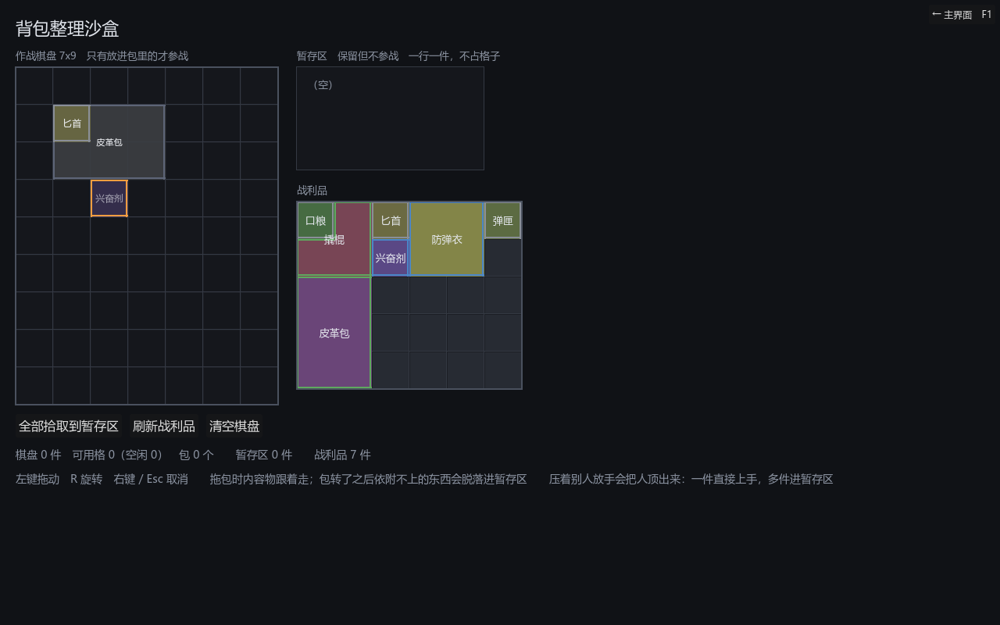

# 028 · 包也能转：依附不上的内容物脱落

> 阶段 3 · 背包交互补完 ｜ 架构文档 v1.21（3.3）

## 一、规则

包可以旋转，连同里面的东西一起抓着转。转过之后**内容物不跟着转**，
仍按原来相对包原点的偏移留在原处；落在新轮廓之外的那些**脱落**，进暂存区。

## 二、为什么不是「内容物跟着转」

早先禁止转包，理由是「内容物要跟着做坐标变换，边界情况多且玩家难以预期」。
这条理由只说对了一半 —— 难写是真的，但那不是真正的问题。

真正的问题是：**转一下包会同时改掉包里每一件东西的朝向。** 玩家把一把 1×3 的步枪
竖着塞进包的左侧，转一下包，步枪变横的、位置也挪了，整个布局被搅乱，
而他只是想把包转过来腾出旁边一列。

脱落是**局部的**（只有轮廓外的几件受影响）、**看得见的**（拖拽残影上就标出来）、
**放手前可以撤回的**（右键取消，一切如初）。



匕首还在轮廓里，兴奋剂落在外面 —— 压暗、描橙边。放手它就进暂存区。

## 三、一条路径，两个入口

```
bag_fit_report(payload, origin, rot)   → {ok, fallen}   不改状态
attach_bag_shedding(payload, origin, rot) → 照报告执行
rotate_bag(uid, steps)                 = detach_bag → attach_bag_shedding(同原点, 新朝向)
```

原地转与拖拽中按 R 走的是**同一段代码**。两处各写一份的话，迟早出现
「在棋盘上转不掉的东西，抓起来转一下就掉了」这种玩家没法理解的差异。

`attach_bag` 保留为**一件不能少**的严格版，只给 `_restore` 的「原样放回」用 ——
那条路上朝向就是原来的朝向，不该有任何东西脱落，脱落了就是别的地方出了错。

## 四、没地方去就不让转

脱落的东西需要暂存区接着。没有暂存区、或暂存区满了：

- 预览直接判红，不画插入线，不给做不到的承诺
- 放手不成立，包连同内容物**整体退回原处**，朝向也回到原样

「塞进去一半、另一半悬着」是比「这一下不生效」更糟的结果。

## 五、改了什么

| 文件 | 改动 |
|---|---|
| `core/inventory/grid_inventory.gd` | `bag_fit_report` / `attach_bag_shedding` / `rotate_bag`；`can_attach_bag` 去掉朝向锁，成为严格版；`rotate_item` 对非空包告警并指向 `rotate_bag` |
| `core/inventory/item_stash.gd` | `room_for(n)` |
| `ui/inventory/drag_layer.gd` | `rotate_dragged` 对包放开；预览与放手走 `bag_fit_report`；残影标出会脱落的；`items_shed` 信号 |
| `ui/inventory/inventory_view.gd` | 预览多一档「合法但有代价」（`costly`），顶人与脱落共用黄色 |
| `tests/test_board_bags.gd` | 新增 `run_rotate_shedding`；两条「不能转」的旧断言改成「严格版一件不能少」 |
| `tests/test_displacement.gd` | 新增拖拽层的脱落与无处可去两组 |
| `tests/test_drag_layer.gd` | 去掉「带内容物不能转」的断言 |

## 六、状态

测试 **1186 项断言 / 19 个套件**，全绿（此前 1154 / 19）。

## 七、遗留

- 脱落只看**这个包**的轮廓。内容物落到另一个包的覆盖范围内也算脱落 ——
  它是这个包的载荷，不该悄悄改嫁。要不要允许「转一下顺势滑进旁边的包」，
  等有人真的这么想用了再说。
- 残影上的标记只有颜色，没有文字。脱落件数多时可以在光标旁写「3 件将脱落」，
  先看有没有人抱怨。
