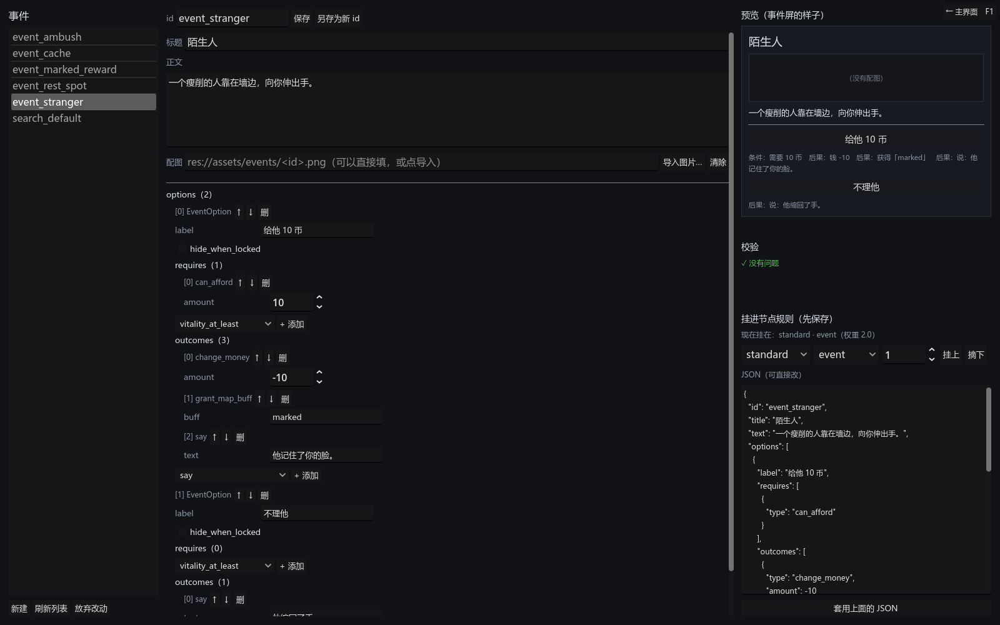

# 064 · 事件编辑器：写文字、导入配图、拼选项、挂进节点规则

> 作者要求 ｜ 架构文档 10.5、11（v1.62）｜ 前一步：[063 事件层](063-event-layer.md)

作者的要求：做一个事件生成器，能输入文本、导入图片；要不要做成 Godot 之外的独立 exe，按性价比定。



## 性价比：放在 Godot 里

| | 项目里的编辑器场景 | Godot 之外的独立程序 |
|---|---|---|
| 条件 / 后果的种类与字段 | 从注册表和 `get_property_list` 反射出来，加一种自动多一项 | 要复制一份清单，加一种就得两边改；漏一次就是「编辑器不认得」 |
| 校验 | 走导入器本身（道具存不存在、buff 是不是地图作用域、至少一个选项……） | 要么再写一份规则（迟早对不上），要么不校验，存了才知道错 |
| 道具、buff 的 id | 从资产里装，下拉框里就有 | 要另找办法读项目文件 |
| 产出 | JSON + `.tres` 一起出，和命令行导入器逐字节相同 | 只能出 JSON，还得回来跑一次导入 |
| 成本 | 一个场景，`PropertyForm` 复用，约 700 行 | 一套新工具链（这台机器上 python 是商店的空壳，导出模板也没装） |
| 给不开 Godot 的作者用 | 装好导出模板后加一个导出预设，整个项目导成 exe，启动选择器就是入口 | 天然独立 |

独立程序唯一的好处是不用开 Godot，而这一点用导出预设也能得到；代价是把注册表、校验、id 表全复制一份。所以做在项目里。

## 产出

| 文件 | 职责 |
|---|---|
| `ui/event_editor/event_editor.gd`、`.tscn` | 左边事件列表；中间 id、标题、正文（多行）、配图（路径 + 导入 + 清除 + 缩略图）、选项表单；右边预览、校验、挂进节点规则、JSON |
| `ui/game/event_image.gd` | `EventImage.load_texture`：先问 ResourceLoader，拿不到按原始文件读。事件屏与编辑器预览共用 |
| `ui/game/event_screen.gd` | 配图改用 `EventImage` 装 |
| `ui/launcher.gd` | 启动选择器多一项「事件编辑器」 |
| `assets/events/` | 配图落在这里（`<id>.<ext>`） |
| `tests/test_event_editor.gd` | 5 组 |

## 几条决定

**和道具编辑器同一条原则：不是另一条通路，只是同一条通路的另一个入口。** 存的是 `data/authoring/events/<id>.json`；
校验是把当前对象导出成 JSON 再用导入器导回来，界面说没问题命令行就一定过得去；保存顺手把导回来的对象存成 `.tres`。
草稿缓存、基准比对、列表上的点、`has_unsaved_changes` 给 DevNav 拦返回 —— 都照道具编辑器。

**选项、条件、后果的表单由反射生成。** `PropertyForm` 对着 `EventDef.options` 画：每个选项一张卡（字、锁住时藏不藏、条件数组、后果数组），
数组的「添加」下拉从 `ContentSchema.available_types` 来 —— 063 登记的 4 种条件、12 种后果都在，以后加一种，编辑器一行不改。
标题、正文、配图在表单之外有专门的控件（正文要多行框、配图要导入按钮），表单里跳过这三个字段，免得两处能改同一个值。

**配图：复制进项目，按事件 id 命名。** 系统文件对话框挑一张 png / jpg / webp，复制到 `assets/events/<id>.<ext>`，路径写进 `image`。
路径框也能直接填，给已经放好的图用。读的时候 `EventImage` 先问 ResourceLoader（Godot 扫过、有 `.import` 的走这条），
拿不到就按原始文件 `Image.load_from_file` —— 作者导完图立刻能在预览里看见，不必先切回 Godot 让它扫一遍；无头测试、无头截图也一样能画。
配图读不到只警告不报错：事件屏本来就画占位（063）。

**预览照着事件屏画。** 标题、图、正文、每个选项一个按钮，按钮底下一行小字写这个选项的条件与后果（构件的 `describe`），
作者不用真的跑一局就看得出「这个选项要 10 币、给一个标记、说一句话」。

**挂进节点规则也走导入器。** 选一份节点规则、一种点、一个权重，点「挂上」写进 `events_by_type`（权重 0 或「摘下」= 删掉那一行）。
这一步把整份规则导回来校验再按导出器的格式写，所以引用没保存过的事件会被拦下（提示先保存）、负权重也过不去；JSON 与 `.tres` 一起更新。
「现在挂在：standard · event（权重 2）」这一行是从节点规则文件里读出来的，不记在事件里 —— 挂在哪本来就是规则的事。

**没做成独立 exe，但留了路。** 装好导出模板后加一个导出预设即可；导出包里写不了 `res://`，到时候把作者数据目录改成可配置的一处（`ContentPaths` 只有一处定义）。

## 验证

```
bash tools/test.sh
通过  7076 项断言，44 个套件
```

- 列表与校验：列表就是作者数据目录里的事件；每个事件在编辑器里校验通过；预览里每个选项一个按钮、顺序一致；JSON 预览与导出器一致；
  「现在挂在」从节点规则里读（搜索点默认事件显示挂在 standard · search 下，从数据推）；没有选项的事件校验不过。
- 草稿：刚打开不算改过；改标题进草稿、列表打点；切走再切回改动还在；改回去撤掉；改正文也算；放弃改动从盘上重读；新建的算未保存。
- 保存往返：新建探针事件（两个选项、一条条件、两个后果、多行正文）→ 保存写了 JSON 与 `.tres`；盘上的 JSON 是往返不动点；条件的数、后果都在；
  资产装得回来、多行正文原样；校验不过时盘上的文件不动。探针用完收回。
- 导入配图：从 `user://` 的一张 8×6 png 导入 → 复制到 `assets/events/<id>.png`、路径写进事件、配图框跟着变、引擎没导入过也装得出来、缩略图有了；
  配图读不到只警告；不是图片的不收；没有 id 不收。探针图片收回。
- 挂进节点规则：挑一种还没挂的点挂权重 3 → JSON 与资产都更新、编辑器显示挂在那儿；没保存过的事件挂不上且文件不动；摘下之后 JSON 与之前逐字节相同。
  `.tres` 的子资源 id 每次保存都随机，逐字节比不了，测试末尾把原来的字节写回去，不弄脏仓库。
- 截图：`capture_scene` 打开编辑器（`demo_fill` 打开「陌生人」）。

## 没做的

- 「说一句话」后果的文字在表单里是单行框（`PropertyForm` 对 String 一律单行）；长段落可以在右边的 JSON 里改。
- 配图不裁不缩，事件屏按宽度等比缩放；尺寸规范等美术定。
- 商店、休息点仍没配事件（063 的遗留），编辑器能挂，内容还没写。
- 独立 exe：导出模板没装；装了之后加导出预设与可配置的作者数据目录。
