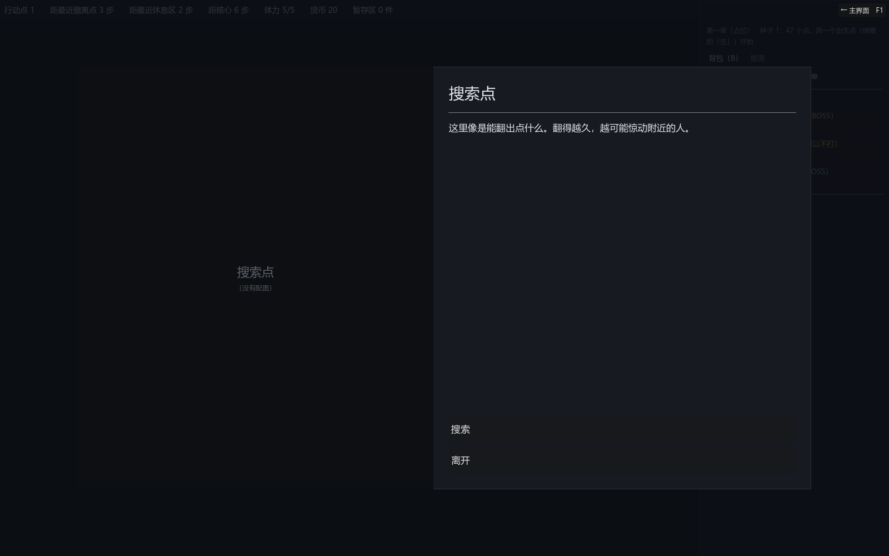

# 065 · 事件屏改版：两栏大框，左边整块是图（参考杀戮尖塔）

> 作者要求 ｜ 架构文档 v1.63 ｜ 前一步：[064 事件编辑器](064-event-editor.md)

作者：事件展示的窗口设计得更大一些，左边完全是图片区域，参考杀戮尖塔。



## 改了什么

| 文件 | 改动 |
|---|---|
| `ui/game/event_screen.gd` | 选项页与结果页共用一个两栏的框 `_frame`：1320×760（视口 1600×1000），左栏 640 宽整块是图，右栏标题（28 号）、分隔线、可滚的正文（17 号）、贴底的选项（整行宽、左对齐、48 高）。锁住的选项灰掉，原因写在按钮底下一行小字。结果页沿用这个点的事件的配图 |
| `ui/event_editor/event_editor.gd` | 预览改成同样的两栏（左图右文），和事件屏一个画法 |
| `tests/test_event_editor.gd` | 预览里的按钮在右栏，递归找 |

**图铺满左栏、按比例裁**（`EXPAND_IGNORE_SIZE` + `KEEP_ASPECT_COVERED`，容器裁边），所以任何比例的图都不会留边、也不会拉变形；
美术定了尺寸规范之后不用改代码。没有图时左栏是深底色，中间淡淡写着事件标题和「没有配图」——占位也占满整栏，版式不因为缺图而塌。

**结果页也是同一个框。** 选了之后的「做了什么」是同一件事的下一页，标题换成选的那一项，正文换成账目，底下一个「继续」；
配图从这个点的事件里拿（`node.content["event"]` → 定义），老路的事件点没有定义就画占位。

## 验证

```
bash tools/test.sh
通过  7076 项断言，44 个套件
```

事件层与编辑器的套件照旧通过（页面的结构变了，公开动作 `choose` / `proceed` / `is_options_page` 没变）。截图：`DEMO_SCREEN=event`。

## 没做的

- 选项按钮还是引擎默认样式；杀戮尖塔那种带底纹的长条等美术。
- 正文没有逐字出现的效果。
