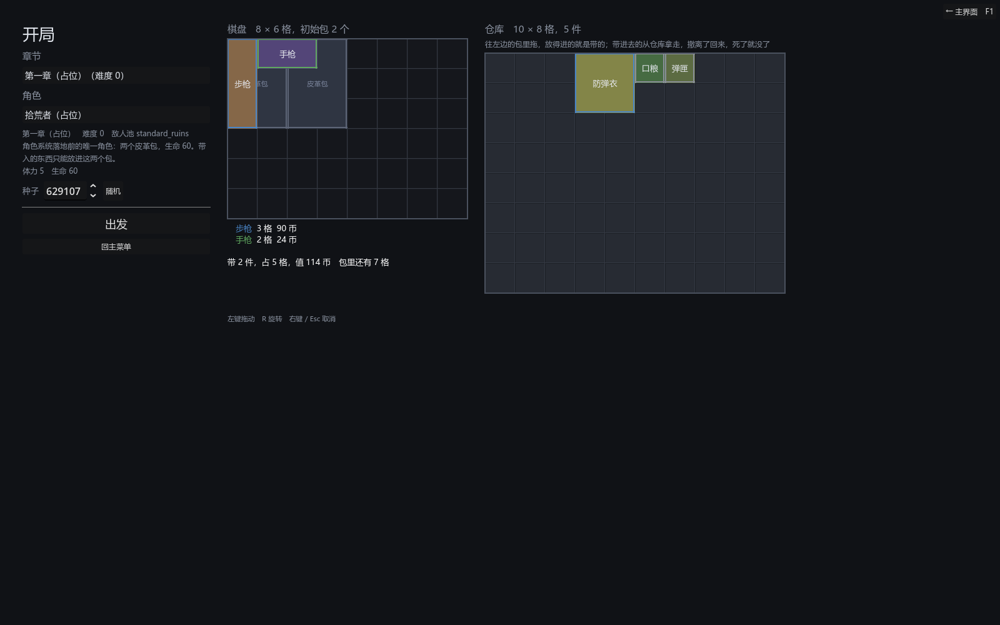

# 067 · 开局预选与 `CharacterDef`：角色、初始包、从仓库往包里拖、第一套

> 058 / 059 顺序里的第 5 项 ｜ 架构文档 7.1、8、8.1、10.1、11、15（v1.65）｜ 前一步：[066 删地图沙盒](066-remove-map-sandbox.md)

作者定的（058 第 2 条、第二轮第 5 条、第六节）：开局预选界面，选角色（占位）、从局外仓库带入物品；带入的限制通过初始包实现，
放得进的就是带的；件数 / 稀有度上限改成字段、默认不限；包只出不进；仓库空的第一局带什么先配置，正式版由新手教程关发。



## 产出

| 文件 | 职责 |
|---|---|
| `core/run/character_def.gd` | `CharacterDef`：基线覆盖项、体力上限、棋盘尺寸、初始包、件数 / 稀有度上限（-1 = 不限）；`baseline()`、`carry_problem()`。**没有搜索速度** |
| `core/authoring/*`、`tools/*` | 新内容种类 `characters`，排在开局装备之后（初始包对着道具查）；校验：体力、棋盘为正，至少一个初始包、每个得是包 |
| `data/authoring/characters/default.json` | 占位角色「拾荒者」：两个皮革包、生命 60 |
| `core/meta/meta_rules.gd`、`meta_rules/standard.json` | `first_kit`：仓库空的第一局发哪一套（开局装备 id，占位 `standard`）；导入器对着开局装备查 |
| `core/meta/meta_state.gd` | `grant()`（往仓库发东西，只收 `keeps` 认的，局外号段）、`take_back()`、`allocate_uid()`；仓库的格子接上 `keeps` 当准入 |
| `core/inventory/grid_inventory.gd` | `accept_filter`：容器级准入回调（无效 = 不限） |
| `core/run/run_state.gd` | `start(..., p_character, p_layout)`：棋盘尺寸、体力上限、基线、初始包按角色；`layout_of()` / `_place_layout()`：开局屏摆好的棋盘原样进一局；`character_id` 跟着存档 |
| `core/run/game_flow.gd` | `characters`、`load_characters`、`character_of`、`loadout_of`；`begin(..., character, layout)`；`grant_first_kit()`（`new_run` 时仓库空就发）；读档按 id 找回基线 |
| `ui/game/setup_screen.gd` | 重写：左边章节、角色、种子；中间角色的棋盘（初始包摆好）；右边仓库格子；同一层拖拽。`carry_in` / `carry_out` / `carried` / `can_depart` / `depart` / `cancel` |
| `ui/inventory/drag_layer.gd` | `unregister_view`（换角色重造棋盘） |
| `tests/test_character_setup.gd` | 4 组 |

## 几条决定

**带入的限制就是初始包的空间。** 开局屏中间是这个角色的棋盘，初始包已经摆好；右边是仓库的格子；从仓库往包里拖，放得进的就是带的。
没有第二套规则去数格子：包的形状、包的准入标签、棋盘的尺寸本来就在那里。件数 / 稀有度上限是角色的两个字段（`carry_max_items` / `carry_rarity_cap`，
默认 -1），出发时 `carry_problem` 查一遍，超了就拦下说原因 —— 作者说的「改成字段，默认不限」。

**包不能带入，规则只在一处。** 局外什么都不收包（`MetaState.keeps`，061），所以仓库里本来没有包；现在仓库的格子也把 `keeps` 接成准入回调，
初始包拖不进仓库，拖过去会弹回来。`GridInventory` 为此多了一个通用的 `accept_filter`，没有再写一个 `is_bag` 分支 —— 将来删掉「包」这个媒介还是只删 `keeps` 那一行。

**拖上棋盘那一刻东西就离开了仓库。** 开局屏的棋盘和仓库是两个真容器，拖拽做的就是 `transfer`。出发时把棋盘记成 layout（一件一行：定义、落点、朝向），
`RunState.start` 按它原样摆回一局的棋盘（uid 重编，摆不回去的进暂存区）并存 meta；「回主菜单」把带上的放回仓库。开局屏怎么摆的，地图上打开背包就是那样。

**角色定什么。** 棋盘尺寸、体力上限、战斗基线（`base_stats` 覆盖默认值，没写的沿用 4.2 的默认）、初始包、两个上限。7.1 写过「等真的有第三样按角色变的东西再建」，
带入限制是第三样，现在建了；`Vitality`、`CombatantBaseline`、编译器、战斗一行没改 —— 它们本来就从参数拿数。读档只写角色 id，`GameFlow._adopt` 按 id 找回基线。
没有角色定义时（老内容、大多数测试）一切照旧：`RunState.start` 不给角色就是占位尺寸与体力，开局屏退回按第一套开局装备开。

**仓库空的第一局。** `MetaRules.first_kit` 指一套开局装备，开局屏打开时仓库空着（且没有带回来的棋盘等着置入）就把它的非包道具发进仓库，玩家再拖进包里。
作者说正式游戏由新手教程关发第一套，这是那之前的配置占位；教程关是第 8 阶段的内容。`LoadoutDef` 于是退成两件事：第一套的清单、老路的 kit。

## 验证

```
bash tools/test.sh
通过  7161 项断言，45 个套件
```

- 管线：角色往返逐字节相同；基线覆盖项盖上去、没写的沿用默认；没有初始包 / 初始包不是包 / 找不到 / 棋盘 0 宽 / 体力 0 / 上限 -2 / 没 id 都报错；
  上限默认不限、2 件与稀有度 1 各拦一次；作者文件是不动点、资产在、`load_characters` 全装回；`first_kit` 引用不存在的装备报错。
- 开局：棋盘尺寸、体力上限、角色 id、基线、初始包个数都按角色；开局屏摆好的棋盘（包 + 一件医疗包）进一局后 `layout_of` 逐件相同、暂存区空；存档带角色 id；老路占位不变。
- 流程：仓库空的第一局发进第一套的非包道具（包没发）、发完存 meta、仓库不空不再发、`first_kit` 空不发；从仓库挪到棋盘再出发 → 一局的棋盘上位置原样、基线按角色、meta 存了；
  换个持有方读档 → 角色 id 在、基线从定义表找回。
- 开局屏（导演）：有角色的棋盘、初始包摆好、第一套在仓库；带上 / 放回 / 再带上，读数写着它；仓库的格子不收包、挪不动、`carry_out` 也不放；
  件数上限临时调 0 → 走不了并说原因；换角色带上的先回仓库；出发 → 一局记着角色、体力按角色、带的那件原位、meta 存了；取消 → 放回仓库、回主菜单、meta 也是放回之后的。
- 旧的三个导演测试改成「把第一套全带上」；其余一条没改。

## 没做的

- 角色只有一个占位，界面上就一张卡；角色系统的内容（多角色、解锁）等第 8 阶段。
- 新手教程关（发第一套）等第 8 阶段；现在靠 `first_kit` 配置。
- 开局屏上还没有「这一趟的预估 DPS」读数（背包整理面板有，出发后按 B 看）。
