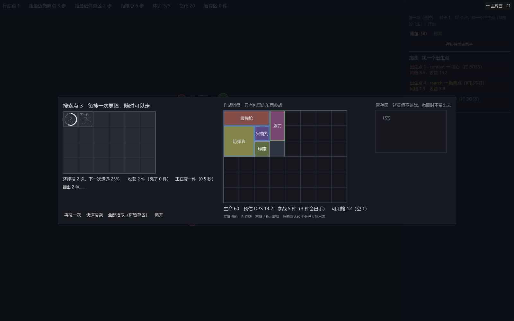

# 068 · 搜索揭示重做：一件一件搜、耗时随稀有度、没亮的只能在容器里挪

> 058 / 059 顺序里的第 6 项 ｜ 架构文档 6.2（v1.66）｜ 前一步：[067 开局预选与 CharacterDef](067-character-and-setup.md)

作者定的（058 第 5 条、第二轮第 1 / 4 条）：搜索耗时和稀有度成正比、和体积无关；未搜索的物品也可以被拖动，可能影响搜索顺序，
但已经在搜的那件不受影响；一个长度为 2 的搜索列表，只知道当前搜谁和下一个搜谁；不需要按光标距离；搜索速度不做成属性；
未搜索的拖不出容器没问题。



## 产出

| 文件 | 职责 |
|---|---|
| `core/run/search_rules.gd` | `reveal_seconds`：每档稀有度几秒（占位 [0.3, 0.5, 0.8, 1.2, 2.0]）、`reveal_time(rarity)`；导入器校验非负、非递减 |
| `ui/game/loot_view.gd` | 揭示循环重写：当前一件按稀有度计时（`advance(delta)`，`_process` 每帧调）、到点亮出来、按栏位顺序挑下一件；`current_uid` / `next_uid` / `progress` / `current_seconds`；当前那件画进度环、下一件画小标；正在搜的锁住，别的没亮的能抓 |
| `ui/inventory/drag_layer.gd` | `drop_filter`：「能不能放到那儿」的第二道门（第一道是视图发不发 `grab_requested`） |
| `ui/game/container_screen.gd` | 耗时表从节点规则来（会话的 / 这一局的）；装上第二道门：没亮的只许放回容器；读数写着「正在搜一件（几秒）」 |
| `data/authoring/node_rules/standard.json` | 归一化写出默认表（导出器对数组一律写出，遭遇曲线、权重表也是） |
| `tests/test_search_reveal.gd` | 5 组；`test_game_flow` 的揭示用例按新规则改 |

## 几条决定

**一件一件来，只知道两件。** 揭示不再是一批一条 Tween。视图里只有「当前」和「进度」两个量，「下一件」是每次问的时候按栏位顺序现算的
（当前之外、最靠前的没亮的）。作者说的「长度为 2 的搜索列表」就是这两样，没有第三件。

**耗时是数据，按稀有度，不按体积。** 每档几秒在 `SearchRules.reveal_seconds`，容器屏从会话的规则（搜索点）或这一局的节点规则（尸体容器）里拿；
没有角色倍率（作者：搜索速度不做成属性）。导入器要求表非递减：越稀有搜得越久 —— 作者说这是正向体验的一部分，那就写成校验。

**没亮的能拖，但只能在容器里挪。** 视图对没亮的东西照发 `grab_requested`（除了正在搜的那件），拖拽层多一道 `drop_filter`：
容器屏给的规则是「亮了随便放，没亮的只许放回这个容器」。预览不画落点、放手退回原处，和放不下是同一条路。
挪一挪就换了「下一件」是谁；正在搜的那件锁住，抓不起来，进度也不受影响。

**时间由 `advance(delta)` 推进。** `_process` 每帧调它，测试直接调 —— 断言「推进一半进度 0.5、到点亮出来、一次推进跨过两件」不必等真的几秒。
`skip()` 把没亮的全亮；`reveal_all()` 照旧。

## 验证

```
bash tools/test.sh
通过  7231 项断言，46 个套件
```

- 规则：按稀有度取、超表按最后一档、负的按第一档；作者文件里是默认表、没写这个键的旧文件导进来也是默认；递减 / 负数 / 空表报错；非默认的表写进 JSON。
- 时间线：当前 = 栏位顺序第一件、下一件 = 第二件；当前要的秒数 = 它稀有度那一档；推进一半进度 0.5、到点亮出来换下一件、新的一件从 0 开始；
  一次推进跨过两件；三件按栏位顺序亮、发一次 `reveal_finished`；快速搜索全亮、再按不重复发；同稀有度不同格数的两件秒数相同（从数据里找）。
- 挪动：把第二件挪到最后，下一件换成第三件，正在搜的和进度都不变；搜完当前接着搜的是挪动后排前面的那件。
- 第二道门：没亮的（不是正在搜的）抓起来了、放到棋盘预览不画且放不下去、退回容器；放回容器别的空位放得下；正在搜的锁住；亮了能放到棋盘。
- 容器屏：耗时表 = 这一局节点规则里的、拖拽层装了门、打开就开始搜、读数写着正在搜、门的答案对（没亮的不许上棋盘、许回容器；亮了许上棋盘）。

## 没做的

- 进度环和「下一件」的小标是占位画法，等美术。
- 尸体容器（打赢的掉落）也走同一条时间线；要不要给它另一张更快的表，作者定（现在两处同一张）。
