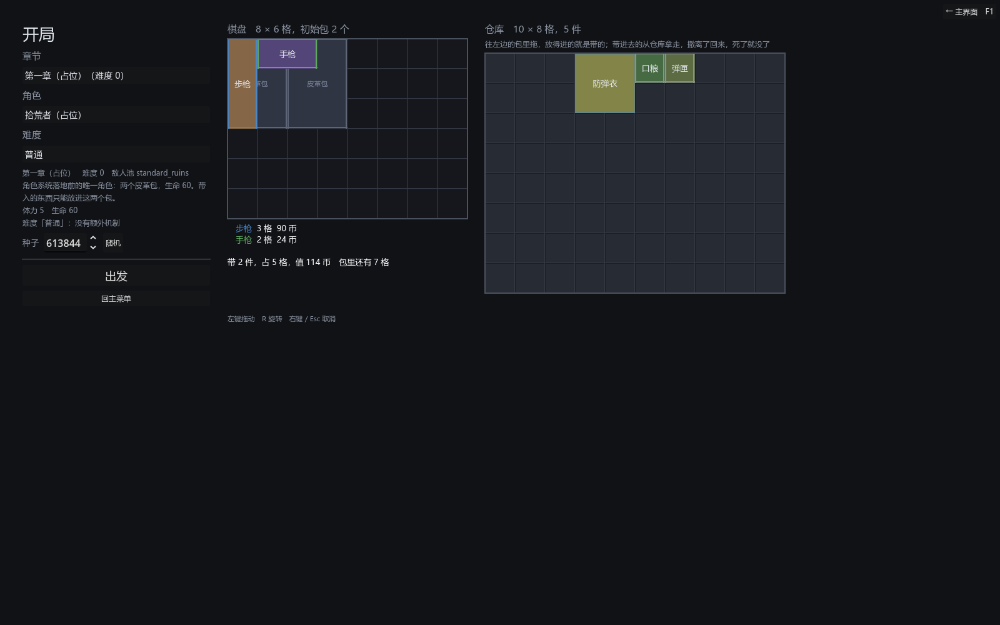

# 070 · 进阶难度骨架：难度是机制清单，机制是构件，局外解锁决定能不能选

> 069 第八节的第 1 步 ｜ 架构文档 8.4、10.1、11、12（v1.67）｜ 前一步：[069 设想](069-difficulty-mechanics-and-hunters.md)

作者定的（069）：进阶难度不是单纯提升数值，要加入机制；侵蚀是高难度才开的机制、延后；难度是局外解锁的特殊选项，名字随意。



## 产出

| 文件 | 职责 |
|---|---|
| `core/run/run_mechanic.gd` | `RunMechanic` 抽象根：`install(run)` 把自己接进一局（开局与读档各一次，必须幂等）、`describe()`；登记表 `EffectRegistry.RUN_MECHANICS` |
| `core/run/mechanics/erosion_mechanic.gd` | 侵蚀机制的**空壳占位**：参数 `rate` / `damage_band`，装的时候只在 `run.mechanic_tags` 留记号；本体（第 7 阶段）落地时在这里造 `ErosionField` 接到 `MapTravel.erosion` |
| `core/run/difficulty_def.gd` | `DifficultyDef`：档位、说明、`requires_unlock`、`mechanics: Array[RunMechanic]`、`effects: Array[Effect]`（RUN / LOOT，和 buff 同一套构件）、`summary()` |
| `core/authoring/*`、`tools/*` | 新内容种类 `difficulties`（排在角色之后）；校验：档位非负、机制非空、effects 只放掉落或一局规则的效果 |
| `data/authoring/difficulties/{normal,ascension_1}.json` | 普通（空清单）；进阶 1 占位：侵蚀（空壳）+ 体力上限 -1，要解锁 `ascension_1` |
| `core/run/run_state.gd` | `difficulty` / `difficulty_id`（跟存档）、`mechanic_tags`、`start(..., p_difficulty)`、`install_mechanics()`；`buff_context()` 与 `_loot_context()` 把难度的修饰算进去 |
| `core/run/game_flow.gd` | `difficulties`、`load_difficulties`（按档位排）、`difficulty_of`、`available_difficulties`（没有解锁要求的 + 已解锁的）、`begin(..., difficulty)`（没解锁兜底拒绝）、`toggle_unlock`；读档找回定义并重新 `install_mechanics` |
| `core/meta/meta_state.gd` | `unlocks`（跟 meta 存）、`has_unlock`、`toggle_unlock`（占位开关） |
| `ui/game/setup_screen.gd` | 「难度」一栏只列能选的；`choose_difficulty` / `difficulty()`；说明里写机制与修饰；出发按它开 |
| `ui/game/meta_screen.gd` | 「局外解锁」占位开关：难度定义里要求的解锁 id 各一个 |
| `tests/test_difficulty.gd` | 4 组 |

## 几条决定

**难度是清单，不是乘数。** 一档难度 = 开哪些机制（各带参数）+ 顺带哪些数值修饰。数值修饰直接复用 062 的 `RunEffect`（体力上限、开局钱、商店价、幸运……），
`RunState.buff_context()` 把它们和局外 buff 一起算，各系统一行不改。机制是新的抽象根 `RunMechanic`，走注册表，加一种 = 一个子类、登记一行，导入器 / 导出器 / 编辑器自动认得。

**机制自己把自己接进一局。** `install(run)` 里想接哪儿接哪儿（侵蚀接 `travel.erosion`，猎手接 `run.hunters`），`RunState` 不认识任何具体机制。
读档只写难度 id，`GameFlow._adopt` 按 id 找回定义、再 `install_mechanics()` 一次 —— 所以机制必须幂等；机制自己的状态若要跟存档，在 install 里读回来（猎手会用到）。

**没有难度定义 = 普通 = 现在的一切。** `RunState.start` 不给难度什么都不装，体力上限照旧；现有套件一条没改，难度自己一个套件 4 组。

**局外解锁是字段 + 占位开关。** `DifficultyDef.requires_unlock` 指一个解锁 id，`MetaState.unlocks` 记着，开局屏只列能选的，`begin` 再兜底拒绝一次。
谁来解锁不写死：现在是局外屏的开关（和局外 buff 一样的占位），将来是成长系统。

**侵蚀改口。** 5.7 原来假设每一局都有侵蚀；现在是某档难度开的机制，普通难度没有。`MapTravel` 的钩子与顺序不动，第 7 阶段做本体时只换 `ErosionMechanic.install` 的内容。
`ChapterDef.difficulty`（这一章本身多难，敌人档位用）保留，与进阶难度是两回事。

## 验证

```
bash tools/test.sh
通过  7297 项断言，47 个套件
```

- 管线：难度往返逐字节相同；机制按注册表造出来、参数在；修饰进 RunContext；解锁要求在；summary 把机制与修饰连起来；档位为负 / 没 id / 认不得的机制 / 战斗效果都报错；空清单合法；
  作者文件是不动点、资产在、`load_difficulties` 全装回且按档位排、第一档普通不用解锁。
- 开局：按进阶开 → 记 id、体力上限 = 占位 + 修饰、侵蚀记号在、`MapTravel.erosion` 仍是 null；存档带 id、读回来定义要持有方找回、装两次幂等；没给难度什么都不装。
- 流程：没解锁不列也开不了；解锁开关跟 meta 存；解锁了能选、按它开；存档换个持有方读回 → 定义找回、机制重新接上；关了又不能选。
- 屏：开局屏的难度按钮 = 能选的那几档、默认普通；局外屏有解锁开关；解锁后开局屏多一档；挑了进阶出发 → 一局记着、体力上限 = 角色的 + 修饰。

## 没做的

- 侵蚀本体（第 7 阶段）；进阶 1 的清单是占位，作者定内容。
- 解锁由什么触发（成长系统）；现在是局外屏的开关。
- 猎手机制：069 第八节的第 2 步，下一份报告。
