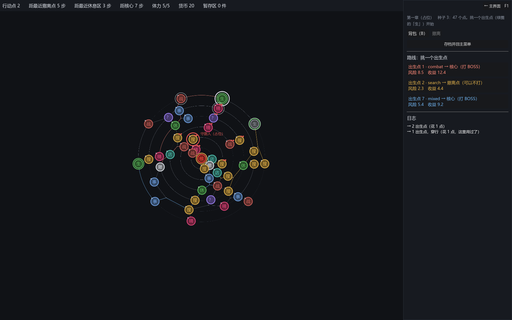

# 071 · 猎手核心：地图上移动的单位、领地、感知、开打前事件屏、六种战败后果

> 069 第八节的第 2 步 ｜ 架构文档 8.5、10.1、11（v1.68）｜ 前一步：[070 进阶难度骨架](070-difficulty-skeleton.md)

作者定的（069 第七节）：按绝对距离、数字全不写死、按等级一份配置；战败后果保留所有选项；模板和普通敌人一样、掉落率更高；
默认在离玩家最远的点出现、数量看地图规模、行为有多种模板；进感知范围提示、可以逃但不一定成功；各有领地、不踏进别人的范围。



## 产出

| 文件 | 职责 |
|---|---|
| `core/run/hunters/hunter_def.gd` | `HunterDef`（内容种类 `hunters`，一个等级一份）：可视性（隐形 / 可见 / 靠近可见）、感知距离、速度、开打距离、领地半径、行动逻辑、战败后果、掉落倍数、逃跑（成功率 / 失败代价 / 冷却）、敌人池与强度规则、节点互动占位 |
| `core/run/hunters/hunter_behavior.gd` + `behaviors/`（5 个） | 行动逻辑构件：靠近、远离、游荡、埋伏、巡逻（登记表 `HUNTER_BEHAVIORS`） |
| `core/run/hunters/hunter_loss_outcome.gd` + `losses/`（6 个） | 战败后果构件：扣体力、没事、必杀、消失、退走并歇几步、赶回上一个点并驻守（登记表 `HUNTER_LOSSES`） |
| `core/run/hunters/map_metric.gd` | 距离度量：`steps`（图上步数）/ `absolute`（布局坐标，持有方按环距归一后注入；没注入退回步数） |
| `core/run/hunters/hunter.gd`、`hunter_system.gd` | 一个猎手的状态；系统：出现（离玩家与彼此最远、离玩家至少 N）、领地、回合、感知提示、够得着就排开打前事件屏、迎战 / 逃跑、后果、存档；随机数走 `RunRNG` 的 `hunters` 流 |
| `core/run/mechanics/hunter_mechanic.gd` | 难度清单里的猎手机制：用哪几种、几个（按规模表）、第几步出现、出现距离、度量；`install` 造系统 / 读档恢复，幂等 |
| `core/run/events/outcomes/hunter_fight.gd`、`hunter_flee.gd` | 开打前事件屏的两个后果（立旗） |
| `core/run/node_events.gd` | `extra_defs`（运行时合成的事件）、`def_by_id`、`fight_hunter` / `flee_hunter` 接口；`choose` 认得猎手的遭遇：逃跑先掷、没逃掉照打、点不标用过；`fight_content` 公开、可带掉落上下文 |
| `core/run/run_state.gd`、`game_flow.gd` | `hunters` / `hunter_defs` / `hunters_saved`、`step_to` 末尾猎手回合、`poke_hunters`（玩家空下来问一声）、存档；flow 读档给定义表、`_flush` 回地图前 poke |
| `core/run/run_context.gd`、`core/loot/*` | 上下文三个字段：侦察距离、感知倍率、逃跑加成（第六节的技能接口）；`LootContext.drop_mult` 乘在掉落率上 |
| `ui/map/map_view.gd`、`ui/game/map_screen.gd` | 看得见的猎手在地图上一圈红环 + 名字；进感知范围日志一句「附近有动静」；被赶回上一个点；绝对度量时注入坐标 |
| `data/authoring/hunters/{hunter_1,hunter_2}.json`、`difficulties/ascension_1.json` | 追猎者（靠近；输了扣体力、退走）、守路人（一直可见、巡逻；输了扣体力、赶回并驻守，逃跑 30%）；进阶 1 开一个追猎者 |
| `tests/test_hunters.gd` | 5 组 |

## 几条决定

**猎手是难度清单里的一个机制。** 普通难度没有；`HunterMechanic` 装进一局就有 `run.hunters`。参数全在机制里（几个、第几步出现、出现距离、度量），
数字全在猎手定义里（感知、速度、开打距离、领地、逃跑），一个等级一份文件 —— 作者说的「按等级生成配置表」。

**回合在玩家一步的末尾。** 这一步的节点事都发生之后猎手才动：出现 → 每个按行动逻辑走几小步 → 感知 → 够得着就排开打前的事件屏。
玩家正忙（等着选的事件、开着的会话）时不打扰，等空下来（叠层看完、会话关了，`GameFlow._flush` 回地图之前）再问一声 `poke_hunters`。

**开打前先过事件屏，走事件层那条路。** 合成一个 `EventDef`（「迎战」+ 能逃就有「逃跑（几率）」），登记在 `NodeEvents.extra_defs`，
`pending` 里多一个 `hunter` 字段跟着存档；读档装机制时重新登记，所以待选的遭遇读档回来还在。玩家看到的就是事件屏，屏一行没改。
遭遇不是节点的事：点不标用过（不和节点互动），但算「发生过事」（离开时暂存区清）。

**强度是开打那一刻现造的。** 和随机点、搜索遭遇同一条路：`EnemyPlacer.pick` + `build_content`，探索度就是现在的总步数与搜索次数；
猎手可以指定自己的池与强度规则。掉落率乘 `drop_mult`（`LootContext` 多一个倍数，`DropResolver` 乘在自身携带与珍宝的概率上）。

**领地与互斥。** 出生时按半径划一片（度量算），行动只在自己领地里选点，且不进别的活着的猎手的领地、不站到它身上；
所以同一步至多一个够得着。出现位置默认离玩家和已出现的猎手都最远（比较到它们的最小距离），且离玩家至少 `spawn_min_distance`，不满足就放宽。

**六种战败后果按顺序执行。** 作者要保留所有选项，就各是一个构件；一份定义写一串。「赶回上一个点」直接改旅程的位置，不花行动点、不触发那个点的事。

**技能接口的三个字段先立住。** `RunContext.scout_range`（隐形猎手在几步内可见）、`sense_mult`（猎手感知距离的倍率）、`flee_bonus`（逃跑成功率加成），
系统已经读它们；往里加数的构件是第 3 步。

## 验证

```
bash tools/test.sh
通过  7399 项断言，48 个套件
```

- 管线：往返逐字节相同；行动逻辑与后果按注册表造、参数在；可视性枚举按名字读；成功率超界 / 速度为负 / 距离为负 / 认不得的构件 / 没 id 都报错；
  作者文件是不动点、资产在、`load_hunters` 全装回。
- 出现与领地：装机制留记号；第 0 步不出现，走第一步出现；出生点离玩家最远（从图上算）；领地 = 半径内的点；走六步猎手始终在自己领地里；
  按规模表出两个、出生点不同、a 能走的点不在 b 的领地里。
- 遭遇：站到玩家的点上 → `poke` 排上事件屏，pending 记着猎手与类型，合成的事件带前缀、选项数按能不能逃；不重复排；迎战打了一场、这个点算发生过事；
  赢了它死 / 输了按定义扣体力、退走后歇；逃跑成功率 1 → 没打、它歇定义里的步数、结果页一句话、歇着的不再追；成功率几乎 0 → 扣 1 体力照打；逃不掉的只有迎战。
- 后果与掉落：六种各自做什么（扣体力、没事、赶回上一个点 + 驻守不动、退走歇 3 步、消失、必杀 = 战败原因 hunter）；掉落率 ×2 乘在自身携带与珍宝上。
- 存档与流程：位置、出生点、领地读回来一样；读回来先没有系统、装机制才有、装两次幂等；待选的遭遇跟着存档、读档后能迎战；
  流程：走一步出现 → 空下来问一声 → 事件屏是猎手的遭遇 → 迎战打了一场 → 回放。
- 截图：`DEMO_SCREEN=hunter`，一个一直可见的守路人在地图上（红环 + 名字）。

## 没做的

- 校准（木桩、50%）：第 4 步。角色技能往上下文加数：第 3 步。
- 猎手的美术、隐形版的表现（现在什么都不画）；「附近有动静」只在日志。
- `absolute` 度量的坐标注入只在地图屏做了；没有地图屏（纯逻辑测试）时退回步数。
- 打输之后猎手站在原地又打（`nothing` 后果）是作者要保留的选项，没有另外限流。
