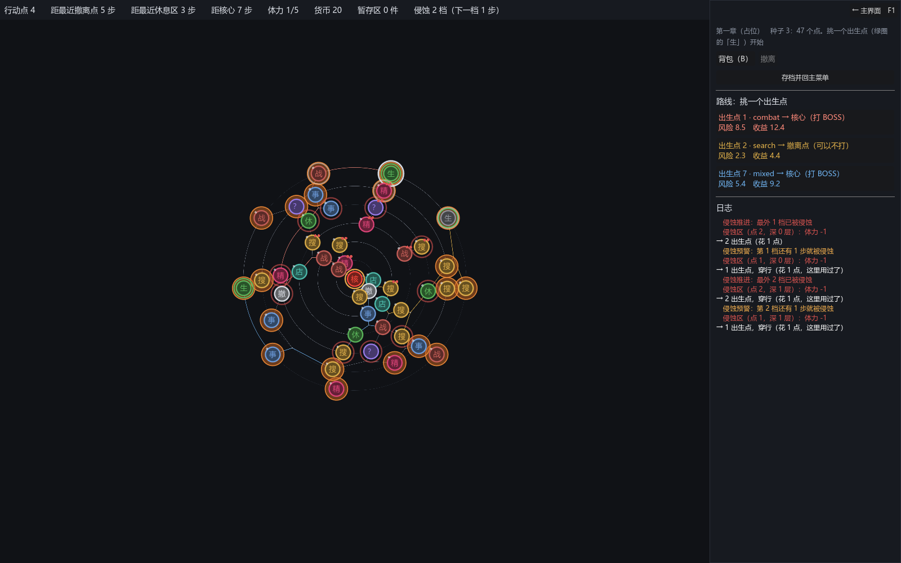

# 075 · 侵蚀本体：逐层向内、必须预警、绝不封路；效果是构件，开关 / 起始层 / 仅终局 / 概率都在数据里

> 069 第八节的第 5 步 = 第 7 阶段 ｜ 架构文档 5.7、8.4、11、12（v1.72）｜ 前一步：[074 猎手专属池与段位](074-hunter-brackets.md)

作者：继续做侵蚀本体，侵蚀的各种效果设计为可以开关或者调整 —— 是否启用、在哪个阶段启用、触发概率都不要写死。



## 产出

| 文件 | 职责 |
|---|---|
| `core/run/erosion/erosion_field.gd` | `ErosionField`：一局里的侵蚀状态 + 结算。`on_action`（MapTravel 每步先调：该推进就推进一层，提前 N 步预警一次）、`settle(node)`（目的地被侵蚀了就把效果清单挨个过门）、`is_eroded` / `depth_of` / `is_total` / `actions_left`；存档 |
| `core/run/erosion/erosion_effect.gd` | 效果构件的抽象根，自带四道门：`enabled`、`from_depth`（被侵蚀至少几层才生效）、`only_total`（仅终局）、`chance`；登记表 `EROSION_EFFECTS` |
| `core/run/erosion/effects/`（3 个） | 扣体力（基数 + 每深一层加多少）、损坏一件（随机 / 最值钱 / 最不值钱；棋盘 / 暂存区 / 都行；含不含包）、丢钱 |
| `core/run/erosion/erosion_context.gd` | 一次结算的上下文与账（体力、钱、烂掉的东西、话） |
| `core/run/mechanics/erosion_mechanic.gd` | 空壳换成本体：时间表（第几个行动点开始、每隔几个推进一层、预警提前量）+ 效果清单；`install` 造场接到 `travel.erosion`、读档恢复，幂等 |
| `core/run/map_travel.gd` | `_settle_penalty`：钩子有 `settle` 就交给它（老的 `move_penalty` 鸭子接口仍认） |
| `core/run/run_state.gd` | 四个信号（预警、推进、结算了、终局）、`erosion_saved`、存档键 `erosion` |
| `core/authoring/content_importer.gd` | 难度里的侵蚀机制：间隔 ≥ 1、**预警提前量 ≥ 1**（5.7 硬约束写成校验）、效果的概率 0～1、起始层非负 |
| `ui/map/map_view.gd`、`ui/game/map_screen.gd` | 被侵蚀的档垫锈色、快被侵蚀的那一档闪红环；HUD 一句「侵蚀 N 档（下一档 X 步）」；预警 / 推进 / 结算 / 终局写进日志 |
| `data/authoring/difficulties/ascension_1.json` | 进阶 1 的侵蚀：第 18 行动点起、每 12 推进、提前 4 预警；扣体力（每深一层 +1）、第 2 层起 25% 损坏最值钱的一件、丢钱（关着、仅终局） |
| `tests/test_erosion.gd` | 3 组；`test_difficulty` 两条按本体改 |

## 几条决定

**效果的门在基类里，子类只写做什么。** 作者要每种效果都能开关、能调：`enabled` / `from_depth` / `only_total` / `chance` 四个字段在 `ErosionEffect` 基类，
`applies(ctx)` 一处判；加一种效果只写 `apply`。所以「在哪个阶段启用」有两个刻度：被侵蚀几层（`from_depth`）和终局（`only_total`），概率是每次结算掷一次。

**时间表在机制里，状态在场里。** 第几个行动点开始、每隔几个推进一层、提前几步预警是难度清单里的参数（5.7 原来设想的 `ErosionSchedule` 就是这几个字段，
不再单独一个资源）；一局里侵蚀了几档、下一次在第几个行动点是 `ErosionField` 的状态，跟着存档，读档装机制时恢复。

**三条硬约束落地。** 必须预警：`warned` 信号 + 地图上闪红环 + 日志，导入器拒绝提前量 < 1 的机制。绝不封路：场里没有任何「不能走」，
MapTravel 的可走集合只由图决定。惩罚随深度递增：扣体力与丢钱各有 `per_depth`，损坏道具用 `from_depth` 与概率分层。

**顺序没动。** MapTravel 的「花行动点 → 侵蚀推进 → 目的地惩罚 → 节点事件」是 M3 定死的；本体只是把 `_settle_penalty` 交给 `settle`。
刚被这一步侵蚀的点这一步就有代价，预警倒计时的最后一步才有意义（测试守着）。

**终局。** 最内一档也被侵蚀 = `is_total`，`only_total` 的效果从此生效；「强制结算」就是把丢钱、更重的扣体力这类效果配成仅终局。占位数据里丢钱关着，作者定。

## 验证

```
bash tools/test.sh
通过  7701 项断言，51 个套件
```

- 时间表：第 first 行动点开始、每 interval 推进一层，逐步走每一步都对；最内一档 = 图上最大的 `erosion_band`；每次推进一层、每档预警一次且距推进恰好 warn 步；
  `is_eroded` / `depth_of` 按带；一路都有路可走；普通难度没有侵蚀。
- 门与效果：默认生效；关了 / 深度不够 / 仅终局没终局 / 概率 0 都不生效；到了起始层、终局了生效；概率 0.5 四百次里约一半；门写进 describe。
  扣体力 = 基数 + 每层 × 深度；损坏的是最值钱的一件、包不在候选里；暂存区也能损坏；丢钱不超过余额；账记全。
- 结算与存档：推进在惩罚之前（刚被侵蚀的点这一步就扣）；存档记着侵蚀了几档，读回来先没有场、装机制才有、状态一样、装两次幂等；
  作者难度的侵蚀带多种效果且配了门、往返逐字节相同；不预警 / 概率超界 / 认不得的效果都导不进。
- 截图：`DEMO_SCREEN=erosion`，最外几档垫了锈色、下一档闪红环、HUD 写着几档几步。

## 没做的

- 「损坏」现在 = 摧毁；道具没有耐久，要「损坏但还能用」得先给道具加耐久。
- 侵蚀的美术（垫色、红环是占位画法，画在屏幕坐标里、节点底下）；预警没有声音。地图上原来的危险区垫色画在画布坐标里，缩小整张图时会缩到节点底下看不见 —— 顺手可以改成同一种画法，没动。
- 进阶 1 的数值是占位，作者定。
