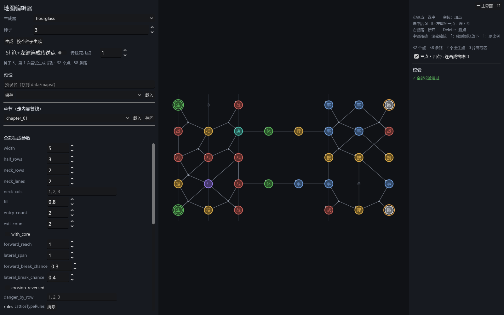
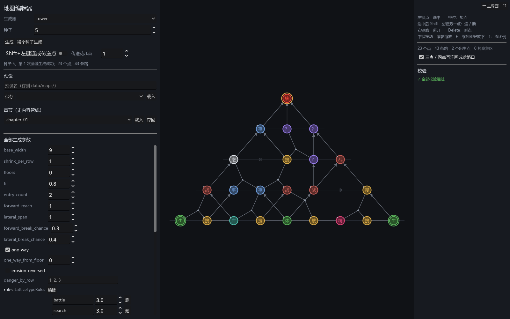

# 078 · 8-2 第二章的两个底层模板：沙漏与塔（分层格阵），编辑器里可选

> 第 8 阶段 8-2 ｜ 架构文档 5.1、5.3、5.11（新）、12（v1.75）｜ 前一步：[077 事件构件](077-event-constructs.md)

作者问「第二章地图是什么」—— 答：文档里只有 5.1 那句从第一天就写着的设计前提（「地图形态会随章节变化」）和 12 节规划表的一行，
从来没有作者的话。作者于是第一次给了需求：**做两个底层模板**（和第一章的同心环并列）：

1. 形状对称的长方形，中间收紧、只有两条平行线段作为连接；
2. 等腰三角形、塔型，可能有「不回头」的设置（具体配置留空占位）；
3. 未来在地图编辑器里可以选择用哪个模板做地图。

看过第一版之后作者补了定义（同日，本报告已按它改）：

- **塔**：横向的层，登上一层就不能向下 —— 同层自由横着走，纵向单向。这正是第一版 `one_way` 做的那种语义，所以它从「占位」变成塔的定义，默认开着。
- **沙漏**：应该是**横置**的（像蝴蝶结）；这张图**核心不是必须的**（BOSS 可有可无），**撤离点在和出生点相对的那一侧**，中途没有撤离点。

## 一、两个模板是同一种东西：分层格阵

沙漏和塔都是**从出生那一层一层层走向终点那一层**，每层若干格；差别只在形状 —— 每层有哪些格、哪几层不许横着走。
所以形状单独描述（`LatticeShape`，由配置算出，不进管线），铺点、连边、断边、定类型、校验只在 `LatticeMapGenerator` 里写一遍；
两个模板各自只回答「形状长什么样」和默认配置（`HourglassMapGenerator` / `TowerMapGenerator` 各 40 行）。

**这是 5.1「可插拔」的第二次兑现，也是第一次真的换形状**：`MapGraph` / `MapNavigator` / `MapTravel` / `ErosionField` / `MapView` 主体 / 存档一个字没改，
新增的是两个 `MapGenerator` 子类、一个 `MapLayout` 子类，注册表各加两行。猎手、侵蚀、事件、传送点在新形状上照常跑（测试里开了一局）。

### 铺法（`LatticeMapGenerator`）

- **铺点**：每层在自己的格子里按填充率挑一些放点。第 0 层、最后一层、只许直上的层、以及直上层两头的层**全填** ——
  两头那层里不对着线段的点靠横边走到线段口，所以得连成一片。挑的时候保证每个格子在下面那层够得着，
  下面那层每个点向上有去处（没有就补一个），保不住就是这次尝试失败、换种子。
- **连边**：层与层之间凡是列差不超过 `forward_reach` 的都连上（直上层进出只许列差 0）；同层挨着的（隔不超过 `lateral_span` 个空格）连横边。
- **断边**：按概率断，守住「每个点向上至少一条、向下至少一条」；第 0 层、最后一层、直上层两头那层的横边不断。
  全图连通与「单向也到得了终点」都由这条不变式给出，不用事后修。
- **分档**：`tier` = 层号（越往上越难）；侵蚀分档默认也是层号，`erosion_reversed` 反过来（从终点那头侵蚀）。
  `danger_by_row` 每层一个危险等级（空 = 全 0）。**没有高危区的生长**（那是环形图的算法），格阵的危险按层给。
- **类型**（`LatticeTypeAssigner` + `LatticeTypeRules`）：出生点 spawn、终点 core → 中途撤离点落在 `extract_rows` 允许的层、两两至少 `extract_min_distance` 步、
  数量在 `extract_count` 里 → 其余按 `type_weights` 抽 → 每层配额 `quota` → 步数覆盖 `coverage`（贪心）→ `no_adjacent`。
  规则写进 `layout_meta.type_rules`，校验从图上读。**没有路线**：格阵的路线是玩家自己走出来的，所以没有风格、没有校准。

### 校验（`validate`，规则从图上读）

通用那几条之外：点都在格子里、一格一个点；边只连相邻层（斜不过 `forward_reach`）或同层邻格；直上层不横连、进出列差 0；
`tier` 与侵蚀分档等于层号；**单向的图每个点顺着方向都走得到终点**（`goal_from_all`）—— 回不了头的死胡同就是困死，这是合格条件不是生成规则；
方向和「不回头」设置对得上、只许向上；类型规则（配额 / 覆盖 / 喘气处不进高危层 / 不许相邻 / 撤离点的层与间距）。传送点先摘下来，它不是路。

## 二、沙漏（`hourglass`）：横置的蝴蝶结

`HourglassMapConfig`：每半 `width` 格宽 × `half_rows` 层；颈部 `neck_rows` 层、`neck_lanes` 条平行线段（默认 2），`neck_cols` 指定落在哪几格
（空 = 在宽度里匀着放，宽 5 两条 → 第 1、3 格，对称）。**横置**：数据里「层」还是 row（离出生那一侧几步），画的时候从左往右排（`LatticeShape.orientation = horizontal`，
布局按它换轴），出生在最左一列。线段层不横连、只直进直出，是**必经的咽喉**：测试把线段的点拿掉，对侧就到不了。

**对侧是终点。** `exit_count` 个撤离点匀着放在最右一列（默认两个、在两端），它们就是 `goal_ids`；**核心不是必须的**：`with_core = false` 默认没有，
开了在对侧正中放一个核心（撞上撤离点就顶掉它）。**中途没有撤离点**（`rules.extract_rows` 默认空）；作者要在咽喉前后放，`neck_end_rows()` 给出那两层，填进去就行。
这带来一条通用的改动：形状的终点不再是「一个核心」，而是 `LatticeShape.goals`（最后一层的 格 → 类型），塔的终点是 `{塔尖: core}`；
校验按形状说的类型查终点，对侧的撤离点不算「中途撤离点」（不受层与间距的规则管）。

## 三、塔（`tower`）：登上一层就不能向下

`TowerMapConfig`：底层 `base_width` 列，每上一层两边各收 `shrink_per_row` 列（等腰），`floors` = 0 时收到 1 列为止（默认 7 / 5 / 3 / 1），
指定层数时收到 1 列之后一直 1 列。塔尖那一层只有终点（核心）。中途撤离点默认在正中那一层。

**横向的层，纵向单向**（作者定的塔的规则）：`one_way` 默认开着 —— 层与层之间的路是单向的（`MapEdge.directed`，从 `one_way_from_floor` 层起），
同层自由横着走；`MapNavigator` / `MapTravel` 早就认单向边，不用改。关掉就是一座能上下的塔。校验守着：向下的单向路、方向和设置对不上、有点困住（顺着方向到不了塔尖），都红。
回不去的楼层怎么侵蚀、撤离点怎么放，还没有作者的话，先按通用的做（侵蚀分档 = 层号，中途撤离点按层）。

## 四、编辑器里可选

`MapGeneratorRegistry` 的下拉来自注册表，登记了就有；`hourglass` / `tower` 的参数表单由 `PropertyForm` 反射出来（整数数组字段这次补了一行文本的编辑法，
`danger_by_row` / `extract_rows` / `neck_cols` 都能改）。空格子画成淡点、可以加点；层画成一行行，出生在底、终点在顶；单向的路带箭头。
截图工具多了 `DEMO_GENERATOR` / `DEMO_SEED` / `DEMO_CONFIG` 三个环境变量（上面三张图就是这么截的）。

章节数据里换模板 = `map_source.generator_id` 写 `hourglass` 或 `tower`、`generator_config` 的 `type` 写 `HourglassMapConfig` / `TowerMapConfig`，
导入器照旧校验「生成器要的配置类对不对」。**没有加 chapter_02**：第二章的内容（用哪个模板、几层几列、规则）是作者的活，这里只交模板。

## 五、测试

新套件 `tests/test_lattice_maps.gd`（四组，8440 项断言 / 54 个套件全过）：
沙漏的层数 / 线段格 / 线段层不横连只直进直出 / 两头全填 / 出生在左、对侧的撤离点是终点、默认没有核心也没有中途撤离点、要核心时对侧正中多一个 / 咽喉必经 / 分档 / 24 个种子过校验且平均尝试少于 3 次 / 同种子同图 / 反向侵蚀 / 指定线段格 / 配置错直说；
塔的宽度序列 / 居中 / 塔尖唯一 / 默认层间单向、关掉就不 / 「上去了回不来」/ 每个点都到得了塔尖 / 校验对翻向的路与困住的点都红 / 从第 2 层起才单向 / 指定层数 / 不收窄报错；
类型规则的撤离点层与数量 / 每层配额 / 手改就红（撤离点放错层、线段间连横边）/ 按层的危险与喘气处；
布局登记、沙漏横着画（出生在左）、塔竖着画（出生在底）、位置两两不同、空格子数、存档往返；**正式的一局在沙漏与塔上开、定内容、走、塔上回不了头**。
已有的注册表覆盖测试自动把两个新生成器和布局都跑了一遍。

## 六、留着的

- 塔的「不回头」之下侵蚀与撤离点要不要另有规矩，等作者定；现在按通用的（侵蚀分档 = 层号，中途撤离点按层）。
- 格阵没有高危区的「生长」，只有按层的危险等级；要片状高危区得另写（或者手绘）。
- 格阵没有传送点的自动生成（编辑器手连照旧能用，移动与校验都认）。
- 没有规模模板（`MapScaleProfile` 是环形图的）；格阵的规模就是几层几列，直接在配置里。
- 第二章的内容文件（章节、节点规则、敌人池）没有，等作者定。
