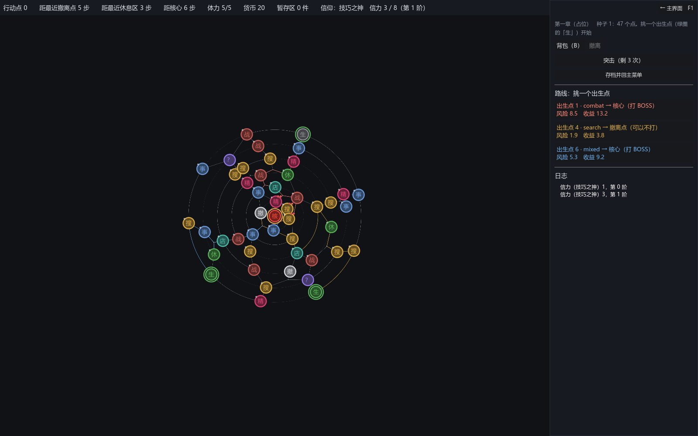

# 082 · 局内技能与信力（作者定，已实施）：技能构件（被动 + 主动）、三个初始角色、信力的行为与阈值、信仰道具按阶解锁

> 第 8 阶段 8-4 ｜ 架构文档 3.8、4.2、7.3（新）、16（v1.84）｜ 前一步：[081 信仰体系](081-faith-system.md)｜ 世界观：[docs/worldview.md](../worldview.md)

作者答了「系统回顾」里的四条：信力机制、不信者（留空）、新教（留空、进待办）、三个初始角色与**局内技能系统**（先前漏了，补上）。本报告按答案实施。

## 一、作者定的

| 项 | 答 |
|---|---|
| 信力 | 获得信仰道具后，完成信仰指定的行为获得信力：置入一定价值的道具 / 进行战斗 / 移动一定距离 / 获得金币 / 花费金币 / 进行探索 / 在事件中选特定选项；信力达到几个阈值后，信仰道具赋予额外功能 |
| 不信者 | 目前没有专属，留空 |
| 新教 | 留空，放进待办 |
| 地图 | 圆形地图和魔法古迹契合 |
| 初始角色 | 三人：擅长逃跑的奴隶 **Andreus**（躲得开猎手；和节点敌人第一次战斗失败不失去体力）、擅长生存的奴隶 **Brutus**（血量、体力、耐力都更高）、擅长战斗的士兵 **Marcus**（耐力更高；局内技能「突击」：下次进入战斗扣除对方 30% 血量） |
| 局内技能 | 可以在大地图移动时使用，也有被动常驻生效（布鲁图斯的被动就是额外提高血量、体力、耐力） |

## 二、局内技能（`core/run/skills/`）

072 的技能只有被动（一局规则的效果构件）。现在技能是一个构件 **`RunSkill`**（注册表 `EffectRegistry.RUN_SKILLS`，抽象根 `RunSkill`）：

- 字段：`id`、`display_name`、`description`、**`passive: Array[Effect]`**（常驻的一局规则 / 掉落效果，和 buff、难度同一套）、`uses`（主动次数，-1 不限）、`cooldown_steps`（用一次走几步才能再用）。
- 主动部分由子类给：`is_active()`、`activate(run) -> String`（空串 = 用了）、`arms_battle()` + `prepare_battle(me, enemy)`（立旗等下一场战斗）。三个构件：
  **`passive`**（纯被动）、**`assault`**（突击：`hp_fraction` 默认 0.3，立旗，开打前把对方的生命上限乘 1 − 比例）、**`evade`**（躲避：`steps`，接下来几步猎手够不着）。
- 两个新的一局规则效果：**`free_losses`**（输给节点敌人前 n 次不扣体力；`RunContext.free_losses`）、**`stat_bonus`**（战斗基线加成：`stat` + `amount`；`RunContext.stat_bonus`）。
- **`RunSkills`**（一局里的账，`run.skills`，没角色也有一份空的）：`uses_left` / `cooldowns` / `armed` / `evade_left`；`can_use` / `use` / `on_step` / `prepare_battle` / `status_line`；跟着存档走（`skills` 一节）。
  读档回来先放 `skills_saved`，持有方按 id 找回角色时（`RunState.set_character`）接上定义与账。
- 接线：`RunState.step_to` / `relocate` 在猎手的回合之后调 `skills.on_step()`（躲 3 步 = 3 个猎手回合够不着）；`NodeEvents.before_battle` 回调在 `BattleSim.run` 之前让立了旗的技能改双方的战斗单位；
  `NodeEvents._fight` 输了先看 `RunContext.free_losses`，已免几次记在 `NodeEvents.losses_forgiven`（跟着存档），**猎手与核心不免**；`HunterSystem.check_engagement` 在 `run.skills.evading()` 时不开打；
  `RunState.effective_baseline()` 把 `stat_bonus` 盖到角色基线上，`compile_player` 用它。`buff_context()` 在角色定了之后才算（之前先算导致体力上限的被动没进开局）。
- 界面：地图屏右栏一个技能一个按钮（「突击（剩 3 次）」，不能用时灰掉、状态栏写原因），日志记「用了「突击」：下次战斗先扣对方 30% 血」；开局屏的技能一句改成「名字（主动、被动各一句）」。

（截图钩子 `DEMO_SCREEN=skills`：按马库斯开局、放一件技巧之神的盾上棋盘、献祭一次。）

## 三、三个角色（`data/authoring/characters/`，占位的 `default` / `scout` 删了）

| id | 名字 | 身份 | 基线 | 技能 |
|---|---|---|---|---|
| `andreus` | 安德烈乌斯 | 奴隶探索者 | 生命 50，两个皮革包 | **躲避**（主动：3 步猎手够不着，2 次，冷却 4 步；被动：逃跑 +25%、免罚一败） |
| `brutus` | 布鲁图斯 | 奴隶探索者 | 生命 60，两个皮革包 | **坚韧**（被动：生命 +20、耐力 +15、体力上限 +1） |
| `marcus` | 马库斯 | 军团士兵 | 生命 55、耐力 65，一个皮革包 + 一个小包 | **突击**（主动：下次战斗先扣对方 30% 血，3 次，冷却 3 步） |

数全是占位。名字沿小说里的安德烈、马库斯（第三个是作者新起的 Brutus）。

## 四、信力（`core/run/faith/`）

- **行为是构件 `FaithDeed`**（注册表 `FAITH_DEEDS`，`amount` = 每次给几点；`gain(event, payload) -> int`）：`place_item`（`min_value`）、`battle`（`won_only`）、`travel`（`every_steps`，看总步数）、
  `earn_money` / `spend_money`（`per_amount`，一笔按整除）、`explore`（搜一次）、`event_choice`（`tag`，选项带这个标签才给；空 = 任何选项）。`EventOption` 多了 `tags`（祭坛的「献上」选项标了 `offering`）。
- **信仰文件**多了 `thresholds`（非递减正数）与 `deeds`；`FaithDef.tier_of(points)` / `next_threshold` / `deeds_summary`。
- **`FaithPower`**（`run.faith_power`）：每个信仰一个池子，`credit(event, payload)` 只给**此刻激活的信仰**记（没激活 = 不记）；`tier_of` / `tiers()`（标签 → 阶，给编译器）/ `line()`（HUD 一句「信力 12 / 30（第 1 阶）」）；跟着存档走（`faith_power` 一节）。
  切换信仰不清别的池子（作者说可以继承 —— 继承还没做，先各池各记）。
- **接线**（`RunState._wire_faith_power`）：`GridInventory.placed`（新信号：道具从别的容器置入时发）→ `place_item`；`Wallet.changed` 正负 → `earn_money` / `spend_money`；`battle_finished` → `battle`；`travel.moved` → `travel`；
  搜索会话的 `searched` → `explore`；`NodeEvents.option_chosen`（新信号）→ `event_choice`。
- **道具的额外功能**：`ItemDef.faith_bonuses: Array[FaithBonus]`（`tier`、`mods`、`rules`、`note`），只许写在信仰道具上、阶从 1 起。`BattleCompiler.compile` 多一个参数 `faith_tiers`（标签 → 阶），
  tier ≤ 现在的加成：修饰施加给那件道具的属性、规则并进它的规则 —— 仍是纯函数。`RunState.compile_player` 传 `faith_power.tiers()`。
  第一批：技巧之神的盾（一阶护甲 +4、二阶开战久弹）、狩猎之神的长弓（一阶伤害 +4、二阶 +15%）、力量的符号（一阶开战血怒 +10% 伤害）。
- 六个信仰的行为（占位数）：暴力 = 打一场 +1；战争 = 打赢 +1、每花 20 币 +1；太阳与火 = 每走 2 步 +1；技巧 = 置入价值 ≥ 10 的道具 +1、献祭 +2；狩猎 = 搜一次 +1、每进账 15 币 +1；新教 = 事件里做选择 +1。阈值 [3, 8]（太阳 [4, 10]）。
- 界面：地图 HUD「信仰：技巧之神　信力 4 / 8（第 1 阶）」，信力变了日志一句；背包面板读数同一句。

## 五、存档

`RunState.to_dict` 多三处：`skills`、`faith_power`、`events.losses_forgiven`。版本号不变（老存档缺这几节就是空账）。

## 六、测试

- `tests/test_character_skills.gd` 重写（五组）：构件走管线（被动 + 主动、往返、七种错的拦下）；三个作者角色各自开局，上下文 = 被动、体力上限 = 角色 + 被动、基线 = 角色 + 加成、编译的生命按加成后的基线；
  突击立旗、下一场对方生命上限 = 原 × 0.7、旗子撤、次数与冷却记账、用完；免罚只对节点敌人（输给猎手照扣）、配额用完照扣；躲避中猎手在脚下也不开打、走够步数又够得着；存档往返（旗子、账、免罚次数）。
- 新套件 `tests/test_faith_power.gd`（三组）：每个信仰有行为与阈值、阶从阈值推、往返、四种错的拦下、无信仰之物不许有按阶功能；没激活不记、激活只记自己的池子、每种事按行为给的点数断言、切换后各池各记、
  一局里的事真的接上了（进账、花钱、走路、事件选项）；编译器按阶并入修饰与规则（0 阶到最高阶逐阶对照）、`compile_player` 点数够了自动带上、存档。
- **9074 项断言 / 57 个套件全过**。连带：作者数据经 `normalize_content` 重写成导出器的格式（默认值不写）。

## 七、留着的

- 信力**继承**（切换时带走积攒的）：作者说可以，还没做；现在各池各记。
- **不信者**专门体系：作者定留空。**新教**体系：留空，进待办（`church` 只有占位与一条行为）。
- 数全是占位：技能的次数 / 冷却 / 比例、信力的行为点数与阈值、道具的按阶功能。
- 技能只能在地图屏用；事件屏、战斗前的迎战屏上没有按钮（作者说「大地图移动时使用」，先照这个）。
- 三个角色没有肖像与身份层（身份决定开局、进出的口、报酬 —— 8-5）。
