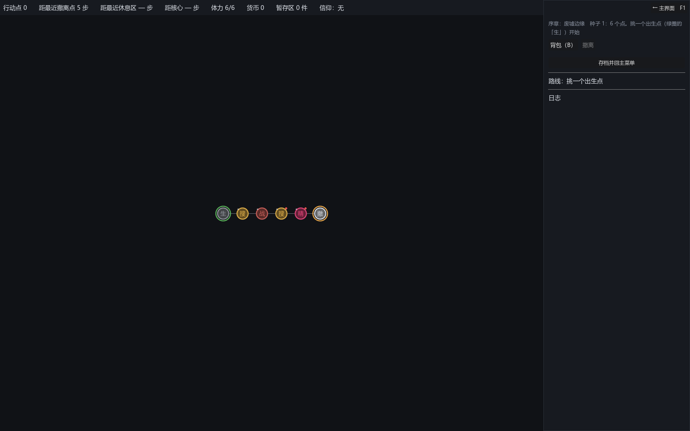

# 083 · 序章（新手教程）：只有布鲁图斯、一条路的预设图，搜 → 整理 → 战 → 战利品 → 搜三次必遇敌 → 战 → 精英 → 撤离；通关解锁第一章

> 第 8 阶段 8-4 / demo ｜ 架构文档 5.3、6.2、8.4（新）、16（v1.85）｜ 前一步：[082 局内技能与信力](082-run-skills-and-faith-power.md)

作者定的 demo 形态：没有第二章，demo 就是展示第一张地图；先做一个带新手教程的序章 —— 开始游戏后以布鲁图斯为可选角色，一张只有一条路的地图，
依次展示搜索（可搜两次、必不遇敌）、搭配、战斗、战利品、再次搜索（要求搜三次、第三次必遇敌）并战斗、战利品、精英、撤离点；教程完成后玩家可以体验第一张地图。

## 一、序章长什么样

`data/maps/prologue.json`（一张手写的 `MapGraph`，新布局 `line`）：**生 → 搜 → 战 → 搜 → 精 → 撤**，六个点五条边，每个点最多两条边。

| 点 | 类型 | 内容 |
|---|---|---|
| 1 | 搜索 | 教程事件 `tut_search_1`；`search_max` 2、`search_curve` [0, 0]（必不遇敌）；固定收获：第一次制式短剑 + 伤药，第二次贴身内甲 |
| 2 | 战斗 | 教程事件 `tut_battle`（「开打」要棋盘上有带 `weapon` 标签的道具，另一项「先整理背包」回到本事件）；写死的敌人：拾荒者 + 匕首 |
| 3 | 搜索 | 教程事件 `tut_search_2`；`search_max` 3、**`search_min` 3**（搜够三次才能走）、`search_curve` [0, 0, 1]（第三次必遇敌）；固定收获：弯刀 / 纱布 + 口粮 / 圆盾；写死的遭遇：蛮兵 + 剁刀 |
| 4 | 精英 | 教程事件 `tut_elite`（同「开打」条件）；写死的敌人：守卫 + 制式短剑 + 圆盾 |
| 5 | 撤离 | 教程事件 `tut_extract`；免费 |

章节 `prologue`：预设地图、无敌人池（敌人全写在图里）、掉落规则 standard、节点规则 `prologue`（`events_by_type` 空 —— 只用图里指定的事件）、经济 `prologue`（`paid_extracts` 0）。

## 二、加的机制（都是数据驱动，别的章节不受影响）

- **章节的门**（`ChapterDef`）：`order`（开局屏先后）、`requires_unlock`（局外解锁 id，没解锁不列）、`grants_unlock`（撤离成功给的解锁）、`characters`（能选的角色 id，空 = 全部）、`allow_carry_in`（能不能从仓库带东西）。
  序章 `order 0`、`grants_unlock prologue_done`、只有布鲁图斯、不能带；第一章 `order 1`、`requires_unlock prologue_done`。
  `GameFlow.available_chapters()`（按解锁过滤、按 order 排；一章都列不出来就全列，解锁 id 写错不该把游戏锁死）、`characters_for(chapter)`；`_settle_run` 撤离成功时 `MetaState.grant_unlock`（跟局外存档）。
  开局屏按这两个列章节与角色，章节换了角色列表重排、仓库那一栏按 `allow_carry_in` 隐藏。
- **节点内容里的搜索覆盖**（`SearchSession` 读 `node.content`）：`search_max`、`search_min`（搜够才能走，容器屏灰掉「离开」）、`search_curve`（遭遇曲线，超出按最后一项）、`search_finds`（第 k 次固定找到什么，没写的照规则抽）；
  `encounter`（写死的遭遇，`NodeEvents` 的遭遇构造优先用它，没有才按池现造）。
- **预设图里写死的敌人**：`RunState.start` 只在有敌人池时才铺敌人；没有池的章节，图里 `content.enemy` / `items` / `board` 就是敌人，`EnemyKit.spec_of` 对 `pool == null` 已经能算。
- **`has_item` 条件多了 `tag`**：「棋盘上得有武器」。
- **事件屏上能整理背包**（15 节第 7 项的尾巴）：选项页多一个「整理背包（B）」，叠 `InventoryPanel`，收起时重画选项（条件可能因为整理过了而满足）。
- **一条线的布局** `ui/map/line_map_layout.gd`（注册表 `MapLayout.LAYOUTS` 的 `line`）：按 `layout.col` 从左到右排。

## 三、教程的文字（事件层，`data/authoring/events/tut_*.json`）

翻找（搜两次、暂存区一挪步就清）→ 整理（战斗是自动的、只有包里的参战、先放武器）→ 再翻一次（三次、第三次必遇敌、输了扣体力）→ 守卫（精英更硬、扣得更多）→ 撤离（带回仓库、序章到此为止、第一章开放）。
「开打」锁着时另一项「先整理背包」把同一个事件再放一遍，玩家在事件屏上按 B 整理。

## 四、测试

新套件 `tests/test_prologue.gd`（三组）：
- 数据：预设过校验、一条路、六个点的顺序、每个点的教程事件与写死的敌人 / 收获都存在、两个搜索点的次数 / 曲线 / 最少次数 / 遭遇按文件断言、只有布鲁图斯、不能带、解锁对得上；
  **打得赢**：用到那一步为止搜到的东西对着三个敌人各模拟五个种子，全赢。
- 走一遍：搜两次拿到固定的收获 → 没武器「开打」锁着、「先整理背包」能选 → 放了武器能开打 → 赢、没扣体力、有战利品 → 搜三次（前两次不遇、搜够才能走、第三次遭遇 = 写死的）→ 赢 → 精英赢 → 撤离，一场没输。
- 门：没通关只列序章、序章只能选布鲁图斯、第一章全部角色；撤离成功给解锁、第一章出现并排在序章后；解锁进局外存档；只有一个要解锁的章节时照样列。

连带改的五个导演级测试（场景流、事件层、暂存区规则、开局屏、难度）要的是第一章的环形图：先把章节许诺的解锁都给上、再挑第一章。**9221 项断言 / 58 个套件全过**。

## 五、留着的

- 教程只靠事件文字，没有高亮、没有箭头指着按钮；「搭配」那一步靠「开打」锁着逼玩家整理。
- 序章的敌人与收获是占位数（打得赢有测试守着）。
- 主菜单还没有「跳过序章」；通关一次之后序章仍列在第一位（想重玩可以选）。
- 通关后的第一章仍是占位内容，demo 的其余缺口见上一轮回顾（图标、配图、敌人改名、数值）。
