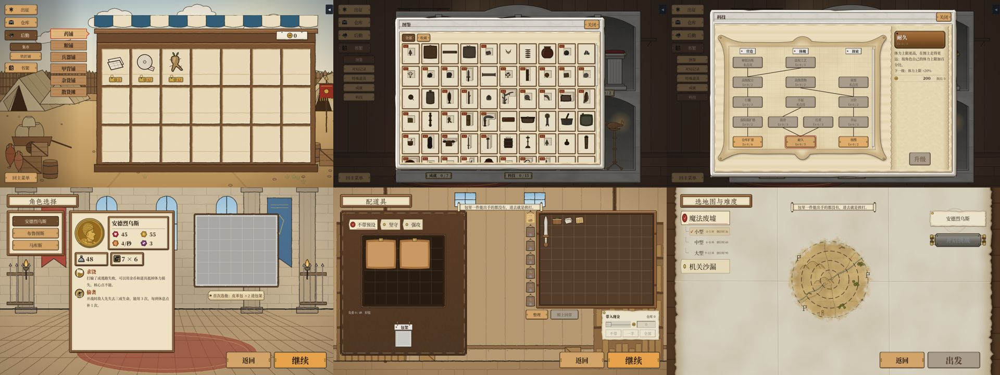

# 280 基地各界面的返回键位置统一

作者 2026-11-04 16:56：「检查并统一基地所有界面的返回键位置」。本报告是**检查结果 + 方案**，代码没动；作者选了之后本线程改。

## 〇 一句话

基地有三种「往回走」的键：整屏退出（基地「回主菜单」、开局屏「返回」）、窗的关闭（书架五扇窗的「关闭」）、窗里的返回（对局记录详情的「返回」）。**整屏那一种左右不一**：基地在左下，开局屏在右下，而且开局第三页比前两页往左挪了 71 px。窗的「关闭」都在标题条右上，但图鉴窗和另外三扇差 11 px，科技窗更大、位置另算。

## 一、现状（1920 × 1080 设计坐标，脚本量的按钮矩形）

| 界面 | 键 | 位置 | 大小 |
|---|---|---|---|
| 基地 出征 / 仓库 / 后勤（集市、铁匠铺）/ 书架 | 回主菜单 | 左下 (24, 920) | 176 × 56 |
| 书架 · 图鉴窗 | 关闭 | 标题条右上 (1337, 106) | 82 × 50 |
| 书架 · 对局记录 / 特殊道具 / 成就窗 | 关闭 | 标题条右上 (1326, 106) | 82 × 50 |
| 书架 · 科技窗（1320 × 900 大窗） | 关闭 | 标题条右上 (1436, 66) | 82 × 50 |
| 书架 · 对局记录 → 一条详情 | 返回 | 窗内顶行左头 | 按字 |
| 开局 第一页（选角色）/ 第二页（配道具） | 返回 | 右下 (1205, 877)，「继续」左边 | 240 × 87 |
| 开局 第三页（选地图） | 返回 | 右下 (1134, 877)：跟着「出发」让开地图纸毛边 | 240 × 87 |

集市、铁匠铺没有自己的返回：它们是「后勤」下面的分页，左列页签就是导航，不算缺。

## 二、方案

| 选项 | 做法 | 改动 |
|---|---|---|
| **A（推荐）** | 整屏退出键一律放**左下**，和基地「回主菜单」同一个锚点（左 24、底边对齐）、同一个大小；开局屏三页的「返回」从「继续 / 出发」旁边挪到左下，右下只剩主键。窗的「关闭」统一在标题条右上、离右沿同样的内边距（图鉴窗那 11 px 对齐）；对局记录详情的「返回」不动（窗里的上一层，本来就在窗里左上） | 开局屏右下那组拆开；书架窗的关闭位置算法统一 |
| B | 整屏退出键一律放**右下**、主键左边：基地「回主菜单」挪到右下角；开局第三页的「返回 / 出发」不再随地图纸左移，和前两页同一个位置 | 基地左列底部空出来；第三页按钮组位置定死 |
| C | 只修偏差不挪键：开局第三页「返回」和前两页对齐，图鉴窗「关闭」对齐另三扇；基地左下、开局右下保持两套 | 最小 |

推荐 A：「回」在左、「进」在右，和阅读方向一致；基地与开局屏是一路连着进出的两屏，退出键在同一个角，手不用换地方；右下只留一颗主键，也就不会把「返回」误点成「出发」。

## 三、待定（没回音按推荐）

1. 选 A / B / C —— **推荐 A**。
2. 开局屏左下的「返回」用开局屏现在的浅木键（240 × 87，比基地「回主菜单」大），还是改成基地那颗 176 × 56 —— **推荐沿用开局屏的大小**（三页的大键是作者 10-31 定的），只对齐左边与底边。

## 四、落地（作者 2026-11-04 选 B）

| 界面 | 改了什么 | 在哪 |
|---|---|---|
| 基地（各页签） | 「回主菜单」从左列底部搬到屏幕右下角（离右、下边各 24，176 × 56 不变），和开局屏「返回」、结算「继续」同一个角；左列只剩页签 | `meta_screen.gd` `MainMenuButton` |
| 开局 第三页 | 「返回 / 出发」不再跟着地图纸右沿左挪，和前两页同一个位置（离屏边 36） | `setup_screen.gd` 删 `_fit_nav` / `NAV_PAPER_GAP` |

测试：`test_base_five_264`（左列不再有回主菜单，回主菜单右下角对齐屏边 24）。
