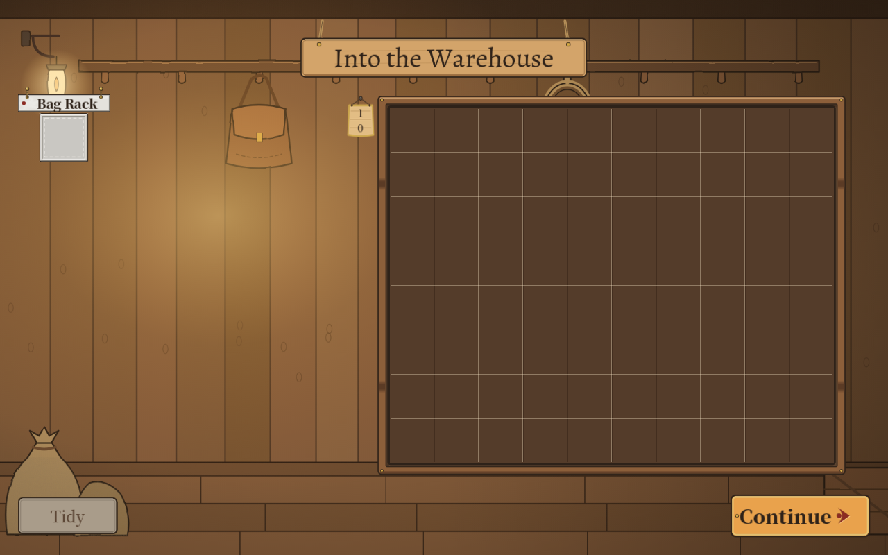

# 291 · 执行方案 2026-11-09 第一批：状态文档、云端调试报告的问题修复、测试日志的 ERROR 闸门

> 2026-11-10 ｜ 架构方案执行 ｜ 依据：[执行方案](../plans/2026-11-09-claude-next-execution.md)（作者 2026-11-10 07:50「已上传至 main，请确认」，本线程 22:28「读取最新方案并执行」）、[云端调试报告](testing/2026-11-10-cloud-debug-0a91d60d.md)
> 落地：v5.47（PR #525）。阶段 C（平衡基线）另起报告。

## 一、目标

执行方案第一批的阶段 A（状态文档与待办收口）和阶段 B（回归、复现与修复）。阶段 B 的问题清单取自同日云端调试报告：G01～G04 四个游戏问题、Q01 测试工具问题。

## 二、开工基线

| 项 | 值 |
|---|---|
| HEAD | `b1c0f009`（main，PR #524 合并后；代码同 v5.46 `0a91d60d`，之后只多了方案、测试报告与证据） |
| 分支 | `claude/project-thread-9bp4s4`，开工时工作区干净 |
| 引擎 | Godot 4.7.1.stable.official.a13da4feb（`/usr/local/bin/godot`） |

## 三、产出

### 阶段 A：`docs/status.md` 重写

按代码与 `architecture.md` §16（v5.00～v5.46）重写：系统现状表（15 个系统，每行写现行规则、入口类、来源报告与版本）、代码地图、内容统计（注明口径：`b1c0f009` 的作者 JSON 文件数，不等于能拿到的内容数）、测试说明、**当前待办**（可直接执行 / 需要作者决定 / 缺素材或真人数据，每行有来源、代码入口、依赖、验收条件）、占位数值核实表、索引里状态过期的行。旧版全文 `git show b1c0f009:docs/status.md`。历史报告里的结论没改。

### 阶段 B：问题修复

| 编号 | 问题 | 处理 | 回归测试 |
|---|---|---|---|
| G01 | 离开休息点时 `HoverTip.release()` 向已离树的窗取鼠标位置，报 `get_viewport() is null`（基地页 `close_shelf` 同一入口） | `release()` 先看在不在树上：不在就直接收起，不取鼠标位置 | `test_tooltip_193.frame_release_off_tree` |
| G02 | 结算「走过的点」数的是 `MapNode.is_visited()`（= 内容用掉了），没撤的付费出口、没歇的休息点漏算 | 改数 `MapTravel.history` 里到过的不同点（出生点算，来回只算一次）；没有走过记录的老档退回原口径：`RunResult.arrived_count` | `test_score_269.run_visited_counts_arrivals` |
| G03 | 英文大字号「Into the Warehouse」顶出标题木牌 | 牌宽原来按标签最小宽量（不等于字宽，且量的时候还没进树、不是主题字）：改成按字体量一行字宽，主题一换（进树当场）、字宽一变都重排牌面：`ResultScreen.title_width / _fit_plank` | `test_result_storeroom_228.frame_storeroom_plank_en_large`；截图见下 |
| G04 | 跳过教程后，军团交代仍说「三趟都活着回来了」 | **没改正文**（作者的文字），草案见 §四，待作者定 | — |
| Q01 | `tools/test.sh` 只拦 `SCRIPT ERROR`，其余引擎 `ERROR:` 静默放过 | ① 修掉测试自己造的错：两处格式串里没转义的 `%`（`test_author_087:62`、`test_adjacency_sentence_171:87`）；两处测试直接调 `CombatantPanel._draw()`（改调新的 `layout_chips()`，只排图标格不画，`_draw` 同一套）；`InventoryView._gui_input` 离树时不取 `get_tree()`；`test_pawn_184:116` 缩成负尺寸的矩形先判空再 `has_point`。② `test.sh` 加闸门：负向用例故意造的错登记在 `tools/expected_errors.txt`（地图生成失败、坏 JSON、拼错的 hook、坏 / 缺的预设地图、退出泄漏统计），其余每一行 `ERROR:` 都判失败 | 拿云端那份日志过一遍新闸门：恰好拦下那 37 行（28 绘制、4 viewport、2 tree、2 格式、1 负矩形），本次日志 0 行 |

顺手：

- 云端报告的证据截图是 JPEG 却叫 `.png`，Godot 导入时报 `ERR_FILE_CORRUPT` 并生成 `.import`。加了 `docs/reports/testing/evidence/.gdignore`，Godot 不再扫这个目录（文件原样保留）。
- `CombatantPanel` 拆出 `_layout_chips` 时，`warnings.sh` 报了一条三元式类型不一，已改，静态警告仍是 0。

G03 修后（英文、大字号、1280 × 800，同云端报告的窗口）：

修前见云端报告 [english-large-warehouse-title.png](testing/evidence/2026-11-10-debug/english-large-warehouse-title.png)。

## 四、待作者决定

### G02 计分口径（已按默认做，可回退）

「走过的点」现在数**到过的点**，和结算页的名字一致。探索分每个点 2 分，所以分数会涨：云端报告那条路线 5 → 7 个点，总分 423 → 427。

如果你原本想奖励的是「用掉的点」，回退只要把结算页的名字改成「用过的点」，计数改回原口径，一行的事。

### G04 跳过教程后的开场白（草案，没改正文）

- **A（推荐）**：保持现状。按故事背景，跳过教程就当作已经走过三趟；不改文字。
- **B**：跳过教程的存档单独用一句开头，后文不变。草案：「听说你在别处走过几趟。下一趟没有图……」 / "Word is you've made a few trips elsewhere. The next one has no map. ..."

选 B 的话，正文由你定稿，我再接上分支（`GameFlow.decline_tutorial` 记了 `TUTORIAL_ASKED`，可以据此换开头）。

## 五、验证

| 项 | 命令 | 结果 |
|---|---|---|
| 全量测试 | `bash tools/test.sh` | 39,276 项断言 / 294 个套件通过，401,292 ms（整个 test.sh 含导入与两项检查 438 s），EXIT=0；0 条 `SCRIPT ERROR`，0 条未登记的 `ERROR:`（日志摘要 [suite-summary.log](testing/evidence/2026-11-10-fixes/suite-summary.log)） |
| 静态警告 | `bash tools/warnings.sh` | 0 条 |
| 单项回归 | `godot --headless --path . --script res://tests/run_tests.gd -- <名>`：`result_storeroom`、`score_269`、`tooltip_193`、`npc_chatter` | 全过 |
| G03 画面 | xvfb 1280 × 800 截图 | 标题在牌面内，两头留边（上图） |

## 六、遗留

- **未做走查**：方案 §4「中英文 × 默认与大字号、三张序章、两张正式地图」的手工走查本批没做。云端报告已覆盖序章一和一条自由模式路线（同为 `0a91d60d`），本批改动由上面的定点测试和全量测试覆盖。其余组合未验证。
- **Q02 退出泄漏**：只是登记进了允许表，没治理（status.md 待办 Q02）。
- **体验建议 1～5**：分类见 status.md 待办。
- 云端报告里的 `WARNING` 行（敌人道具摆不下、锚点尺寸等）不在闸门范围。

## 七、下一步

阶段 C：用现有工具跑当前版本平衡基线（`standard_ruins`、`clockwork`、猎手、武器估算对实测），只出统计和调参建议，不改数。
