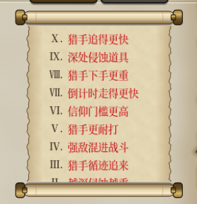
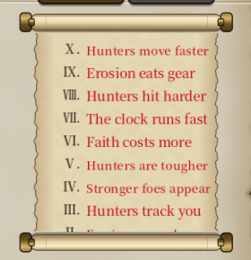

# 320 十档进阶与侵蚀改革（分批落地）

> 日期：2026-11-14。作者 2026-11-14 15:04：「执行」。
> 方案：[2026-11-14-ten-ascensions-and-erosion.md](../plans/2026-11-14-ten-ascensions-and-erosion.md)。作者 2026-11-14 13:04（难度线程）：「进阶二的侵蚀只留扣体力，损坏道具挪到更高层」。
> 档位写法：A0 = 普通，A1～A10 = 进阶一到十（方案 §1），不用报告 318 的实验编号 D1～D5。

## 批次状态

| 批次 | 内容 | 状态 |
|---|---|---|
| A | 基础审计；先拆掉旧的随机损坏道具 | 已做（见 §A） |
| B | A1～A4：敌人生命、纯体力侵蚀、猎手平滑、进阶池 | 已做（见 §B） |
| C | A5～A8：猎手生命 / 攻击、信力门槛、倒计时精确累计 | 已做（见 §C） |
| D | A9：道具侵蚀层数、永久损毁、撤离清零、合成继承、迁移 | 已做（见 §D） |
| E | A10：猎手追踪加速、安全窗口 | 已做（见 §E） |
| F | 全档回归、奖励校准、中英文与解锁界面 | 已做，计分系数待作者定（见 §F） |

## A：基础审计

实施基线：main `8875e48`。

### A.1 现在的三档

| 档 | id | 规则 | 解锁 |
|---|---|---|---|
| A0 | `normal` | 没有任何机制 | 一直可选 |
| A1 | `ascension_1` | 体力上限 −1 | 成就「满载而归」（`big_haul`） |
| A2 | `ascension_2` | A1 + 侵蚀（每层深度扣 1 点体力；~~深度 2 起 25% 损坏一件道具~~；掉钱关着） | A1 撤离一次 |
| A3 | `ascension_3` | A2 + 猎手（`hunter_1`，段位 0 / 5 / 10 / 20 步 → 强度 0 / 1 / 2 / 3） | A2 撤离一次 |

- 每档的 json 是完整清单，不自动继承（A3 自己写了侵蚀和猎手两样）。
- 侵蚀的时间表没有在难度里覆盖：第 18 个行动点开始，之后每 12 个推进一层，提前 4 个预警。
- 计分的难度系数是线性的：1 + 0.25 × 档位（`base_rules/score.json` 的 `difficulty_step`）。

### A.2 走一步时的先后顺序（`MapTravel.apply` → `RunState.step_to`）

1. 花行动点：`ActionClock.spend(边的 action_cost × 负重倍数)`。
2. 侵蚀推进：`ErosionField.on_action`，该推进就推进一层或几层，然后预警。
3. 侵蚀结算：途经点和目的地挨个过 `ErosionField.settle`，被侵蚀的点按效果清单结算。每次走进都结算，重进也算。
4. 进点前的闸门：猎手的回合（`HunterSystem.on_player_step`：该出现就出现 → 每个猎手走 `speed` 步 → 感知 → 够得着就上开打前事件屏）。
5. 头一回踩上的点发节点事件。
6. 技能冷却减一，发 `stepped`。倒计时模块在这里看剩几步，归零就算行动失败。

原地耗时（`MapTravel.wait`）：花行动点 → 侵蚀推进 → **结算脚下这个点**。A9 的「随机侵蚀一件」不能挂在这条路上（方案 §6.1：停留不触发），只能在真正走进时触发。

### A.3 谁跟着什么走

同一个数 `ActionClock.total` 同时驱动四样东西：

| 依赖它的 | 怎么用 |
|---|---|
| 倒计时 | 剩余 = 上限 − total |
| 侵蚀推进 | 到第几个行动点推进一层 |
| 猎手段位 | `HunterSystem.step_count()` 就是 total |
| 猎手出现 | 走到第几步出现 |

所以：
- A7（倒计时加速）不能去改 total，否则猎手段位和侵蚀也跟着变快。要给倒计时单独记一份消耗（固定精度累计），侵蚀和猎手照旧看 total。
- A10（猎手追得更快）要另起一个累计器，挂在猎手的回合里，和 A7 那份分开。

### A.4 各项改动的落点

| 项 | 现在的入口 | 打算怎么做 |
|---|---|---|
| A1 / A5 生命 | `EnemyKit.spec_of`：节点战、搜索遭遇、猎手、对打工具都走这一处编译 | 战斗内容带一个生命倍率，编译完只乘一次；普通敌人和猎手分开给 |
| A8 猎手攻击 | 同上 | 只放大直接攻击伤害，具体字段到 C 批再核对 |
| A3 猎手平滑 | `HunterDef.strength_by_bracket` 在 5 / 10 / 20 步跳档 | B 批先在 4/5、9/10、19/20 步做配对对打，看跳档有多大 |
| A4 进阶池 | `EnemyPlacer.fill` 开局一次性给战斗点配敌人 | B 批在这里按配额替换 |
| A6 信力 | `FaithDef.thresholds` 是累计表（如日神 50 / 150 / 300 / 1000，教会 3 / 8） | 开局给这一局的信仰表复制一份、按倍率改，界面和结算读同一份 |
| A7 倒计时 | `CountdownModule.left()` = 上限 − total | 模块自己记倒计时消耗（千分位累计），进存档 |
| A9 道具侵蚀 | `ErosionField.settle` 的效果清单 | 新效果构件，只在走进时触发；道具实例加层数字段 |
| A10 猎手 | `HunterSystem._move` 每步走 `speed` 步 | 千分位累计，攒够一次多走一步 |

### A.5 发现的风险

- **旧局的规则快照**：存档只记难度 id，读档时用现在的 json。改了档位内容以后，进行中的旧局会换成新规则（方案 §7 要求保留旧规则直到这一局结束）。到 D / F 批做：存档里带一份这一局的难度规则。
- **道具实例没有侵蚀字段**：A9 要新加一个字段，进存档；旧档默认 0。
- **小地图上的猎手**：现在每个猎手每步走整数步，A10 不能直接把 1 改成 2（方案 §4.3）。

### A.6 这一批改了什么

- 进阶二、进阶三去掉「深度 2 起 25% 损坏一件道具」，侵蚀只剩扣体力（作者 13:04）。效果构件 `damage_item` 本身留着，没有档位再用它。
- 「体力上限 −1」留到 B 批跟 A1 一起换掉，这一批不动，免得进阶一暂时什么都没有。

## B：进阶一～四

数据都是木桩对打（`archetypes.json` 的 108 份，每段 27 份），不是整局，也不是真人。

### B.1 A1 敌人更耐打（替掉体力上限 −1）

- 难度新加 `enemy_hp_percent`（百分数，10 = 最大生命 ×1.10）。是最终值，进阶二～四写同一个数，不连乘。
- 入口只有一个：`EnemyKit.spec_of` 编译完（道具加的生命也在内）乘一次。节点内容上记一笔 `hp_mult`，重复写不叠。
  - 开局图上放好的敌人在开局写。
  - 现造的（随机点、搜索遭遇、事件开打）在 `NodeEvents` 写。
  - 寂灭试炼也写。
  - 猎手不吃（走自己的路）。
  - 有档案的章（切片、教程）不吃。
- 地图预览、战前准备屏、真打读的是同一份内容，显示的生命就是真打的生命。
- 体力上限 −1 从进阶一～三删了，不在背后保留。

`tools/bench_normal_enemies.gd`，每格 30 场 × 27 份：

| 木桩段 | 档 | 环 | 普通 | 生命 ×1.05 | 生命 ×1.10 |
|---|---|---|---|---|---|
| 0～4 步 | 0 | 外围 | 91% | 90%（−1） | 88%（−3） |
| 5～9 步 | 0 | 废墟 | 98% | 97%（−1） | 97%（−1） |
| 5～9 步 | 1 | 废墟 | 80% | 79%（−1） | 79%（−1） |
| 10～19 步 | 1 | 深处 | 95% | 94%（−1） | 93%（−2） |
| 10～19 步 | 2 | 深处 | 71% | 69%（−2） | 66%（−5） |
| 20 步起 | 2 | 核心环 | 82% | 81%（−1） | 81%（−1） |
| 20 步起 | 3 | 内环 | 49% | 48%（−1） | 46%（−3） |

×1.05 基本看不出来，×1.10 掉 1～5 个百分点。取 ×1.10。

### B.2 A2 侵蚀边界

A 批已经把损坏道具拆了，这一批只换说明文字：侵蚀只扣体力，掉钱照旧关着。

### B.3 A3 猎手平滑

不动段位表（0 / 5 / 10 / 20 步）和每段的档位，免得木桩分段和猎手技能跟着变。改成段内生命渐变：
- 猎手机制新加 `hp_from` / `hp_to`：每段刚进来时 ×`hp_from`，走到下一段的前一步时 ×`hp_to`，中间按步数线性。
- 最后一段没有终点，用 `hp_last_span`（10 步）走完。
- 进阶三取：

| 段 | 步数 | 生命倍率 |
|---|---|---|
| 0 | 0～4 | 1.0 → 1.4 |
| 1 | 5～9 | 0.6 → 1.4 |
| 2 | 10～19 | 0.6 → 1.6 |
| 3 | 20 步起 | 0.5 → 1.0（到第 30 步） |

`tools/bench_hunter_ramp.gd`：同一份上一段木桩，在边界前一步、后一步各打一次，每格 20 场 × 27 份：

| 跨到第几步 | 原来：前一步 → 后一步 | 渐变后：前一步 → 后一步 |
|---|---|---|
| 4 → 5（档 0 → 1） | 98% → 56%（−42） | 91% → 75%（−16） |
| 9 → 10（档 1 → 2） | 80% → 28%（−52） | 66% → 59%（−7） |
| 19 → 20（档 2 → 3） | 77% → 16%（−61） | 59% → 36%（−23） |

扫过的倍率（`--explore`）：

| 跨到第几步 | 这一档 ×1.2 / 1.4 / 1.6 / 1.8 / 2.0 | 下一档 ×0.4 / 0.5 / 0.6 / 0.8 / 1.0 |
|---|---|---|
| 4 → 5 | 95 / 91 / 87 / 84 / 78% | 85 / 80 / 75 / 65 / 56% |
| 9 → 10 | 74 / 66 / 63 / 57 / 50% | 72 / 65 / 59 / 43 / 28% |
| 19 → 20 | 71 / 65 / 59 / 52 / 43% | 48 / 36 / 34 / 20 / 16% |

- 19 → 20 用生命接不平：第三档就算只剩 0.4 倍生命也只有 48%，差的是伤害和道具，不是血量。要接平得做一个过渡档（第三档的配装、第二档的稀有度上限），那要新的敌人内容，留给 F 批整局回归时再看。
- 第三段开头 ×0.5、10 步内回到 ×1.0，之后和原来一样；这一段的木桩本来就更强。
- 每段平均生命和原来差不多（0.75～1.2 倍），只是把跳变摊进了段里。

### B.4 A4 强敌混进战斗

- 新档进阶四：进阶三的一切，再加 `advanced_percent` = 15。
- 开局把 15% 的普通战斗点（四舍五入成场数）换成本色档位更高的一种敌人。道具档位、节点类型、奖励都不变，精英保底不会误发。
- 挑法（`AdvancedPool`）：
  - 先挑普通池够不着的（本色比想要的高出容差以上）。
  - 没有就退一步，挑本色比想要的高的。
  - 再没有就留着原来的敌人，记进回报（`advanced_report.missed`）。
- 按配额挑，不逐点掷硬币。
  - 离入口最近的 2 场不换（`advanced_skip_first`）。
  - 换上的点互不相邻。
  - 同一种敌人能避就避。
- 池子就是这一章的池，只取合法的行（环、节点类型照旧过滤）。

木桩对打（同上，「更强的一种」也乘了 A1 的 ×1.10）：

| 木桩段 | 档 | 环 | 普通 ×1.10 | 更强的一种 ×1.10 | 来的是谁 |
|---|---|---|---|---|---|
| 0～4 步 | 0 | 外围 | 88% | 78%（−10） | 电鳗、蛮兵 |
| 5～9 步 | 0 | 废墟 | 97% | 98%（+1） | 巫医、电鳗、盾卫、蛮兵、魔法学徒 |
| 5～9 步 | 1 | 废墟 | 79% | 74%（−5） | 同上 |
| 10～19 步 | 1 | 深处 | 93% | 90%（−3） | 熟练的魔法师、穴熊 |
| 10～19 步 | 2 | 深处 | 66% | 51%（−15） | 同上 |
| 20 步起 | 2 | 核心环 | 81% | 86%（+5） | 同上 |
| 20 步起 | 3 | 内环 | 46% | 换不了 | 第三档以上没有更强的本色 |

- 括号里是比同样 ×1.10 的普通敌人差多少。换上的一场难 0～15 个百分点，浅处和中段最明显。只占普通战斗的 15%，每局多出来的压力不大。玩家主要得认得出地图上那几只。
- 第三档没有更强的本色，深处的高档点会落到「换不了」，实际换掉的比例会低于 15%，回报里记着。F 批整局统计时报实际比例。
- 预览显示真实敌人。没有按玩家构筑挑克制的敌人。

### B.5 计分系数

计分规则新加 `difficulty_mults`（下标 = 档）：0～3 档还是 1 / 1.25 / 1.5 / 1.75，进阶四暂时和进阶三一样，是 1.75。这是方案 §7 的实验对照值，不是正式奖励；F 批定 0～10 的正式表。

### B.6 这一批没做的

- 旧局规则快照（报告 §A.5）还没做：读档时用现在的 json。进行中的进阶一～三旧局读档后会换成新规则（没有了体力上限 −1，多了敌人生命）。D / F 批补上。
- 进阶四的解锁和开局屏：在进阶三撤离一次后解锁，跟原来的链一样；开局屏照档位排，没有单独改界面。

## C：进阶五～八

每一级在上一级的基础上只多一个字段（百分数，说明文本用 `{字段名}`），都取 10：

| 档 | 字段 | 挑战 |
|---|---|---|
| A5 | `hunter_hp_percent` | 猎手更耐打 |
| A6 | `faith_threshold_percent` | 信仰门槛更高 |
| A7 | `countdown_percent` | 倒计时走得更快 |
| A8 | `hunter_damage_percent` | 猎手下手更重 |

解锁照旧：上一级撤离一次开下一级，进阶八暂时是最后一级。计分系数五～八暂时都是 1.75（同进阶三，实验对照值）。

### C.1 A5 / A8 猎手生命、攻击

- 生命：猎手的生命倍率 = 段内渐变（A3）× (1 + `hunter_hp_percent`)，在 `HunterSystem.build_content` 盖章，编译时乘一次。
- 攻击：内容里盖 `dmg_mult`，编译完每件道具的 `damage` 属性基础值和加算都乘，乘算不动，所以终值正好 × 倍率。法杖、弓轮读的晶石和箭加的那份也乘。
- 流血层数、反伤、固定附伤、箭的真实伤害不变。
- 普通敌人不吃这两样（只有猎手盖章）。

`tools/bench_hunter_mods.gd`：每段的木桩打这一段的猎手（生命取段中间那一步的渐变），每格 20 场 × 27 份：

| 段 | 步数 | 档 | 渐变 | 这一档 | 生命 ×1.05 | 生命 ×1.10 | 攻击 ×1.05 | 攻击 ×1.10 | 都 ×1.10 |
|---|---|---|---|---|---|---|---|---|---|
| 0 | 0～4 | 0 | ×1.20 | 95% | 94%（−1） | 94%（−1） | 94%（−1） | 93%（−2） | 91%（−4） |
| 1 | 5～9 | 1 | ×1.00 | 80% | 79%（−1） | 76%（−4） | 79%（−1） | 78%（−2） | 72%（−8） |
| 2 | 10～19 | 2 | ×1.04 | 76% | 74%（−2） | 73%（−3） | 74%（−2） | 70%（−6） | 67%（−9） |
| 3 | 20～30 | 3 | ×0.75 | 44% | 43%（−1） | 42%（−2） | 41%（−3） | 37%（−7） | 35%（−9） |

×1.05 几乎看不出来，取 ×1.10。到进阶八两样叠起来，每段掉 4～9 个百分点。

这张表只有胜率。方案要的首次出手前死亡、被迫战斗、战后损失要整局才看得到，留给 F 批。

### C.2 A6 信仰门槛

- `DifficultyDef.scaled_faiths`：开局把信仰表复制一份，首阶不变，之后每阶 × 1.1 四舍五入，至少比前一阶多 1。
- 一局的 `run.faith_defs` 就是这份，局内界面（背包、地图的信仰浮窗、`{faith_threshold:…}`）和结算读的都是它。原表不动。
- 已经攒的信力、来源、事件消费都不改。

| 信仰 | 原来 | 进阶六 |
|---|---|---|
| 蛮神 | 30 / 100 / 200 / 400 | 30 / 110 / 220 / 440 |
| 新教 | 3 / 8 | 3 / 9 |
| 大地之神 | 25 / 100 / 250 / 500 | 25 / 110 / 275 / 550 |
| 狩猎之神 | 25 / 80 | 25 / 88 |
| 自然之神 | 25 / 80 / 150 / 400 / 800 | 25 / 88 / 165 / 440 / 880 |
| 技巧之神 | 25 / 80 | 25 / 88 |
| 日神 | 50 / 150 / 300 / 1000 | 50 / 165 / 330 / 1100 |

新教第二阶 8 → 9 实际是 +12.5%（小整数）。每种信仰到阶要多走几步，得整局统计，F 批做。

### C.3 A7 倒计时

- 倒计时已扣 = 累计行动点 × (100 + `countdown_percent`) ÷ 100，向下取整（`CountdownModule.spent`）。基础 1 点走 10 次扣 11，9 次扣 9，25 次扣 27。
- 行动点只增不减，所以余数不用另存，读档照样对。
- 侵蚀推进、猎手段位、猎手出现还看原来的行动点，A7 不让它们变快。
- 两章都有倒计时，A7 都生效：

| 章 | 规模 | 倒计时 | 能走的行动点 |
|---|---|---|---|
| 魔法废墟 | 小 / 中 / 大 | 36 / 60 / 90 | 33 / 55 / 82 |
| 机关沙漏 | 小 / 中 / 大 | 24 / 40 / 60 | 22 / 37 / 55 |

- 每步预览的实际花费还没改（地图上照旧写倒计时剩几步），F 批做界面时补。

### C.4 这一批没做的

- 旧局规则快照仍未做（同 §B.6）。
- 首次出手前死亡、信力到阶步数、时间耗尽率等整局统计放在 F 批。

## D：进阶九（深层侵蚀）与旧局规则快照

### D.1 规则

- 新侵蚀效果 `item_layer`（`ErodeItemLayer`）。进阶九在进阶八的侵蚀清单后面加一条：`from_depth` 2、`limit` 3。
- 触发：真正走进被侵蚀 2 层以上的点（途经点也算，和扣体力一样），从棋盘上的合格道具里等权随机挑一件，层数 +1。
  - 原地耗时结算脚下的点不触发（`MapTravel.wait` 传 `entered = false`）。
  - 打开界面、整理、读档不走侵蚀结算，也不触发。
  - 离开再进来照样触发。
- 上限 3：第 1、2 层还在，第 3 层立即永久损毁（`RunState.destroy_item`，统一入口：从容器拿掉、发 `item_destroyed`）。
  - 独一道具按扫描算，拿掉就不再算已有，以后按原规则还能再得。
  - 不生成替代品。
- 合格：棋盘上的道具，包里装着的也算，锁了的、红武也算。
  - 不算：包本身（包没了里面全散）、角色随身之物、券、特殊道具、内部道具（铸牌）。
  - 地上暂存、托付区不算。
- 没有合格道具：什么也不做，日志写一句。
- 随机数走侵蚀那条流，跟着存档。

### D.2 层数跟着实例走

- 记在道具实例的 `state`（`erosion` / `erosion_limit`），旧档没有 = 0。移动、旋转、地上交换、买卖回购、存读档都保留。
- 合成：成品继承所有输入里最高的层数（不算一次新侵蚀）。
  - 满了的话合完立即损毁。
  - 确认窗写明「成品继承侵蚀2/3」或「成品侵蚀已满，合成后立即损毁」。
- 魔晶石碎成碎晶也接着层数。
- 正常撤离：带出来的（棋盘上的、托付出去的）幸存道具清零，回报记清了几件。
- 战败不清：托付出去保下来的带着层数回仓库，以后再带进来撤离成功才清。

### D.3 界面

- 道具浮窗（放在后面，坏消息在后）：
  - 红字「侵蚀2/3：达到满值时损毁」
  - 灰字「正常撤离后，未损毁道具的侵蚀清零。损毁无法恢复。」
- 地图悬停：够深的被侵蚀点加一句「进入后随机侵蚀一件随身道具。」。按现在的侵蚀算，不预告挑中哪一件；不受「节点浮窗」开关管。
- 地图日志写「「X」被侵蚀（2/3）」，损毁写「「X」侵蚀满了，永久损毁」并弹一条提示。
- 帮助页「侵蚀」：删了旧的「毁掉包里最值钱的一件」，改成进阶九的规则。

### D.4 旧局规则快照（报告 §A.5 的风险）

- 开局把这一档难度的完整规则（`ResourceSnapshot`：脚本路径加每个存档字段，子构件递归）存进存档 `difficulty_rules`。
- 读档时：
  - 现在的定义和快照一样，就用现在的（同一个对象）。
  - 不一样，按快照重建，这一局按开局时的规则走到底。
  - 快照坏了或没有（这一版之前的档），按 id 用现在的。
- 这一版之前开的进阶局没有快照，读档后已经是 B / C 批的新规则，补不回来。
- 进阶九是新档，没有旧局会中途多出道具侵蚀。

### D.5 这一批没做的

- 侵蚀响应道具的接口（方案 §6.6）：现在只有层数和损毁事件（`item_destroyed`），没有按层数推导效果的接口，也没有正面加成。按方案留到以后单列待办。
- 道具定义还不能单独改上限（都按效果的 3）。
- 每件侵蚀层数、永久损失、廉价物品吸收比例这些整局统计放在 F 批。

## E：进阶十（猎手追得更快）

进阶十 = 进阶九 + `hunter_chase_percent: 10`。其余字段、侵蚀、猎手段位表都和进阶九一样，进阶九撤离一次开进阶十，进阶十是最后一级。

### E.1 规则

- 每个猎手一个追击累计（`Hunter.chase`，百分数）。每次原本能走的机会（玩家走一步或原地耗时、它不在歇着也不在驻守）攒 `hunter_chase_percent × 速度`，攒到 100 多给一次机会，扣掉 100。
  - 多给的这次机会按它的行动逻辑走（靠近 / 游荡），只走合法的相邻点，不扩大感知、不穿禁行边、不瞬移。
  - 行动逻辑选了站着，这次机会也算用掉，和原有移动同一口径。所以「每十次原本能走的机会多一次」，不是「每十步多走一步」。
- 不多走的情况（累计留着，最多攒满 100，攒不出第二步）：
  - 原有那一步走完已经够得着玩家（开打距离 + 安全窗口以内）；
  - 没有合法的相邻点可走；
  - 出现的那一步：不攒也不走。
- 撞上一次（开打前的事件屏排上）清零：打完、逃掉之后不能用攒下的那一步立刻再追上来。
- 一次行动最多一次遭遇，和原来一样：所有猎手先走完（含多给的一步），再查一次够不够得着。
- 累计和诊断数（`moved` 原有移动走了几步、`chased` 多走了几步）跟着存档，读档不重算。随机数走猎手那条流。
- 安全窗口 `hunter_chase_window`（步，默认 0）：离玩家只差开打距离再加这么多步时不多走。进阶十现在是 0，见 E.3。
- 和 A7 的倒计时累计是两套，互不影响。
- 开发诊断：调试模式下地图上猎手的悬浮多一行 `chase 多走 / 原有 · 累计%`。玩家看到的是难度说明「猎手追得更快，平均每走十步多追一步」。

### E.2 校准（`tools/bench_hunter_chase.gd`）

真实地图（自由模式），同一批种子开 / 不开追击各走一遍，进阶九的猎手配置。只走路和猎手回合，撞上按逃掉算（猎手歇几步），走满这张图的步数上限。两种走法：

- route：不看猎手，一个接一个去最近的没去过的点。
- evade：看得见所有猎手，每步挑离最近的猎手最远的一格（同样远再朝目标）。它被拦的次数可以当成「躲也躲不开」的上界参考（它只看一步，不是最优解）。

小、中图各 100 个种子，大图 40 个，安全窗口 0：

| 规模 | 走法 | 追击 | 有接战的局 | 每局接战 | 连着两步被拦 | 第一次接战（步） | 猎手原有移动 | 追击多走 | 多走 / 原有 |
|---|---|---|---|---|---|---|---|---|---|
| small | route | 0% | 99 / 100 | 5.89 | 0 | 8.8 | 18.8 | 0.0 | 0.0% |
| small | route | 10% | 100 / 100 | 6.08 | 0 | 8.1 | 18.3 | 0.4 | 2.1% |
| small | route | 20% | 100 / 100 | 6.45 | 0 | 7.5 | 17.7 | 1.5 | 8.3% |
| small | evade | 0% | 18 / 100 | 0.24 | 0 | 22.4 | 20.4 | 0.0 | 0.0% |
| small | evade | 10% | 39 / 100 | 0.63 | 0 | 21.4 | 20.2 | 1.6 | 7.8% |
| small | evade | 20% | 46 / 100 | 0.96 | 0 | 19.8 | 19.9 | 3.5 | 17.6% |
| medium | route | 0% | 100 / 100 | 5.91 | 0 | 19.0 | 28.4 | 0.0 | 0.0% |
| medium | route | 10% | 100 / 100 | 6.07 | 0 | 18.6 | 28.2 | 1.0 | 3.6% |
| medium | route | 20% | 100 / 100 | 6.24 | 0 | 18.3 | 27.4 | 2.8 | 10.3% |
| medium | evade | 0% | 3 / 100 | 0.06 | 0 | 17.0 | 29.6 | 0.0 | 0.0% |
| medium | evade | 10% | 7 / 100 | 0.10 | 0 | 28.9 | 28.4 | 2.2 | 7.7% |
| medium | evade | 20% | 11 / 100 | 0.19 | 0 | 31.5 | 28.5 | 4.8 | 16.9% |
| large | route | 0% | 40 / 40 | 3.67 | 0 | 52.2 | 44.8 | 0.0 | 0.0% |
| large | route | 10% | 40 / 40 | 3.75 | 0 | 53.0 | 44.2 | 2.9 | 6.6% |
| large | route | 20% | 40 / 40 | 4.05 | 0 | 52.4 | 43.6 | 6.6 | 15.1% |
| large | evade | 0% | 3 / 40 | 0.12 | 0 | 42.0 | 44.0 | 0.0 | 0.0% |
| large | evade | 10% | 2 / 40 | 0.05 | 0 | 54.5 | 45.2 | 4.3 | 9.5% |
| large | evade | 20% | 2 / 40 | 0.07 | 0 | 45.0 | 44.0 | 8.7 | 19.8% |

- 实际多走的比例：会躲的走法下是原有移动的 8%～10%，和方案的「约一成」对得上。不躲的走法只有 2%～7%，因为猎手常在开打距离内或在歇着。
- 不躲的玩家几乎没感觉：每局接战 +0.1～0.2 次，第一次接战早不到一步。
- 会躲的玩家在小图上压力明显变大：有接战的局从 18 / 100 变成 39 / 100，每局 0.24 → 0.63 次。中图 3 → 7，大图没差别。
- 所有条件下「连着两步被拦」都是 0。

安全窗口 1（多走的那一步不会直接撞上），小、中图各 100 个种子：

| 规模 | 走法 | 追击 | 有接战的局 | 每局接战 | 连着两步被拦 | 第一次接战（步） | 猎手原有移动 | 追击多走 | 多走 / 原有 |
|---|---|---|---|---|---|---|---|---|---|
| small | route | 0% | 99 / 100 | 5.89 | 0 | 8.8 | 18.8 | 0.0 | 0.0% |
| small | route | 10% | 99 / 100 | 5.89 | 0 | 8.8 | 18.8 | 0.1 | 0.7% |
| small | route | 20% | 99 / 100 | 5.93 | 0 | 8.7 | 18.6 | 0.6 | 3.4% |
| small | evade | 0% | 18 / 100 | 0.24 | 0 | 22.4 | 20.4 | 0.0 | 0.0% |
| small | evade | 10% | 20 / 100 | 0.26 | 0 | 19.9 | 20.9 | 1.2 | 5.7% |
| small | evade | 20% | 20 / 100 | 0.32 | 0 | 20.6 | 20.9 | 2.7 | 12.9% |
| medium | route | 0% | 100 / 100 | 5.91 | 0 | 19.0 | 28.4 | 0.0 | 0.0% |
| medium | route | 10% | 100 / 100 | 5.91 | 0 | 18.9 | 28.5 | 0.8 | 2.7% |
| medium | route | 20% | 100 / 100 | 5.88 | 0 | 18.6 | 27.9 | 2.2 | 8.1% |
| medium | evade | 0% | 3 / 100 | 0.06 | 0 | 17.0 | 29.6 | 0.0 | 0.0% |
| medium | evade | 10% | 7 / 100 | 0.08 | 0 | 31.3 | 28.6 | 2.2 | 7.6% |
| medium | evade | 20% | 5 / 100 | 0.07 | 0 | 30.0 | 28.7 | 4.6 | 16.1% |

- 窗口 1 基本把进阶十抹平了：不躲的玩家完全没变，会躲的玩家在小图上 18 → 20。压力几乎全来自「隔一格时多扑一步」。

### E.3 定的数

- 进阶十先用 10%、窗口 0：不躲的人几乎不受影响，会躲的人在小图上被追上的局约翻一倍，但仍有六成局一次都不碰面，且从不连着被拦。这是最高一档，符合「综合撤离规划」的定位。
- 如果实际玩下来觉得小图上躲不开，改数据就行，不用改代码：把 `hunter_chase_window` 设成 1（上面第二张表），或者把幅度降到 5%。
- 计分系数：进阶十暂时也是 1.75，奖励表放在 F 批一起定。

### E.4 这一批没做的

- 整局统计（玩家真打、真用事件）放在 F 批：A0 / A3 / A6 / A9 / A10 对照、接战次数和撤离率。
- 行动预览里显示「这一步之后猎手可能贴上来」也放在 F 批。

## F：全档回归、解锁、界面与计分

### F.1 老存档补发解锁

- B 批给进阶三接上了「撤离开进阶四」，之前在进阶三撤离过的老档没有进阶四。
- `GameFlow.backfill_difficulty_unlocks`：读档后、每局结算后（和成就同一处）看对局记录（最近几局、最佳一局），在某一档撤离过却没有它许诺的下一档，补上。
  - 只补一级（只证明打过这一档）；战败不补；补过再调什么也不做。
  - 记录只留最近 20 局和最佳一局，更早的撤离查不到就不补。

### F.2 整局模拟 A0～A10

`tools/sim/encumbrance_sim.gd`，真打（不改血量）、事件随机选，自由模式三个角色、小 / 中图各 10 个种子，每格 30 局。机器人这一批改成会避开侵蚀：被侵蚀的点不当目标，同样近挑侵蚀浅的一步，体力剩两点就去撤离；倒计时按进阶七的多扣算撤离时机。

| 档 | 规模 | 局数 | 撤离率 | 平均总分 | 撤离局平均总分 | 走的步数 | 猎手接战 / 局 | 侵蚀损毁 / 局 | 失败原因 |
|---|---|---|---|---|---|---|---|---|---|
| A0 | small | 30 | 63% | 5509 | 8445 | 14.6 | 0.00 | 0.00 | 超时 11 |
| A0 | medium | 30 | 57% | 2918 | 4642 | 26.9 | 0.00 | 0.00 | 超时 13 |
| A1 | small | 30 | 63% | 7108 | 10907 | 14.6 | 0.00 | 0.00 | 超时 11 |
| A1 | medium | 30 | 57% | 4059 | 6528 | 26.8 | 0.00 | 0.00 | 超时 13 |
| A2 | small | 30 | 83% | 10295 | 12214 | 14.0 | 0.00 | 0.00 | 超时 3、侵蚀 2 |
| A2 | medium | 30 | 77% | 6987 | 8844 | 22.8 | 0.00 | 0.00 | 侵蚀 4、超时 3 |
| A3 | small | 30 | 53% | 3526 | 6415 | 10.7 | 1.80 | 0.00 | 其他 9、侵蚀 4、超时 1 |
| A3 | medium | 30 | 57% | 5830 | 10059 | 18.9 | 1.53 | 0.00 | 其他 9、侵蚀 2、超时 2 |
| A4 | small | 30 | 57% | 10360 | 17992 | 11.3 | 1.57 | 0.00 | 其他 6、侵蚀 5、超时 2 |
| A4 | medium | 30 | 60% | 6367 | 10270 | 20.6 | 1.53 | 0.00 | 其他 6、超时 4、侵蚀 2 |
| A5 | small | 30 | 57% | 10360 | 17992 | 11.3 | 1.57 | 0.00 | 其他 6、侵蚀 5、超时 2 |
| A5 | medium | 30 | 57% | 6109 | 10418 | 20.4 | 1.53 | 0.00 | 其他 7、超时 4、侵蚀 2 |
| A6 | small | 30 | 57% | 10360 | 17992 | 11.3 | 1.57 | 0.00 | 其他 6、侵蚀 5、超时 2 |
| A6 | medium | 30 | 57% | 6109 | 10418 | 20.4 | 1.53 | 0.00 | 其他 7、超时 4、侵蚀 2 |
| A7 | small | 30 | 50% | 9701 | 19120 | 10.8 | 1.53 | 0.00 | 其他 6、侵蚀 5、超时 4 |
| A7 | medium | 30 | 53% | 5811 | 10540 | 19.6 | 1.53 | 0.00 | 其他 8、超时 4、侵蚀 2 |
| A8 | small | 30 | 43% | 3230 | 7128 | 10.6 | 1.60 | 0.00 | 其他 8、侵蚀 5、超时 4 |
| A8 | medium | 30 | 50% | 5462 | 10546 | 19.5 | 1.57 | 0.00 | 其他 9、超时 4、侵蚀 2 |
| A9 | small | 30 | 43% | 3230 | 7128 | 10.6 | 1.60 | 0.00 | 其他 8、侵蚀 5、超时 4 |
| A9 | medium | 30 | 50% | 5462 | 10546 | 19.5 | 1.57 | 0.00 | 其他 9、超时 4、侵蚀 2 |
| A10 | small | 30 | 50% | 4015 | 7792 | 10.7 | 1.70 | 0.00 | 其他 8、侵蚀 4、超时 3 |
| A10 | medium | 30 | 53% | 5730 | 10389 | 19.1 | 1.50 | 0.00 | 其他 8、超时 4、侵蚀 2 |

失败原因里「其他」多数是打输（含猎手）。

读法：

- 机器人很粗（不看猎手、事件乱选、只会贪最近的点），撤离率主要反映机器人的毛病，不能当玩家胜率。A0 / A1 的超时多，是它撤得太晚；A2 起体力一低就撤，撤离率反而更高。
- 真正的台阶在 A3（猎手出现，每局接战 1.5～1.8 次）。A4～A10 每档在这个机器人上只差几个百分点，A8（猎手攻击）在小图上最明显。
- A5 / A6 和 A4 几乎一样：猎手生命 +10% 只在打猎手时才显出来；机器人不走信仰，信仰门槛对它没影响。
- A9 的道具侵蚀一件都没损毁：机器人不进被侵蚀的点。这符合「绕开的人不受罚」，但也说明 A9 只在玩家冒险进深处时才咬人。
- A10 和 A9 差不多（E.2 的结论：不躲的人几乎没感觉）。
- 方案要求的分流派、400 场 / 条件、人工试玩，这个机器人做不到，等游戏测试线程按档试玩补。

### F.3 计分系数（待作者定）

现在：A0～A3 = 1.0 / 1.25 / 1.5 / 1.75，A4～A10 暂时都是 1.75（方案 §7 的实验控制值）。这样往上爬没有计分上的好处，不能当正式值。候选：

| 方案 | A4 | A5 | A6 | A7 | A8 | A9 | A10 |
|---|---|---|---|---|---|---|---|
| A 照旧 | 1.75 | 1.75 | 1.75 | 1.75 | 1.75 | 1.75 | 1.75 |
| B 每档 +0.05（推荐） | 1.8 | 1.85 | 1.9 | 1.95 | 2.0 | 2.05 | 2.1 |
| C 每档 +0.1 | 1.85 | 1.95 | 2.05 | 2.15 | 2.25 | 2.35 | 2.45 |

- 推荐 B：A4～A10 每档的难度增量比 A1～A3 小得多（上表各档只差几个百分点），每档 +0.05 和增量相称；A10 = 2.1，比 A3 多两成。
- 计分系数直接影响见识（1000 / 2000 / 5000 各一点），C 会让高档刷见识明显更快。
- 定了只改 `data/authoring/base_rules/score.json` 一处。

### F.4 开局屏

- 十档都能在开局屏选，卷轴最上面是最新一档，早的几档藏在底卷轴后面、滚轮一格一行（原设计）。
- 英文挑战行原来逐字母折行（「faste / r」），改成按词折行；并把五条英文挑战缩短，现在每条一行。

 

### F.5 没做的

- 行动前预览实际代价与危险：登记在 [待办](../todo/2026-11-14-action-danger-preview.md)。
- 侵蚀响应道具：已有 [待办](../todo/2026-11-14-erosion-responsive-items.md)。
- 猎手 19→20 步的过渡档（B.3）：A3 的段内渐变已经把跳档从掉 61 个百分点缩到 23，过渡档没加。如果试玩觉得第 20 步还是太陡再加。

## 落地

| 版本 | PR | 内容 |
|---|---|---|
| v6.21 | #630 | A 批：审计；进阶二、三去掉随机损坏道具 |
| v6.23 | #632 | B 批：进阶一～四（敌人生命、猎手段内渐变、强敌混进战斗、计分系数表） |
| v6.24 | #633 | C 批：进阶五～八（猎手生命 / 攻击、信仰门槛、倒计时多扣） |
| v6.26 | #635 | D 批：进阶九道具侵蚀、旧局规则快照 |
| v6.27 | #637 | E 批：进阶十猎手追击加速 |
| v6.29 | #640 | F 批：补发解锁、整局模拟、开局屏英文 |
