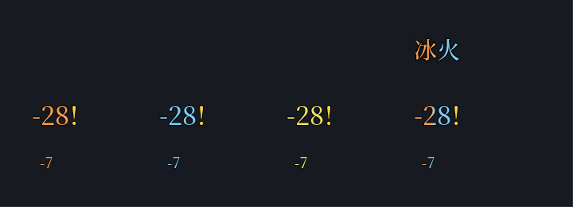

# 340 战斗伤害跳字落地（按报告 339）

> 日期：2026-11-20。作者 2026-11-20 13:44「生成方案然后交给执行线程」，方案见 [339](339-damage-popups-speed-colors-gradient.md)。
> 339 第五节三点作者还没回，按推荐默认做（见「关键决策」），改了再跟。

## 目标

339 的五件事：跳字时长与暂停跟随回放；冰、雷有自己的颜色；暴击保留类型色；反应名与反应伤害数字两色渐变；伤害数字细描边。

## 产出

| 文件 | 改了什么 |
|---|---|
| `ui/battle/combatant_panel.gd` | `popup` 多两个参数：时长系数、反应两色；暴击用类型色、描边两倍、出现时放大到 1.3 倍再弹回（0.12 秒，跟倍速）；所有飘字的补间记在面板上，`pause_popups` 一起停 / 接着飘；字号、颜色、描边改用 `LabelSettings` |
| `ui/battle/popup_gradient.gdshader` | 新：反应飘字的两色渐变，过渡集中在中间三分之一 |
| `ui/battle/battle_view.gd` | `_popup_scale`（1 / 倍速，每档都缩）；`_sync_popup_pause` 代替 309 的 `_pause_reaction_label`：暂停、教程 / 反应讲解压着、拖时间轴时停，播完不算停；`reaction_colors` 取反应表里两种元素的颜色；反应打的伤害（事件带 `reaction`）传两色 |
| `data/authoring/ui/text_colors.json`、`ui/ui_palette.gd` | 冰 `#7fd0ff` / `#1f5f8a`，雷 `#f2e36b` / `#6b5a10`（代码默认也补上深版） |
| `tests/ui/test_damage_popups_339.gd` | 新：时长、停住、暴击颜色与放大、描边、冰雷分色、渐变挂与不挂 |
| `tests/ui/test_reactions_ui_175.gd` | 描边断言改看 `label_settings` |

时长：伤害数 1 / 2 / 4 倍速 0.9 / 0.45 / 0.3 秒（下限 0.3）；反应名 1.2 / 0.6 / 0.5 秒（下限 0.5）。抖动、格子弹一下不动（仍只在 4 倍速缩短）。中途切倍速：已经飘出来的按原速飘完。

## 关键决策

- 339 第五节按默认：冰、雷用初值；治疗绿与毒绿不动；暴击不用金色（`UiPalette.CRIT` 保留，金牌闪等别处还在用）。UI设计 的色样张已出，作者挑定后只改 `text_colors.json`。
- 渐变的做法：字改成白色，着色器按横向位置乘上两色之间的颜色；描边是黑的，乘了还是黑。只有一种色（或反应表里查不到）就不挂，退回第一种元素色。
- `add_theme_` 覆盖：飘字两处共 6 个改成 `LabelSettings`，总数下降，没有涨。
- 明暗：飘字画在对阵面板 / 铜面板（压在斗技场图上），一律取深底版颜色加黑描边，和原来一样。UI设计 提醒浅底上黑描边会糊，但战斗里没有浅底的飘字，这次不加浅描边。
- 冰、雷颜色在说明文字里不受影响：说明文字的元素色走另一套（`frost` / `thunder` 样式码），这次只改了伤害跳字用的那一套。

## 验证

- `bash tools/test.sh 339`：通过 49 项断言。
- `bash tools/warnings.sh`：共 0 条。
- 全量测试 `bash tools/test.sh`：通过 41858 项断言，345 个套件，EXIT=0。

## 遗留

- 作者挑定冰、雷（以及要不要拉开治疗与毒、暴击要不要金描边）后改色值。
- 无头跑不出着色器效果，渐变要在游戏里看一眼（三种文字大小、中英文）。

## 下一步

游戏测试线程按 339 第四节验收走一遍。

## 补记（2026-11-20，v6.64）：作者在 339 样张上选了 1B 和 2C

- **治疗改青绿（1B）**：`text_colors.json` 的 `styles.heal` 深版 `#4fd8b0`、浅版 `#17695a`；`UiPalette.HEAL` 跟着改。毒色不动。
  原来拿 `UiPalette.HEAL` 当「好 / 成了」用的地方（科技已满、撤离记录、成就已办成、地图上的可去节点、编辑器里的正数等）改用新常量 `UiPalette.GOOD`（原来的 `#5cb85c`），`styles.good` 也指它，这些地方颜色不变。
- **暴击「!」染金（2C）**：数字仍是类型色（反应打的仍是渐变），末尾的「!」拆成数字那条字的一个子节点，染 `UiPalette.CRIT`；跟着飘、淡出、放大，不吃渐变。跳字只画在深底上，浅版金（`#725600`）这次用不上。
- 截图（深底面板上，火、冰、雷暴击，最右是火冰反应打的暴击，下面一行是普通伤害）：

截图脚本：[340-shots/crit_shot.gd](340-shots/crit_shot.gd)（`xvfb-run godot --path . --rendering-driver opengl3 --script res://docs/reports/340-shots/crit_shot.gd`，`SHOT_OUT` 指定输出）。
