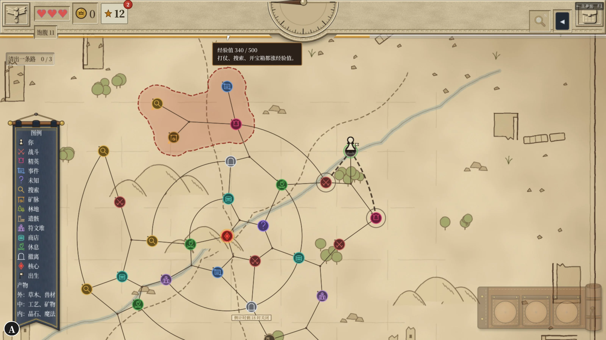
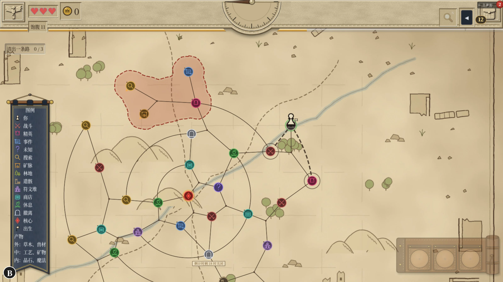
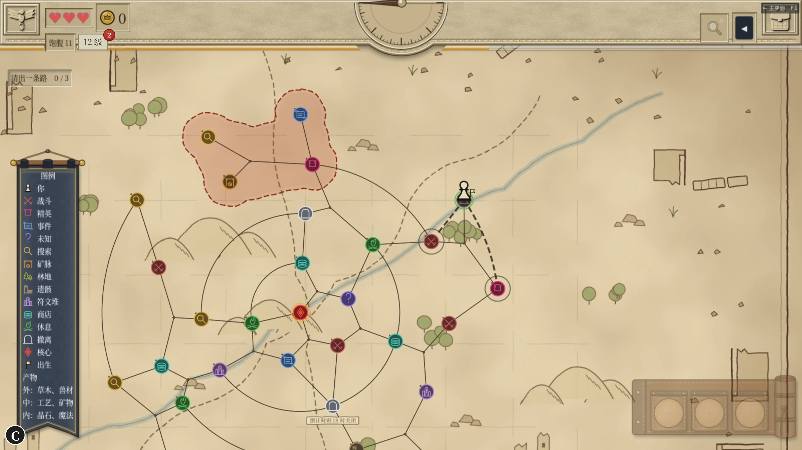
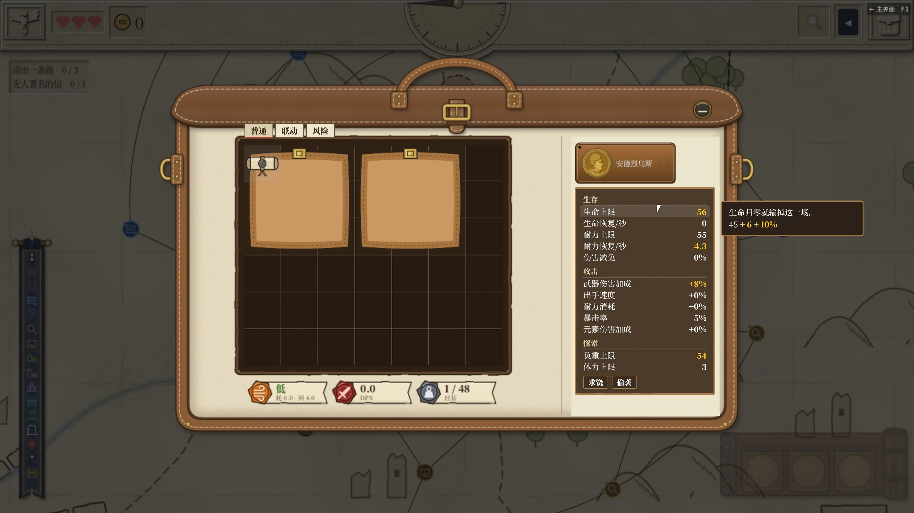

# 381 经验值条布局与状态界面全属性栏（UI设计，2026-11-22）

这份方案回应作者 2026-11-22 21:17 对报告 372 样张的第 9、11 条意见。第 10 条（升级选牌用 A 羊皮纸）已经定了，不在这里讨论。
样张是画在现有游戏截图上的示意图，用来定布局，不是最终美术。

## 一、经验值条（第 9 条）

作者原话：经验值条宽度为整个屏幕，紧贴顶端栏，做出半透明的玻璃材质就行，不需要两侧的装饰性UI，表示当前等级的区域需要放在其他地方。

### 1. 顶端栏下沿审核

顶端栏下沿在 y≈91（1600×900 画面）。现在有三样东西挂在下沿下面，经验值条会经过它们：

| 位置 | 东西 | 处理 |
|---|---|---|
| 左，x 88–154 | 「饱腹」小牌 | 小牌压在条上面，条从它底下穿过 |
| 中，x 705–895 | 日晷下半圆（到 y≈108） | 日晷压在条上面 |
| 左，y 138 起 | 任务追踪牌 | 不碰（条只占 y 91–101） |

其余位置（图例、腰带、右上键）都离得够远。

### 2. 条本身

- 全屏宽，高 10，贴着顶端栏下沿（y 91–101）。
- 材质是半透明玻璃：白色 25–35% 透明底，顶上一道亮线，下沿一道淡墨线。不画铜帽，也不画两头的装饰。
- 灌入琥珀色液体，和升级选牌的羊皮纸同一个暖色调。按这一级的进度从左到右填满。
- 条上不写字（高 10 写不下，奥卡姆剃刀）。停上去弹悬浮窗：第一行「经验值 a / b」，第二行写经验值从哪里来。
- 有待选的牌时，液体整条慢慢发亮呼吸，提示可以去选牌。

### 3. 等级放在哪里（三选一）

| | 位置 | 样张 |
|---|---|---|
| **A（推荐）** | 顶端栏左边一组，排在红心和金币后面，和金币框同样大小的一格：星形加等级数字。有待选牌时右上角挂红点写张数，点这一格就打开选牌。 |  |
| B | 右上「状态界面」键上挂一个等级徽标，待选牌的红点也挂在这个键上。 |  |
| C | 在「饱腹」小牌旁边再挂一块同款小牌，写「12 级」。 |  |

推荐 A 的理由：红心、金币、等级都是「我现在怎么样」，读的时候眼睛不用跳。点等级去选牌，入口和信息在同一处。B 把两件事挤在一个键上，C 让左上角挂的小牌越来越多。

## 二、状态界面角色卡（第 11 条）

### 1. 卡底的【普通】【联动】【风险】是什么

这三个是**背包棋盘的查看方式**，和角色卡本身无关（局内界面布局方案 §6）：

- **普通**：平常的样子。
- **联动**：只亮出彼此之间真的连上了增益、受益、装载格的道具，没连上的压灰。
- **风险**：只亮出有风险的道具，比如侵蚀了的写「侵蚀 n/满」，不参战的写「不参战」，其余压灰。

它们管的是左边的棋盘，却放在右栏角色卡下面，所以看起来像角色卡的页签。**建议挪到棋盘框的左上角**，做成三个贴着棋盘的小页签（见下图）。右栏就空出来给全属性栏用。

### 2. 颜色

- 基础值用**纯白** `#FFFFFF`。
- 这一局加成过的数用**饱和的金黄** `#FFC928`（原来的黄偏淡，和白色差得不够）。
- 两种颜色都在深底上，对比度都过 4.5。

### 3. 全属性栏

- 名牌缩小到原来的 72%，下面一张深底卡列出全部属性，按三组排，每组一个小组名：
  - **生存**：生命上限、生命恢复/秒、耐力上限、耐力恢复/秒、伤害减免……
  - **攻击**：武器伤害加成、出手速度、耐力消耗、暴击率、元素伤害加成……
  - **探索**：负重上限、体力上限……
- 实际列哪些属性，以代码里玩家真有的属性为准，由执行线程列全。没有加成的属性也照样列出来（白字），这样拿到牌时，玩家能看到是哪一行变了色。
- 牌的加成直接算进这些数里，不再单独列「这一局的牌」。
- 角色的两条被动（如求饶、偷袭）缩成卡底的两个小签，停上去看说明。
- 每行高 20，三组十二三行加组名，正好放进右栏，不用滚动。属性再多时，先把卡加宽，或者分两列。

### 4. 悬浮窗

停在某一行上，这一行微微提亮，旁边弹出悬浮窗：

- 第一行：属性的说明，例如「生命归零就输掉这一场。」
- 第二行：基础值 N（白字），后面接加成 M、Q（黄字），写成 `45 + 6 + 10%`。

没有加成的属性只写第一行和基础值。

### 5. 质变牌

作者 21:18 补充：质变牌要单独列出，但放在信仰界面还是角色属性里，等架构设计出方案再定。这份方案**不给质变牌安排位置**，定下来以后再补。

## 三、要作者定的

1. 等级放在哪里：A 顶端栏左组一格（推荐）/ B 挂在状态界面键上 / C 饱腹旁边再挂一块小牌。
2. 【普通】【联动】【风险】挪到棋盘框左上角：同意 / 不同意。
3. 全属性栏照上面的分组和悬浮窗格式做：同意 / 要改（请说改哪里）。
