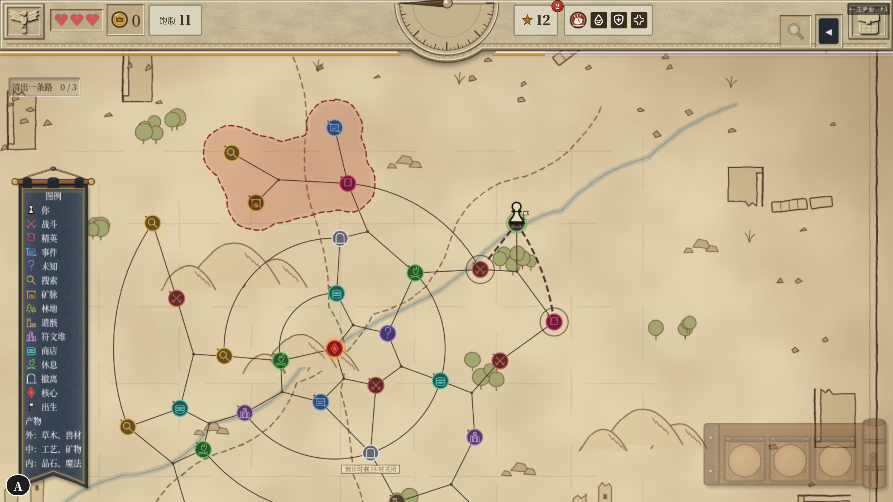
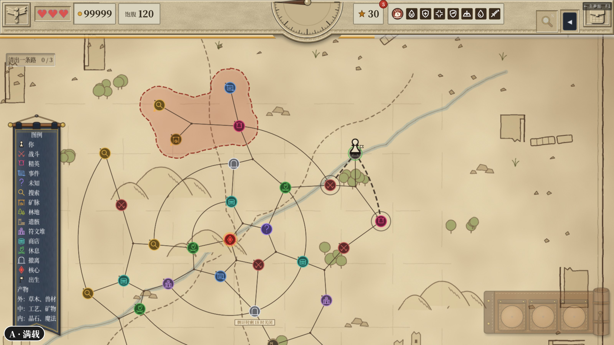
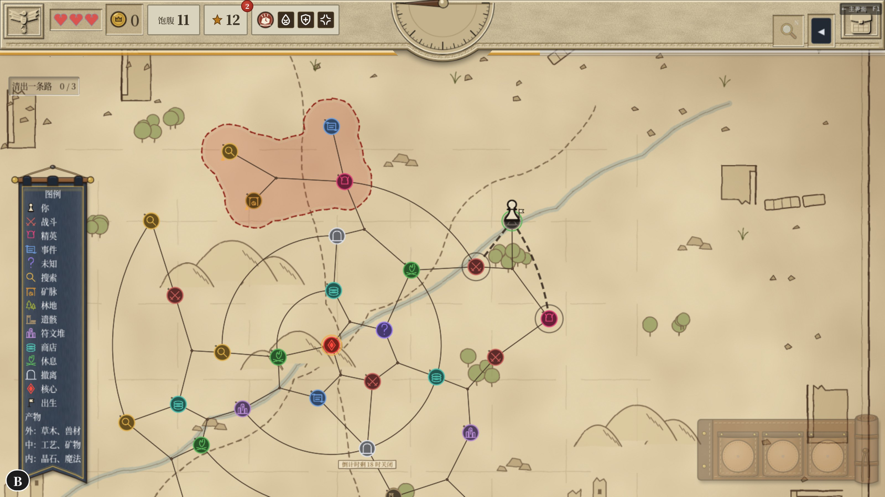
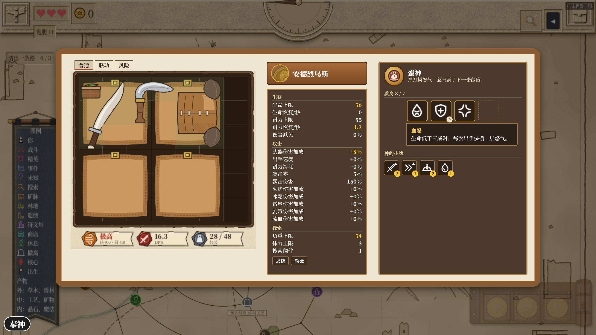
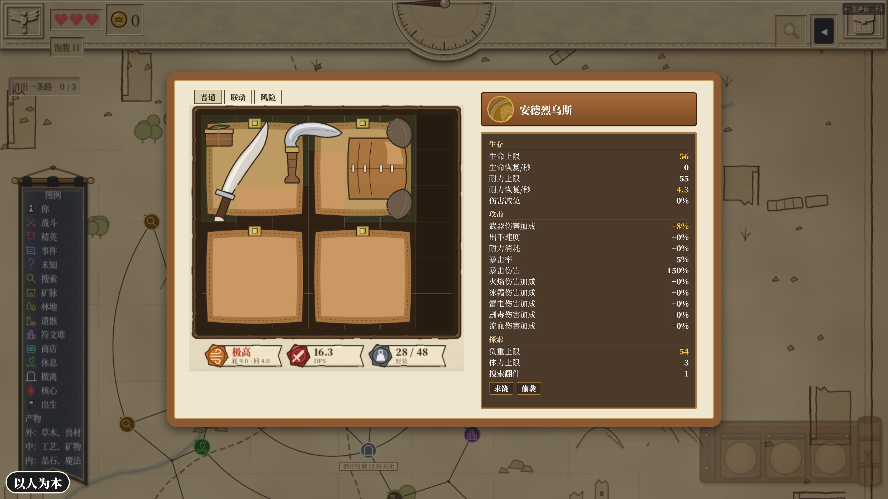

# 382 局内整体布局：等级、神恩区、顶端栏神恩小图标（UI设计，2026-11-22）

作者 2026-11-22 21:27：「1~3 确认要添加一个神恩区，并有推荐的效果。4 和前面三条一样，需要重新梳理一遍UI布局，保证信息完整不杂乱，内容多时也不会导致组件越界，设计一套方案再敲定。」

这份方案把报告 381 第 4 条（等级放在哪）和报告 380 定下的神恩区、顶端栏神恩小图标放在一起，重新排一遍局内的顶端栏和状态界面。381 第 5、6 条（查看方式页签挪到棋盘框上、全属性栏）已经按推荐交给执行，这里只把它们画进整体布局，不再重新讨论。
图都是画在 v7.80 截图上的示意，用来定布局，不是最终美术。

## 一、现状审核（v7.80，1600×900）

| 区域 | 现在有什么 | 问题 |
|---|---|---|
| 顶端栏左组 | 菜单、生命、金币、信仰徽记（不奉神时是空槽） | 正常 |
| 顶端栏中间 | 日晷（倒计时），下半圆垂到 y≈108 | 正常 |
| 顶端栏右组 | 放大镜、收起键、状态界面键 | 日晷到放大镜之间（x 900–1395）是空的 |
| 顶端栏下面 | 「饱腹」小牌挂在左组下面；经验值管占位是一行裸字「Lv.1 经验值 0/9」，压在地图节点上 | 饱腹挂在栏外，和栏里的格子不是一套；占位违反「无裸文字」，还挡住节点 |
| 状态界面 | 左边背包棋盘，右栏名牌、三行属性、两条被动、查看方式三个键 | 属性太少；查看方式管的是棋盘却放在右栏（381 已改） |

要新加的东西：经验值条（全屏宽）、等级、待选牌提示、神恩小图标（最多 7 个）、状态界面的神恩区。

## 二、整体分区原则

1. **顶端栏左右两组分工。** 左组放「我还剩多少」：生命、金币、饱腹。右组放「我成长到哪了」：等级、信仰徽记、神恩小图标。日晷在中间，管时间。
2. **栏外只挂经验值条。** 饱腹收进左组，变成栏里的一格。顶端栏下沿只剩一根贴着它的经验值条，不再挂别的小牌。
3. **状态界面三栏：棋盘、属性、神恩。** 不奉神（以人为本）时神恩栏整块不出现，窗口收窄成两栏。
4. **每块区域的大小固定，内容多了在区域里面处理（滚动、截断、换行），区域本身不长大、不越界。**

## 三、顶端栏

### 推荐 A：成长一组放在日晷右边

- 左组：菜单 | 生命 | 金币 | 饱腹（新，从栏外收进来）。
- 右组，紧挨日晷：等级格（星形 + 等级数字）| 信仰格（徽记 + 拿到的神恩小图标）。
- 有待选的牌时，等级格右上角挂红点写张数。点等级格打开选牌。
- 神恩小图标只画拿到的，按拿到的先后排，不画空槽（空槽只在状态界面里画）。悬停看效果，带次数的写剩几次。
- 不奉神时信仰格保持现在的空槽，等级格照常。

**满载检查**：等级 30、待选 5 张、金币 99999、饱腹 120、神恩 7 个全满时，右组最右到 x≈1312，离放大镜（x 1397）还有 85。左组到 x≈418，离日晷（x 705）很远。

### B：全部挤在左边（不推荐）

只拿到 3 张时看着还行，但 7 张全满时左组会伸到 x≈750，压进日晷。所以 B 不满足「内容多时不越界」，列出来只是为了对比。

### 经验值条（按 381 定稿）

全屏宽、高 10、半透明玻璃，贴着顶端栏下沿。日晷压在它上面。条上不写字，悬停看「经验值 a / b」和经验值来源。有待选牌时整条慢慢发亮。现在那行「Lv.1 经验值 0/9」占位裸字删掉。

## 四、状态界面

### 奉神时：三栏

窗口从现在的 1000 宽加到 1300 宽（x 150–1450），高不变。

| 栏 | 宽 | 内容 |
|---|---|---|
| 棋盘 | 496 | 左上角是查看方式三个小页签，下面是棋盘，最下面是三枚属性签 |
| 属性 | 270 | 名牌，下面是全属性卡（生存、攻击、探索三组），卡底是被动小签 |
| 神恩 | 400 | 见下 |

**神恩栏**从上往下：

1. **神像行**：圆形徽记、神名，旁边一句核心机制。
2. **质变**：小标题写「质变 3 / 7」。下面 7 个槽排成 4 + 3，每个 56。拿到的按先后填进去，空槽只画虚线框。带次数的在角上写剩几次。悬停看效果（图里演示了悬停「血怒」）。
3. **神的小牌**：每级三选一里神的那一张。图标 40，角上的金色数字是层数，同一张只占一格。悬停看效果和这一层的实际数值。

### 不奉神时：两栏

神恩栏整块不出现，窗口收回 1000 宽，属性栏跟着加宽到 390。

## 五、内容多时怎么不越界

| 地方 | 最多会有多少 | 处理 |
|---|---|---|
| 顶端栏神恩小图标 | 7 个（质变牌上限） | 固定 30 一格，最宽的情况已经核过（见第三节） |
| 等级、待选红点 | 等级 2 位，红点最多 2 位 | 等级格定宽，按 2 位数排；红点超过 9 写「9+」 |
| 金币、饱腹 | 5 位、3 位 | 两格按 5 位、3 位定宽 |
| 属性卡 | 20 来行，以后还会加 | 卡的高度固定，超出就在卡里面滚动，右边出一根细滚动条；组名跟着滚动 |
| 属性名 | 英文、大字号时会变长 | 名字超出一行就截断加省略号，全名写在悬浮窗第一行；数值右对齐，定宽 64 |
| 被动小签 | 角色 2 条，以后可能更多 | 换行排；超过两行就并进属性卡一起滚动 |
| 神像行的一句话 | 中文一行、英文两行 | 最多两行，超出截断，全文看悬浮窗 |
| 质变槽 | 7 | 固定 7 槽，不会多 |
| 神的小牌 | 每位神 6 张，加上带次数能力的「再加 1 次」 | 每行 8 格换行，两行之后在区域里滚动 |
| 大字号设置 | 全部文字放大 | 区域尺寸不变，文字多出来的部分按上面几条处理；图标尺寸不随字号变 |

## 六、请作者定

1. 顶端栏用 **A**（左组生命、金币、饱腹；成长一组放在日晷右边：等级 + 待选红点、徽记 + 神恩小图标）（推荐），还是 B。
2. 「饱腹」从栏外的小牌收进左组，变成栏里的一格：同意 / 不同意（推荐同意）。
3. 状态界面奉神时三栏（窗口加宽到 1300），不奉神时两栏：同意 / 要改（推荐同意）。
4. 第五节「内容多时」的处理办法：照做 / 要改（推荐照做）。
