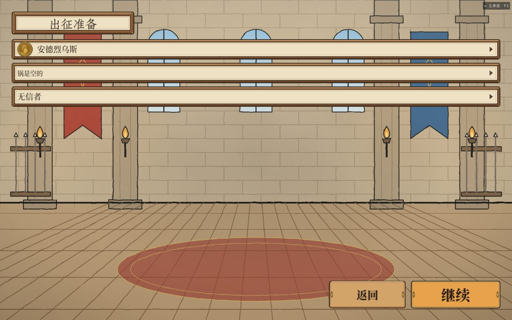
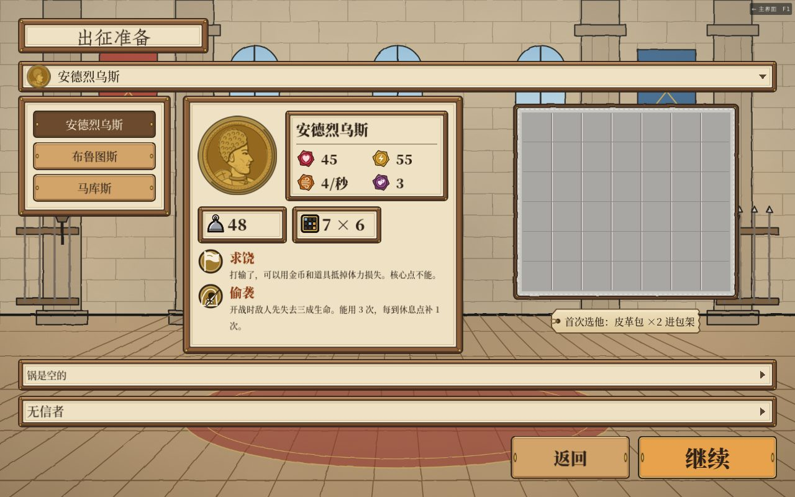
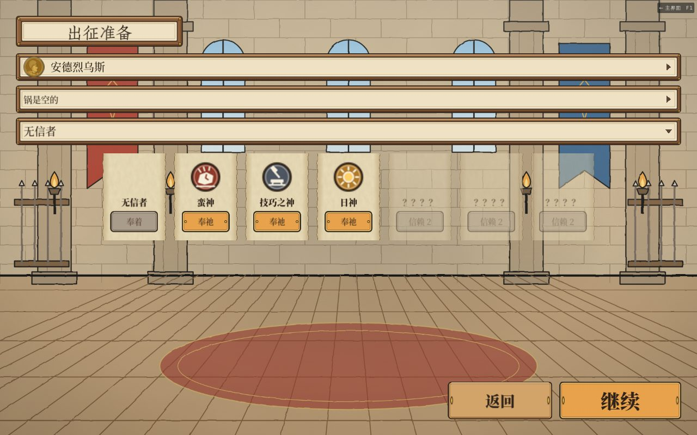
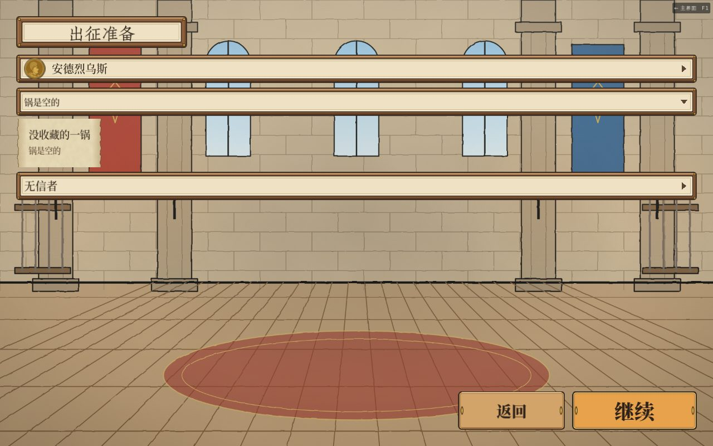
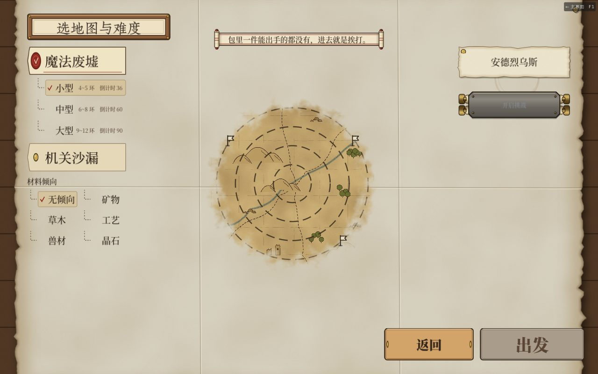
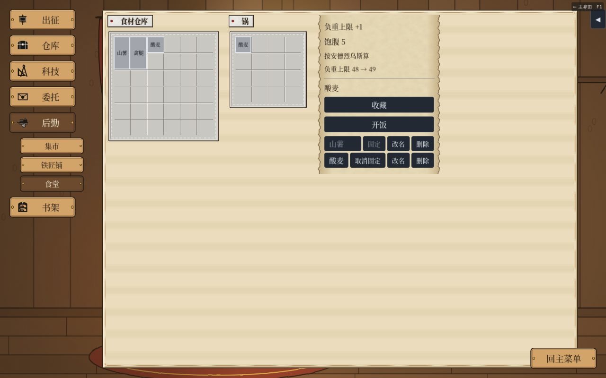

# 383 出征流程整合 · 落地记录

> 规格：[383-departure-flow-consolidation.md](383-departure-flow-consolidation.md) 第三、四节（作者 2026-11-22 23:49 定稿）。分两批落地。

## 第一批：三屏、折叠横条、删军需牌（v8.04）

### 目标

出征固定三屏，顺序照旧：一 出征准备（角色、食物、信仰三条折叠横条），二 配道具，三 地图、难度、材料倾向。原第四页「本次准备」与万神院出征时跳出的选神弹窗取消。基地出征页的军需牌删掉。

### 产出

| 文件 | 改了什么 |
|---|---|
| `ui/widgets/fold_bar.gd`（新） | 折叠横条：木牌头（折叠时的大致信息 + 右端画出来的小三角），点一下展开 / 收起下面的内容 |
| `ui/game/setup_screen.gd` | 第一页改成三条横条（角色总有，食堂开了有食物，万神院到了有信仰），进来都折叠，同一时间只展开一条；角色那条展开就是原来的三栏；第四页删掉，这一锅挪进食物横条、材料倾向挪到第三页地图列表下面（两列小签）；记住并沿用上回的角色和材料倾向（新旗标 `last_bias`）；角色卡的数字并进局外加成；配道具页棋盘下面多一行随身技能圆槽 |
| `ui/widgets/belt_grant_slot.gd`（新） | 随身技能圆槽（原 `ExpeditionBoard.BeltSlot`，挪出来给配道具页用） |
| `ui/widgets/expedition_board.gd` | 删军需牌和 `god_pick_asked`；【开始探索】直接进开局屏 |
| `ui/widgets/stat_seal_plate.gd` | 每格可带第二行悬停：「基础 N · 局外加成 +M」 |
| `ui/game/pantheon_panel.gd` | PICK 模式现在是信仰横条展开后的内容；奉着的那座写「奉着」、换底 |
| `ui/game/meta_screen.gd` | 删 `show_god_pick` 选神弹窗和它的翻书、教练层（挪进开局屏）|
| `ui/game/setup_screen.gd`（选神） | 万神院刚到后的第一次出征，信仰横条自己展开一次；第一次展开先翻百科「万神院与选神」，合上再放教练层 `god_pick`（三个目标 shrines / none / choose 指横条里的神龛）；翻书、讲解时 Esc 先合书、回车不翻页 |
| `tools/help_shots.gd`、`assets/help/shots/*/pantheon_pick.png` | 截图改截展开的信仰横条，中英重出 |
| `data/authoring/help_pages/pantheon_choose.json` | 帮助页第一句改成「出征第一屏多一条信仰横条……不改就沿用上一局」（中英） |
| `core/text/ui_text.gd` | 第一页标题「出征准备」；删「本次准备」「军需」；加「奉着」和来源那一行 |
| `tests/run_tests.gd` | frame_ 用例改成一帧跑一个套件。原来全部塞在一帧里，各屏建控件排进消息队列的延迟调用要到这一帧结束才清；main 已经贴着上限（退出时泄漏 187 万个对象），这批多出的开局屏节点把消息队列（默认 32 MB）撑爆，断言全过但进程退出时崩（退出码 134）。分帧以后每帧末清一次 |
| `tests/ui/test_feedback_1012.gd`、`tests/ui/test_text_and_tooltips.gd` | 分帧以后上一个套件的游戏真被释放了，道具窗的「认不认这个配方」探针变成空（= 全认），纱布的窗多出配方词、被「配方词留住」不收。两个用例自己固定探针为「一个都不认」，用完放回 |
| 测试 | 新套件 `tests/ui/test_departure_383.gd`；改 `test_base_five_264`、`test_cartographers_342b3`、`test_canteen_355`、`test_pantheon_377`、`test_setup_179`、`test_setup_pages_161` |

### 关键决策

- **同一时间只展开一条**（报告里标的初值）。角色那条展开以后三栏的高度按「设计高减页边、标题、右下按钮、各条木牌头」收：角色卡定高跟着收、字照 258 的办法一号一号缩；棋盘预览只缩格子（最小 36），不缩字。三条都在、展开角色那条时也放得下（测试量了）。
- **局外加成并进数字**：生命、耐力、耐力回复、体力上限、负重上限按科技的局外 buff 算好再显示（算式同 `RunState.effective_baseline`），悬停第二行写来源。不改数字的科技（行囊、不屈、侦察、议价这类）出征页上不再单独列；它们照常生效，科技页上能看到。
- **信仰横条**直接用 `Pantheon.choice`：默认就是上回奉的神；上回的神这次不可选时折叠头上写【无信者】。
- **材料倾向**挪到第三页地图列表下面，换成两列小签（同规模那一档的皮），六个方向三行，不顶出纸。

### 验证

- 新套件 `tests/ui/test_departure_383.gd`：三屏、横条默认折叠、头上写的东西、展开 / 收起、同一时间只展开一条、三条都在时展开哪一条都放得下、信仰横条选神出发、沿用上回的角色与神、角色卡数字带局外加成和来源、配道具页的随身技能圆槽。
- 全套：`bash tools/test.sh` 通过 45265 项断言、357 个套件，退出码 0（合并 main v8.03 后重跑）
- 截图（1600 × 1000 设计尺寸，xvfb 渲染）：

| 三条都折叠 | 展开角色 | 展开信仰 | 展开食物 | 第三屏材料倾向 |
|---|---|---|---|---|
|  |  |  |  |  |

### 遗留

- 第一屏是占位排版，样张请 UI设计 出（「只有角色一条」「三条都折叠」「展开其中一条」）。
- 第二批：食堂「固定配方」和【开饭】。
- 折叠头上只有字和头像 / 徽记，食物那条没有图标，等样张一起定。

## 第二批：食堂「固定配方」与【开饭】（v8.07）

### 目标

作者定：食物横条默认是空的，除非设了固定配方；在食堂吃过了，出征这里就不能再改。报告里标「初值」的两处照做：固定配方是收藏里的一个标记（同一时间一份），【开饭】是食堂页的一颗键。

### 产出

| 文件 | 改了什么 |
|---|---|
| `core/meta/canteen.gd` | 新字段 `fixed`（收藏里第几份，-1 = 没设）、`eaten`（按过【开饭】）；`set_fixed`、`eat`、`prepare`（进出征第一屏时配锅：吃过不动 / 有固定配方照它重做 / 没有就把锅倒回食材仓库）、`empty_pot`；删收藏时固定的那份跟着挪；存档带这两项 |
| `core/run/game_flow.gd` | `canteen_set_fixed`、`canteen_eat`、`canteen_prepare`；吃过了 `canteen_load_menu` 不认；出发吃掉这一锅时清掉吃过的标记 |
| `ui/game/setup_screen.gd` | 进开局屏先 `canteen_prepare`；食物横条吃过了写「已吃过」，展开只能看（一句「在食堂吃过了，这一锅不能再换」，没有收藏键）；固定的那份收藏悬停里写「固定配方」 |
| `ui/game/canteen_panel.gd` | 每份收藏多一颗【固定】/【取消固定】；纸条上多一颗【开饭】，吃过以后变「已吃过」、灰掉，锅退出拖拽层（拿不出、放不进），收藏的重做键也灰掉 |
| `core/text/ui_text.gd` | 固定、取消固定、开饭、已吃过和两句悬停 |
| 测试 | `tests/ui/test_departure_383.gd` 加两个用例；`test_canteen_355` 的开局屏用例先设固定配方 |

### 关键决策

- **存档迁移**：不升版本。旧档读回来没有 `fixed`、`eaten` 就是没设固定、没吃过；`eaten` 只在锅里有东西时才认。
- **没设固定配方时进开局屏会把锅倒回食材仓库**（作者「没设就为空」）。在食堂摆好了一锅又不想设固定的，按【开饭】就能带走这一锅；也可以在食物横条里点一份收藏。食材仍是出征成功那一刻才消耗，取消出征不扣。
- 吃过以后锅拖不动，免得吃下的和锅里的对不上。

### 验证

- 新用例：固定配方同一时间一份、删收藏跟着挪、锅空不能开饭、存档带两项且旧档算没设没吃；没设固定进来空锅；设了照它配；食堂页【固定】【开饭】、吃过锅拖不动；吃过后横条带「已吃过」只能看、换不了；出发吃的就是这一锅，锅空、标记清掉。
- 全套：45299 项断言，只有一项没过：新截图旁缺 `.import`（素材导入检查）；补导后该套件 24 项全过。v8.06 并入的只是地图小旗与 A12 测试，不碰这批文件。
- 食堂页：
