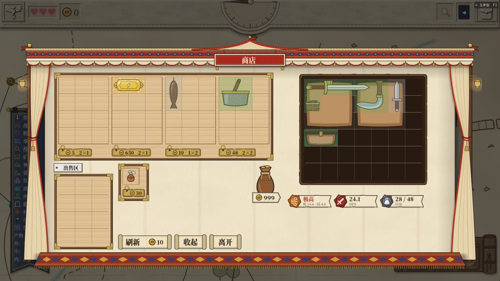
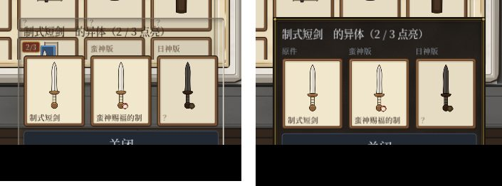

# PR #411（拖空包预览类型错、图鉴异体窗实底）复测报告 — 2026-11-04

main 19effa2

## 全量测试
`tools/test.sh` 结果：EXIT=0，通过 33740 项断言，267 个套件，用时 517 s，0 条 SCRIPT ERROR。

## 走查
脚本 drag411.gd、codex411.gd，中文、英文各三档字号，共六组，全部 0 条 SCRIPT ERROR。

### 拖空包进棋盘
- 进商店后，把货架第 1 格换成腰包（空包），用真鼠标从货架抓起，在棋盘 7×6 共 42 格上逐格移动。
- 每组的预览都一样：绿 18 格，黄（顶掉一个包）15 格，红 9 格。红格是放不下、也没有包可换的地方，这正是原来报错的那条路径。
- 在绿格松手，腰包进了棋盘，金币 999 → 994，告示「买下了「腰包」，花了 5 币」。
- 再抓起棋盘上这只空腰包扫一遍，分布同上。停在黄格右键取消后，腰包还在原处。
- **修前对照**：在修前的 main 49aa73c 上用同一脚本跑中文中号，日志里有 50 条 SCRIPT ERROR：`Invalid type in function 'set_preview' … argument 4 (Array) does not have the same element type`，出自 drag_layer.gd:510。修后为 0。
- 截图：，六组全套在共享文件夹 testing/2026-11-04-pr411/<组>/drag/。

### 图鉴异体窗
- 书架 · 图鉴里点短剑，异体窗打开，底样式是 PanelTooltip（修前是 PanelDark）。
- 窗里四边取色都是深褐色（#1d1916 – #29231e 一带），看不到底下的格子。
- 修前修后对比图：，左边是修前（中间透出下面的图鉴格），右边是修后（实底）。

## 观察（不是这次改出来的）
- 异体窗往下出屏：被点的格子在下排时，窗从 y=720 开始往下摆，高 208–223 像素（窗口 900），六组都出屏，最下面的【关闭】键只露出一半。
  - 原因：摆位时按固定的 400×200 往回收（meta_screen.gd 的 show_variants），实际窗比 200 高，英文大号还更宽。
  - 点别处也能关，不挡操作。
  - 截图：共享文件夹 testing/2026-11-04-pr411/<组>/codex/02_variants.png。
- 商店买东西的告示写「花了 5 币」，没有用金币图标。是不是要按「金币用图标」的规则改，交给作者判断。

## 结论
没有红项。拖空包不再报类型错，异体窗是实底。
