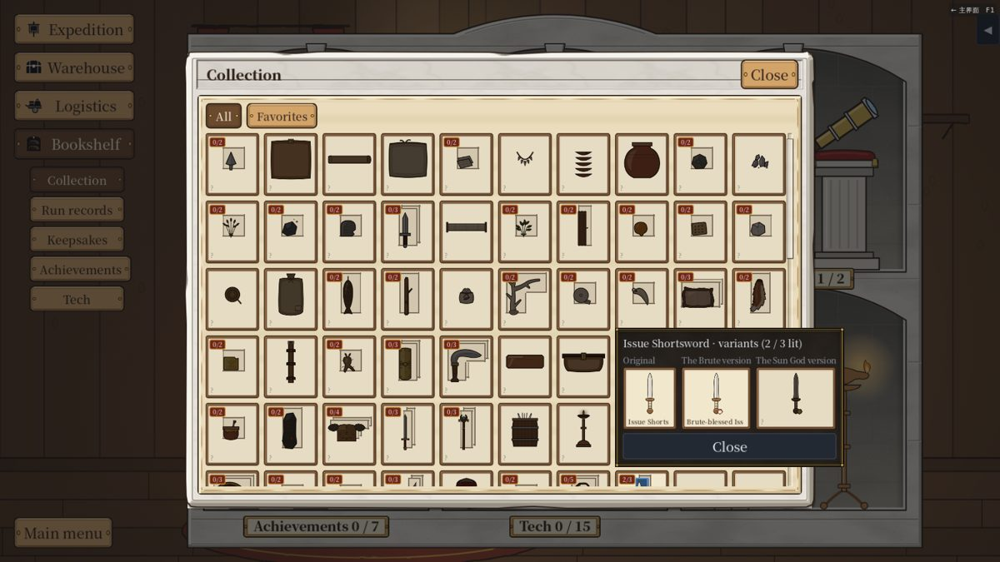
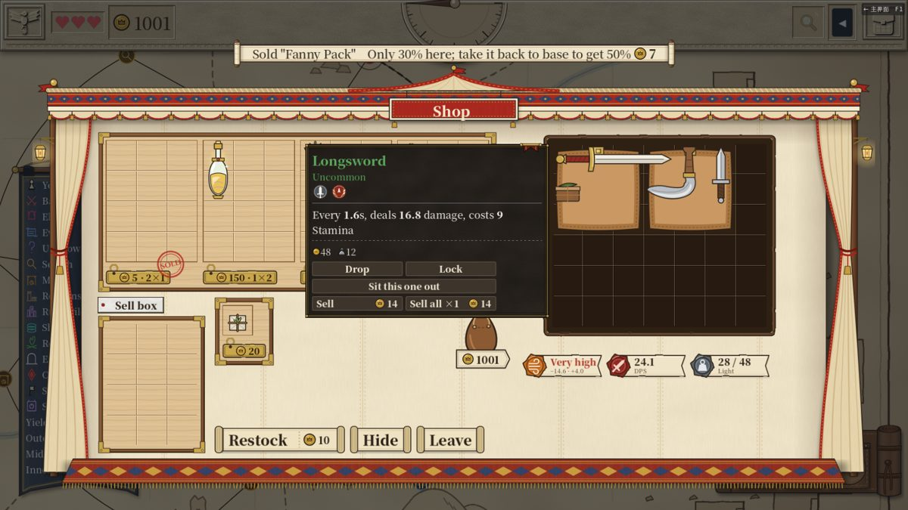

# PR #412（异体窗翻到格子上方、买卖告示用金币图标）复测报告 — 2026-11-04

main d493ec1

## 全量测试
`tools/test.sh` 结果：EXIT=0，通过 33753 项断言，267 个套件，用时 501 s，0 条 SCRIPT ERROR。

## 走查
脚本 drag411.gd（加了卖出一步）、codex411.gd，中文、英文各三档字号，共六组，全部 0 条 SCRIPT ERROR。

### 图鉴异体窗
- 点开下排的短剑格，异体窗翻到格子上方。顶边在 y=525–528，高 208–223，六组都没出屏（上回从 y=720 开始，伸出屏幕底边）。
- 【关闭】键整块露出来了。
- 底色仍是实底（PanelTooltip）。
- 截图：（英文大号；六组在共享文件夹 testing/2026-11-04-pr412/<组>/codex/）。

### 商店买卖告示
- 买：告示原文是「买下了「腰包」[coin=5]」，英文为 `Bought "Fanny Pack"[coin=5]`。画出来是金币图标加 5，不写「币」，也不写当前持有金额。
- 卖：告示原文是「卖掉了「腰包」　这里只收三成；带回基地能卖五成[coin=7]」，画出来同样是金币图标加 7。
- 截图：共享文件夹 testing/2026-11-04-pr412/<组>/drag/03_bought.png、06_sold_notice.png。
- 拖空包这一项顺带又跑了一遍，结果和 PR #411 那次一样（绿 18、黄 15、红 9，0 报错）。

## 观察
- 第一次卖东西时，金币跟在「这里只收三成；带回基地能卖五成」这句提示后面，读起来像「能卖五成 7」，和「卖掉了」隔开了。要不要把金币挪到物品名后面、提示放最后，由作者判断。
  - 截图：。（PR #417 已改）
- 异体窗里的小格名字被截断，例如英文的「Issue Shorts」「Brute-blessed Iss」。这是以前就有的，不是这次改出来的。

## 结论
没有红项。异体窗不再出屏，买卖告示用金币图标显示。
