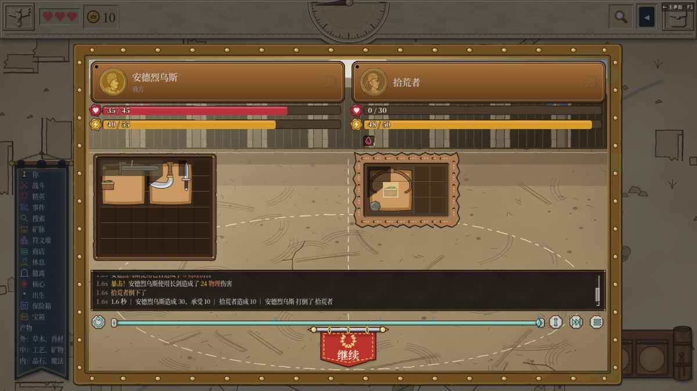
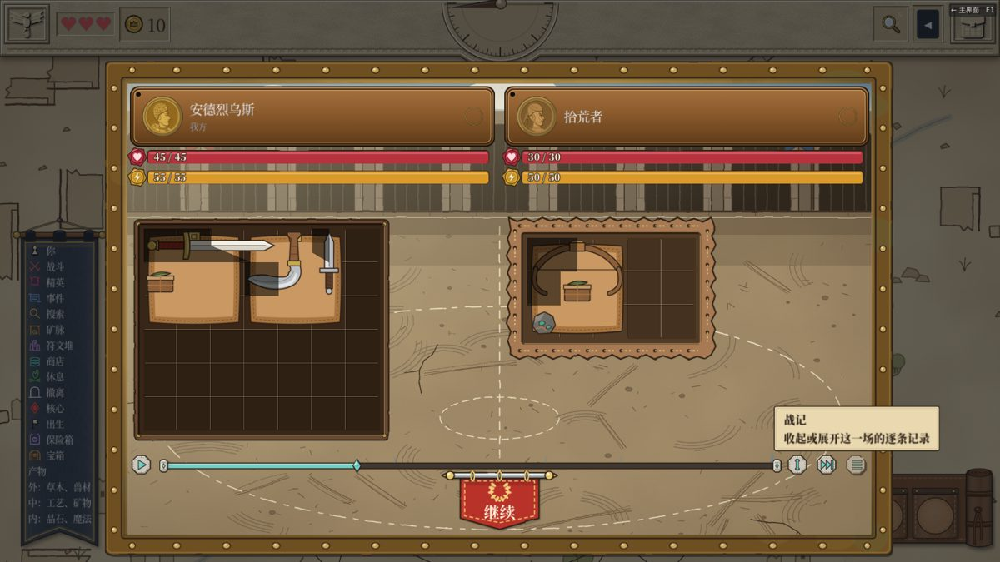
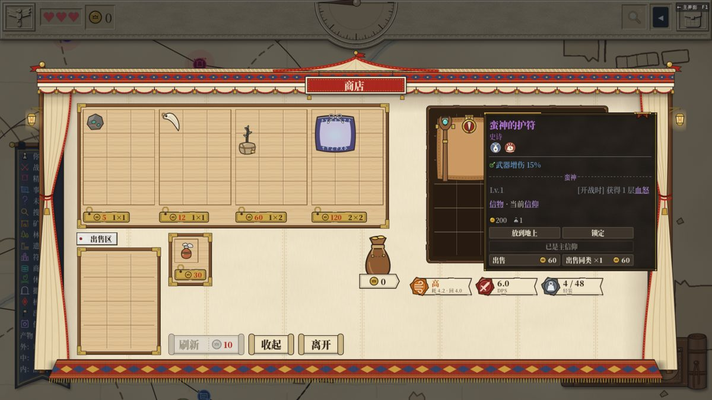
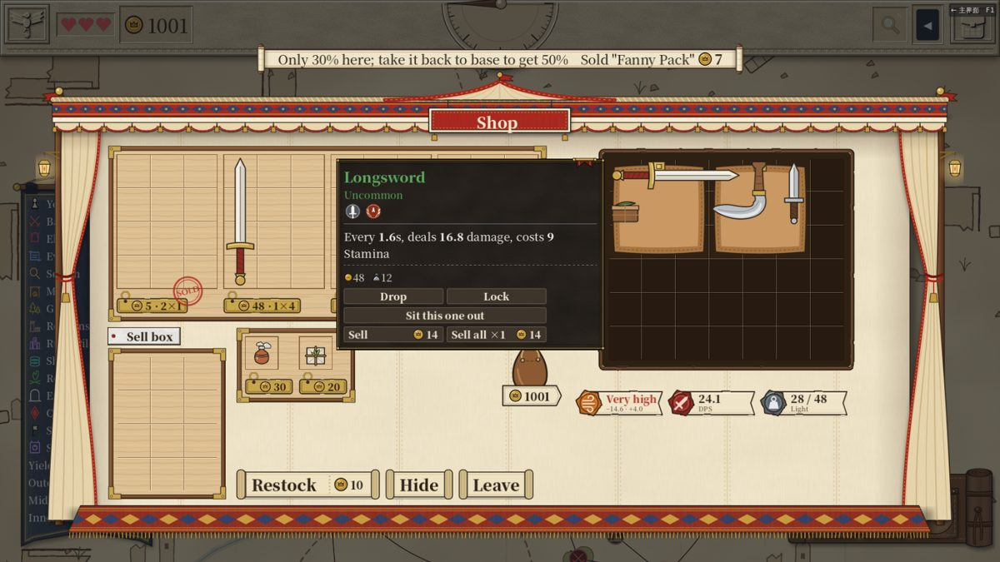
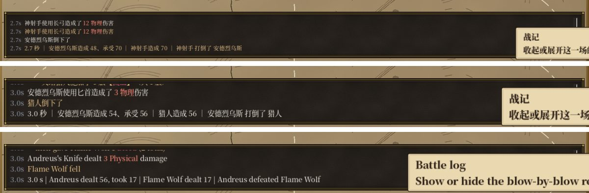

# v5.00（PR #416，272 战记）+ PR #417（耐力估算、信物脚注、首次卖出提示）复测报告 — 2026-11-04

main ffa4f2b

## 全量测试
`tools/test.sh` 结果：EXIT=0，通过 33831 项断言，268 个套件，用时 493 s，0 条 SCRIPT ERROR。

## 走查
脚本 battle500.gd、shop417.gd、drag411.gd，中文、英文各三档字号，共六组，全部 0 条 SCRIPT ERROR。六组截图在共享文件夹 testing/2026-11-04-v500/<组>/。

### 战记栏（#416）
每组都从开局打到第一场战斗。

- **位置**
  - 战记栏在棋盘下方、时间轴上方，六组都在屏内。
  - 战斗面板顶边比顶端栏下沿低 8–11 像素，没有压到顶端栏。
- **逐条贴**：边播边贴，每行开头是时刻，然后是一句话，例如「安德烈乌斯使用长剑造成了 24 物理伤害」。
  - 同一次出手的后续写成缩进行，英文例如 `then gave Flame Wolf 1 Bleed (1 total)`。
  - 末行是战报，和面板上的战报一致。
- **拖时间轴**
  - 拖到一半时，栏里重写为到那一刻为止的几行（例如中文中号 4 行）。
  - 拖回 0.5 秒时清空。
  - 跳过后全文都在，末行是战报。
- **折行**：没有一行折行。最长的一行宽 525–702，栏宽 1286。
- **收起 / 展开**
  - 点控制条最右的「战记」键，栏收起，棋盘从 ×0.667 回到 ×1，设置 battle_log_open 记成 false。
  - 再点一次展开，栏和棋盘缩放都恢复，设置记回 true。

### 法杖装晶石时的耐力估算（#417）
在商店里把棋盘上的武器清掉，只放一根魔法杖。

| 棋盘 | 耐力签 |
|---|---|
| 空 | 低，耗 0.0 · 回 4.0 |
| 只有空杖 | 高，耗 4.2 · 回 4.0 |
| 杖旁边放火晶石 | 低，耗 0.0 · 回 4.0 |
| 拿走晶石 | 高，耗 4.2 · 回 4.0 |

六组结果相同。

### 信物脚注字号（#417）
蛮神护符的悬浮窗里，「信物 · 当前信仰」这一行和上面的加成行在同一个字块里。字号跟着档位走：小号 14、中号 16、大号 18，不再单独缩成 13 号。

### 首次卖出的提示顺序（#417）
提示放在了前面，句末是物品名和金币。中文为「这里只收三成；带回基地能卖五成　卖掉了「腰包」」，后跟金币 7。英文为 `Only 30% here; take it back to base to get 50%　Sold "Fanny Pack"`，后跟同样的金币。

## 观察（供作者判断）
1. **战记栏最上面一行被切掉半截**
   - 栏高固定（窗口里约 95 像素）。中号、大号字时只放得下三行多一点，最上面那行只露出下半截。
   - 小号字放得下四整行，没这个问题。
   - 可以考虑把栏高按行高取整，或者按字号放高一点。
2. **战报行的时刻写了两遍**：末行是「3.0s　3.0 秒 ｜ …」，英文是「3.0s　3.0 s | …」。按「图能说明的不加字」的原则，可以去掉一处。

## 结论
没有红项。战记栏和 #417 的三处都正常。另有两条排版观察。
