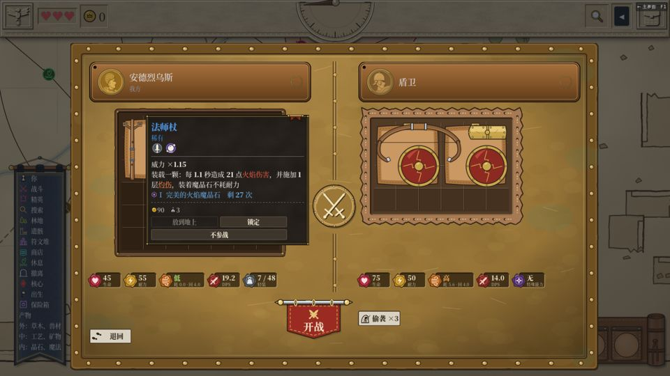
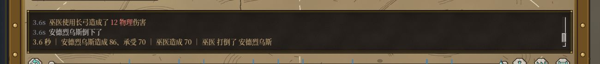
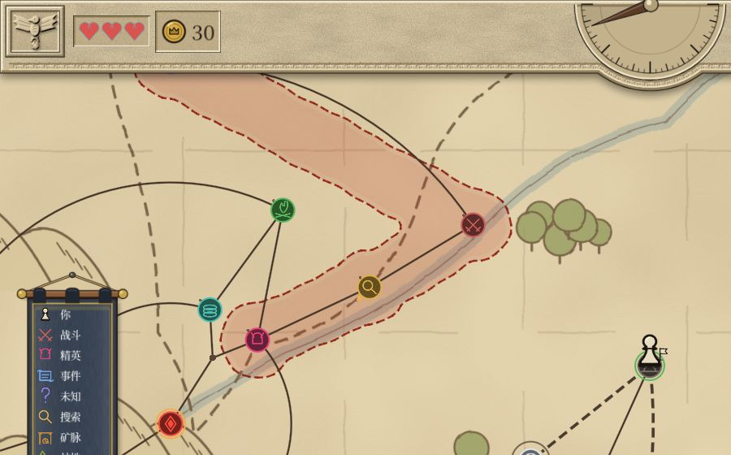
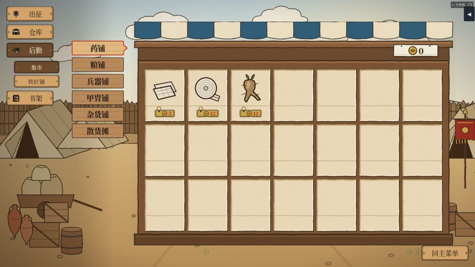

# v5.01–v5.04 复测报告 — 2026-11-04

main 700dfef。这一轮覆盖以下改动：

- v5.01 #423：法杖威力
- v5.02 #430：清空说明
- #429：277 便利性改进
- v5.03 #436：高危区、战记键、战记栏
- #438：280 返回键
- v5.04 #441：274 Ctrl 整包

## 全量测试
`tools/test.sh` 结果：EXIT=0，通过 33988 项断言，274 个套件，用时 454 s，0 条 SCRIPT ERROR。

`tools/warnings.sh` 的结果是「共 0 条」。

## 走查
用了七个脚本：items502、qol429、shop417、battle500、tip491、cursor496、battle501（魔法师杖装火晶石、大魔导杖不装），中文、英文各三档字号，共六组。全部 0 条 SCRIPT ERROR。

qol429 有三组超时（中文中号、英文小号、英文中号）。原因在测试脚本：这三组随机地图上，脚本碰到的事件第一个选项不能选（例如 `event_marked_reward`），或者卡在事件页，于是一直重试。没有报错。其余三组从开局走到结算，全程走通。

### 法杖威力和说明（v5.01、v5.02）
- **道具扫描**
  - 152 件道具，说明字段全部为空，悬浮窗里没有斜体说明行。
  - 「威力 ×N」只出现在三根杖上：法师杖、魔导杖、大魔导杖。这一行是程序生成的，不是说明文字。
- **实战**
  - 法师杖装火晶石：每下 20 点火焰伤害，等于 floor(18 × 1.15)。
  - 大魔导杖空着：每下 17 点物理伤害，等于 floor(12 × 1.45)。
  - 六组结果相同。

### 便利性改进（#429，以中文小号、中文大号、英文大号三组为准）
| 项 | 结果 |
|---|---|
| 战前按 Enter | 进入战斗 |
| 回放里按 Space | 播放 / 暂停来回切换；Enter 跳到结尾，再按一次 Enter 进入战利品 |
| 战利品按 Enter | 全部拿走；再按一次回到地图 |
| 拖着道具滚轮 | 上滚顺时针转（方向 0→1），下滚两下转到方向 3 |
| 点远处的点 | 分几步走到，例如路线 [4, 3] |
| 地上道具的按钮 | 有「全部拾取 ×N」；按下后能放进棋盘的都进了棋盘 |
| 结算页 | 连按三次 Enter 回到基地 |
| 【照上回带】 | 首次开局是灰的。注入「上回带」的记录后，按一下棋盘从 2 件变成 4 件 |
| 百科「按键一览」 | 有这一页，中文 287 字，英文 749 字 |

「照上回带」首次开局记下 0 件，原因是脚本带的是开局预设的道具，不计入记录。这是测试的做法造成的，不是问题。

### 战记栏和高危区（v5.03）
- **战记栏不再切半行**：中号、大号字下，栏里都是三整行，最上面一行不再被切掉。
- **战报行**：末行写作「2.0 秒 ｜ 安德烈乌斯造成 39、承受 30 ｜ …」，英文为 `1.6 s | Andreus dealt 28…`，开头的时刻不再重复。
- **收起 / 展开、拖时间轴、跳过**：和 v5.00 那次一样正常。
- **高危区**：地图上是一整块连着的红晕，外面围一圈虚线。点的右上角不再有小红点。

### 返回键（#438）
- 基地的「回主菜单」键在右下角。
- 开局三页的「返回」和「继续 / 出发」两个键，三页的位置完全一样：中文大号在 (1205, 869) 和 (1461, 869)，英文在 (1205, 880) 和 (1461, 880)。

### Ctrl 整包（#441）
六组结果相同：

- **Ctrl 悬停**：法杖所在的包加了描边。
- **Ctrl 按下**：拿起的是整个皮革包，法杖跟着包一起离开棋盘。
- **Ctrl 右键**：弹出包的菜单，有「放到地上 / 锁定 / 出售 / 出售同类 ×2」。
- **回购**：卖出前不显示；卖出后显示，提示写「魔法杖」；点一下买回法杖，键随即消失。
- **帮助页**：「按键一览」和「拖放与旋转」里都有关于 Ctrl 的那一句。

## 观察（供作者判断）
1. **悬浮窗的伤害和战斗里的数字差 1**：法师杖装火晶石时，悬浮窗写「每 1.1 秒造成 21 点火焰伤害」，战记里每下 20。悬浮窗的数看起来是算进暴击期望之后的值（20 × 1.05 ≈ 21）。放血刀也一样：悬浮窗写 15.8，编译出的伤害是 15。如果想让玩家对得上，可以让悬浮窗写单下伤害。
2. **按钮高度随字号变**：开局页的「返回 / 继续」，中文大号时高 95，其他组高 84。位置一致，只是高矮不同。

## 结论
没有红项。v5.01–v5.04 和 #429、#436、#438、#441 都正常。另有两条观察。
