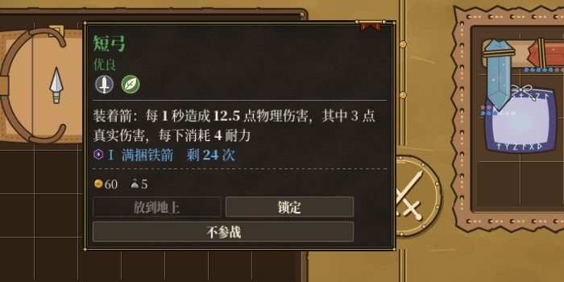
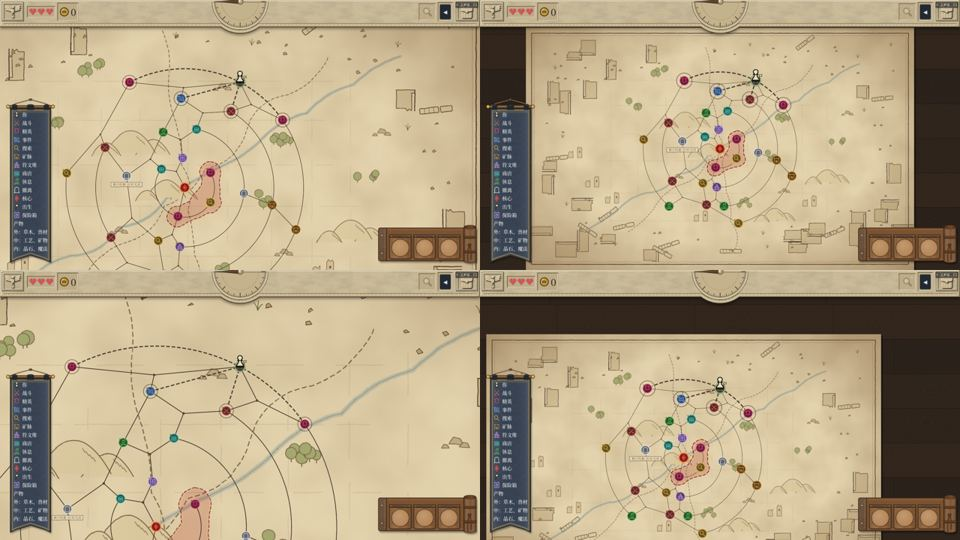
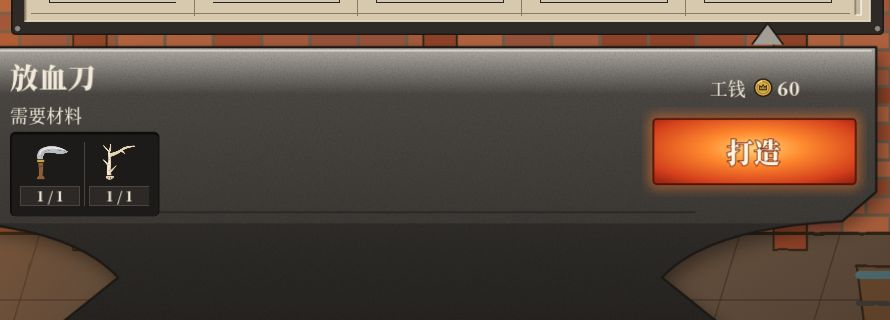
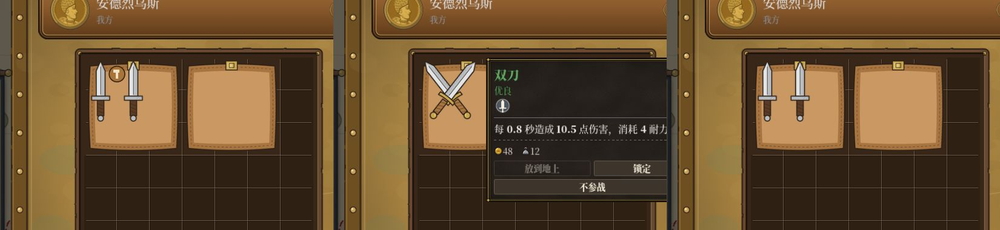
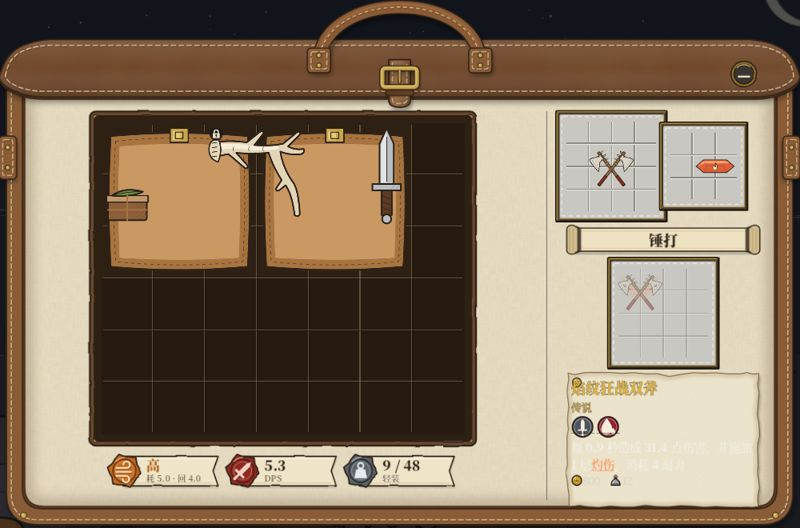
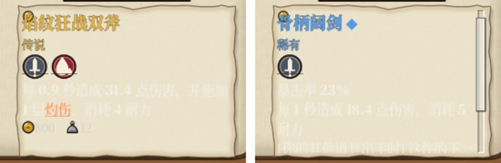
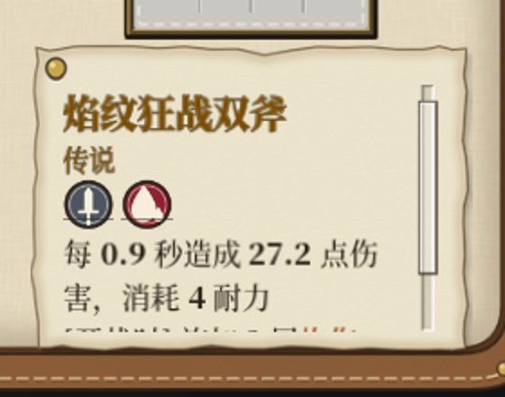
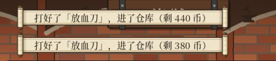

# v5.05–v5.14 复测报告（279 武器网）— 2026-11-04

这一轮从 v5.05 测到 v5.14，共五个提交点：

| 提交 | 包含 | 全量测试 | 静态警告 |
|---|---|---|---|
| 224e9d5 | v5.05 弓弩装箭、v5.06 铁匠铺材质格、v5.07 拼接、v5.08 品质 | 35562 项 / 277 套件，546 s | 0 |
| df4fd2f | v5.09 休息点的砧、v5.10 台架与集市排序 | 35613 项 / 279 套件，542 s | 0 |
| 4a53824 | v5.11 紫 / 橙武器、48 张砧配方 | 36863 项 / 279 套件，573 s | 0 |
| c024f4a | v5.12 台架定调（压伤害、品质叠层、敌人武器上限） | 36857 项 / 279 套件，572 s | 0 |
| 5d879e9 | v5.13 紫橙每把一句叠层、v5.14 砧便条等修复 | 36871 项 / 279 套件，581 s | 0 |

五次都是 EXIT=0，0 条 SCRIPT ERROR。

## 走查脚本
中文、英文各三档字号，共六组。v5.13 和 v5.14 只跑了中文中号、英文大号两组。

| 脚本 | 内容 |
|---|---|
| battle501 | 战前换上指定的武器和箭（或晶石），记悬浮窗全文，开战，记每一下伤害 |
| smith506 | 基地铁匠铺：仓库里放一件高档、一件低档、一件锁住的低档材料，点【打造】两次 |
| fuse507 | 战前把两把匕首放进包里：贴着、不贴着、贴着并切到勾选模式 |
| anvil509 | 把出生点旁的点改成休息点 →【砧】→ 鼠标把武器、锁住的材料、材料拖进槽 →【锤】→ 关窗 |
| mapzoom505 | 地图原样、按 F、滚轮放大、滚轮缩小，各截一张 |
| items502 / orange511 / quality512 / enemy512 | 无头：全道具悬浮窗、橙档名单、品质前后对照、三个敌人池按档实际组装 |

各脚本都在共享文件夹 testing/ 里，六组的截图在 testing/2026-11-04-v508 … v513/。

## 弓弩装箭（v5.05）
- 短弓装铁箭：每下 9 点物理伤害，紧跟一下 3 点真实伤害。悬浮窗写「每 1 秒造成 12.5 点物理伤害，其中 3 点真实伤害」，12.5 是算进暴击期望后的值（执行确认这是有意的）。
- 轻弩装火箭：每下 18（10 + 8），开战时先免费射一下，伤害 10。轻弩的装填格在上方。
- 短弓不装箭：每下 4。
- 打完一场，箭的耐久从 24 降到 23。
- 268 件带战斗档的道具里，有 30 件写「其中 N 点真实伤害」。33 件写「开战先出手 N 下，不耗耐力」。暴击率写成百分数，例如「暴击率 18%」。
- 地图缩放：按 F、滚轮放大、滚轮缩小时，高危区的红晕都跟着地图一起缩放，没有错位。

## 铁匠铺（v5.06、v5.11）
每次都在仓库里放一件低档材料、一件高档材料，再放一件锁住的低档材料，而且把锁住的那件排在最前面。

| 配方 | 第一次扣的 | 锁住的 | 第二次（只剩高档那件） |
|---|---|---|---|
| 放血刀（骨，绿起） | 鹿角（绿） | 留着 | 骰骨（紫），出 2 档 ◆◆ |
| 钢弩（金属，绿起） | 铜锭（绿） | 留着 | 苍白碎片（橙），出 2 档 |
| 狂战双斧（金属，蓝起，升紫） | 黄铜齿轮（蓝） | 留着 | 苍白碎片，出 2 档 |
| 焰纹狂战双斧（火焰魔晶石，紫起，升橙） | 火焰魔晶石 | 留着 | 高阶火焰魔晶石，出 1 档 |

- 配方卷的材质格画的是这次要扣的那一件。
- 品质 2 档时，伤害是 ×1.2，例如放血刀 15 → 18。v5.12 起，每下的流血仍是 1 层；「流血满 6 层时每层造成 N 点」这类写死的点数从 3 变成 5。
- 陨铁大锤开战时的减速，2 档从 3 层变成 5 层。

## 拼接（v5.07）
六组结果相同：

- **贴着**：两把匕首在包里左右贴着，接缝上出现一枚小锤。点小锤后得到双刀，双刀占着两把匕首原来的格子，仍在包里。
- **不贴着**：不出锤。
- **勾选模式**：不画锤，点接缝也不会合成。

## 休息点的砧（v5.09、v5.11、v5.14）
六组都是用鼠标真拖进槽的：

- **只放武器**：便条列出能升成的每一把，例如阔剑写「骨柄阔剑　要一件骨（优良起）」等三行；骨柄双斧升紫写「要一件金属（稀有起）」；狂战双斧升橙写「要一件火焰魔晶石（史诗起）」。
- **锁住的材料**：鹿角拖不进材料槽。
- **两件都放**：出件槽出现淡影，便条变成结果件的完整说明，带品质。兽爪配阔剑是 1 档 ◆，暴击率 23%。
- **点【锤】**：两件都被扣掉，出件进入出件槽，图鉴点亮，锤键变灰。
- **关窗**：出件回到背包。同一个休息点的【砧】键变灰。
- 阔剑的悬浮窗有「可升为：骨柄阔剑 / 铁木阔剑 / 钢阔剑」；材料没有这一行。

v5.09–v5.12 时，便条上结果件的说明是浅色字，配浅色纸看不清。v5.14 改成了深色字，图钉也不再压住名字，复测已经看得清。

## 橙档与敌人（v5.11–v5.14）
- **橙档的范围**：只能锻造的橙档有 16 件，加上它们的 42 件赐福版。这些都不在 `ids()` 里，而搜索、掉落、商店、集市和敌人的候选都从 `ids()` 取。图鉴列着 16 件原件。
- **其他数据**：其他数据文件里没有点名引用橙档的地方。
- **敌人身上**：三个池按档实际组装了 5760 个敌人，身上没有一件橙档。
- **字形**：道具名里的字全都在字体子集里。中文中号、英文大号截图里，新武器的名字都能正常显示。

**敌人武器的稀有度**：三个池、每一档、池里每个敌人各组装 40 次（这样抽是为了覆盖面，实际游戏里不是每个敌人都会出现在每一档）。

| 档 | 武器上限 | 随机抽到的武器 | 超上限的 |
|---|---|---|---|
| 0 | 白 | 都守上限 | 只有招牌和套路，例如神射手的短弓、拾荒者的剁刀套路 |
| 1 | 绿 | 都守上限 | 只有招牌和套路，例如屠夫套路里的放血刀 |
| 2 | 蓝 | 都守上限 | 只有招牌和套路，例如神射手的赐福长弓、巫医的溃烂之刃 |
| 3 | 紫（v5.13） | 都守上限 | 只有大魔导的大魔导杖 |

v5.14 起，档 0–2 的敌人身上没有带真实伤害的武器；档 3 有 15–16 种。

## 紫 / 橙的提示句（v5.13）
33 把紫 / 橙原件的悬浮窗都已检查。每下施加的叠层只写一句，例如「并施加 2 层流血」。橙档的元素写成「[开战时] 施加 3 层灼伤」。

## v5.14 的修复复查
- 战记的后续行写作「又造成了 3 真实伤害」，英文为 `then dealt 3 true damage`。
- 英文写作「1 loading slot」，31 处都已改对。
- 铁匠铺打造后的告示改成「打好了「放血刀」，进了仓库」，不再写余额。

## 观察（供作者判断）
1. **刽子手巨斧的第二句没有数字**：写的是「[出手时] 若对手的生命不高于 29%，造成物理伤害」（英文同样）。它用的是武器自己的伤害，但句子没写打多少。
2. **骨铁大棒每下有两句叠层**：写的是「并使对手减速 1 层，施加 2 层流血」。如果「每把只留一句」也包括减速轴，这把还多一句。
3. **测试脚本的局限**：qol429 有几组因为随机事件卡住而超时，anvil509 在英文大号的升紫那组找不到可改的点。这些都是脚本的问题，其他组已经覆盖到同样的内容。

## 结论
没有未修的红项。v5.09 砧便条看不清那一条，已在 v5.14 修好。另有两条观察。
