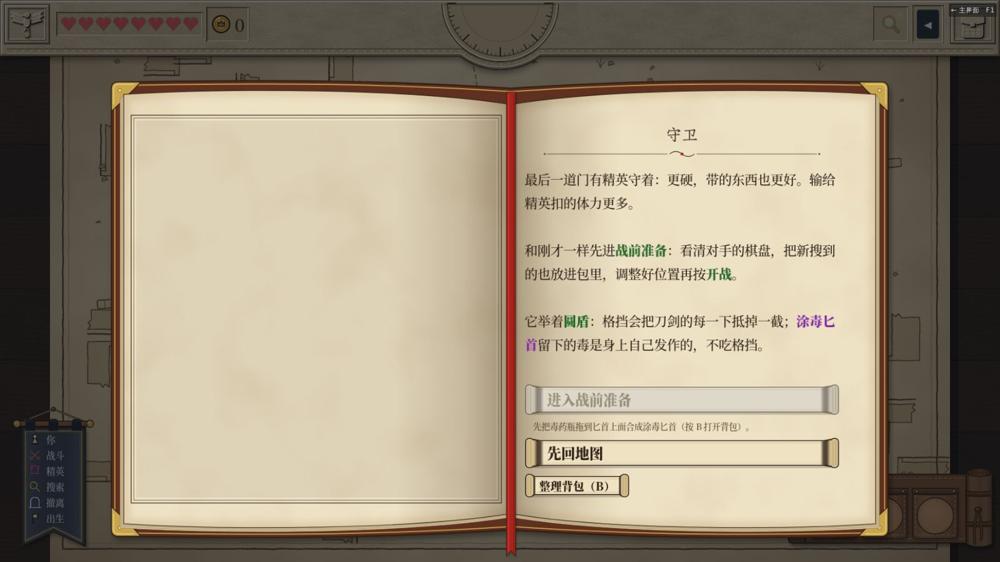
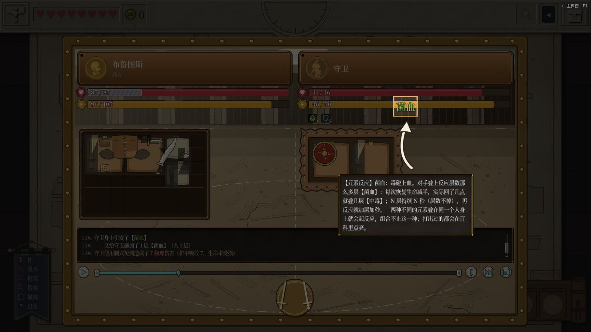
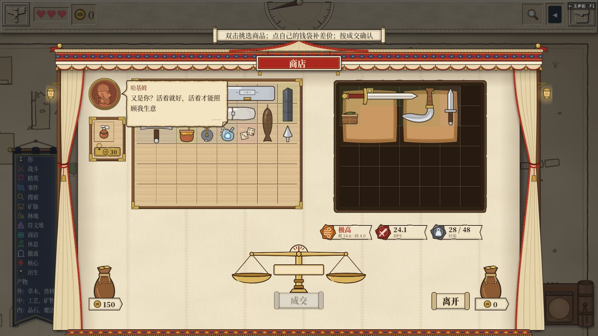
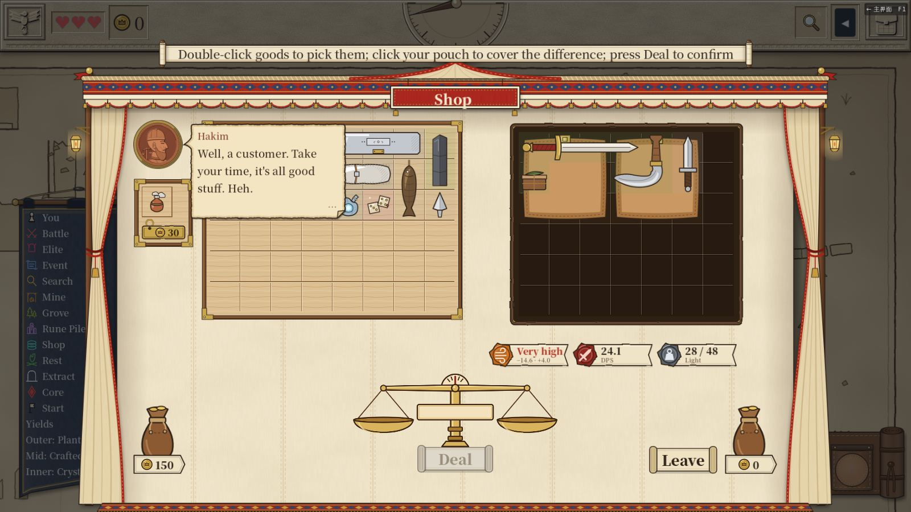
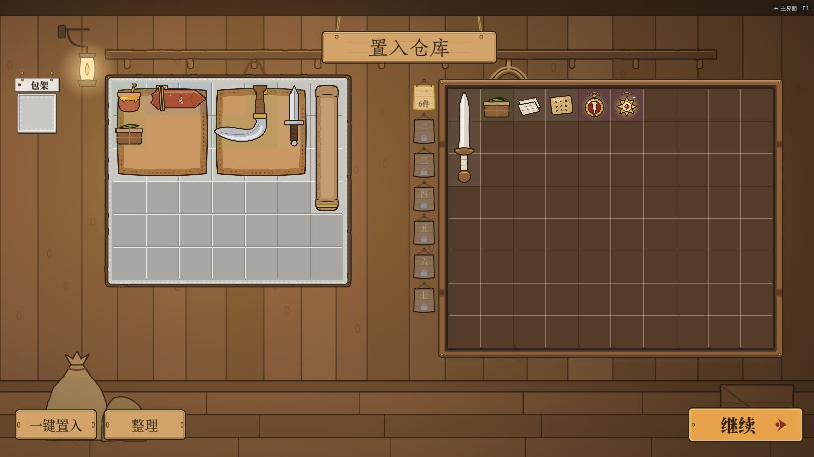
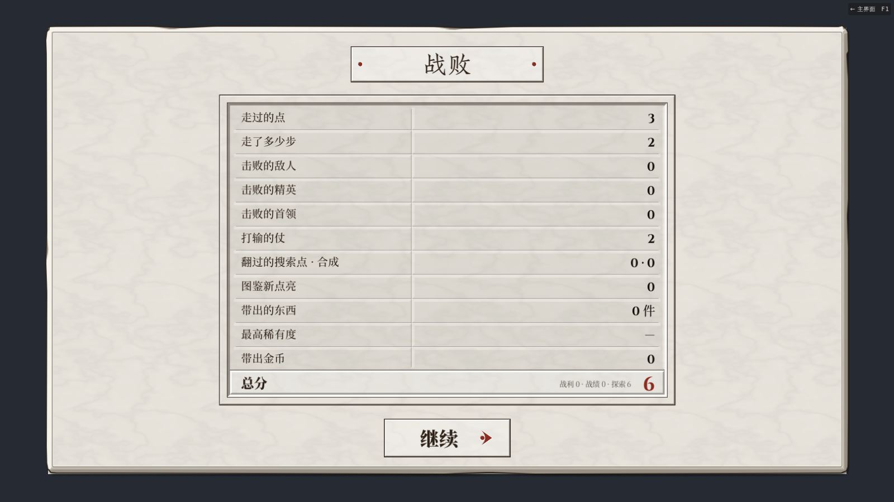
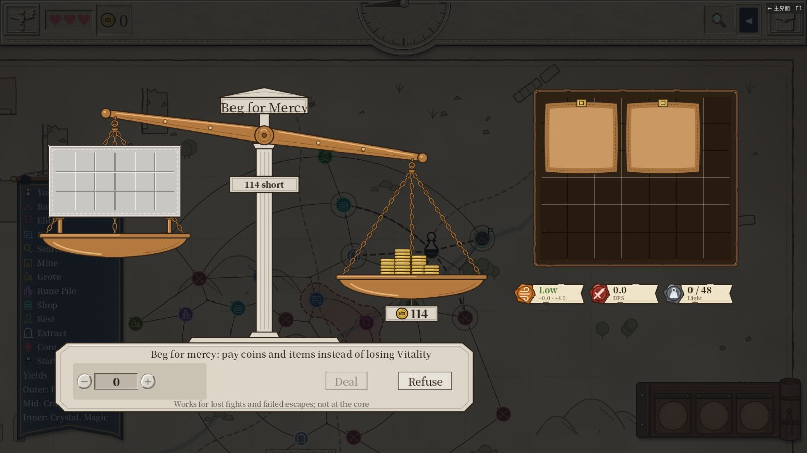
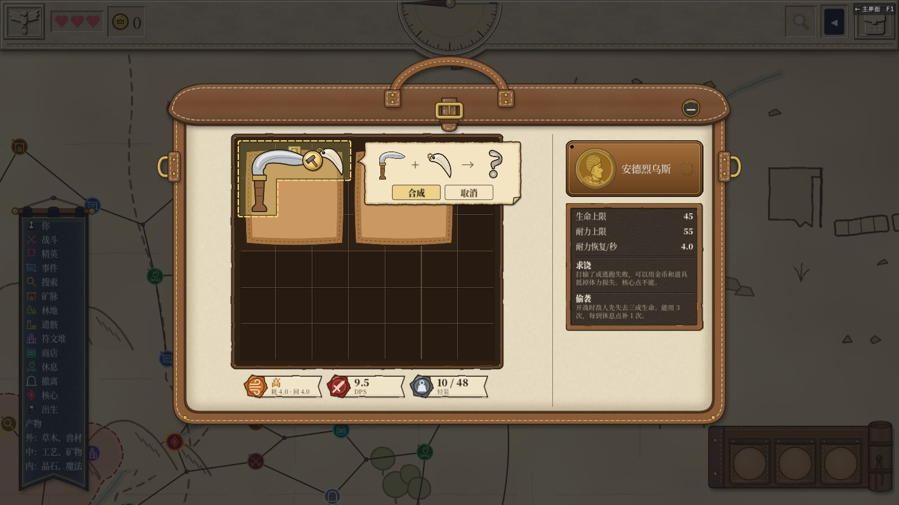
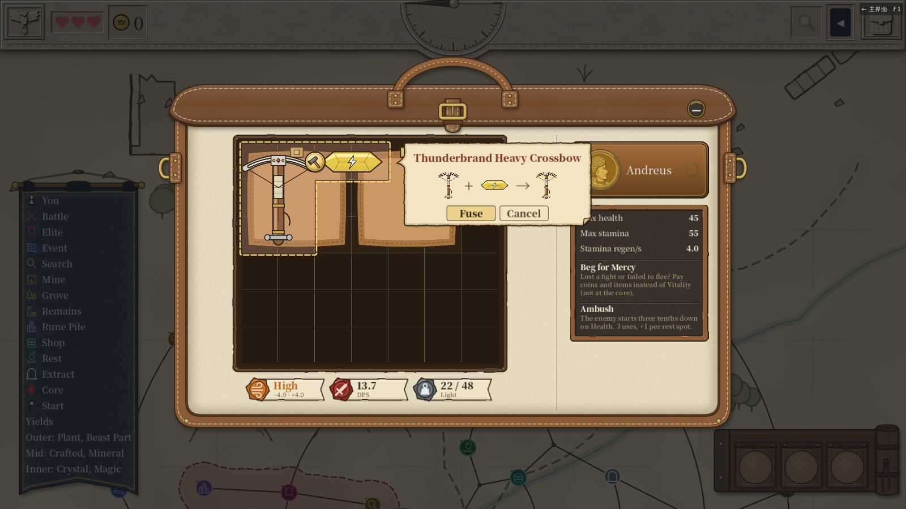

# v5.85 体验整改复测（v5.92–v5.96）

> 日期：2026-11-12。依据：[方案](../../plans/2026-11-12-v585-experience-improvements.md) §9.2、[报告 309](../309-v585-experience-batch-a.md)、[报告 310](../310-fusion-reform-batch-c.md)。
> 跑的版本：v5.93（51d3507a）上跑复测矩阵；v5.95 + v5.96（bd46fc30）上跑六张新配方和全量测试。
> 环境：云端容器，Xvfb 1600×900，OpenGL3 软件渲染，没有声音。全套截图、录像、日志在共享文件夹 `testing/2026-11-12-v593/`、`testing/2026-11-12-v595/`。

## 结论

- 全量测试：v5.92 通过 40249 项断言；v5.96 通过 40365 项断言、312 个套件。两次都 EXIT=0、0 个 SCRIPT ERROR，静态警告 0 条。
- 复测矩阵 4 种设置 × 4 条路线，16 次全部跑完，没有卡住，也没有脚本错误。
- 整改项都按预期生效。另外找到两处要改，一处建议，见「发现」。

## 复测矩阵

设置：中文 / 英文 × 默认 / 大字号。每次都是新存档，每条路线都留了截图和录像（`<设置>/<路线>/<路线>.mp4`）。

| 路线 | 做了什么 | 四种设置的结果 |
|---|---|---|
| 序章，种子 71888 | 完整序章：两处搜索、三场战斗、守卫门、撤离、置入仓库 | 都一样：第三次搜索拿到毒药瓶。到守卫门时身上有普通匕首和毒药瓶。「进入战前准备」是灰的，下面提示先合成；「直接准备战斗」和「补领匕首」都藏起来了。合成涂毒匕首后，「进入战前准备」能点。最后撤离，带出 16 件、66 币，置入仓库 16 件，留下 0 件 |
| 普通图，种子 780613 | 魔法废墟 / 小型 / 普通，安德烈乌斯，「强攻」预设：先去商店，以物换物买一件，然后撤离、置入仓库 | 都一样：进店时说了一句怎么买。钱是 0，所以拿长剑（卖价 14）换蜂蜜罐（12）；点钱袋时提示「不用补钱，按成交就行」，成交成功。打一场普通战斗时，讲解指向反应弹字（过载）。撤离时带出 8 件、25 币，置入 8 件，蜂蜜罐进了仓库 |
| 失败 | 同一张图，卸下装备去打精英，两次都不求饶 | 都一样：输给精英体力 3 → 1，再输一次 1 → 0，这一局战败。结算页写「打输的仗 2、带出 0 件」，没有第二页。仓库还是开局那 6 件，局外记下战败 1 次 |
| 关窗后重进 | 在失败后的基地关掉窗口，再开一次游戏 | 都一样：关窗正常退出。重开后仓库 6 件、战败 1 次、历史 1 条，和关窗前完全一样 |

### 守卫战的战记

我把四种设置下序章守卫战的原生回放读出来，生成了战记。

- 中文写成「我方使用制式短剑造成了 7 物理伤害（格挡抵消 5，生命 −2）」。守卫打我方是「护甲吸收 7，生命未受损」。毒伤被挡满时写「格挡抵消 3，生命未受损」。
- 英文写成「… dealt 7 Physical damage (block stopped 5; 2 HP lost)」。

格挡和护甲分开写，生命只写实际扣掉的那部分，和 305 一致。

### 头一回出现反应时的讲解

- 序章守卫战第一次出现菌血时，讲解停下来，指着守卫状态行上的「菌血」弹字，弹字没有淡掉（图 02）。
- 普通图第一场战斗出现的是过载，也同样停下来指着弹字。
- 同一局里第二次出现反应时不再停。

### 合成确认窗（相邻配方）

- v5.90 用「手斧 + 磨刀石」走过一遍。
- v5.95 新加的六张配方逐张走了一遍，中文默认和英文大字都试了：
  - 放血刀
  - 焰牙
  - 霜牙
  - 重弩
  - 角弓
  - 雷纹重弩
- 每张都是摆两件相邻的东西，点锤子，然后：
  - 第一次打开时成品是问号，不写名字（图 08）；
  - 按「合成」后，棋盘上出现成品；
  - 再摆一对时，窗里写出名字。
- 英文最长的名字「Thunderbrand Heavy Crossbow」也放得下（图 09）。
- 序章里的毒药瓶加匕首仍是拖上去直接合成，还没改成相邻点锤加确认。报告 310 第二节第 1 步会改，到时再走一遍。

### v5.92 的三处单独走查

| 项目 | 结果 |
|---|---|
| 多步教程纸条写进度 | 地图教程三步依次写「1/3」「2/3」「3/3」，中英都对 |
| 头一回进店的提示 | 中文默认、英文默认、英文大字都出现了（图 03、04）。离店后再进同一家店，不再出现 |
| 钱袋补差的提示 | 不差钱时写「不用补钱，按成交就行」。钱不够时写「还差」加上差额 |

## 发现

| # | 类型 | 问题 | 依据 | 建议 |
|---|---|---|---|---|
| 1 | 体验 | 头一回进店的提示只停留 3 秒（告示 SHOW_SEC）。它和商人的问候纸条同时出现。英文那句约 100 个字符，说的是三步操作。v5.92 的一次英文大字走查里，大约 5 秒后去读，提示已经收掉了 | `ui/widgets/notice_layer.gd` SHOW_SEC = 3.0；`testing/2026-11-12-v592/en_large/shop592/` | 这句按要紧告示处理（5 秒），或者停到玩家第一次在店里操作再收 |
| 2 | 界面 | 「求饶」屏顶上的标题牌不随字号变宽。英文大字号时「Beg for Mercy」被切掉一截（图 07）；中文大字号时「求饶」贴着牌子下沿 | `testing/2026-11-12-v593/*/fail/013_RANSOM.png` 四张对比 | 标题牌按字宽撑开，或者大字号时缩小标题字 |
| 3 | 建议 | 付费撤离点在钱不够时，「撤离」选项照样能点。点了不会撤离，回到地图；代码注释说结果页会说明。这和守卫门那种「灰掉并写原因」的做法不一致 | 第一次调试走普通图时，带 0 币走到 50 币的撤离点 | 钱不够时把「撤离」灰掉，并写「还差 X」，和其他锁住的选项一致 |

## 没有覆盖

- 声音、真机性能、最小窗口和其他分辨率：这次只跑了 1600×900。
- 第二、三章的完整内容，以及长期经济。
- 正式自由局打到耐力耗尽：这次失败路线是靠卸下装备打输的。
- 「继续」按钮。重进检查用的是探针自己的存档路径，没有存档位，所以只核对了局外数据有没有存住，没有走主菜单的「继续」。
- 真人新玩家观察（方案 §9.3）：没有招募。

## 脚本

都在共享文件夹 `testing/` 下：

- `exp593.gd <out.csv> 1 <prologue|free|fail|reenter>`：本次的复测探针，从 `tools/perf_probe.gd` 改来。
  - 路线：走向商店或撤离点时按最短路径；走撤离点只选付得起、还没关的。
  - 商店：用以物换物来买。
  - 求饶屏：失败路线一律不求饶。
  - 结算：分两页按「继续」，再按「置入仓库」。
  - 截图：每换一屏、讲解每走一步都截一张。
  - 录像：每 5 帧存一张小图，最后合成 mp4。
- `fuse595.gd`：六张新配方的确认窗走查。
- `narr309.gd <replay.json> [zh|en]`：读原生回放，打印战记里讲格挡、护甲、生命的行。
- `shop592.gd`：v5.92 商店首访、钱袋补差、教程进度。
- 跑法：`/tmp` 下的 `m593.sh`（矩阵）、`r557.sh`（单个走查加全量测试）。

## 图

| # | 内容 |
|---|---|
| 01 |  守卫门，合成前 |
| 02 |  菌血讲解指向反应弹字 |
| 03 |  头一回进店的提示 |
| 04 |  英文大字号的同一句 |
| 05 |  普通图撤离后置入仓库 |
| 06 |  战败结算 |
| 07 |  求饶标题牌被切（发现 2） |
| 08 |  没合过的配方：问号 |
| 09 |  合过后：英文最长的名字 |
