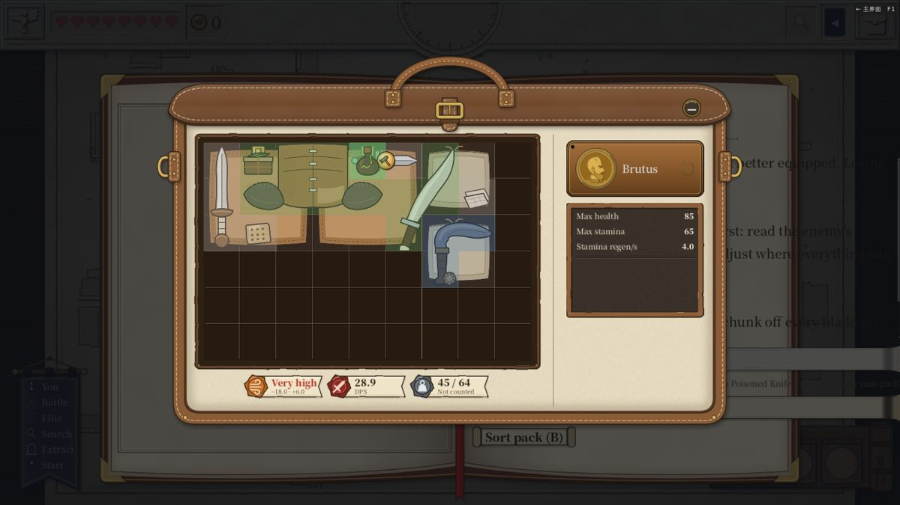
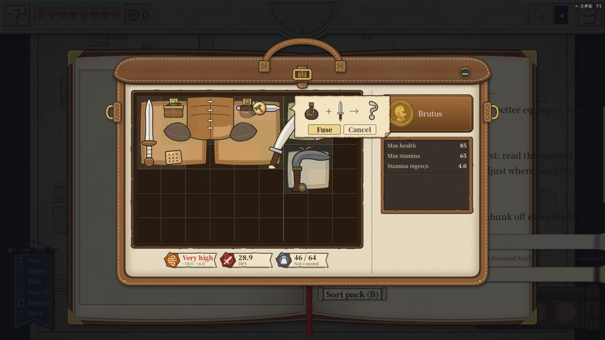
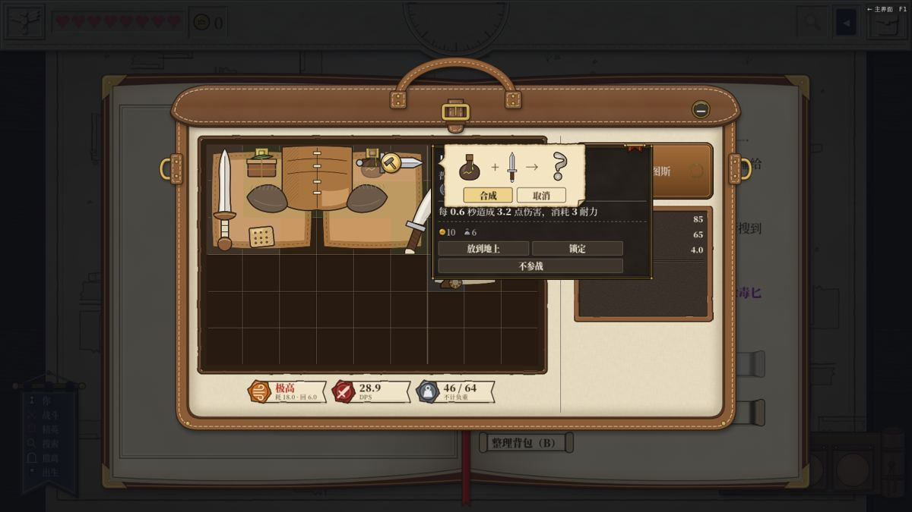
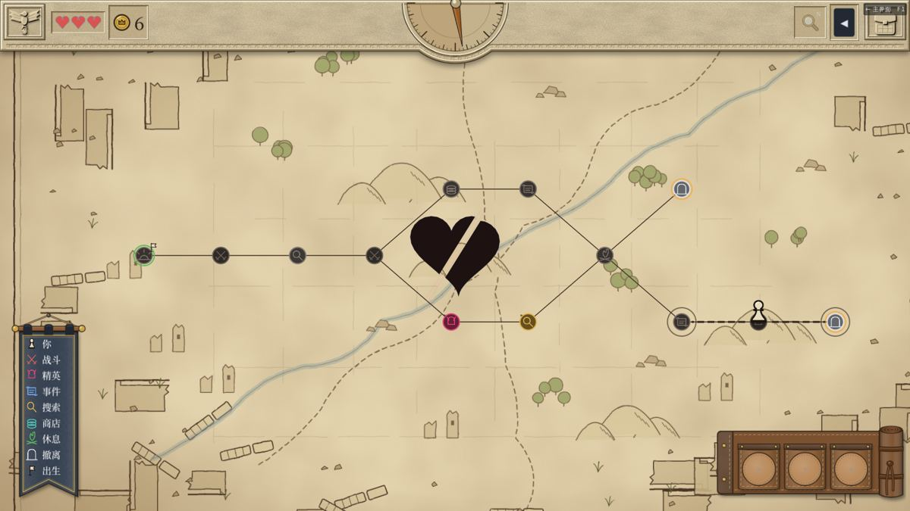
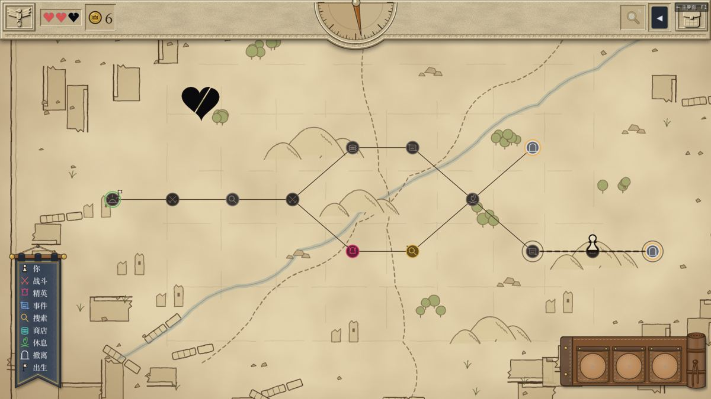
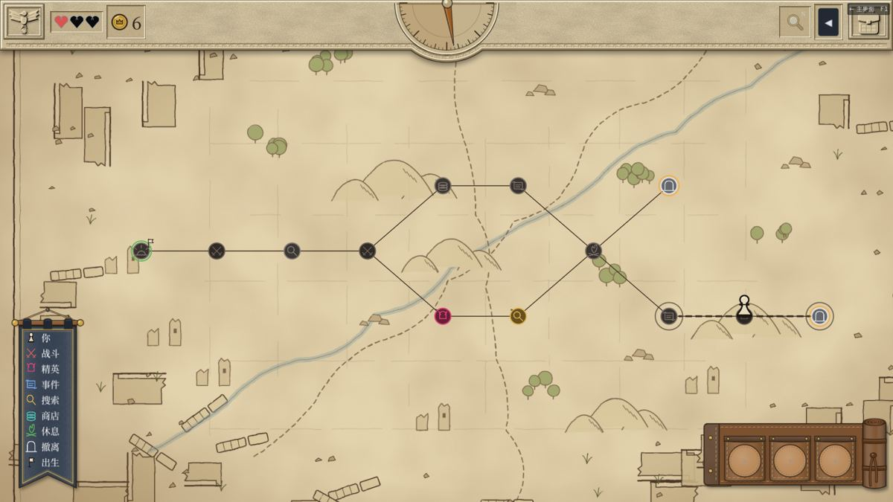

# v6.08–v6.12 回归与切片 S3 走查

> 日期：2026-11-12。依据：[报告 313](../313-vertical-slice-s1.md)（切片 S1 / S2）、[报告 315](../315-drag-to-fuse-landing.md)（拖放合成）、v6.09 劈心动画、v6.11 / v6.12 道具卡修正。
> 跑的版本：v6.12（5277548a）。全量测试另外在 v6.10、v6.11 上各跑了一遍。
> 环境：云端容器，Xvfb，OpenGL3 软件渲染，没有声音。全套截图、录像、日志在共享文件夹 `testing/2026-11-12-v612/`（序章）和 `testing/2026-11-12-v612-s3/`（切片）。

## 结论

- 全量测试：
  - v6.10 通过 40705 项断言；
  - v6.11 通过 40706 项；
  - v6.12 通过 40709 项，共 318 个套件。
  - 三次都是 EXIT=0、0 个 SCRIPT ERROR，静态警告 0 条。
- 走查覆盖中文 / 英文 × 默认 / 大字号四种设置：序章拖放合成跑了 4 次，切片 5 条路线跑了 20 次，全部跑完。
- 找到一处问题：松手后被压那件的道具卡和确认窗叠在一起。v6.12 已经修好，复测通过。
- 另有一处观察，见「发现」第 2 条。

## 序章守卫门：拖放合成

种子 71888。到守卫门时，按「整理背包」，用真鼠标把毒药瓶拖到匕首上。一共拖四轮，前三轮分别用三种方式关掉确认窗，第四轮合成：

| 轮 | 关窗方式 | 四种设置的结果 |
|---|---|---|
| 1 | 点「取消」 | 毒药瓶回到原位 (7,0)，没有合成 |
| 2 | 按 Esc | 同上 |
| 3 | 点窗外 | 同上 |
| 4 | 点「合成」 | 棋盘上出现涂毒匕首，在原来匕首的位置。「进入战前准备」从灰变成可点 |

每一轮都一样：

- 拿起毒药瓶时，只有匕首身上标小锤（图 01）。
- 拖着停在匕首上 40 帧，不弹道具卡。
- 松手后弹出确认窗。成品是问号，因为还没合过。被压那件的小锤变亮。
- v6.12 上松手后不再弹道具卡（图 02）。
- 英文大字号下「Fuse / Cancel」放得下。

## 切片 S3

用 `--profile=slice` 启动，每次都是新存档。

| 路线 | 做了什么 | 四种设置的结果 |
|---|---|---|
| A | 打赢守卫，在 12 撤离 | 都撤离成功。现有装备打不过守卫，进 11 之前用测试手段补了涂毒匕首、弯刀、圆盾、皮甲 |
| B | 跳过守卫，在 9 免费撤离 | 都撤离成功。在 3 合出淬火匕首 |
| C | 失败 | 体力 3→2→1→0 后战败，仓库回到开局 4 件，局外记战败 1 次 |
| H | 走 A 的路线，但不补装备 | 用来看精英败仗扣 2 点。中文大字、英文默认、英文大字三次都输给守卫；中文默认那次赢了 |
| F | 搜第三次遇到屠夫，选逃跑 | 用来看逃跑失败。用测试手段把逃跑成功率压到 0，然后求饶屏不求饶，扣 1 点，照样开打 |

几条共同的检查：

- 三种结局之后，基地都只有「出征」「仓库」两个页签。按「再次出征」能打开开局屏，章节只有魔法废墟。
- 地图讲解两步（倒计时、体力）、战前准备讲解两步（敌方棋盘、我方棋盘）都出现了。
- 进店提示：6 秒内不按鼠标，提示一直在；按一下就收起。

### 劈心动画

| 情况 | 结果 |
|---|---|
| 普通败仗，扣 1 点 | 中央一颗红心先被一刀劈开，变黑，再飞到体力条最右边那颗上。体力条从 3 颗红变成 2 颗红（图 04） |
| 精英败仗，扣 2 点 | 先劈最右边那颗，再劈它左边那颗，从右往左（图 05、06） |
| 逃跑失败 | 打完那场仗、回到地图时放 |
| 点一下鼠标 | 在裂开那一段点一下，6 帧内收尾，该黑的心直接变黑。正常放完一颗要 25 到 30 帧 |

## 发现

| # | 类型 | 问题 | 依据 | 状态 |
|---|---|---|---|---|
| 1 | 界面 | v6.11 上，松手后鼠标还停在匕首上，大约 20 帧后弹出匕首的道具卡，压在确认窗下面。点「取消」后卡也不收，正好盖住刚放回去的毒药瓶（图 03） | `testing/2026-11-12-v611/zh_normal/prologue/043、044` | v6.12（PR #614）已修，四种设置复测都没有再弹 |
| 2 | 观察 | 逃跑失败扣了体力后，接着打的那场仗和战利品屏上，体力条仍画 3 颗红心，回到地图放完动画才变黑。这符合「回地图时放」的设计，但玩家在那场战斗里看不出刚扣过体力 | `testing/2026-11-12-v612-s3/*/sF/` | 已转给「实装常规事件第一批」判断 |

## 没有覆盖

- 声音、真机帧率。
  - 软件渲染下一帧约 60 ms，截图时会更慢，所以动画的秒数只能参考，帧数是准的。
- 切片里在地图上直接遇到的逃跑：猎手、伏击这次没有遇到。
- A 路线：是补了装备才打赢守卫的。报告 313 已经写了，开局装备不先合成就打不过。

## 脚本

都在共享文件夹 `testing/` 下：

- `exp593.gd <out.csv> 1 prologue`（v6.10 起）：
  - 到守卫门先翻完背包讲解；
  - 用 `Input.parse_input_event` 发真鼠标事件拖放；
  - 每轮开始前把鼠标挪开；
  - 日志搜「P610」。
- `s3.gd <out.csv> 1 <sA|sB|sC|sH|sF> --profile=slice`：
  - 回到地图时跟踪劈心动画，按刀光、裂开、飞回三段截图；
  - C 路线第二次败仗时点一下鼠标；
  - 日志搜「劈心」。
- 跑法：`/tmp` 下的 `m593.sh`（序章）、`s3run.sh`（切片）、`r557.sh`（全量测试和静态警告）。

## 图

| # | 内容 |
|---|---|
| 01 |  英文大字：拿起毒药瓶，匕首标小锤 |
| 02 |  v6.12：松手后只有确认窗 |
| 03 |  v6.11：道具卡和确认窗叠在一起（发现 1） |
| 04 |  中文大字：红心劈开变黑 |
| 05 |  扣 2 点：第二颗飞向体力条 |
| 06 |  放完：体力条 1 红 2 黑 |
