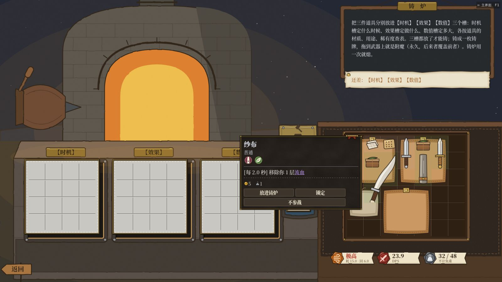
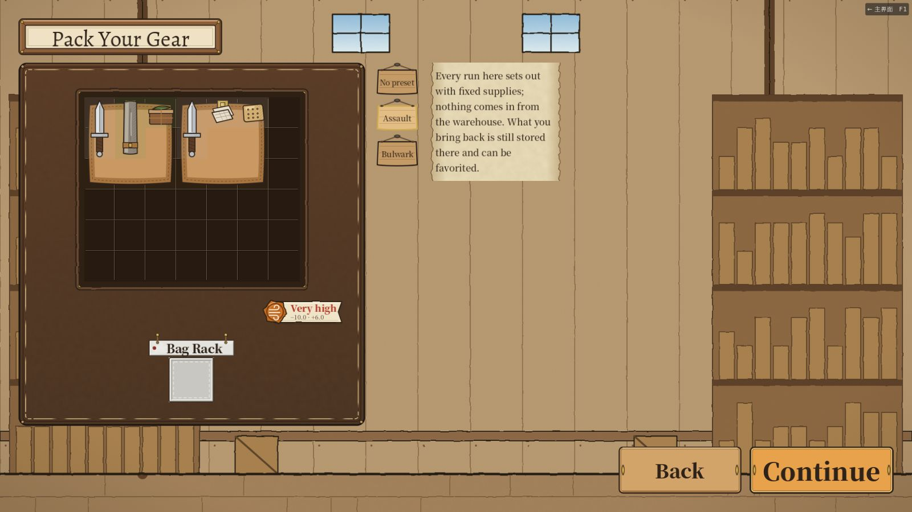
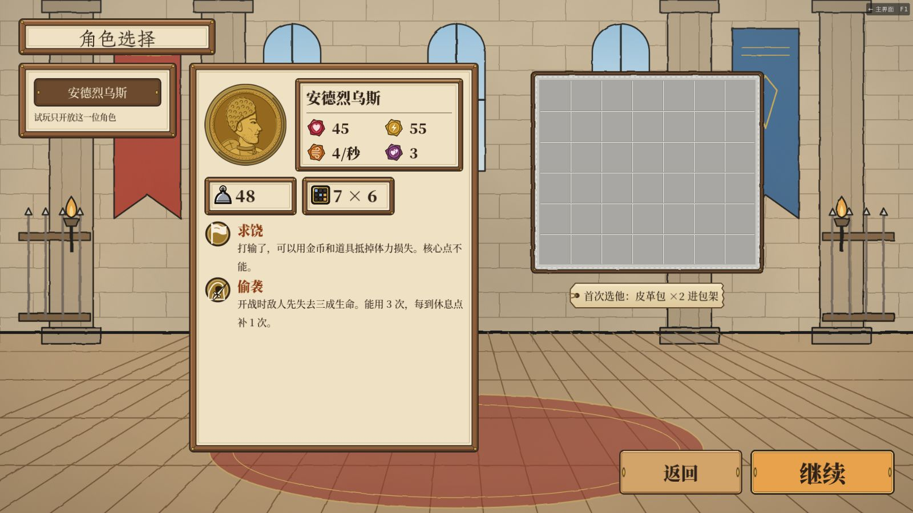
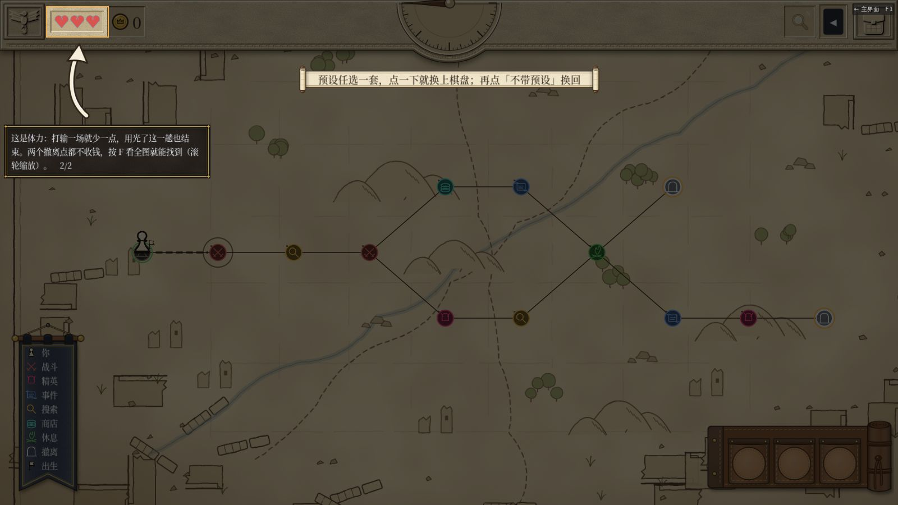
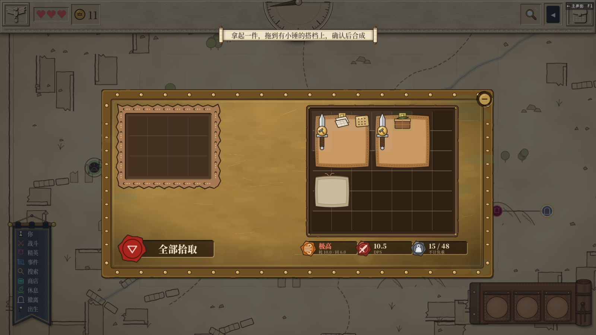
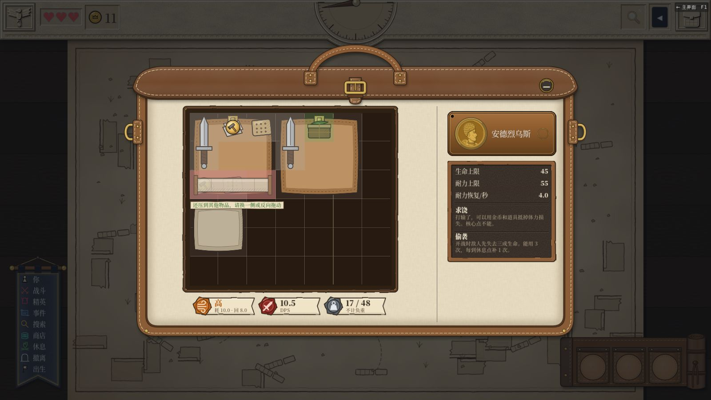
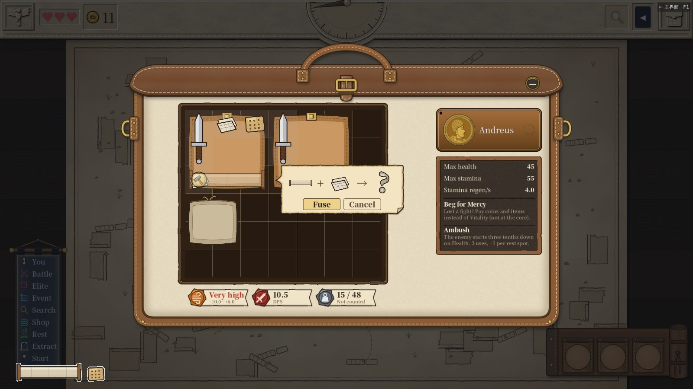
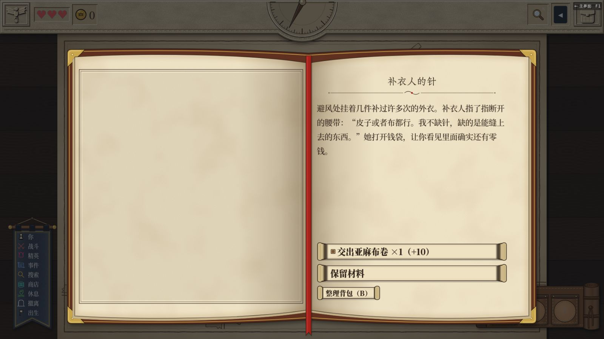

# v6.14–v6.18 回归与切片走查

> 日期：2026-11-13。
> 依据：
> - v6.14（PR #617）：逃跑失败直接开打；
> - v6.15（PR #618，[报告 316](../316-fusion-reform-batch-d-remove-anvil.md)）：拆砧；
> - v6.16 / v6.17（PR #621 / #622，[报告 317](../317-slice-v614-fixes.md)）：切片修复 A–D；
> - v6.18（PR #623，报告 318）：只改难度校准工具。
>
> 环境：云端容器，Xvfb，OpenGL3 软件渲染，没有声音。截图、录像、日志都在共享文件夹 `testing/` 下：
> - `2026-11-13-v615-s3/`
> - `2026-11-13-v616-s3/`
> - `2026-11-13-v618-s3/`

## 结论

全量测试三次都是 EXIT=0、0 个 SCRIPT ERROR，静态警告 0 条：

| 版本 | 断言 | 套件 |
|---|---|---|
| v6.15 | 39921 | 317 |
| v6.16 | 39982 | 318 |
| v6.18 | 40047 | 318 |

走查覆盖中文 / 英文 × 默认 / 大字号四种设置，全部跑完，没有找到问题。

- **v6.14**：逃跑失败后直接开打，体力不扣，身上没有虚弱，回地图也不劈心。
- **v6.15**：局内和铁匠铺都没有砧和升级配方了。
- **v6.16**：整备页、§2.3 长序列（B01）都对。
- **v6.17**：这次要测的五项都对。

## v6.14 逃跑失败

用测试手段把逃跑成功率压到 0，然后选「逃跑」。中文默认、英文大字两种设置的结果一样：

- 直接进了战斗；
- 体力还是 3/3；
- 身上没有效果；
- 没有待放的劈心动画。

照常打完，撤离成功。普通败仗仍然扣 1 点体力并放劈心动画；点一下鼠标，6 帧内收尾。

## v6.15 拆砧

**铁匠铺**
- 共 34 张配方：1 级 9 张、2 级 6 张、3 级 19 张。
- 没有 `anvil_*` 配方，也没有吃武器的配方。
- 帝国剑、烈焰双斧、秘银剑、大法师杖四张金武打造配方都能打，打出来品质 0。中文默认、英文大字都试过。

**切片休息点**
- 选项里没有砧。
- 进营地铁炉只有铸炉（图 01）。
- 悬浮窗里没有「可升为」。

序章、自由模式、失败、重进四条老路线在中文默认、英文大字下都跑完，没有报错。

## v6.16 整备页和长序列

**整备页**
- 预设只有「强攻」「坚守」两套。
- 仓库那块换成纸条：「这一章每局用固定补给出发，仓库里的东西不带进来。带回来的照常存进仓库、可以收藏。」仓库框不显示。
- 补给直接摆在棋盘上：
  - 不选预设：两个皮革包 + 匕首、纱布、口粮；
  - 选强攻：再加匕首、磨刀石、药膏；
  - 选坚守：再加皮甲、磨刀石、药膏。
- 按「强攻 → 坚守 → 强攻」换一圈，东西不会叠加（图 02）。
- 出发后，棋盘上的东西和整备页最后的预览完全一致。

**§2.3 长序列（B01）**

买完东西后，在地图上连跑 12 轮。每轮按这个顺序做：

1. 开背包；
2. 真鼠标拖一对能合的：第一轮合成，之后都取消；
3. 每三轮做一次长物挤出；
4. 关背包；
5. 开关调试台；
6. 再开背包，悬停地上的三件，双击收回一件；
7. 关背包，再悬停地上。

结果：

- 四种设置都跑完 12 轮，没有报错。
- 悬浮窗该出就出。
- 悬浮登记数每轮都一样，开着背包是 [0,0,1,1]，关着是 [0,0,0]，跑完回到 [0,0,0]，没有越积越多。
- v6.16 上拿匕首压磨刀石、又压到别的东西时，会照顶替处理（就是 U01）。v6.17 已经改了，见下一节。

## v6.17 五项

| 项 | 四种设置的结果 |
|---|---|
| 选人栏 | 只有安德烈乌斯一位。名字下面写着「试玩只开放这一位角色」（英文：Only this character is open in the demo），在羊皮纸栏里（图 03） |
| 地图教程第二步 | 「……两个撤离点都不收钱，按 F 看全图就能找到（滚轮缩放）。　2/2」，英文同样写 F（图 04）。先把缩放调到 2.00 再按 F，变成 0.75，看到全图 |
| 第一次能合成 | 第一场仗赢下来，在战利品屏按「全部拾取」，棋盘上有了两把匕首。顶上马上出现「拿起一件，拖到有小锤的搭档上，确认后合成」，两把匕首都标了小锤（图 05） |
| 布卷压纱布加别的 | 纱布在左、口粮在右，用真鼠标把亚麻布卷（三格长）的左格拖到纱布上，这时布卷也压到口粮。残影是红的，旁边写「还压到其他物品，请换一侧或反向拖动」（图 06）。松手后不弹确认窗，三件都在原处，告示说同一句。把口粮挪开再拖，只压纱布，残影是绿的，松手弹确认窗（图 07），取消后都回原处 |
| 补衣人 | 只剩两项：「交出亚麻布卷 ×1（+10）」「保留材料」（图 08） |

一处说明：第一次能合成的提示只说一次。这次的测试脚本起先没按按钮，是直接调「全部拾取」的接口，接口拿完东西就关掉战利品屏。结果提示出现在地图上，背包关着，看不到小锤，提示也就用掉了。改成按真的「全部拾取」按钮后，战利品屏留着，提示和小锤都在屏上。玩家只会按按钮，所以不算问题。

## 没有覆盖

- 声音、真机帧率。
- 「压到两件能合的道具」那句：只有单元测试覆盖，走查没有摆两块纱布。
- 补衣人只看了选项，没有比对交出布卷后拿到的钱数。

## 脚本

都在共享文件夹 `testing/` 下：

- `s3.gd <out.csv> 1 <模式> --profile=slice`：
  - sL：整备页 + 长序列，日志搜「E617」；
  - sM：v6.17 五项，日志搜「E617」；
  - sB：顺带进营地铁炉，日志搜「E616」。
- `smith616.gd`：铁匠铺配方数和打造。
- 跑法：`/tmp` 下的 `r557.sh`（全量测试和静态警告）、`s3run.sh`（切片）。

## 图

| # | 内容 |
|---|---|
| 01 |  v6.15：营地铁炉只有铸炉，悬浮窗没有「可升为」 |
| 02 |  英文大字：强攻 → 坚守 → 强攻之后的整备页 |
| 03 |  选人栏纸条 |
| 04 |  地图教程第二步写着 F |
| 05 |  第一次能合成：提示和两把匕首上的小锤 |
| 06 |  布卷压到纱布和口粮：红残影和那句提示 |
| 07 |  英文大字：只压纱布，弹确认窗 |
| 08 |  补衣人只剩两项 |
