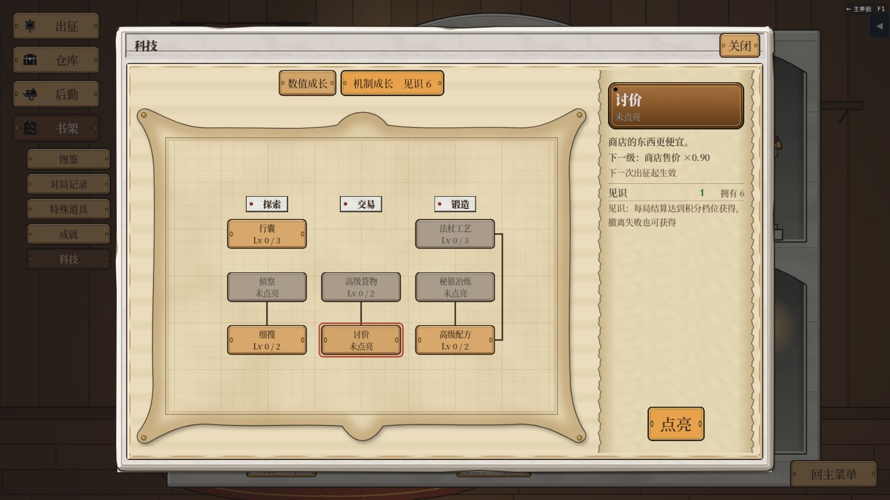
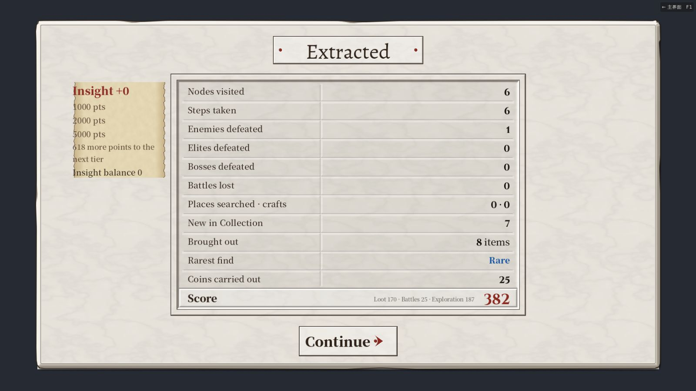
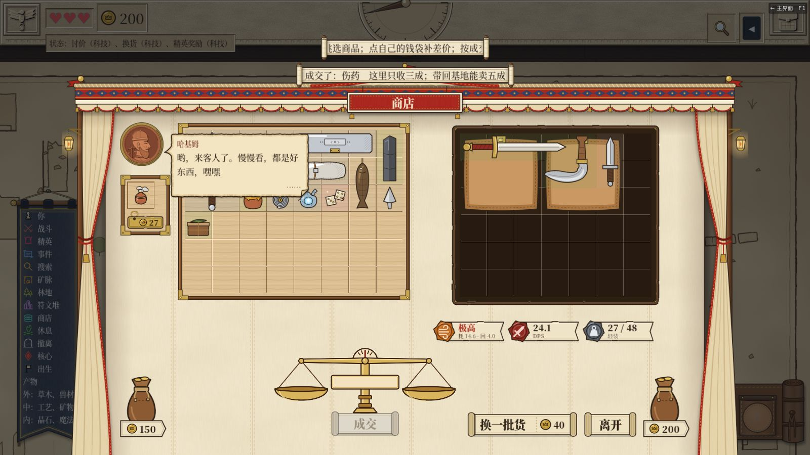
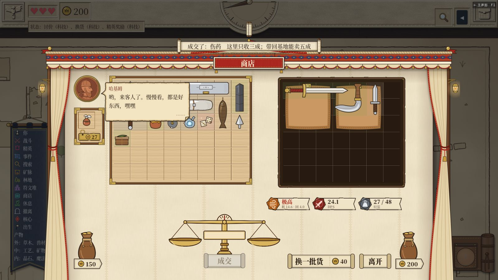
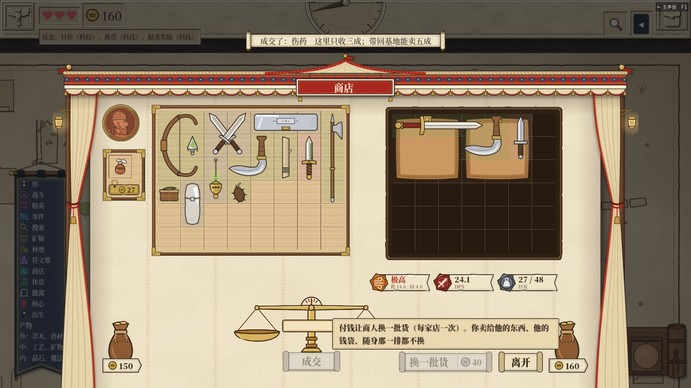
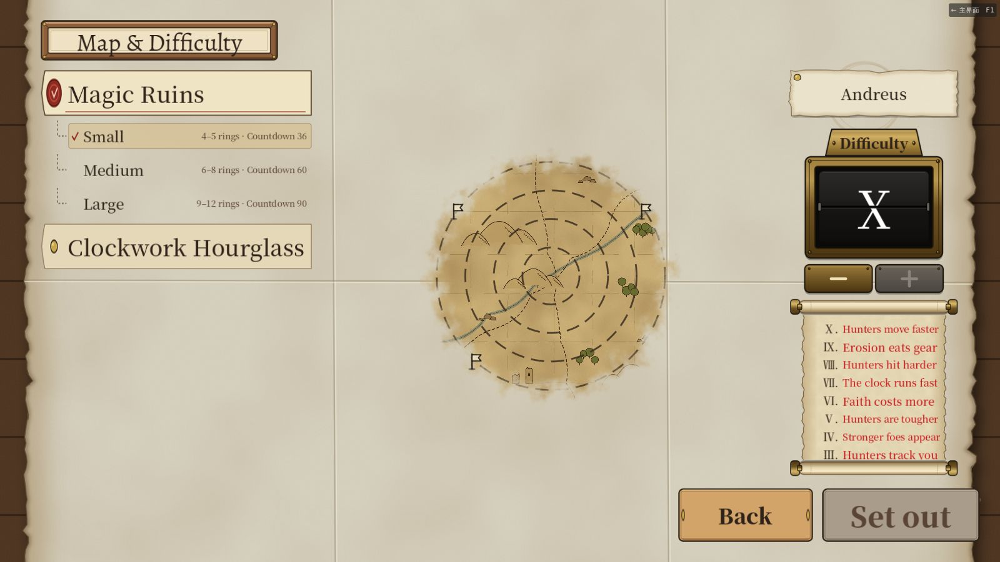

# v6.20–v6.26 回归：双科技树、精英奖励、换货、十档进阶

> 日期：2026-11-14。
>
> 依据：
> - [报告 319](../319-meta-progression-dual-trees.md)：
>   - v6.20：A+B 批；
>   - v6.22：C 批；
>   - v6.25：换货小修。
> - 报告 320：
>   - v6.21：A 批；
>   - v6.23：B 批，进阶一～四；
>   - v6.24：C 批，进阶五～八；
>   - v6.26：D 批，进阶九。
>
> 环境：云端容器，Xvfb，OpenGL3 软件渲染，没有声音。截图、录像、日志在共享文件夹 `testing/` 下：
> - `2026-11-14-v620/`、`2026-11-14-v622/`、`2026-11-14-v626/`；
> - 对应的 `-s3/` 切片目录。

## 结论

| 版本 | 断言 | 套件 | 结果 |
|---|---|---|---|
| v6.20 | 40236 | 319 | EXIT=0，0 个 SCRIPT ERROR，静态警告 0 |
| v6.22 | 40338 | 320 | 同上 |
| v6.24 | 40494 | 321 | 同上 |
| v6.26 | 40547 | 321 | 同上 |

走查在中文默认、英文大字两种设置下都跑完，没有报错。找到两处问题：

| # | 问题 | 状态 |
|---|---|---|
| 1 | 局内商店「换一批货」后，商人的金银那一格整件消失，也不补 | v6.25 已修，复测通过 |
| 2 | 结算屏的见识小纸没有左边距，每行第一个字压在纸的毛边上，有的露到纸外（图 02） | v6.28 已修，英文大字复测通过（图 06） |

## v6.20 双科技树

**科技页**：新档，用测试手段给 6 点见识。
- 树区上面两枚页签：「数值成长」「机制成长　见识 6」，英文是 Growth / Know-how。
- 数值树 6 个节点，机制树 8 个节点（图 01）。
- 升行囊：见识 6 → 5，钱不动，账目行写「见识　1」和怎么得见识。
- 在机制树上选仓库扩建，会自动切回数值页签。

**旧档迁移**：把 `tests/fixtures/meta_v4.json` 放进第 1 位再开游戏。
- 幸运删掉；讨价从 2 级降到 1 级。
- 退了 3500 币。仓库多了 2 硬木板、2 铆钉盒、1 银锭、2 碎晶。
- 留了 `meta.json.v4.bak`，迁移记录写着「luck 3」「bargain 2 -> 1」。
- 钱最后是 3924，比报告里样例的 3600 多 324。多出来的是存档修复：样例档里有 3 件已经改掉的道具，按原有的修复规则折成了钱，开局有提示。不是这次迁移的问题。

**结算屏**：自由模式撤离和失败都摆了见识小纸，切片不摆。
- 小纸上写着三档门槛、还差几分到下一档、见识余额。
- 这两局总分都不到 1000，所以见识都是 +0。「到档发见识」只有单元测试覆盖。

## v6.22 / v6.25 讨价、换货、精英奖励

自由模式，种子 780613，第一家店。用测试手段点亮讨价、换货、精英奖励三项科技，给 200 币。

**讨价**
- 买价都打 9 折，比如钢制巨剑 180 → 162。大银锭不打折，这是原有规则：金银不吃倍率。
- 卖价不变：伤药卖 3 = 定价 12 × 0.3。

**换一批货**
- 钥匙在「离开」左边，价签写 40。没钱时置灰（图 03）。
- 用真鼠标点了以后：
  - 钱 200 → 160；
  - 卖进来的伤药留在原位；
  - 其余普通货换了一批；
  - 钥匙变灰。
- 再点一次不换，原因写「这家店已经换过货了」（图 05）。悬停钥匙说明换什么、不换什么。
- v6.22 上换完以后，大银锭不见了，也没补（发现 1）。v6.25 上大银锭留在 (4,0) 原位，只换普通货（图 04）。

**精英 / 首领额外奖励**：只有单元测试覆盖。自由模式这条路线不打精英。切片的精英照旧多掉涂毒匕首。

## v6.23 / v6.24 / v6.26 十档进阶

新档开局只能选「普通」。用测试手段解锁进阶一～九后，九档都能选。

用自由模式（种子 780613、强攻预设）在进阶四、八、九各跑一整局，都撤离成功，没有报错。开局时记的数：

| 项 | 进阶四 | 进阶八 / 九 |
|---|---|---|
| 体力上限 | 3（不再扣） | 3 |
| 普通战斗生命倍率 | 5 场都 ×1.10 | 同左 |
| 换成强敌 | 5 场里换 1 场（第 17 点），没有换不了的 | 同左 |
| 猎手生命 | 段内渐变：0 步 ×1.0，4 步 ×1.4，5 步 ×0.6，9 步 ×1.4，10 步 ×0.6，19 步 ×1.6，20 步 ×0.5，30 步 ×1.0 | 再 ×1.10，攻击 ×1.10 |
| 信仰门槛 | 蛮族 30 / 100 / 200 / 400 | 30 / 110 / 220 / 440 |
| 倒计时 | 不多扣 | 多扣 10% |

进阶九的说明里，占位数字都填上了（「走进侵蚀了 2 层以上的点……到 3 层永久损毁」）。

## 老路线

以下路线都跑完，没有报错：
- 序章（含真鼠标拖放合成）、自由、失败、重进：中文默认、英文大字都跑了。
- 切片 sB、sE：sB 两种设置都跑了，sE 跑了英文大字。

## 补测：v6.27 进阶十、v6.28 小纸边距

全量测试：

| 版本 | 断言 | 套件 | 结果 |
|---|---|---|---|
| v6.27 | 40576 | 321 | EXIT=0，0 个 SCRIPT ERROR，静态警告 0 |
| v6.28 | 40577 | 321 | 同上 |

- **进阶十**：中文默认、英文大字各跑一整局，都撤离成功，没有报错。
  - 说明写「平均每走十步多追一步（追击 +10%）」；开局记到猎手追击 +10%。
  - 前九档的各项照旧：敌人生命 ×1.10、强敌份额 0.15、猎手生命和攻击 ×1.10、倒计时多扣 10%、信仰门槛 +10%。
  - 这两局都没有撞上猎手，追得快不快没有在走查里看出来，只有单元测试和木桩数据。
- **见识小纸**：英文大字结算屏上，每行都离纸边有一段距离，不再压边（图 06）。

## 补测：v6.29 开局屏英文挑战

全量测试 40580 项 / 321 个套件通过，EXIT=0，0 个 SCRIPT ERROR，静态警告 0 条。进阶十在英文大字、中文默认下各跑一整局，都没有报错。

英文大字开局屏选进阶十（图 07）：
- 卷轴上 X～III 每条挑战一行，没有逐字母断开。
- 更早的几档藏在底卷轴后面，这是原设计。

两点观察，不算问题：
- 各行字号不一样大。「Faith costs more」「Erosion eats gear」明显比「Hunters move faster」「Stronger foes appear」大，看着像是每行按宽度各自缩放。
- 「Stronger foes appear」最后一个字母贴着卷轴右边的毛边。

v6.30 复测：全量测试 40580 项通过，静态警告 0 条。英文大字进阶十整局没有报错。开局屏卷轴各行字号一样大，右边都留了空，「Stronger foes appear」不再贴边。

## 没有覆盖

- 到档发见识：这几局总分都不到 1000。
- 精英 / 首领额外奖励：自由模式路线不打精英，单元测试覆盖。
- 进阶九的道具侵蚀：这条路线短，走不到侵蚀 2 层的点，一次也没触发。层数、损毁、撤离清零只有单元测试覆盖。
- 旧局规则快照：只有单元测试覆盖。
- 声音、真机帧率。

## 脚本

都在共享文件夹 `testing/` 下：

- `tech620.gd <outdir> <fresh|old>`：
  - fresh：科技页两枚页签，机制树花见识；
  - old：v4 旧档迁移；
  - 日志行以「TK」开头。
- `exp593.gd <out.csv> 1 <模式>`：
  - shop622：讨价、换货，日志搜「E622」；
  - freeA4 / freeA8 / freeA9：解锁并选对应进阶，开局记各项数值，日志搜「E624」；进阶九另外跟踪道具侵蚀，日志搜「E626」；
  - 结算屏的见识小纸，日志搜「E620」。
- `s3.gd` 的 sE：切片两场精英的掉落。

## 图

| # | 内容 |
|---|---|
| 01 |  科技页：「机制成长　见识 6」页签 |
| 02 |  英文大字结算屏：见识小纸每行第一个字压在毛边上（发现 2） |
| 03 |  换货前：大银锭在右上，「换一批货 40」钥匙 |
| 04 |  v6.25 换货后：大银锭和卖进来的伤药留在原位 |
| 05 |  换过一次后钥匙变灰，悬停有说明 |
| 06 |  v6.28 英文大字：见识小纸有了边距 |
| 07 |  v6.29 英文大字：开局屏挑战卷轴 |
