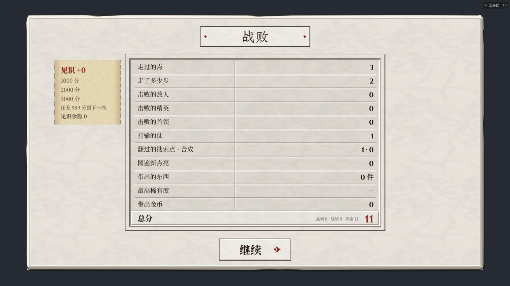
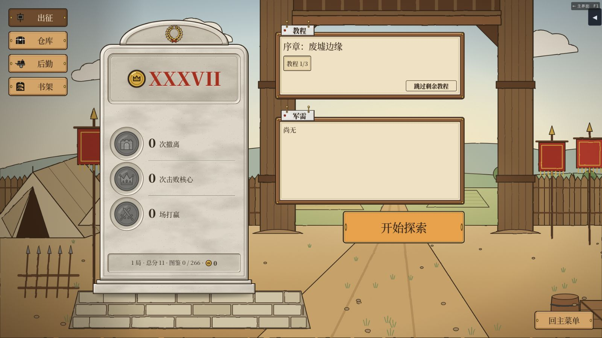
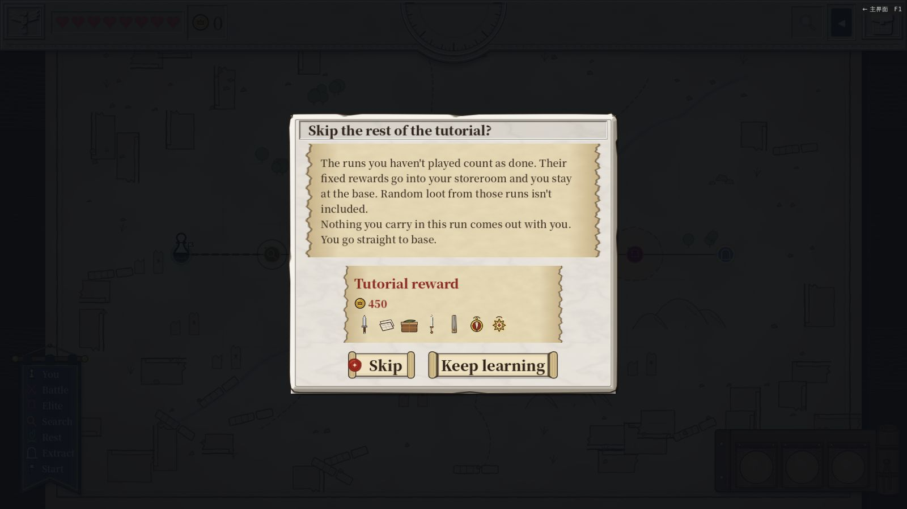
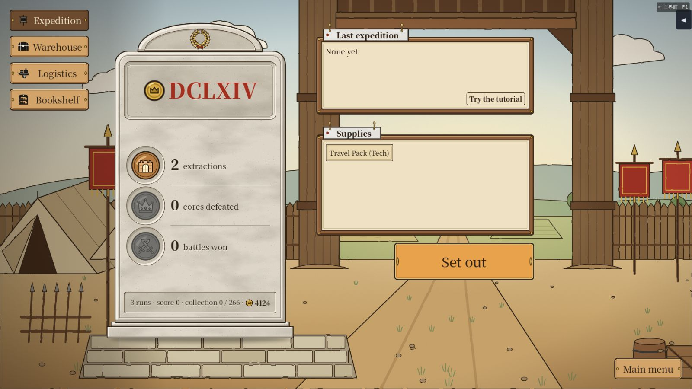

# v6.35–v6.44 统一教程回归与 F 批真实界面走查

> 日期：2026-11-18。对象：统一教程方案（[plan](../../plans/2026-11-18-unified-tutorial-and-base-return.md) §12.2）A–F 批，报告 321–328。
> 最后一轮在 main `c46cfb2b`（v6.44，PR #661）上跑。全套截图、录像和完整日志在共享文件夹 `testing/2026-11-18-v644-F/`；探针脚本和每局关键日志进了仓库 [evidence/2026-11-18-unified-tutorial/](evidence/2026-11-18-unified-tutorial/)。

## 一、结论

- 全量测试：41146 项断言、331 个套件全过，0 条脚本错误；静态警告 0 条。平衡场景检查结果和以往一样：合法 100 份，有问题 8 份，全被挡住。
- §12.2 要求的三条路径都走通了：正常打完三段、部分跳过、失败后重试。正式版和切片都跑了，中文和英文各跑默认、大两档字号。
- F 批两个新入口都能用：
  - 局内暂停菜单的「跳过剩余教程」；
  - 切片老档的「体验统一教程」。
- 我在 v6.43 报的基地快速连切页签脚本错误，v6.44 已经修好。18 局走查日志里一条也没有了。
- 这一轮没发现新的游戏缺陷。下面 §四 有三处观察和两处字号偏紧，交给作者判断。

## 二、走查矩阵（v6.44）

探针用真鼠标点基地页签、出征页【开始探索】、跳过键、确认页两个键、暂停菜单和老档的体验键。地图、事件、战斗这些环节走游戏接口。

| 路径 | 中文默认 | 中文大 | 英文默认 | 英文大 |
|---|---|---|---|---|
| A 正常打完三段 | 正式 ✓ 切片 ✓ | 正式 ✓ 切片 ✓ | 正式 ✓ 切片 ✓ | 正式 ✓ 切片 ✓ |
| B 第一段打完，在基地跳过 | 正式 ✓ 切片 ✓ | — | — | — |
| C 第一段输掉，再重试 | 正式 ✓ 切片 ✓ | — | — | — |
| P 第二段局内暂停菜单跳过 | 正式 ✓ 切片 ✓ | 正式 ✓ | — | 正式 ✓ |
| L 切片老档「体验统一教程」 | 切片 ✓ | — | 切片 ✓ | — |

另外单独复现了确认页（`repro644.gd`）：中文默认、中文大、英文大三种设置下各真点 3 次【接着学】（同帧按放、直接发信号、按放分两帧）。之后 17 帧内地图都没有走动，暂停菜单还开着。

## 三、各路径看到的结果

### A 正常三段（正式版、中文默认）

| 段 | 结算 | 教程奖励小纸 | 回基地后 |
|---|---|---|---|
| 1 | 撤离 | 3 件道具图 | 钱 167，仓库 7 件，有待入库；先放基地导览（入库动作步真点了【一键置入】），木牌「教程 2/3」 |
| 2 | 撤离（第 9 点教学商店，进了能出来） | 2 件道具图 | 钱 377，木牌「教程 3/3」 |
| 3 | 撤离 | 只有金币 | 三段都通了，木牌换成「上回出征」和「军需」 |

- 在基地切四个页签、挂 6 拍，都没有自己开局。每一段都要点【开始探索】才开。
- 教程三第一座神坛：骰子和护符碎片放上祭品台，预览 +60 信力、升到 1 阶，献祭后蛮神 Lv.1。
- 接过日神护符后，第二战要求「激活蛮神」。把蛮神护符重新落下（右键重放）就恢复了，选项随之可选。
- 第二座神坛在 2 阶，没有祭品时列出两个特殊操作：「祈求赐福（花 40 信力……）」「献祭 5 生命上限」。真点了「祈求赐福」，神坛随即关闭。
- 英文两档同样走通。英文神坛文字为「Altar · The Brute Lv.0 · 19 / 30」，特殊操作是「Pray for a Blessing (40 Faith: bless your most valuable item)」。

### B 第一段打完，在基地跳过

- 出征页的「跳过剩余教程」：清单显示补 350 金币。真点【跳过】后：
  - 钱从 167 变成 517；
  - 仓库从 7 件变成 11 件；
  - 解锁里有 `prologue2_done`、`prologue3_done`；
  - 木牌换成「上回出征」。
- 正式版和切片结果一样。

### C 第一段失败后重试

- 真玩第一段很难输：空手打输两仗只扣 2 点体力（6/8），在走过的点之间来回走也不耗体力，最后照样撤离。所以失败这一步用了**测试辅助**：去第一场战斗前把体力压到 1，棋盘只留包。
- 输了以后：
  - 结算标题是「战败」，没有教程奖励小纸，见识 +0；
  - 回基地，钱 0，仓库 4 件（开局装备）；
  - 木牌「序章：废墟边缘 / 教程 1/3」，【跳过剩余教程】还在；
  - 账本里第一段没有记成完成。
- 点【开始探索】重开第一段，撤离后：
  - 奖励照常发，钱 167，3 件道具；
  - 场次 2，撤离 1，战败 1。
- 后面两段照常打完。正式版和切片结果一样。

### P 局内暂停菜单跳过（F 批新入口）

- 第二段一进地图按 Esc，暂停菜单里有「跳过剩余教程」，真点后弹出确认页。确认页和出征页是同一张，多一句「这一局身上的东西不会带出来」。
- 先点【接着学】：确认页关掉，地图不动，钱和场次都不变。
- 再进来点【跳过】：
  - 直接回基地，没有结算；
  - 场次还是 1，没有多记一场；
  - 钱从 167 变成 517（补了第二、三段的 350）；
  - 三段都记为通过。

### L 切片老档「体验统一教程」（F 批新入口）

- 老档构造：`tests/fixtures/meta_v4.json` 改成场次 3、撤离 2、战败 1、钱 300，放进 `user://slice/slots/1/`。
- 从主菜单真点「继续」进基地：
  - 出战没锁（下一段「全通」，`prologue3_done` 已补），木牌是「上回出征」；
  - 右下有「体验统一教程」。
- 真点后直接开第一段，打完领第一段的固定奖励：钱从 4124 变成 4291，3 件道具。回基地后体验键还在，下一次是第二段。
- 正式版和新切片档都没有这个键，18 局里每次都记了一行。

## 四、观察（不算缺陷，请作者判断）

1. **教程三段打完后「上回出征」写「尚无」**：碑上写「3 局 · 总分 2188」、3 次撤离，木牌却写「尚无」。看来教程局不记入「上回出征」，但两处放在一起，玩家可能会疑惑。[截图](images/2026-11-18-tut-all-done-board.jpg)
2. **第一段几乎不会失败**：方案里的「第一局失败也正常结算并回基地」做好了，但正常玩很难触发，只能靠测试辅助验证。需不需要给新手一个真实的失败可能，由作者决定。
3. **英文确认页把仓库叫「storeroom」**：页签和其他地方都叫「Warehouse」。

字号偏紧，都在英文大字号下：

- 暂停菜单的「Skip the rest of the tutorial」字贴到纸卷两端（[截图](images/2026-11-18-tut-pause-menu-en-large.jpg)）；
- 确认页的「Keep learning」也贴边。

两处都没有被截断。

## 五、v6.35–v6.43 回归摘要（每版合并后都跑过）

| 版本 | 全量 | 走查要点 |
|---|---|---|
| v6.35 A | 过 | 锁定与出战：结算和主菜单的「继续」都回基地；出征开第二段 |
| v6.36 B | 40797 / 325 过 | 第一段后跳过补 350；开场跳过补 450 加 7 件；重复跳过不重复发；v4 老档钱数不变，不补发 |
| v6.37 C | 过 | 讲解卡：点阴影不翻页；【上一步】【收起】正常；收起不记看过；暂停菜单「重看教程」正常；卡片开着时回放停在 0.00 |
| v6.38 D1 | 过 | 木牌「教程 2/3」，确认页列出 350 和 4 张道具图。**报**：结算后跳过没反应、跳过后基地不刷新（v6.39 修） |
| v6.40 D2 | 过 | 切片四个页签、两项科技。**报**：切片市场缺铁矿等 4 种材料（v6.41 修，三张配方都锻成了） |
| v6.42 D3 | 41054 / 329 过 | 基地导览的入库动作步要真点一键置入；收起不记看过，再进基地重放；4 种设置组合都看了 |
| v6.43 E | 过 | 第二段教学商店；第三段神坛讲解读的是真实阶数和信力。**报**：基地快速连切页签时 `_swap_backdrop` 报脚本错误（v6.44 修） |
| v6.44 F | 41146 / 331 过 | 本报告 §二至 §四 |

## 六、没覆盖到的

- 方案 §12.2 中这些项没测：
  - 第三段中途跳过、保存后重开、崩溃恢复、保存失败；
  - 满仓；
  - 小窗口、改键、纯键盘操作；
  - 「目标不在屏内先定位」。
- 拖放献祭没有真拖：祭品是通过神坛屏的 `put_on_table` 放上去的，护符重新落下也是走接口。
- 失败路径是测试辅助的（见 §三 C）。
- 首次玩家理解验证（分清生命和体力、会合成、找得到仓库和科技、知道能留在基地、会主动开下一段）需要作者找新玩家做，自动走查替代不了。

## 七、脚本

都在 [evidence/2026-11-18-unified-tutorial/](evidence/2026-11-18-unified-tutorial/)：

- `s3.gd`：F 批探针，模式有：
  - tutA：正常三段；
  - tutB：第一段后跳过；
  - tutC：失败后重试；
  - tutP：暂停菜单跳过；
  - tutL：老档体验。
- `tutF44.sh`：矩阵运行器。
- `repro644.gd`：确认页【接着学】复现。
- `tut635.gd`、`exp593.gd`、`tech620.gd`：A–D3 批的探针。
- `r644.sh`：全量测试运行器。
- `xr.sh`：xvfb 启动脚本。
- `<设置>_<版本>-<路径>.log`：每局的关键日志行。
