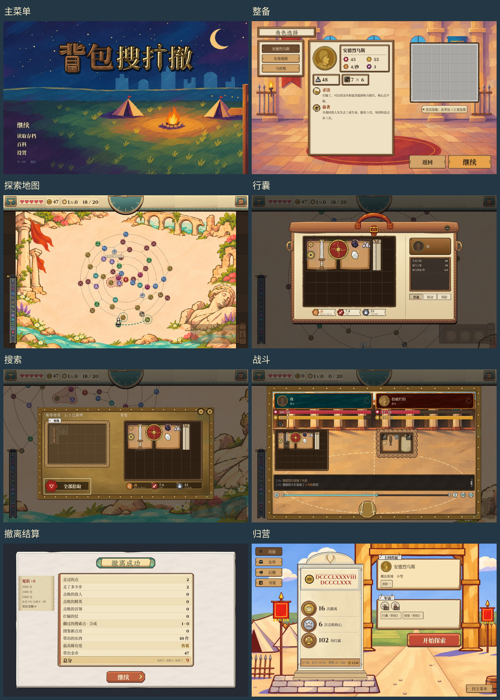

# 玩家界面 · 明亮厚涂全局验收

以美术分支的出征首样 `c5e544f4` 为比较点。运行画面沿用 main 的二维轮廓与场景用途。动笔优先处理近景缺层次、底图与文字争夺注意力、按钮难以辨认的地方。同一套操作在不同屏保有相同反馈。道具作画留到下一阶段。

## 逐屏取舍

| 玩家位置 | 保留的识别特征 | 本轮调整与验收重点 |
|---|---|---|
| 主菜单、存档与设置 | 原中英字标、透明文字菜单、三种营地场景 | 营火、登记口、地图桌分别用大色块建立视线；底部小字提亮。档位和进度分两行，设置选项可换行、返回键有固定位置。 |
| 选角、配装与选图 | 选角厅的窗、整备室两侧挂架，角色与物品原图 | 背景在控件下方减纹，重点留给角色属性、仓库和背包；配装读数提亮，英文大字号下长告示避让标题。 |
| 基地出征 | 营门中央的道路、左侧弧顶军功碑、右侧军令与军需 | 天空和木柱收色。碑沿以厚涂切面塑形，读数区留净；空军需用短牌，朱红「开始探索」作为主动作。验证 888,888 估值两种记法和满军需大字号。 |
| 基地仓库、市场、铁匠、书架 | 库存原格、分类木牌、配方工单、五个可点石龛 | 仓库工具纸随出售模式、撤回背包伸缩。市场与铁匠的柜台、档案室的书架分别组织近景。优化页签焦点、配方名称对比度和关闭档案后的焦点归位。实际切换五窗、购买短矛、点开短剑配方。 |
| 探索地图、暂停与背包 | 节点图、棋子、石梁和独立半圆日晷；皮包轮廓和道具原图 | 五章远景各有地貌。两个暗色章节的整图道路至少宽 1.6 像素，可走路线另有薄荷色双描边。点击脚下棋子或按 N 可重开当前节点，顶栏移去放大镜。落点用勾、双箭或叉区分放置、交换、无效。 |
| 搜索、战利品 | 容器与玩家棋盘并排，保留揭示进度 | 明确两侧归属和已揭示数量；搜索层三个操作可用 Tab 正反循环，收起后重开仍是同批物品。 |
| 战前准备、战斗回放 | 铜框、双方阵列与时间轴 | 用底色和文字标阵营；出手轮廓盖过冷却遮罩。终局可读到倒下状态，「跳至结尾」变灰，保留继续与重播。 |
| 事件书、商店、神坛、保险箱、求饶 | 书页、帐篷、供桌、物品托付与天平各有专用形状 | 保留浅色阅读面。神坛操作按当前条件更新，献祭预览给出祈愿收益；已托付物件有蜡封，天平金额适配铭牌。 |
| 休息营地、宝箱、局内铸炉 | 场景里直接操作设施、锁孔和三个投料位 | 四张营地与五张宝箱背景按原设施、锁孔和容器的位置重新配色。冷炉和热炉在同一构图上改变炉墙反光，中英文路牌均在画面内。营地设施可用键盘查看，开锁进度有亮弧和端点。 |
| 百科与公共告示 | 石板目录、纸面正文和卷轴 | 目录有独立键盘焦点，长标题可换行，翻新条目从正文顶端读起。较长告示按可用宽度换行，价格有独立位置。 |
| 撤离、战败、归营入库 | 原有账簿、计分与仓储流程 | 月桂和断矛分别标记撤离与战败。入库、整理、继续分层，金额与总分保持清楚。实测撤离后五件全部入库、战败后返回基地。 |

**字体。** 军功碑、金额和顶栏数值采用项目的 Cinzel Bold 碑铭字，中文采用思源宋体；原版字标与各类正文保留各自用途。字重、字体文件和 OFL 授权随项目交付。三档字号实测 48 组碑额排版，覆盖长数字、上划线与中英文。

## 实机证据

- [出征页同档对照](images/bright-expedition-review-comparison.jpg) · [中文大字](images/bright-expedition-review-zh.jpg) · [英文大字](images/bright-expedition-review-en.jpg)
- [存档、设置、百科、准备与局末补充画面](images/bright-global-supporting-screens.jpg) · [基地四处操作](images/bright-global-base-rooms.jpg)
- [五章地图整图对照](images/bright-global-map-palettes.jpg) · [地图远景](images/bright-global-map-overview.jpg) · [近景](images/bright-global-map.jpg) · [背包](images/bright-global-inventory.jpg) · [搜索](images/bright-global-search.jpg)
- [战斗回放](images/bright-battle-replay-zh.jpg) · [英文终局](images/bright-battle-result-en.jpg) · [撤离结算](images/bright-global-ledger.jpg)
- [营地、宝箱、铸炉、商店、事件](images/bright-global-node-scenes.jpg) · [神坛、托付、求饶](images/bright-global-specials.jpg)

主要截图取自 Godot 4.7.1 的 1280 × 800 玩家视口。菜单到探索与归营走真实场景入口；战斗使用同种子、同配装的独立取样。支线采用对应节点的真实界面和测试状态。截图覆盖简中与英文常见及大字号场景；各语言、各章节与所有支线的笛卡尔积未逐张截图。

## 复验方法与结果

- **走一遍普通玩家流程。** 使用玩家入口建档，经过整备、探索、搜索和撤离回到基地。用同一份基地存档切换五个房间，在市场购买短矛，余额由 520 变成 472，仓内物品由 25 件变成 26 件。在仓库切换快速出售，空载工具板的高度由 391 变为 586 设计像素，取消后恢复。另用带回的 6×4 棋盘验证出售时仍能看见整块棋盘。
- **重看地图教程。** 在序章选点前打开暂停菜单并重看，最后一步指向可选出生点；落子后重看，同一步指向棋子。简中、英文均在真实地图上验证过提示与高亮。配装溢出的修复另在 1600×1000 的中、大字号复测，两位角色的板底均为 832。
- **校正测试状态。** 为悬停测试分别准备无配方链接的物品和真实纱布，鼠标进入空格与移到可点击的配方提示窗各有明确预期。重复配装测试使用实际入仓路径分配编号。预热测试先清理整组战斗纹理缓存，确保计数不受上一套测试影响。
- **导出后再启动。** 用 Godot 4.7.1 的「玩家版」预设导出 PCK，离开源码目录后从包内加载全部 19 个注册画面、碑铭字体和 9 张代表性贴图，实际打开基地五页并进入自由模式地图。退出无头走查时 Godot 仍报告退出时有资源和 RID 被引用，这是项目已登记的退出日志。
- **全项目回归。** Godot 4.7.1 执行 `bash tools/test.sh`，340 个套件、41,566 项断言通过，退出码为 0。全项目加载 1,091 个脚本，35 种内容一致性检查通过。测试期间故意构造的坏文件、无解地图等按仓库既有的预期错误列表区分。随后按内容检查提示微调暗底生命值与危险文字的红色，单独复跑字色套件（78 项断言）、脚本及内容检查。两条暗底对比度提示均已消除，并重新导出玩家包。
