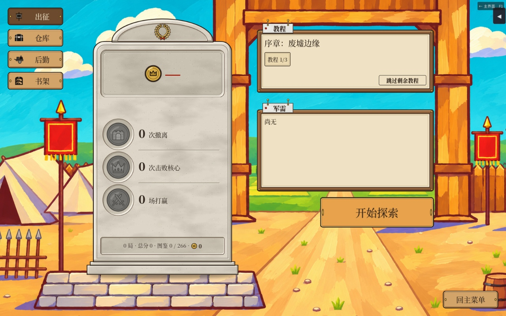

# 出征营门 · 明亮厚涂首样

以 main 的 a49899e4 为底稿，沿用帐篷、木寨、门楼与碑台的构图。运行时改动仅一张 1920 × 1080 背景贴图。

Godot 4.7.1，Compatibility 渲染，1280 × 800。从游戏场景进入基地出征页，核对碑脚与石台、原版军令、页签与出发按钮。cursor_press_271 套件 16 项断言通过。截图驱动退出时引擎报告资源未释放。本次验证范围为出征页。

