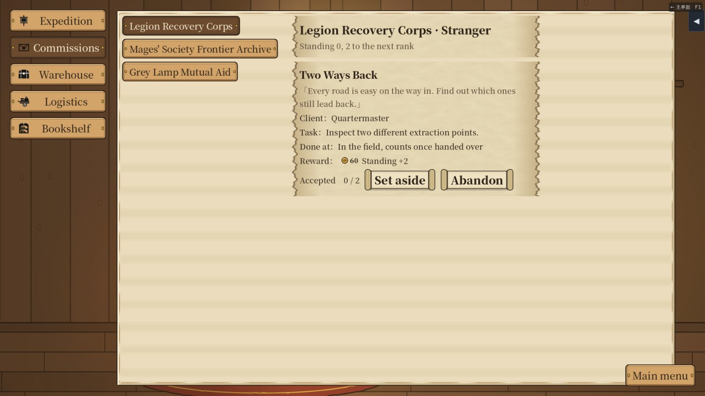
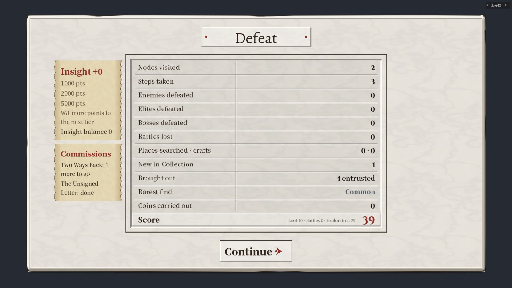
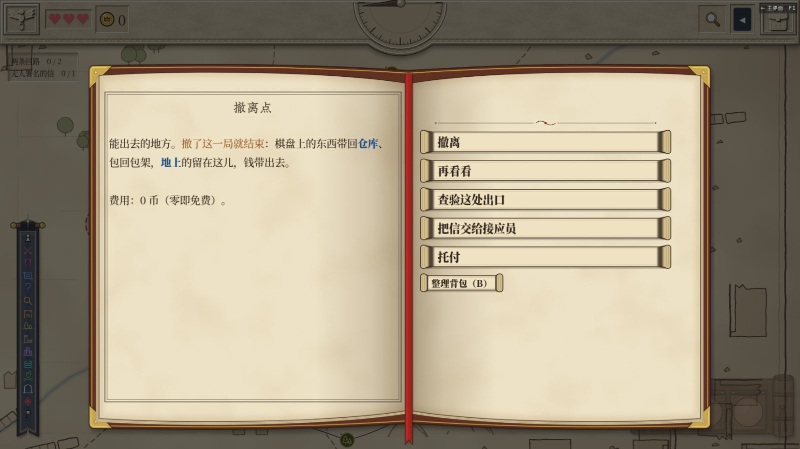
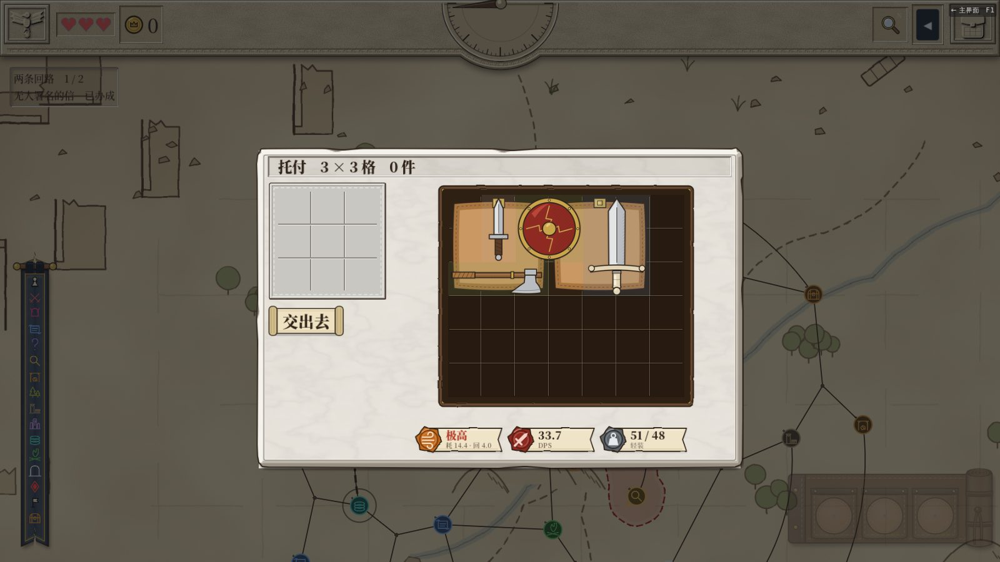
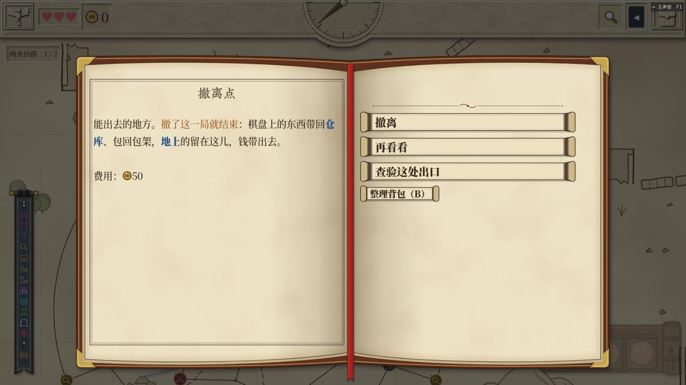

# v6.58–v6.59 阵营与委托 W1、撤离点【托付】：全量测试和真鼠标走查

> 日期：2026-11-19。
>
> 测试对象：
> - v6.58（PR #686，报告 337）：基地「委托」页签、撤离点事件的查验和交信、地图左上角的委托小牌、结算屏的委托段。
> - v6.59（PR #687，报告 338）：撤离点事件末尾的「托付」。
>
> 测试版本：全量测试 v6.58（`fe7806d7`）、v6.59（`c1bda5ae`）各跑一遍；走查都在 v6.59 上跑。
>
> 证据位置：全套截图和日志在共享文件夹 `testing/2026-11-19-v659/comm-<设置>/`；走查脚本在 [evidence/2026-11-19-commissions/](evidence/2026-11-19-commissions/)。

## 一、结论

- **全量测试**：
  - v6.58：41781 项断言、343 个套件全过。
  - v6.59：41801 项断言、344 个套件全过。
  - 两次都是 0 条脚本错误，静态警告 0 条。
- **报告 335 第四节的循环**：中文默认、英文大字号、中文大字号三组都走通。读档、重进节点、回主菜单再读都不重复记账。
- **【托付】**：v6.58 时真玩确实点不到。地图上带【托付】的撤离确认框只有测试会打开，游戏里没有调用方。v6.59 之后免费撤离点的事件里有「托付」，真鼠标点得到，托付屏能开能关，关了站在原地点节点会再弹撤离。付费撤离点没有这一项。
- **W1 的查验和交信**：加了「托付」以后不受影响，位置还是第 3、4 项，「托付」排在后面。
- **要执行线程看的问题**：1 处，见第四节。另有 3 处观察交作者判断。

## 二、走查流程

每组设置都是一份新存档，拒教程直接进基地。基地、事件屏、托付屏、结算屏上的键都是真鼠标点的。以下几处用了测试辅助：

- 开局屏的出生点直接调 `pick_spawn`；
- 进图后棋盘加五件武器，防路上打输；
- 托付屏里把匕首放进托付格；
- 第一局用 `fail` 直接败退；
- 节点在屏幕外时直接调 `_on_node_pressed`，因为脚本不会拖动地图。

| 步骤 | 结果（三组一致） |
|---|---|
| 基地左列 | 页签是「出征 / 委托 / 仓库 / 后勤 / 书架」，委托排第二。教程跳过后就能看到 |
| 委托页 | 左列三方：边区军团接应队、魔法师协会边境考据所、灰灯互助会。卡上写委托人、做什么、在哪完成、报酬（金币图 + 声望） |
| 接《两条回路》《无人署名的信》 | 卡上变成「已接　0 / 2」，键变成「暂缓 / 放弃」 |
| 考据所《照抄也要做得出》 | 接下键灰着，提示「同时最多接两份」。配方下拉灰着，提示「没有现在能打的配方」 |
| 第一局进图 | 背包里有一封「未署名的信」。左上小牌两行：「两条回路　0 / 2」「无人署名的信　0 / 1」 |
| 走到免费撤离点 | 事件屏的键依次是：撤离、再看看、查验这处出口、把信交给接应员、托付 |
| 真点「把信交给接应员」 | 结果页写「把信交给接应员」，点继续回到同一事件。交信那项没了，小牌变成「已办成」 |
| 真点「查验这处出口」 | 回到同一事件，查验那项也没了，小牌「两条回路　1 / 2」。本局记账 2 条 |
| 存档 → 主菜单 → 真点「继续」 | 回到撤离点事件，查验和交信都不再出现，记账还是 2 条 |
| 真点「托付」 | 打开托付屏（3×3 格，键「交出去」）。放进匕首，点「交出去」回地图，人还在撤离点 |
| 站在原地点自己的节点 | 撤离事件再弹，「托付」还在，可以照样撤 |
| 「再看看」→ 走开一格 → 走回来 | 事件再弹，查验和交信都不出现，记账还是 2 条 |
| 败退 | 结算屏左边「委托」段写「两条回路：还差 1 处」「无人署名的信：办成了」。「带出」一栏写「1（托付）」 |
| 回营委托簿 | 灰灯「声望 1，下一级还差 1」，信那份「已办成」，回执「无人署名的信：办成了」。军团那份「已接　1 / 2」。回主菜单再读，数一样 |
| 第二局 | 只带《两条回路》，没有信。免费撤离点：查验、托付都有。付费撤离点：有查验，没有托付 |
| 付费点真点查验，走回免费点真点撤离 | 结算屏写「两条回路：办成了」。委托簿军团「熟面，声望 2」，回执「两条回路：办成了」。再读一致 |

英文是 "Inspect this exit / Hand the letter to the contact / Entrust"、"Two Ways Back: 1 more to go"、"The Unsigned Letter: done"。大字号下卡、事件键、结算屏的委托段都没有溢出。






## 三、不重复记账

- 交信、查验各记一次后，以下几种情况都没有再记：
  - 存档读档；
  - 关托付屏后再弹事件；
  - 走开再回来。
  事件里那两项也不再出现。
- 败退结算后，局外进度 1（军团）、办成 1（灰灯）。回主菜单再读，数字不变。
- 第二局结算后，局外两份都办成，声望军团 2、灰灯 1。再读不变。

## 四、要执行线程看的问题

**局内小牌不算之前几局的进度。**

- 第一局查了一处，局外已经记了 1 / 2。可是第二局一进图，小牌写的还是「两条回路　0 / 2」。
- 第二局查完第二处，委托其实已经办成，结算屏也写了「两条回路：办成了」。但局内小牌只写「1 / 2」，不写「已办成」。
- 原因：`CommissionModule.lines()` 只数这一局记的条数，出征快照里只有「第几步」，没有这一步已经做到几。
- 报告 337 把查验改成了跨局累计，这块牌子就会和实际进度对不上。

三组设置都能复现。

## 五、观察（交作者判断）

1. **走事件屏办成委托，没有告示。** 交信、查验以后，结果页只重复一遍选项名（「把信交给接应员」）。「信已送达」「查验了这处撤离点」「委托办成，回营领酬」这几句告示只挂在地图确认框那条路上，真玩不会出现。
2. **撤离点事件正文写「费用：0 币（零即免费）」**，英文是 "Fee: 0 coins"。用了「币」字，项目规则是钱一律用金币图标。这句是 `extract_default` 原有的正文，不是这次加的。
3. **委托小牌是半透明底。** 地图上的房屋线条透过来压在字上，看着有点乱（占位美术）。

## 六、复现

```
SUITE=1 WALKS="" bash r645.sh                          # 全量测试 + 场景校验 + 静态警告
COMBOS="zh_normal en_large zh_large" bash chain659.sh  # 委托循环 + 托付走查
```

## 七、v6.60 复测（PR #689）

这一轮在 main `7ed73f25`（v6.60）上跑。截图在共享文件夹 `testing/2026-11-19-v660/`。

- **全量测试**：41809 项断言、344 个套件全过，0 条脚本错误，静态警告 0 条。
- **走查**：用第二节的同一套流程，在中文默认、英文大字号、中文大字号三组设置下各走两局，三组结果一致。
- **第四节的问题已修好**：
  - 第二局一进图，小牌写「两条回路　1 / 2」（英文 "Two Ways Back　1 / 2"），和局外进度一致。
  - 在付费撤离点查完第二处，小牌当场变成「已办成」（英文 "Done"），和结算屏「两条回路：办成了」一致。
- **第五节第 2 条已修好**：
  - 付费撤离点正文最后一行是「费用：〔金币图〕50」（英文 "Fee: 〔金币图〕50"），不再写「币」字。
  - 免费撤离点没有这一行。
  - 图：`v660-paid-extract-fee-coin-zh-large.jpg`。
- **不重复记账**：
  - 第一局交信、查验后，存档读档、关托付屏后再弹事件、走开再回来，事件里那两项都不再出现，本局记账始终 2 条。
  - 第一局结算后，局外是军团进度 1、灰灯办成，回主菜单再读数字不变。
  - 第二局结算后两份都办成，声望军团 2、灰灯 1，再读不变。
- **托付**：免费撤离点照旧有「托付」，付费点没有。
- 走查脚本这一轮补了两处：
  - 寻路时绕开核心节点；
  - 点节点前先收起悬浮窗。前一个节点的悬浮窗会挡住相邻节点，脚本直接点击时点到了悬浮窗上。真玩时鼠标移过去悬浮窗会先收起，所以不算游戏问题。


