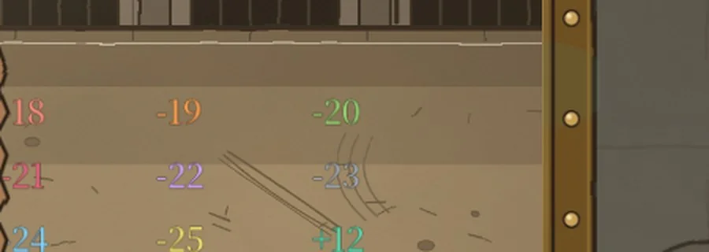
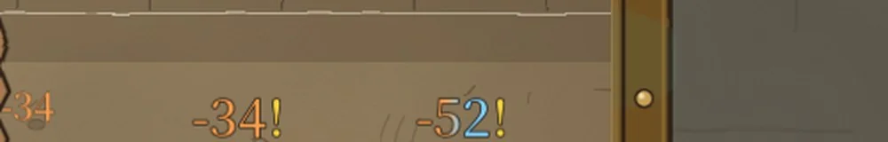
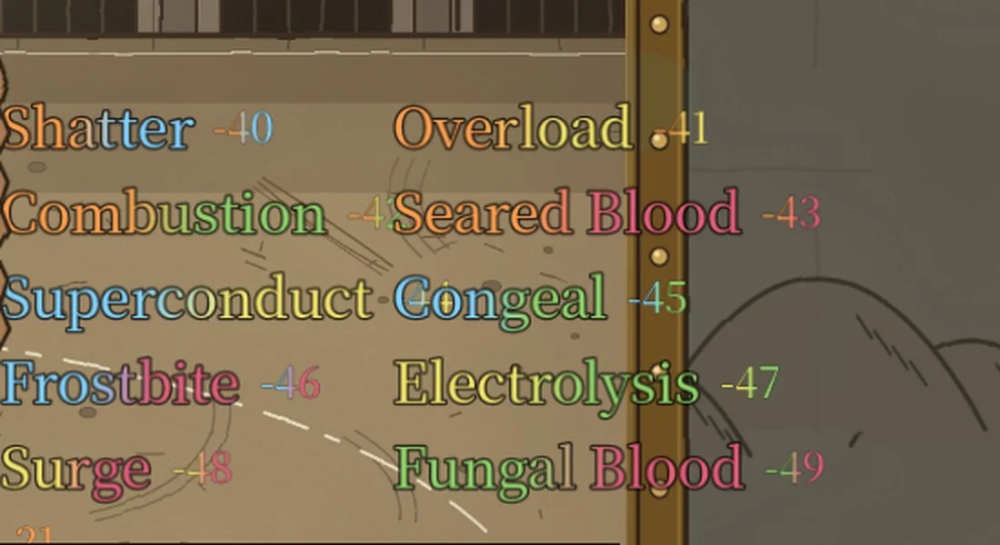
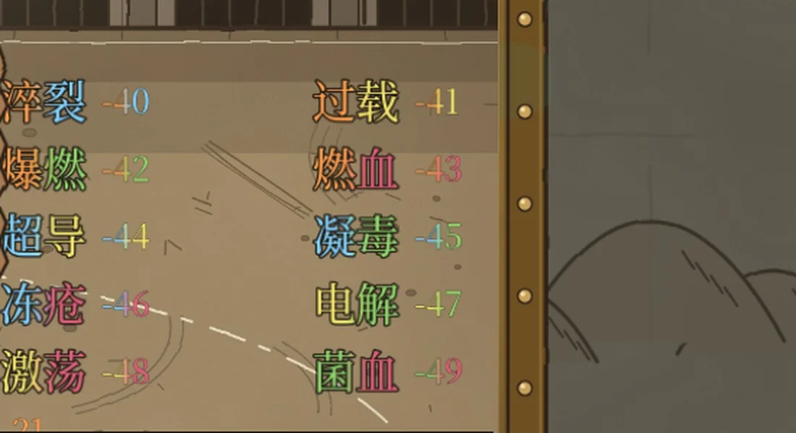
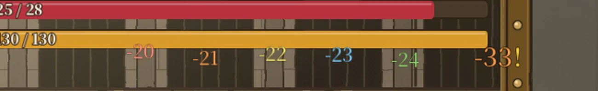

# v6.62–v6.64 战斗伤害跳字：全量测试和渲染走查

> 日期：2026-11-20。
>
> 测试对象：
> - v6.62（PR #692，报告 340）：按[报告 339](../339-damage-popups-speed-colors-gradient.md) 第四节验收。
> - v6.64（PR #694）：治疗改青绿，暴击的「!」染金。
>
> 测试版本：
> - 全量测试在 v6.62（`8a848de3`）和 v6.64（`7898f7df`）上各跑一遍。
> - 走查在两个版本上各跑一遍，本文的截图来自 v6.64。
>
> 证据位置：全套截图和日志在共享文件夹 `testing/2026-11-20-v662/`、`testing/2026-11-20-v664/`、`testing/2026-11-20-v664b/`；走查脚本在 [evidence/2026-11-20-damage-popups/](evidence/2026-11-20-damage-popups/)。

## 一、结论

- **全量测试**：
  - v6.62：41858 项断言、345 个套件全过。
  - v6.64：41864 项断言、345 个套件全过。
  - 两次都是 0 条脚本错误，静态警告 0 条。
- **走查**：中文默认、英文大字号、中文大字号三组设置下都没发现问题。
  - 跳字时长跟倍速，暂停时停住，继续接着飘。
  - 冰、雷有自己的颜色。治疗是青绿，和毒绿分开了。暴击保留类型色，「!」是金色。
  - 十种反应的反应名和反应伤害数字都是两色渐变，普通伤害仍是单色。
  - 数字有细黑描边。
- **着色器能出画面**：走查用 xvfb 开窗口、OpenGL 渲染，不是 `--headless`，渐变在截图里看得到。
- **没验到的一项**：暴击出现时放大到 1.3 倍。xvfb 下软件渲染每秒只有 7 帧左右，0.12 秒的放大在一帧里就做完了，脚本量到的最大缩放只有 1.00–1.01。要在真机上看一眼。
- **观察 1 处**（交作者判断）：见第四节，跳字飘过敌方体力条时，橙、黄两色不好认。

## 二、怎么测的

- 新存档拒教程，开常规图，走到第一场战斗。
- 倍速键、暂停 / 继续键都是真鼠标点的。
- 跳字是测试辅助直接在敌方面板上调 `popup` / `popup_text` 打出来的，参数和战斗里一样，然后摆开、停住再截图。这样八种伤害、暴击、十种反应都能放进一张图，不用等实战打出来。
- 为了看清，大部分截图把字摆在面板下面的沙地上。第四节另截了一张字在原位的。

## 三、结果

### 1. 倍速时长

时长按游戏时间算（每帧的 delta 累加）。帧率低，精度约一帧 0.13 秒。两个版本、三组设置结果一样。

| 倍速 | 伤害数（应为） | 伤害数（实测） | 反应名（应为） | 反应名（实测） |
|---|---|---|---|---|
| 1 倍 | 0.9 秒 | 0.92–0.94 秒 | 1.2 秒 | 1.21–1.33 秒 |
| 2 倍 | 0.45 秒 | 0.52–0.55 秒 | 0.6 秒 | 0.65–0.67 秒 |
| 4 倍 | 0.3 秒 | 0.40–0.41 秒 | 0.5 秒 | 0.52–0.54 秒 |

实测都只比应为值多出不到一帧，是帧率低造成的。

### 2. 暂停

- 飘到一半时真点暂停：回放停了，面板上的字停在原地，30 帧里位置和透明度都没变。
- 再点继续：下一帧字就接着往上飘（三组各上移 6–7 像素）。

### 3. 八种伤害和治疗

| 类型 | 颜色 |
|---|---|
| 物理 | `#ff8a7a` |
| 火 | `#ff9d4d` |
| 毒 | `#8ed36b` |
| 流血 | `#e05c7a` |
| 反伤 | `#c9a0ff` |
| 吸取 | `#9aa3b2` |
| 冰 | `#7fd0ff` |
| 雷 | `#f2e36b` |
| 治疗 | `#4fd8b0`（v6.62 是 `#5cb85c`） |

都是细描边（2）。冰、雷和其它几种分得开，治疗青绿和毒绿也分得开了。



### 4. 火属性暴击

- v6.64 的暴击数字是「-34」，用火的橙色 `#ff9d4d`。后面的「!」单独一段，是暴击金 `#ffd23f`。
- 字号 32（普通 23），描边 4（普通 2）。大字号下是 35 对 25。
- 暴击打在反应上（火 + 冰）：数字是火 → 冰的渐变，「!」仍是纯金色，不吃渐变。
- 放大一下没截到，见第一节。



### 5. 十种反应

| 反应 | 两色 |
|---|---|
| 淬裂 | 火 → 冰 |
| 过载 | 火 → 雷 |
| 爆燃 | 火 → 毒 |
| 燃血 | 火 → 流血 |
| 超导 | 冰 → 雷 |
| 凝毒 | 冰 → 毒 |
| 冻疮 | 冰 → 流血 |
| 电解 | 雷 → 毒 |
| 激荡 | 雷 → 流血 |
| 菌血 | 毒 → 流血 |

- 反应名和反应伤害数字都挂了渐变材质，字本身是白色。截图里能看到左半一色、右半另一色，中间过渡。描边仍是黑的。
- 英文长名（"Superconduct"、"Fungal Blood"）也是从左到右渐变。
- 同一面板上的普通火伤害没挂材质，是单色 `#ff9d4d`。




## 四、观察（交作者判断）

**跳字起点压在敌方体力条下沿，往上飘时会穿过体力条和血条。**

- 跳字出现在面板高度的 0.45 处（加减 8 像素），往上飘 42 像素，正好经过橙色的体力条和红色的血条。
- 火的橙色、雷的黄色叠在橙色体力条上，对比很弱。这次描边改细了，叠上去时更难认。
- 这个位置不是这次改的，但新颜色和细描边让它更显眼。

下图是跳字在原位停住时的样子，从左到右依次是物理、火、雷、冰、毒、火暴击：



## 五、复现

```
SUITE=1 WALKS="" bash r645.sh                       # 全量测试 + 场景校验 + 静态警告
COMBOS="zh_normal en_large zh_large" bash chain662.sh
```
