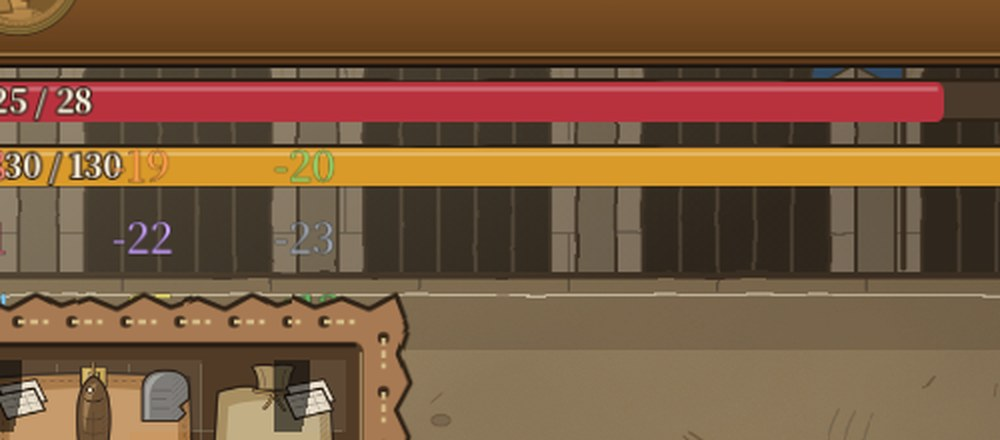
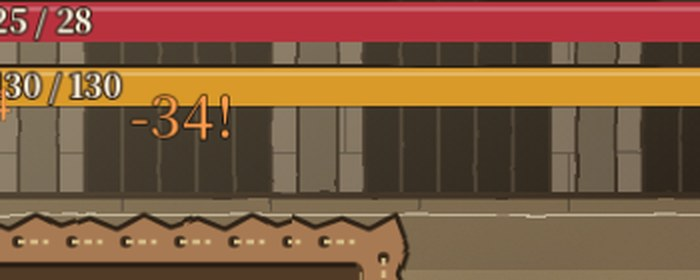
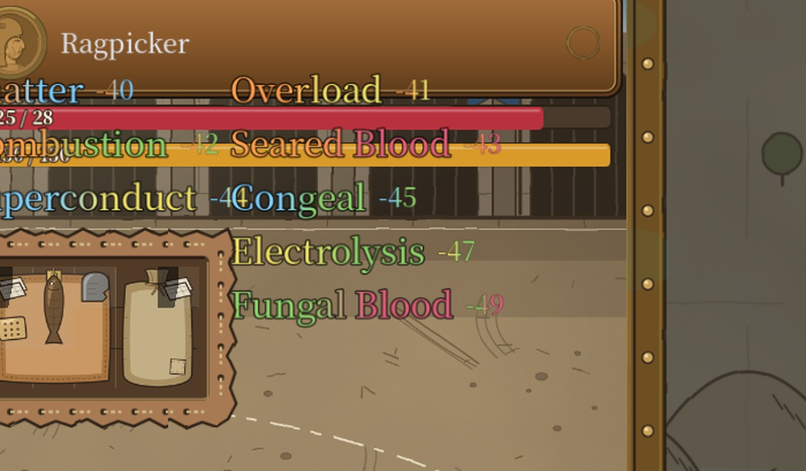
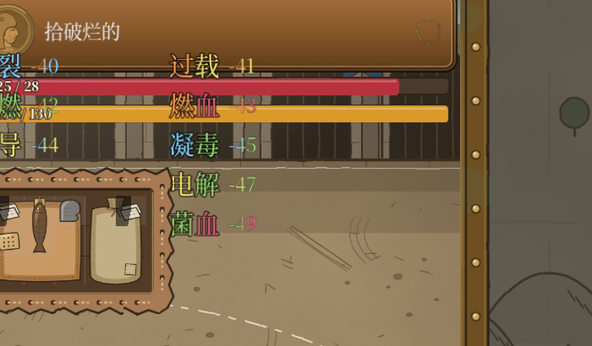

# v6.62 战斗伤害跳字：全量测试和渲染走查

> 日期：2026-11-20。
>
> 测试对象：PR #692（报告 340），按[报告 339](../339-damage-popups-speed-colors-gradient.md) 第四节验收。
>
> 测试版本：main `8a848de3`（v6.62）。
>
> 证据位置：全套截图和日志在共享文件夹 `testing/2026-11-20-v662/popup-<设置>/`；走查脚本在 [evidence/2026-11-20-damage-popups/](evidence/2026-11-20-damage-popups/)。

## 一、结论

- **全量测试**：41858 项断言、345 个套件全过，0 条脚本错误，静态警告 0 条。
- **走查**：中文默认、英文大字号、中文大字号三组设置下都没发现问题。
  - 跳字时长跟倍速，暂停时停住，继续接着飘。
  - 冰、雷有自己的颜色。暴击保留类型色。
  - 十种反应的反应名和反应伤害数字都是两色渐变，普通伤害仍是单色。
  - 数字有细黑描边。
- **着色器能出画面**：走查用 xvfb 开窗口、OpenGL 渲染，不是 `--headless`，渐变在截图里看得到。
- **没验到的一项**：暴击出现时放大到 1.3 倍。xvfb 下软件渲染只有每秒 7 帧左右，0.12 秒的放大在一帧之内就做完了，截不到。要在真机上看一眼。

## 二、怎么测的

- 新存档拒教程，开常规图，走到第一场战斗。
- 倍速键、暂停 / 继续键都是真鼠标点的。
- 跳字是测试辅助直接在敌方面板上调 `popup` / `popup_text` 打出来的，参数和战斗里一样，然后摆开、停住再截图。这样八种伤害、暴击、十种反应都能放进一张图里，不用等实战打出来。

## 三、结果

### 1. 倍速时长

时长按游戏时间算（每帧的 delta 累加，帧率低，精度约一帧 0.13 秒）。三组设置结果一样。

| 倍速 | 伤害数（应为） | 伤害数（实测） | 反应名（应为） | 反应名（实测） |
|---|---|---|---|---|
| 1 倍 | 0.9 秒 | 0.93 秒 | 1.2 秒 | 1.21–1.33 秒 |
| 2 倍 | 0.45 秒 | 0.54–0.55 秒 | 0.6 秒 | 0.65–0.66 秒 |
| 4 倍 | 0.3 秒 | 0.40–0.41 秒 | 0.5 秒 | 0.52–0.54 秒 |

实测都只比应为值多出不到一帧，是帧率低造成的。

### 2. 暂停

- 飘到一半时真点暂停：回放停了，面板上的字停在原地，30 帧里位置和透明度都没变。
- 再点继续：下一帧字就接着往上飘（三组各上移约 6 像素）。

### 3. 八种伤害和治疗

| 类型 | 颜色 |
|---|---|
| 物理 | `#ff8a7a` |
| 火 | `#ff9d4d` |
| 毒 | `#8ed36b` |
| 流血 | `#e05c7a` |
| 反伤 | `#c9a0ff` |
| 吸取 | `#9aa3b2` |
| 冰 | `#7fd0ff` |
| 雷 | `#f2e36b` |
| 治疗 | `#5cb85c` |

- 都是细描边（2）。冰、雷和其它几种分得开。
- 治疗绿和毒绿离得近。这是 339 留给作者的待定项，这次没动。



### 4. 火属性暴击

- 「-34!」是火的橙色 `#ff9d4d`，没有变成金色。
- 字号 32（普通 23），描边 4（普通 2）。大字号下是 35 对 25。
- 放大一下没截到，见第一节。



### 5. 十种反应

| 反应 | 两色 |
|---|---|
| 淬裂 | 火 → 冰 |
| 过载 | 火 → 雷 |
| 爆燃 | 火 → 毒 |
| 燃血 | 火 → 流血 |
| 超导 | 冰 → 雷 |
| 凝毒 | 冰 → 毒 |
| 冻疮 | 冰 → 流血 |
| 电解 | 雷 → 毒 |
| 激荡 | 雷 → 流血 |
| 菌血 | 毒 → 流血 |

- 反应名和反应伤害数字都挂了渐变材质，字本身是白色。截图里能看到左半一色、右半另一色，中间过渡。描边仍是黑的。
- 英文长名（"Superconduct"、"Fungal Blood"）也是从左到右渐变。
- 同一面板上的普通火伤害「-21」没挂材质，是单色 `#ff9d4d`。




截图里的跳字是脚本摆开的，有的压在血条上，那是摆放位置造成的，不是游戏里的样子。

## 四、复现

```
SUITE=1 WALKS="" bash r645.sh                       # 全量测试 + 场景校验 + 静态警告
COMBOS="zh_normal en_large zh_large" bash chain662.sh
```
