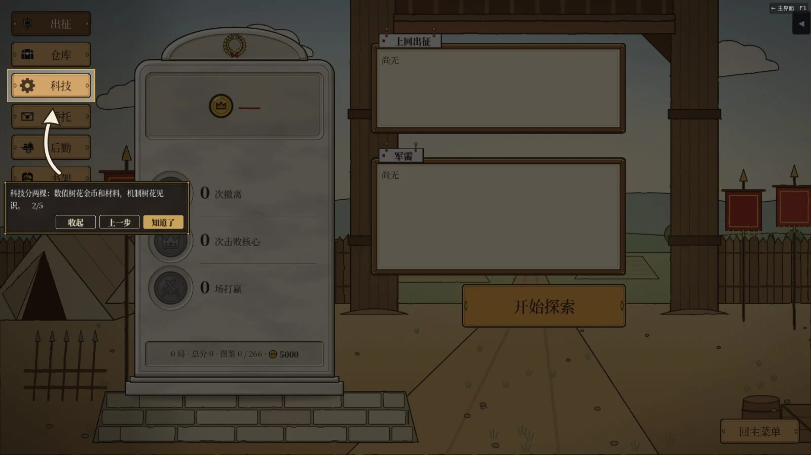
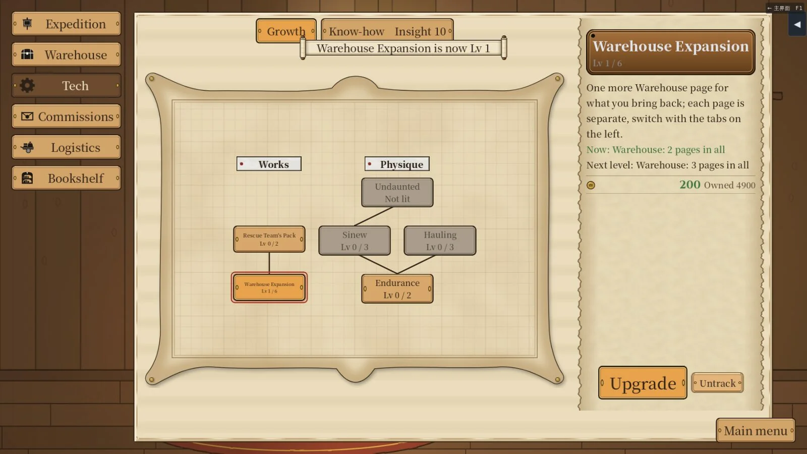
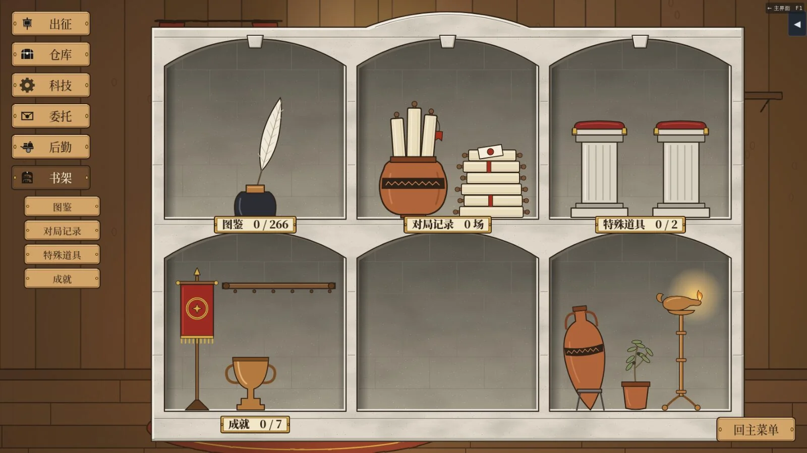

# v6.68 科技升为一级页签：全量测试和走查

> 日期：2026-11-20。
>
> 测试对象：v6.68（PR #705，[报告 344](../344-base-nav-b1-tech-tab.md)）。基地页签变成六个，科技从书架搬成一级页签，书架原科技格空出来。
>
> 测试版本：`ddd5a791`。
>
> 证据位置：全套截图和日志在共享文件夹 `testing/2026-11-20-v668/`；走查脚本在 [evidence/2026-11-20-base-tech-tab/](evidence/2026-11-20-base-tech-tab/)。

## 一、结论

- **全量测试**：41854 项断言、345 个套件全过，0 条脚本错误，静态警告 0 条。
- **走查**：中文默认、英文大字号、中文大字号三组设置都没发现问题。
  - 六个页签顺序对，真鼠标点哪个落哪个。科技页收起右半边的仓库，不出屏。
  - 基地导览第 2 步指科技页签，洞就挖在那颗页签上。书架那一步不再提科技。
  - 科技页的【升级】【追踪】不被「回主菜单」压住。真鼠标升级、追踪、换树都正常，重进基地后都还在。
  - 书架剩四颗小键、四格能点，第五格空着，第六格是油灯。
  - 试玩切片的页签是 出征 / 仓库 / 科技 / 后勤 / 书架，科技能点开。
- **快捷键和奖励链接**：游戏里没有切页签的快捷键，也没有跳到科技页的奖励按钮。和科技有关的只有结算小纸上「追踪的科技还差什么」那行字，追踪后这行字正常。

## 二、怎么测的

- 新存档。测试辅助把第一段教程记成打完、三段教程记成走完（这样委托页签会露出来，导览也会放），再给 5000 金币、10 点见识。
- 回基地后：
  1. 导览逐步真点【知道了】，记下每步指哪颗页签。
  2. 真鼠标依次点六个页签。
  3. 在科技页真点升级、追踪、机制树页签，再升一级行囊。
  4. 真点书架的四颗小键。
  5. 用旧入口 `show_tab("tech")` 切一次。
  6. 回主菜单，再按继续进基地，看导览会不会重放、科技进度还在不在。
- 试玩切片单独开一次，只看页签。

## 三、结果

### 1. 页签

| 顺序 | 中文 | 英文 | 右半边仓库 |
|---|---|---|---|
| 1 | 出征 | Expedition | 收起 |
| 2 | 仓库 | Warehouse | 露着 |
| 3 | 科技 | Tech | 收起 |
| 4 | 委托 | Commissions | 收起 |
| 5 | 后勤 | Logistics | 收起（集市整页） |
| 6 | 书架 | Bookshelf | 收起 |

- 每颗都是真点的。点完落在对应的页，那颗页签呈按下状态。
- 英文大字号下页签宽 244，"Commissions" 放得下。

### 2. 基地导览

- 导览共五步：仓库、科技、后勤、书架、出征。这次没有带回来的东西，所以没有入库那一步。
- 每一步的洞都正好是那颗页签的矩形。
- 第 2 步写的是「科技分两棵：数值树花金币和材料，机制树花见识。」，英文是 "Tech has two trees: ..."。
- 第 4 步书架写的是「图鉴、对局记录、特殊道具和成就」，不再提科技。
- 看完后回主菜单再进基地，导览不再放。



### 3. 科技页

| 设置 | 【升级】 | 【追踪】 | 回主菜单 | 压住了吗 |
|---|---|---|---|---|
| 中文默认 | 1432,811 114×69 | 1554,824 72×43 | 1577,920 176×56 | 没有 |
| 英文大字号 | 1328,806 197×74 | 1533,820 93×46 | 1576,920 177×56 | 没有 |
| 中文大字号 | 1426,806 120×74 | 1554,820 76×46 | 1577,920 176×56 | 没有 |

- 科技页在中列，整页在屏内。
- 真点【升级】：仓库扩建 0 → 1 级，金币 5000 → 4900。
- 真点【追踪】：结算小纸那行变成「目标：仓库扩建，材料都有了」（英文 "Goal: Warehouse Expansion, materials ready"）。
- 真点机制树页签能换过去。升行囊花了 1 点见识，见识 10 → 9。
- 回主菜单再进：仓库扩建 1 级、行囊 1 级、追踪项都还在。



### 4. 书架

- 小键四颗：图鉴、对局记录、特殊道具、成就。每颗真点后，开的都是对应那扇窗。
- 能点的格也是这四格。第五格空着，没有图也没有小牌；第六格是油灯。
- 旧入口 `show_tab("tech")` 落到科技页签，不开书架窗。



## 四、复现

```
SUITE=1 WALKS="" bash r645.sh                         # 全量测试 + 场景校验 + 静态警告
COMBOS="zh_normal en_large zh_large" bash chain668.sh  # 每组跑 normal 和 slice 两遍
```
