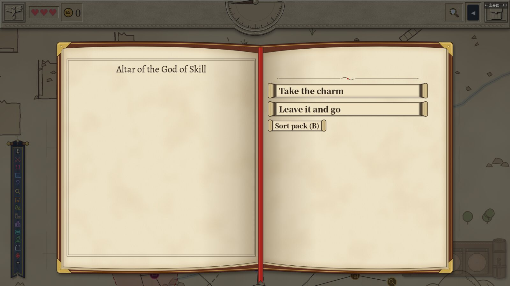
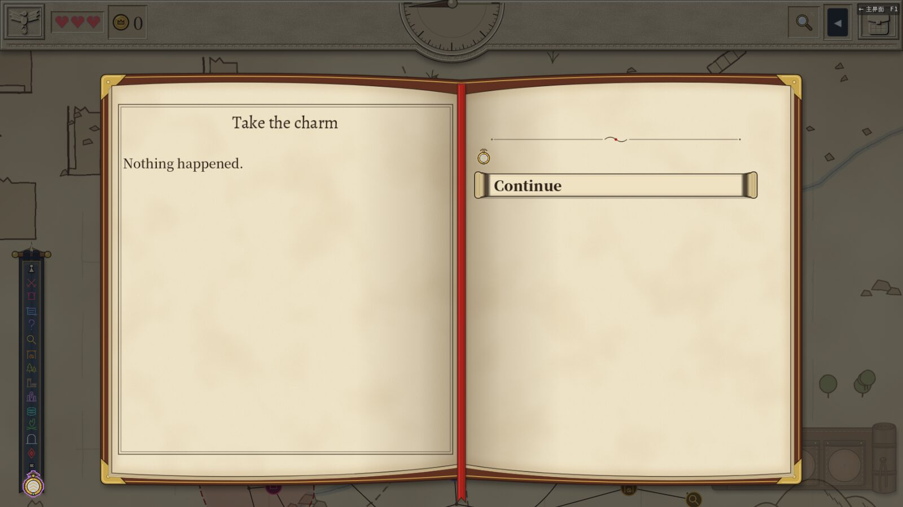
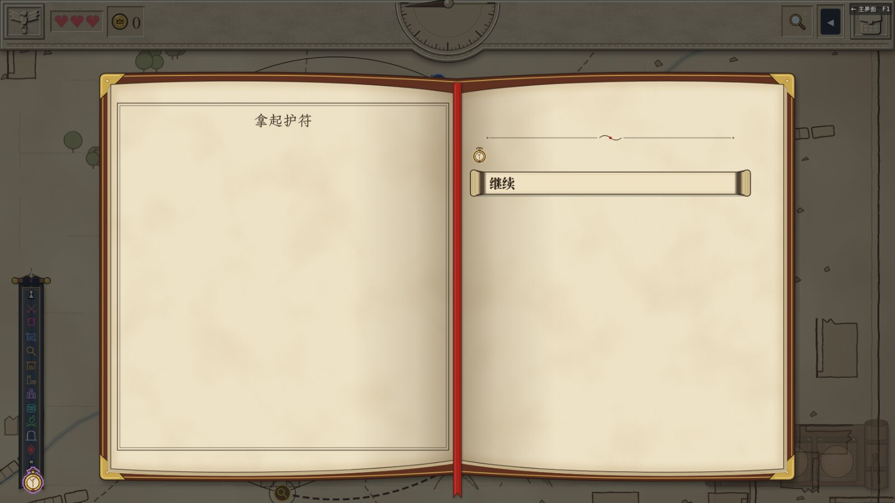
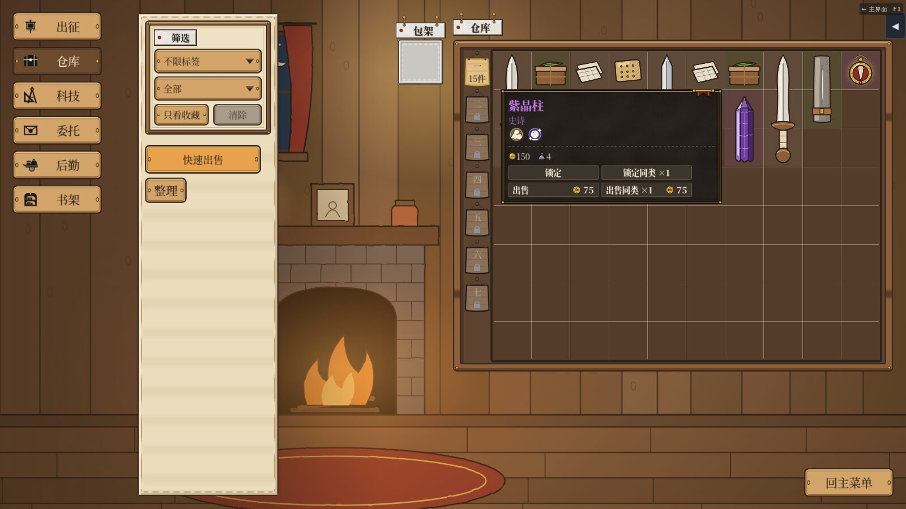
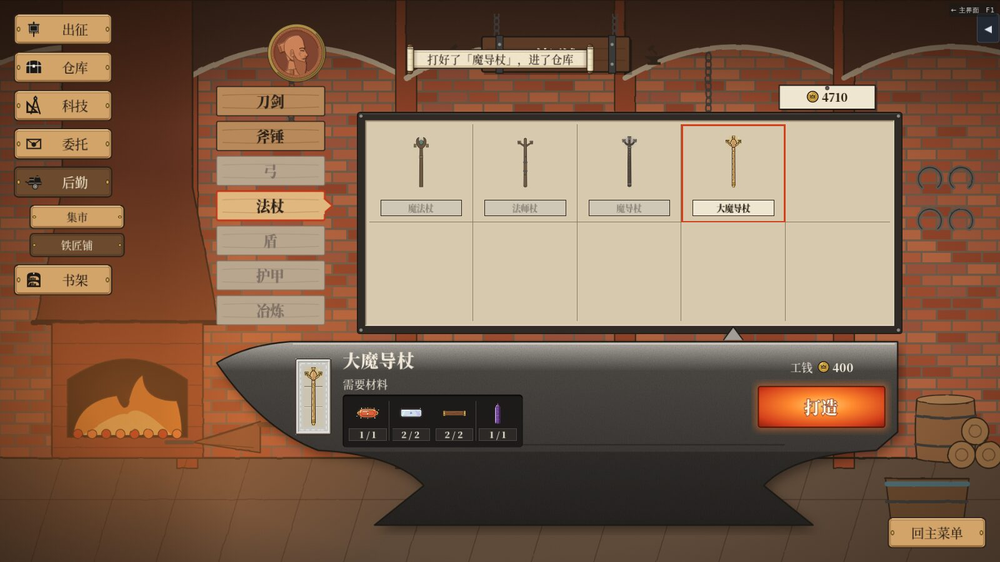
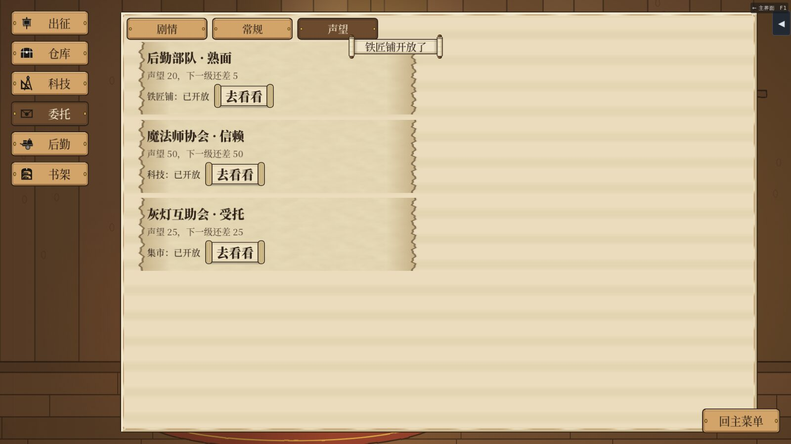
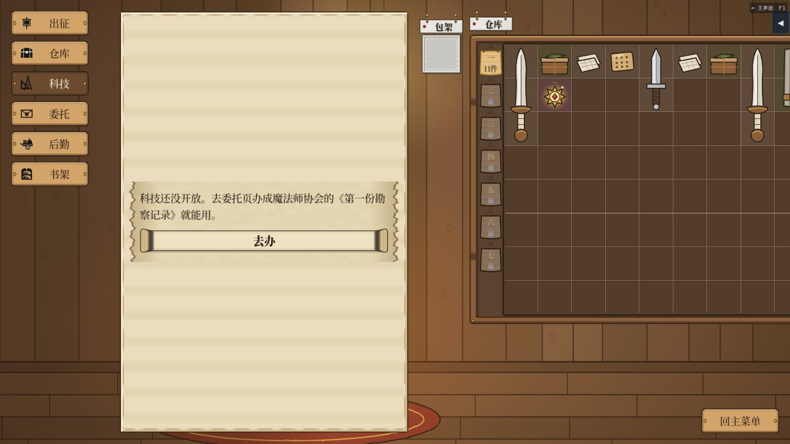

# v6.70–v6.74 祭坛六选一、晶石、五档声望与引导剧情：全量测试和走查

> 日期：2026-11-20。
>
> 测试对象：
> - v6.70（PR #707，[报告 346](../346-hunt-skill-charms-and-smithy-slots.md)）：祭坛六选一、铁匠铺三种 ≥优良 材料格、铜锭冶炼、科技页签图标和书架第五格定稿图。
> - v6.71（PR #708，[报告 347](../347-raw-crystal-materials-landing.md)）、v6.73（PR #712）：四种晶石和定稿图，法杖三张配方加晶石格。
> - v6.72（PR #711，[报告 348](../348-five-tier-reputation-facility-openers.md)）：五档声望、存档 v6 旧档折算、新档三份引导剧情开放设施、委托页三子页、未开放设施说明板。
> - v6.74（PR #713，[报告 349](../349-followup-stories-to-25.md)）：后续剧情到 25、营地交货、击败敌人、到访节点、常规委托条件、祭坛结果页修正。
>
> 测试版本：全量测试在 v6.70（`48a119f8`）和 v6.74（`70f6cbd1`）上各跑一遍；祭坛和铁匠铺新材料格的走查在 v6.70 上跑，其余走查在 v6.74 上跑。
>
> 证据位置：全套截图和日志在共享文件夹 `testing/2026-11-20-v670/`、`testing/2026-11-20-v674/`；走查脚本在 [evidence/2026-11-20-commissions-b2/](evidence/2026-11-20-commissions-b2/)。

## 一、结论

- **全量测试**：
  - v6.70：41867 项断言、345 个套件全过。
  - v6.74：42012 项断言、346 个套件全过。
  - 两次都是 0 条脚本错误，静态警告 0 条。
- **问题 1 处，已修**：v6.70 上，狩猎和技巧祭坛点【拿起护符】后，护符到了地上，结果页却写「什么也没发生。」。v6.74 已修，复测不再出现。
- **重点两项都通过**：
  - 旧存档读入不倒退：存档从 v5 升到 v6，声望按表折算，三处设施都开着，金币、科技、仓库都没变。
  - 新存档走完教程后，三处设施关着。三份开放剧情各真点一次【办理】，就依次开放。
- **观察 3 处**（交作者判断），见第四节。

## 二、v6.70：祭坛六选一、铁匠铺新材料格

### 1. 祭坛

| 设置 | 抽到 | 正文 | 护符 |
|---|---|---|---|
| 中文默认 | 狩猎 | 空（作者待写） | 狩猎之神的护符，在地上 |
| 英文大字号 | 技巧 | 空 | Charm of Skill，在地上 |
| 中文大字号 | 技巧 | 空 | 技巧之神的护符，在地上 |

- 走法：真鼠标走到「无名的祭坛」，真点【靠近】，再真点【拿起护符】。
- 抽到哪位神由种子决定，脚本会换种子，直到抽到要看的那位。
- 六位神的分布：真游戏开局 40 个种子里，狩猎 10、技巧 10、蛮神 9、日神 6、大地 5、自然 0。按测试用的开局抽 300 张图，每位 43–58 次，接近各 1/6。





### 2. 铁匠铺

| 配方 | 测试辅助放的料 | 结果 |
|---|---|---|
| 铜锭（冶炼） | 铜矿石 ×2 | 能打，扣 2 块矿、10 金币 |
| 圆盾 | 铜锭 + 风干木料（木 优良） | 能打，扣风干木料 |
| 皮甲 | 熟皮革 ×2 + 兽尾（皮 优良） | 能打，扣兽尾 |
| 放血刀 | 碎骨串 + 钢锭 + 致密玄武岩 | 铁匠铺 1 级时灰着，提示「铁匠铺要 2 级」。这是配方本来的等级要求 |

- 每张都是真点格子、真点【打造】，三组设置结果一样。

### 3. 定稿图

- v6.68 的页签走查在 v6.70 上又跑了一遍（中文大字号）。科技页签换成了圆规与角尺图标，书架第五格是旧背包，不可点，也没有小牌。
- 页签、导览、科技页、书架的其余结果都和 [v6.68 报告](2026-11-20-v668-base-tech-tab.md)一样。

## 三、v6.71–v6.74

### 1. 晶石在搜索里的出现率

按本章的搜索规则直接抽，每个深度抽 20000 次，件数占比如下。

| 搜索 | 深度 | 雾晶 | 烟晶 | 棱晶 | 紫晶柱 | 碎晶（对照） |
|---|---|---|---|---|---|---|
| 普通 | 0.2 | 0.77% | 0.73% | 0.44% | 0.09% | 1.07% |
| 普通 | 0.5 | 0.76% | 0.77% | 0.47% | 0.11% | 0.87% |
| 普通 | 0.9 | 0.73% | 0.65% | 0.46% | 0.13% | 0.67% |
| 符文堆 | 0.2 | 10.80% | 11.06% | 6.39% | 2.03% | 15.27% |
| 符文堆 | 0.5 | 10.28% | 10.44% | 6.98% | 2.42% | 11.61% |
| 符文堆 | 0.9 | 9.89% | 10.01% | 7.43% | 2.71% | 8.90% |

- 四种都在搜索候选里，稀有度、占格和报告 347 一致：紫晶柱占 2 格。
- 越深，稀有的越多。普通搜索里四种晶石合起来约占 2%，符文堆里约 30%。
- 悬停：
  - 雾晶、烟晶写「优良 · 12」，棱晶写「稀有 · 30」，紫晶柱写「史诗 · 150」。
  - 说明都空着。
  - 图是 v6.73 的定稿图。



### 2. 法杖配方的晶石格

测试辅助把铁匠铺升到 3 级、法杖工艺点到 3 级。每一步只往仓库补一样料，然后真点格子看素材行，能打就真点【打造】。三组设置结果一样。

| 配方 | 料 | 晶石格 | 能打吗 |
|---|---|---|---|
| 法师杖 | 火焰晶石 ×2 + 银锭 + 木棍 | 0 / 1 | 不能。多出的那块火焰晶石不顶晶石格 |
| | 再加碎晶 | 0 / 1 | 不能。碎晶不够优良 |
| | 再加雾晶 | 1 / 1 | 能。打完扣雾晶，碎晶留着 |
| 魔导杖 | 火焰魔晶石 + 铁木枝 + 秘银锭 + 烟晶 | 0 / 1 | 不能。烟晶不够稀有 |
| | 再加棱晶 | 1 / 1 | 能。打完扣棱晶，烟晶留着 |
| 大魔导杖 | 火焰魔晶核 + 秘银锭 ×2 + 硬木板 ×2 + 棱晶 | 0 / 1 | 不能。棱晶不够史诗 |
| | 再加紫晶柱 | 1 / 1 | 能。打完扣紫晶柱 |



### 3. 旧存档读入（v6.71 做的 v5 档）

在 v6.71 上新开存档拒教程，测试辅助写进度后存档：后勤 0 但办成过《两条回路》、灰灯 6、考据所 9，金币 1234，仓库扩建 2 级，法杖工艺 1 级。然后在 v6.74 上按「继续」读进来。

| 项 | 读入后 |
|---|---|
| 存档版本 | 6 |
| 声望 | 后勤部队 0 → 10（办成过，保底 10），灰灯 6 → 25，魔法师协会 9 → 50 |
| 档 | 熟面 / 受托 / 信赖 |
| 迁移记录 | 一条，三方前后数都对 |
| 设施 | 铁匠铺、科技、集市都开着；没有说明板 |
| 金币、科技、仓库 | 1234、仓库扩建 2 / 法杖工艺 1、14 件，和存档前一样 |
| 《两条回路》 | 仍是办成；回执不重发 |
| 进基地落在 | 出征页 |

- 三份开放剧情也给旧档补上了。真点《领炉牌》的【办理】：后勤部队 +10，到 20。
- 回主菜单再继续，以上各项不变。
- 三组设置结果一样。英文里两方的新名字是 Logistics Corps、Mages' Society。



### 4. 新存档：三份开放剧情开放设施

新开存档并拒教程。进基地时教程算走完，委托页可见。

- **进基地前**：
  - 落在委托页的剧情子页。
  - 三份开放剧情已自动接上，三方声望都是 0。
  - 铁匠铺、科技、集市都关着。
- **说明板**：
  - 真点「科技」：说明板写「科技还没开放。去委托页办成魔法师协会的《第一份勘察记录》就能用。」，下面一颗【去办】。
  - 真点【去办】：回到委托页的剧情子页。
  - 「后勤」的集市、铁匠铺两页也各是一块说明板，各自写对哪方、哪份剧情。
- **逐个办理**：

| 真点【办理】 | 声望 | 开放 | 告示 |
|---|---|---|---|
| 《领炉牌》 | 后勤部队 10（熟面） | 铁匠铺 | 铁匠铺开放了 |
| 《第一份勘察记录》 | 魔法师协会 10 | 科技 | 科技开放了 |
| 《认一认秤》 | 灰灯互助会 10 | 集市 | 集市开放了 |

- **办完以后**：
  - 再真点科技、集市、铁匠铺，都是正常的页，没有说明板。
  - 五份基础剧情自动接上：查验材料、清出一条路、辨认矿样、无人署名的信、核对药包。
  - 回主菜单再继续：落在出征页，三处还开着。
- 三组设置结果一样。英文的【办理】是 "Settle it"，【去办】是 "Take it on"。



### 5. 营地交货（v6.74）

交货都是测试辅助往仓库放料，然后真点那份剧情的【办理】。

| 剧情 | 仓库里 | 真点后 |
|---|---|---|
| 辨认矿样（晶石 ×2） | 一块雾晶 | 交了雾晶，进度 1 / 2，没办完 |
| | 再放棱晶、碎晶 | 交了碎晶，办完，魔法师协会 +5；棱晶留着（便宜的先交） |
| 查验材料（金属 ×3） | 三块铜矿石 + 一把战斧 | 交了三块矿石，办完，后勤部队 +5；战斧留着（武器不收） |
| 核对药包（草药 ×2） | 干草药 + 苦根 | 只交了干草药，进度 1 / 2。苦根的材质是草药，但没有「素材」标签，所以不收（规则和铁匠铺的材料格一样） |

- 中文默认三份都走通了。
- 英文大字号、中文大字号下，魔法师协会那页的卡片多，【办理】在滚动区下面。脚本没有滚动，所以《辨认矿样》没点到。这是脚本没滚动，不是游戏的问题。另外两份结果和中文默认一样。


### 6. 一局里的击败敌人、到访节点（v6.74，中文默认）

测试辅助先把三份开放剧情办理掉，再把五份基础剧情记成办成，只留《清出一条路》。这样《协会登记证》（到访搜索点）和《灰灯会牌》（到访休息点）就会接上。然后真点出征，依次走到休息点、战斗、搜索点、休息点；下一场战斗打输，这一局败退。

| 委托 | 局内记账 | 回基地 |
|---|---|---|
| 灰灯会牌（休息点 ×2） | 两处各一条 | 办完，灰灯 20 → 25（受托） |
| 清出一条路（普通战斗 ×3） | 赢的那场一条，输的那场不记 | 进度 1 / 3 |
| 协会登记证（搜索点 ×2） | 一条 | 进度 1 / 2 |

败退也照样记账，和报告 349 第二节一致。

## 四、观察（交作者判断）

1. **《照抄也要做得出》不会自动接上**：报告 349 说剧情都是「够格自动接上」。这一份要先选一张配方，下拉框只列「现在就打得出」的配方。新档仓库空，所以下拉框和【接下】都是灰的。它是协会许可单的前置，要等玩家攒够某张配方的料才能接。
2. **旧档也弹「铁匠铺开放了」**：旧档的三处设施本来就开着，办《领炉牌》时还是弹「铁匠铺开放了」。见第三节第 3 小节的截图。
3. **说明板这页露着右半边仓库**：科技开放后，科技页会收起仓库。没开放时的说明板页仓库还露着，两种状态的版面不一样。

## 五、复现

```
SUITE=1 WALKS="" bash r645.sh                                   # 全量测试 + 场景校验 + 静态警告
SEEDS="zh_normal:1,hunt en_large:9,skill zh_large:13,skill" bash chain670.sh   # 铁匠铺新材料格 + 祭坛（v6.70）
bash chain673.sh                                                # 晶石抽样、旧档 v5 → v6、新档开放、法杖（v6.74）
bash chain674b.sh                                               # 新档逐个办理 + 交货、悬停、局内目标
```
