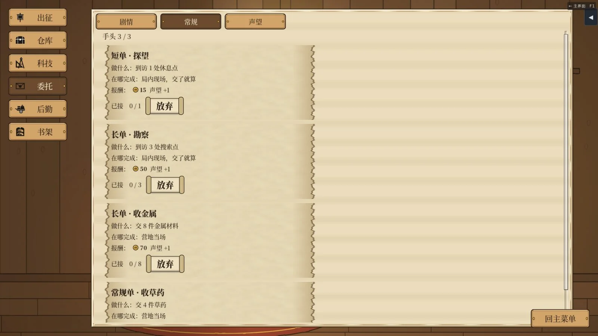
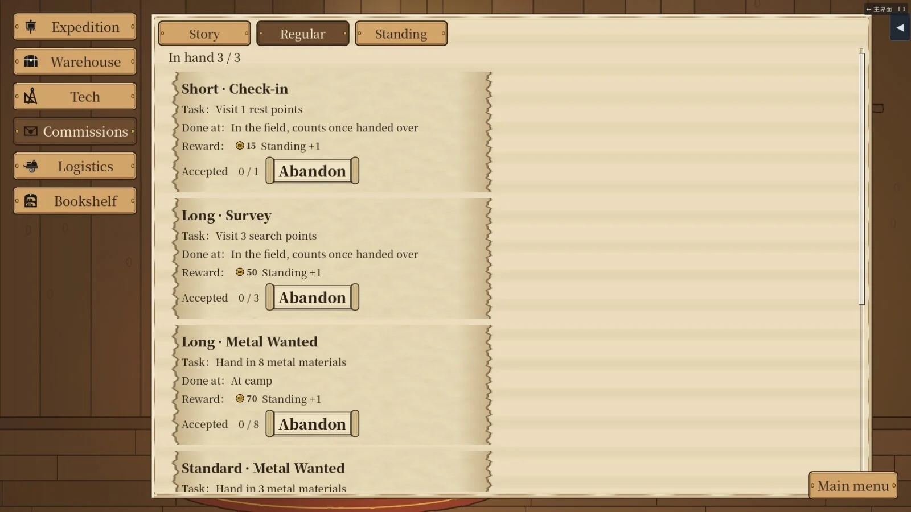
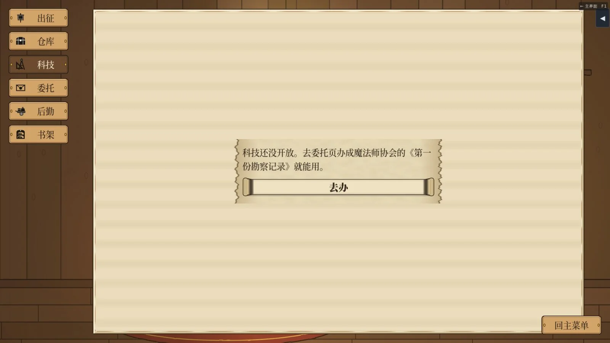
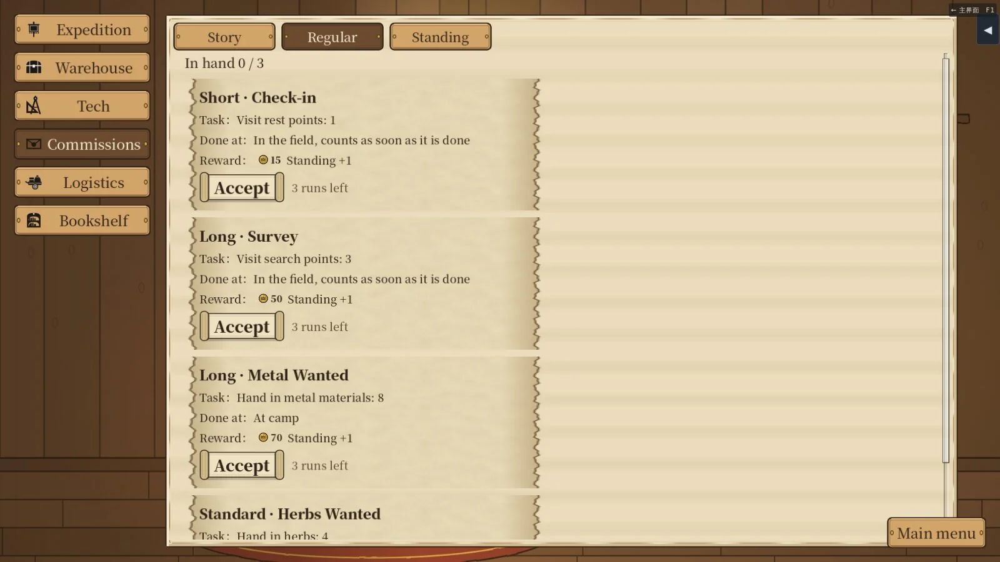

# 测试报告：告示栏常规委托 v6.75

> 日期：2026-11-20。对象：main 4c7e3ee7（PR #715，[报告 350](../350-notice-board-regular-commissions.md)）。
> 走查脚本和日志在 [evidence/2026-11-20-notice-board/](evidence/2026-11-20-notice-board/)，三组的全套截图在共享文件夹 `testing/2026-11-20-v675/`。

## 结论

全量测试通过，静态警告 0 条。告示栏的规则都对得上：贴单条件、6 个钉位、手头最多 3 份、3 局到期、回营补位、保底 2 张、放弃、交货结单、读档重进。中文、英文大字、中文大字三组都跑过。两处顺手修也已生效：老档办开放单不再弹「开放了」，没开放设施的说明板会收起仓库。

没有发现问题，有 3 处观察。

## 一、全量测试

| 项 | 结果 |
|---|---|
| `tools/test.sh` | 通过 42055 项断言，346 个套件，用时 700 秒，SCRIPT ERROR 0 |
| `tools/warnings.sh` | 共 0 条 |
| 配装场景检测 | 和上一轮一样：合法 100 份，挡住 8 份；`--allow-dropped` 通过 |

## 二、告示栏走查（`board675.gd`，三组结果相同）

**准备。** 新档拒教程。三份开放单用真点办理，其余基础剧情由测试辅助记成办成，三方声望补到 25，三份许可单办成，然后调用 `sync_commissions`。

| 检查 | 实测 |
|---|---|
| 第一次开放时贴几张 | 贴 4 张，占前 4 个钉位，都写「还剩 3 局」。前 3 张分属三方（灰灯、协会、后勤），第 4 张是协会的另一种单，同一方不撞模板 |
| 纸条内容 | 「短单 · 探望」到访 1 处休息点，酬 15；「长单 · 勘察」到访 3 处搜索点，酬 50；「长单 · 收金属」交 8 件，酬 70；「常规单 · 收草药」交 4 件，酬 34。件数都在报告 350 的档位区间里，酬金等于件数 × 单份 × 档系数 |
| 真点【接下】三张 | 手头从 0 / 3 涨到 3 / 3。接下的卡换成「已接 0 / N」和【放弃】，没有【暂缓】。第四张的【接下】变灰，悬停提示「手头满了」 |
| 存档回主菜单再继续 | 钉位、纸条、手头和之前完全一样 |
| 第 1 局后 | 局数 1。没接的那张从剩 3 局变成剩 2 局。补了 2 张（补位掷骰）。栏上没接的 3 张，手头 3 张不动 |
| 真点【放弃】（探望） | 纸条从簿里和钉位上都没了，不回栏上，五方声望不变 |
| 真点【接下】「常规单 · 收金属」×3，放 3 块铜矿石后真点【办理】 | 状态变成办成，金币 580 → 605（+25），后勤声望 30 → 31。回执写「常规单 · 收金属：办成了」（英文是 "Standard · Metal Wanted: done"） |
| 第 2 局后 | 办成的纸条从簿里清掉，回执里的名字还在。补了 1 张。栏上没接的 3 张，手头 2 张不动 |
| 第 3 局后 | 第一批的「常规单 · 收草药」到 0 局，被撤下。补 2 张，栏上没接的 4 张 |
| 第 4 局后 | 第 1 局补上的「短单 · 护送」到期撤下，没补新的。栏上没接的还有 3 张，没低于保底 2 张。手头两张一直没扣时限 |

## 三、两处修复复测（`gate672.gd old / new`，三组相同）

| 检查 | 实测 |
|---|---|
| 老档（v6.71 存档 v5）真点《领炉牌》【办理】 | 告示栏空着，不再弹「铁匠铺开放了」；声望照样 +10 |
| 新档真点三份开放单 | 依次弹「铁匠铺开放了」「科技开放了」「集市开放了」（英文是 "… is now open"），和以前一样 |
| 新档点「科技」、后勤的「集市」「铁匠铺」 | 说明板居中，右列仓库收起（三处都检查了） |
| 老档迁移 | 和上一轮一致：后勤 0 → 10、灰灯 6 → 25、协会 9 → 50，金币、科技、仓库不变 |

## 四、观察（不算问题，请作者看看）

1. **纸条卡上看不出是哪一方的。** 卡上只写「声望 +1」，没写给谁加。例如「短单 · 护送」和「短单 · 巡路」做的事一样，分属灰灯和后勤。报告 350 第三节说界面还是占位，等软木告示栏样张时可以一起考虑。
2. **手头的和栏上的连在一起。** 两组之间没有分隔或小标题，只靠【放弃】和【接下】分辨。也是占位界面的问题。
3. **文字小处。**
   - 到访和击败类纸条的「在哪完成」写「局内现场，交了就算」，但这两类没有东西可交。
   - 英文件数为 1 时写成 "Visit 1 rest points"，多了复数 s。

## 五、v6.76 复测（PR #717，main 65719b98）

- 全量测试：通过 42055 项断言、346 个套件，SCRIPT ERROR 0；静态警告 0 条。
- 告示栏走查（`board675.gd`）在三组里重跑，结果和上面一样。
- 第四节观察 3 已修：
  - 到访 / 击败类的「在哪完成」改为「局内现场，做到就算」，英文是 "In the field, counts as soon as it is done"。
  - 英文纸条改为 "Visit rest points: 1"、"Hand in metal materials: 8" 的写法，没有错的复数了。
  - 营地交货类仍写「营地当场」。
- 观察 1、2 是占位界面的问题，照旧。

