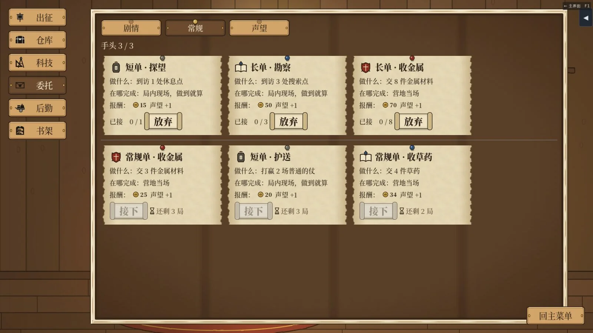
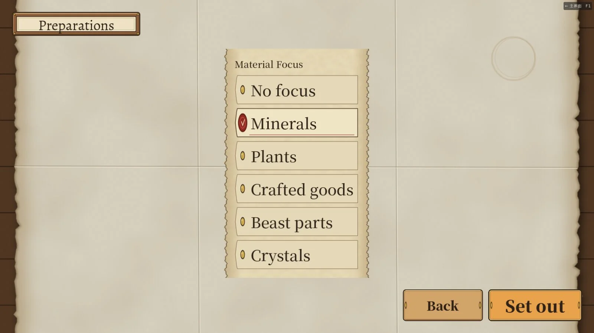
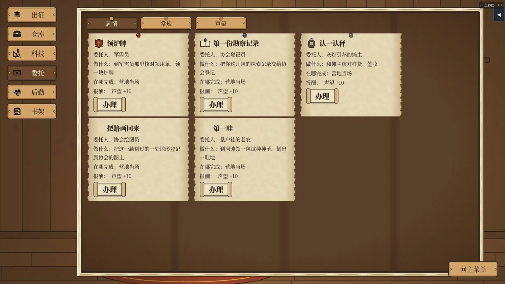
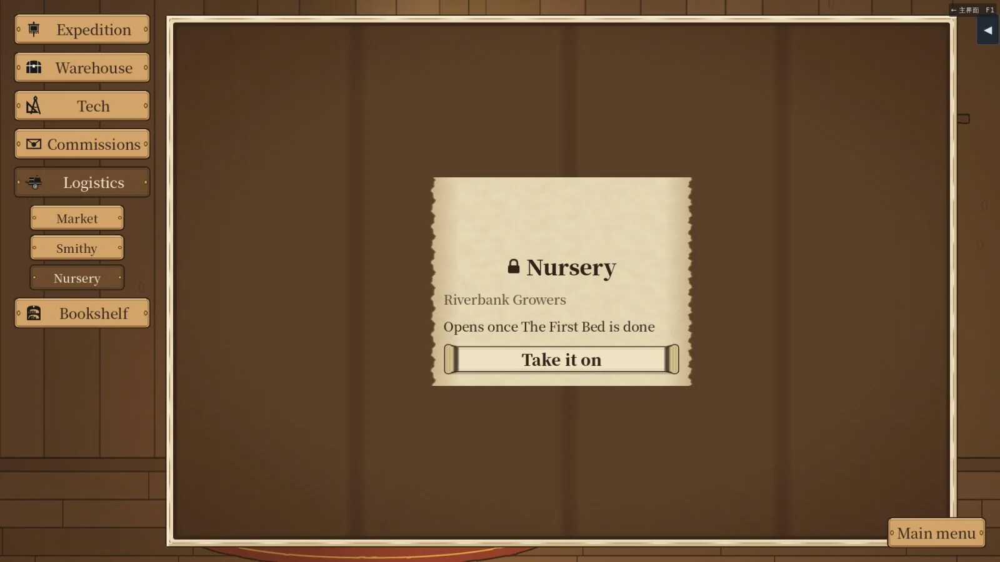
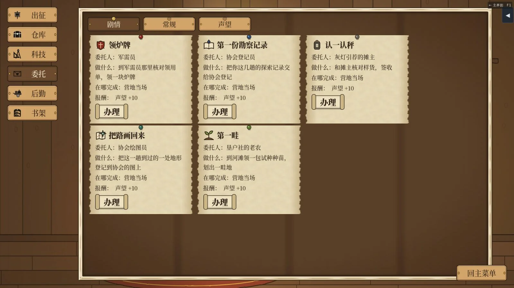
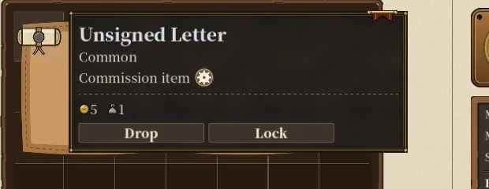

# 测试报告：委托页告示板、地图协会与材料倾向、垦户社与苗圃 v6.77–v6.80

> 日期：2026-11-20。对象：main 530c307f（v6.80）。
> - v6.77（PR #719）：委托页和说明板换成告示板部件。
> - v6.78（PR #720，[报告 351](../351-cartographers-material-bias.md)）：地图协会、材料倾向、出征第四页，局内存档 v7。
> - v6.79（PR #721）：图钉压在纸上、「手头」改浅字、说明板铺深木板。
> - v6.80（PR #722，[报告 353](../353-growers-nursery.md)）：垦户社与苗圃，局外存档 v7。
>
> 走查脚本和日志：
> - [evidence/2026-11-20-map-society-nursery/](evidence/2026-11-20-map-society-nursery/)
> - 告示栏和说明板的脚本（加了排版溢出检查）更新在 [evidence/2026-11-20-notice-board/](evidence/2026-11-20-notice-board/)
>
> 三组的全套截图在共享文件夹 `testing/2026-11-20-v677/`、`testing/2026-11-20-v680/`。

## 结论

全量测试通过，静态警告 0 条。中文、英文大字、中文大字三组都跑过。

- **排版**：委托三子页、未开放设施说明板、第四页、苗圃页一共查了 300 多处文字，都没有出框。
- **旧档**：用 v6.71 写的旧档（局外 v5、局内 v6）读进 v6.80：局内存档接着走；倾向为空；局外加了一畦空地。
- **材料倾向**：抽样看，只在普通搜索里、只在材料之间重分权重。材料节点带不带倾向，逐次结果完全一样。
- **苗圃**：
  - 空跑不推进；正式一局推进一格；同一局再结算一次不推第二次；存档重进进度不变。
  - 仓库满时收获整体退回，地里照旧；腾出地方再收，就入库、清畦、记上《收获》。
  - 苦叶草播种时扣掉一束干草药。

发现 1 处问题、2 处观察。

## 一、全量测试

| 版本 | 结果 |
|---|---|
| v6.77（6a72ef85） | 通过 42056 项断言，346 个套件，SCRIPT ERROR 0；警告 0 条 |
| v6.79（7ea1d374） | 通过 42122 项断言，347 个套件；警告 0 条 |
| v6.80（530c307f） | 通过 42185 项断言，348 个套件，用时 655 秒，SCRIPT ERROR 0；警告 0 条 |

配装场景检测和上几轮一样（合法 100 份，挡住 8 份；`--allow-dropped` 通过）。

## 二、委托页告示板（v6.77、v6.79）

- 告示栏（`board675.gd`）和新旧档剧情 / 说明板（`gate672.gd`）在三组里重跑，行为和 v6.75 报告一致。
- 新加的溢出检查：每页里看得见的字落在它所在的纸 / 板框外，或者不换行的字比自己的框宽，都算溢出。各页查了 4～48 处，都是 0。
- 告示栏报告的两处观察已由 v6.77 解决：纸条上有阵营图标，手头的和栏上的之间有分隔线。
- v6.77 时「手头 3 / 3」是深字压在深木板上，几乎看不清；v6.79 改浅字后清楚了。图钉也压在纸上了。
- 未开放设施的说明板：右边的仓库收起，三组都对。v6.79 起说明板后面铺深木板。

## 三、地图协会与材料倾向（v6.78）

### 3.1 走查（`prep678.gd new`，三组相同）

| 检查 | 实测 |
|---|---|
| 新档拒教程进基地 | 委托页三方，材料倾向没开。开局屏最后一页是第 3 页 |
| 正式一局（走到最近的普通搜索点，测试辅助撤离；走了 3 步） | 结算算「正式探索」。回营后多了地图协会和河滩垦户社，`arrived` 记第 1 局。《把路画回来》《第一畦》自动接上 |
| 真点【办理】《把路画回来》 | 声望 +10，告示「材料倾向开放了」。《两条回路》《核实矿脉》接着接上 |
| 再出征，真点【继续】翻到第四页 | 标题「本次准备」（英文 "Preparations"）。六个选项，默认按下「无倾向」，按钮写【出发】。自由模式和沙漏章六项都能选，没有压灰 |
| 真点「矿物」再真点【出发】 | 局内倾向 mineral，搜索事件里也是 mineral |
| 存档回主菜单再继续 | 倾向还是 mineral。走到普通搜索点，搜索会话带「矿物」标签、×1.5 |

### 3.2 旧局内存档（`makerun.gd` 在 v6.71 上写档，`prep678.gd old` 在 v6.80 上读）

- 旧版：局内存档 v6、局外存档 v5，进图后存局、回主菜单。
- 新版主菜单【继续】：直接回到地图上的第 2 点，倾向为空。走到普通搜索点照常搜，翻出鹿角、双刀。
- 局外存档升到 v7，苗圃是一畦空地，地图协会 / 垦户社还没来（要等下一次正式探索）。三组相同。

### 3.3 抽样（`bias678.gd`，自由模式的搜索规则，每格 6000 次，同一种子）

| 深度 0.2 | 共几件 | 材料 | 目标系占材料 |
|---|---|---|---|
| 无倾向 | 8925 | 3732 | — |
| 矿物 | 8925 | 3783 | 13.8% → 19.0% |
| 草木 | 8925 | 3760 | 19.2% → 24.5% |
| 工艺 | 8925 | 3695 | 40.4% → 50.0% |
| 兽材 | 8925 | 3682 | 15.6% → 20.1% |
| 晶石 | 8925 | 3807 | 12.3% → 16.3% |

- 件数完全不变。材料件数和每档稀有度件数在 ±3% 内，是随机数走开后的抽样误差。目标系的份额变成原来的 1.25～1.4 倍。深度 0.9 结果一样，全表见 `bias_sample.log`。
- 四种材料节点（林地、矿点、遗骸、符文堆）各抽 2000 次，带「草木」倾向和不带，逐次结果一样，0 次不同。

## 四、垦户社与苗圃（v6.80，`nurs680.gd`，三组相同）

| 检查 | 实测 |
|---|---|
| 新档进基地 | 后勤只有集市、铁匠铺两颗小键，苗圃没开 |
| 正式一局后 | 垦户社来了，后勤多一颗「苗圃」。真点它是说明板：「苗圃 / 河滩垦户社 / 办成《第一畦》开放」，右列仓库收起 |
| 真点【办理】《第一畦》 | 苗圃开，声望 +10，告示「苗圃开放了」，《试种》接上 |
| 苗圃页 | 一畦空地，两种作物写明种苗、收成、几局熟。仓库没干草药时，苦叶草的【种下】灰着，悬浮写「仓库里没有种苗」 |
| 真点【种下】绳麻 | 还差 3 局；《试种》办成（声望 15），《收获》接上 |
| 空跑一局（没走出起点） | 仍差 3 局，`last_run` 没动 |
| 正式一局 | 差 2 局，`last_run` 记这一局 |
| 测试辅助拿同一局的 run_id 再推进一次 | 返回 false，仍差 2 局 |
| 存档回主菜单再继续 | 仍差 2 局 |
| 再两局正式 | 差 1 → 0。后勤页签写「后勤　可收获」（英文 "Logistics　Ripe…"），小键写「苗圃　可收获」，没弹窗 |
| 测试辅助把仓库塞满，真点【收获】 | 仓库件数不变，麻绳卷 0，地里还是熟的绳麻，告示「仓库放不下，先留在地里」 |
| 拿掉 3 件再真点【收获】 | 麻绳卷 +1，畦清空，`可收获` 字样消失，《收获》办成（声望 20），许可单接上 |
| 放一束干草药，真点【种下】苦叶草 | 干草药 1 → 0，差 2 局；许可单《登记留种》办成（声望 25） |

## 五、问题

1. **地图协会、垦户社的纸卡没有阵营图标，也没有图钉。** 剧情页上原来三方的卡左上角有图标、顶上有图钉；新两方的卡标题前空着一块，顶上也没钉。苗圃的说明板也没有阵营图标（科技说明板有协会的书本图标）。三组都一样。看着像这两方缺图标资源，钉的颜色也跟着缺。

## 六、观察

1. 苗圃页只有一畦，大部分是空白羊皮纸。报告 353 说是占位排版，等样张。
2. 沙漏章的第四页六项都能选（没有压灰）。报告 351 的抽样说沙漏章普通搜索里目标材料很少，倾向几乎没作用；玩家选了也看不出差别。是否压灰或加说明，等作者定报告 351 第四节第 2 条。

## 七、v6.81 复测（PR #724，main 8db44ac5，只有美术）

- 在中文、英文大字、中文大字三组里，重跑了第三节的第四页走查（`prep678.gd new`）和第四节的苗圃走查（`nurs680.gd`）。所有步骤和数字都和上面一样，排版溢出 0。
- 第五节的问题已修好：
  - 地图协会《把路画回来》的卡上有折图纹章和青色图钉。
  - 垦户社《第一畦》的卡上有幼苗纹章和绿色图钉。
  - 苗圃说明板上有幼苗纹章和图钉。
- 只有美术改动，没有重跑全量测试。

## 八、委托信定稿图复测（PR #728，main cd45594a，只有美术）

脚本和日志在 [evidence/2026-11-21-commission-letter/](evidence/2026-11-21-commission-letter/)（`letter728.gd`）。流程：新档拒教程，办完三份开放单，接《无人署名的信》，开自由模式，打开背包，悬停在信上。中文、英文大字、中文大字三组结果相同：

- `commission_letter.png`（60×60）和 `@2x`（160×160）都能载入。
- 开局后信在背包左上角那一格，画的是绳系信卷（B），封蜡和垂下的绳都看得清。
- 悬浮窗写「未署名的信 / 普通 / 委托物」，英文是 "Unsigned Letter / Common / Commission item"。说明按规定留空。
- 没有出框，也没有缺图。

观察：道具叫「未署名的信」，委托单和局内目标叫《无人署名的信》，差两个字。这是 PR #728 之前就有的，要不要统一等作者定。
