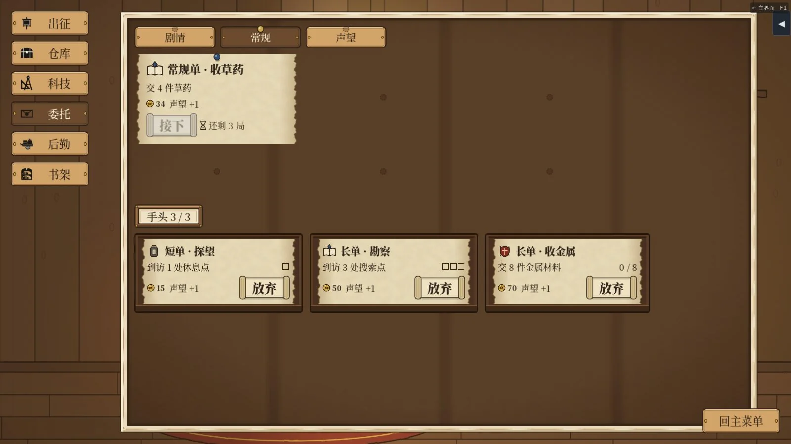
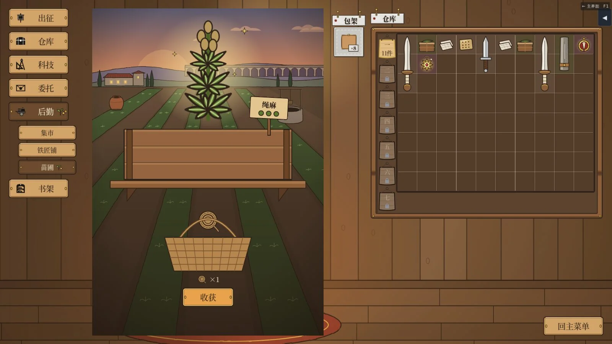
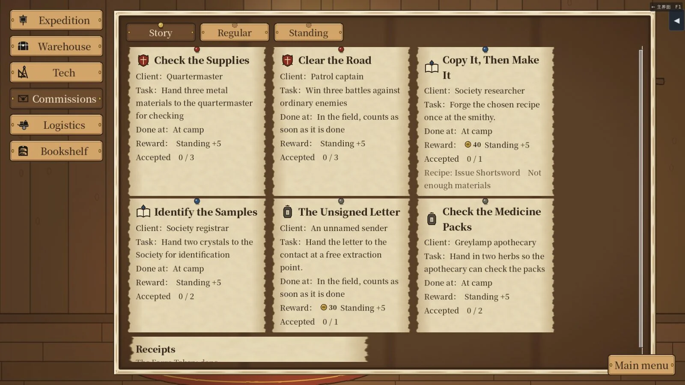
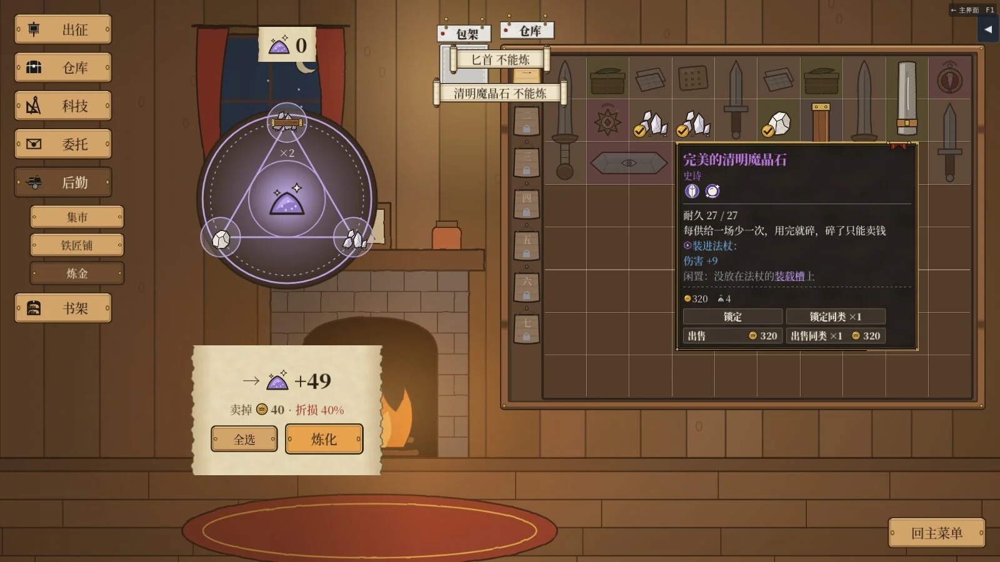
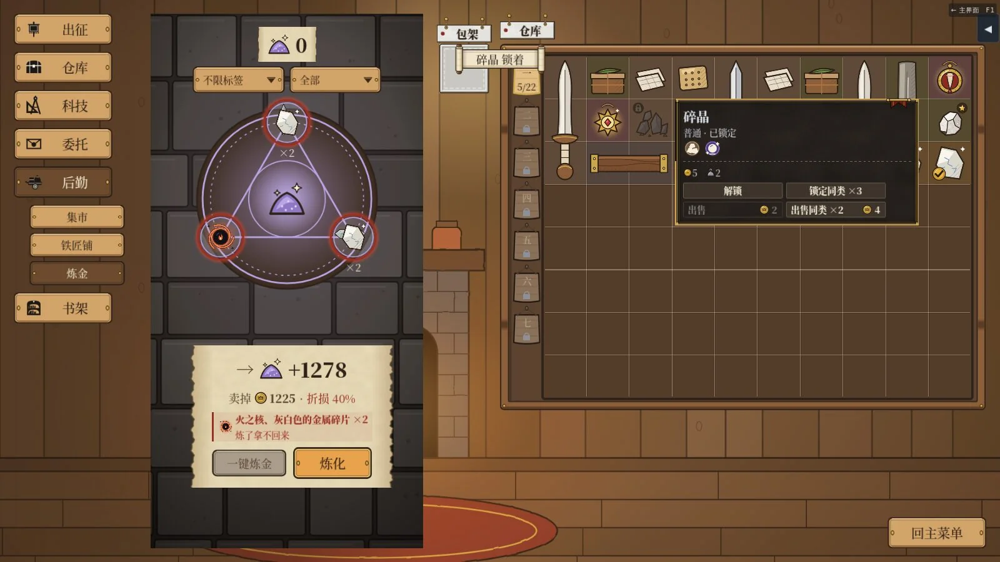
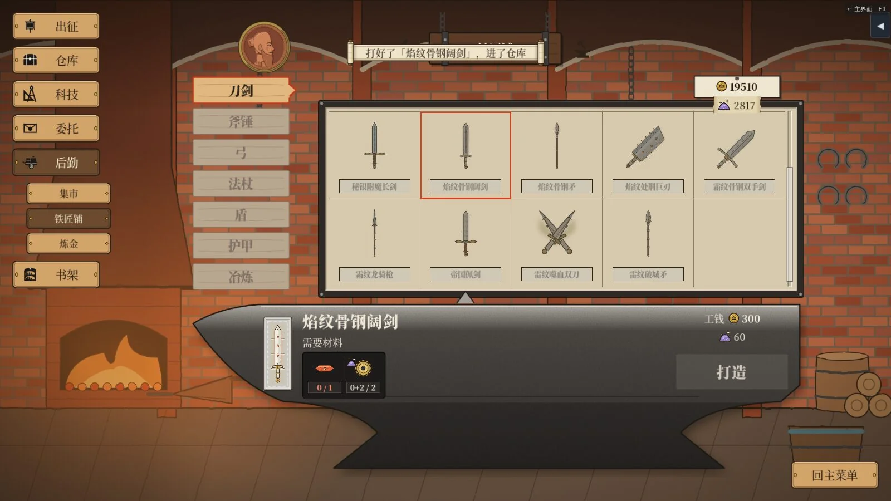
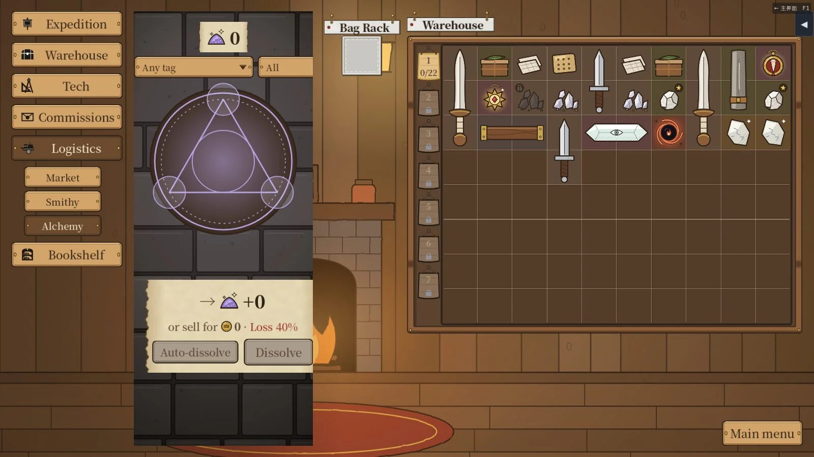

# 测试报告：告示栏托盘、苗圃花槽、法杖原晶、炼金术 v6.82–v6.99

> 日期：2026-11-21。对象：main 48fb01a9（v6.99）。
> - v6.82（PR #730）：告示栏「手头」改成 C 托盘；苗圃页改成 B 花槽、背景换成农田、「可收获」改成小图；《照抄也要做得出》先接单、后凑料。
> - v6.84（PR #732）：苗圃页两处小修（仓库被挤出屏、熟了的作物贴顶）。
> - v6.85（PR #735）：碎晶降到 5；三把法杖改用原晶。
> - v6.91（PR #740，报告 356）：炼金术第一批，分解成万物之尘，局外存档 v8。
> - v6.93（PR #742，报告 357）：炼金术第二批，铁匠铺用尘补料。
> - v6.94（PR #743）：法杖的晶石格按稀有度收原晶。
> - v6.96（PR #745）：铁匠配方的自选材料格不收独一道具。
> - v6.97（PR #746，报告 358）：炼金页所有道具都能炼，新增【一键炼金】。
> - v6.98（PR #747、#748）：红字里同名道具合成「×n」。
> - v6.99（PR #749）：炼金页按 UI A 版重排（木签筛选、红圈、警告带）。
>
> 走查脚本和日志在 [evidence/2026-11-21-trays-nursery-alchemy/](evidence/2026-11-21-trays-nursery-alchemy/)。全套截图在共享文件夹 `testing/2026-11-21-v684/`、`v685/`、`v691/`、`v693/`、`v694/`、`v696/`、`v697/`、`v699/`。

## 结论

每一版的全量测试都通过，静态警告 0 条。中文、英文大字、中文大字三组都走过。

- 托盘、花槽、《照抄》、法杖、碎晶、炼金、用尘补料都按改动说明工作。排版溢出检查都是 0。
- v6.85 写的旧档读进 v6.91 正常：尘是 0，「打造过」为空，仓库、金币、设施都不变。
- v6.94 发现 1 处问题：大魔导杖会吃掉独一的首领核。已报，v6.96 修好，复测通过。
- v6.99 发现 1 处问题：英文大字下炼金页右边被截掉。已报，待修。
- 另有 2 处小问题、1 处观察。

## 一、全量测试

| 版本 | 结果 |
|---|---|
| v6.84（d86b1dc9） | 通过 42192 项断言，348 个套件，用时 734 秒；SCRIPT ERROR 0；警告 0 条 |
| v6.85（941757df） | 通过 42192 项断言，348 个套件，用时 757 秒；警告 0 条 |
| v6.91（33817338） | 通过 42260 项断言，349 个套件，用时 741 秒；警告 0 条 |
| v6.94（75ab4bce） | 通过 42285 项断言，349 个套件，用时 759 秒；警告 0 条 |
| v6.96（8d5a21dc） | 通过 42290 项断言，349 个套件，用时 774 秒；警告 0 条 |
| v6.97（0f29eb55） | 通过 42321 项断言，349 个套件，用时 774 秒；警告 0 条 |
| v6.99（48fb01a9） | 通过 42324 项断言，349 个套件，用时 778 秒；SCRIPT ERROR 0；警告 0 条 |

有几版刚开始跑全量，下一版就合并了，就停掉改跑新的：v6.82 让给 v6.84，v6.93 让给 v6.94，v6.98 让给 v6.99。配装场景检测和上几轮一样：合法 100 份，挡住 8 份。

## 二、告示栏托盘（v6.82，`board682.gd`）

- 刚办完开放单时：木牌「手头 0 / 3」的字在牌里，三只托盘都是空的，栏上有 2 个空钉位。
- 接满三张后：
  - 木牌写「手头 3 / 3」。
  - 三张纸条各在自己的托盘里，没有出盘。
  - 栏上剩 5 个空钉位。
  - 剩下那张的【接下】灰着，写「手头满了」。
- 常规页一共查了 5 屏，排版溢出都是 0。英文写 "In hand 3 / 3"。

## 三、苗圃花槽（v6.82、v6.84，`nurs682.gd`）

苗圃全流程和 v6.80 一样：

- 空跑不推进，同一局不重复推进。
- 仓库满时收获整体退回；腾出地方再收，就入库并清畦。
- 种苦叶草时扣一束干草药。

v6.84 修的两处：

| 检查 | 实测（三组相同） |
|---|---|
| 右边仓库在不在屏里 | 苗圃页 672 像素宽。仓库的两块格子都在屏里，七个状态（空地、种下、熟了、满仓收获、收完、种苦叶草等）都查了 |
| 熟了的作物顶端 | 离页面上沿 15 像素，离屏幕上沿 39 像素，不再贴顶 |
| 「可收获」小图 | 熟了时后勤页签和苗圃小键上都显示，在键里面，悬停写「可收获」。收完后小图隐藏 |

刚种下的种子和长到一半的苦叶草，图框顶端比页面上沿高 22 像素，但上半截是透明的，截图上看不出来，不算问题。

## 四、《照抄也要做得出》先接单（v6.82，`copy682.gd`）

| 检查 | 实测（三组相同） |
|---|---|
| 新档 | 仓库 11 件。配方下拉列出学会的 9 张：制式短剑、剁刀、铜锭、皮甲、长剑、圆盾、短弓、战锤、银锭 |
| 没选配方 | 【接下】灰着 |
| 真选「制式短剑」（现在打不出：素材不够） | 【接下】变亮 |
| 真点【接下】 | 接下了，记下的配方是制式短剑。卡上写「照配方：制式短剑　素材不够」 |
| 测试辅助补料 | 卡上那一行变成「照配方：制式短剑」 |
| 照这张打一次 | 《照抄》办成 |

## 五、法杖原晶与碎晶（v6.85、v6.94、v6.96）

v6.85（`smith735.gd`）：

- 三把法杖都能打，扣料都对：
  - 法师杖：雾晶 ×2、银锭、木棍，工钱 90。
  - 魔导杖：棱晶 ×2、铁木枝、秘银锭，工钱 200。
  - 大魔导杖：紫晶柱、秘银锭 ×2、硬木板 ×2，工钱 400。
- 碎晶的基础价是 5。悬停写「出售 2」「出售同类 ×3　6」，真点【出售】两下后金币 +2。

v6.94 起晶石改成自选格（`staff694.gd`）。仓库里一直放着三品火焰魔晶石、清明魔晶石和碎晶：

| 这一轮放的晶石 | 用掉的 |
|---|---|
| 法师杖：两块雾晶 | 两块雾晶 |
| 魔导杖：两块棱晶 | 两块棱晶 |
| 大魔导杖：一根紫晶柱 | 紫晶柱 |
| 法师杖：雾晶、烟晶、紫晶柱各一 | 雾晶和烟晶，紫晶柱留着 |
| 魔导杖：一块雾晶、一块棱晶 | 【打造】灰着，写「素材不够」 |

火焰魔晶石、清明魔晶石、碎晶一件都没被收。

v6.96 在三组复测「没有紫晶柱、只有一颗火之核」的情况：火之核不再被收，大魔导杖的【打造】灰着，写「素材不够」。

## 六、炼金术第一批（v6.91，`alch691.gd`）

| 检查 | 实测（三组相同） |
|---|---|
| 新档 | 尘 0，后勤没有「炼金」 |
| 测试辅助：协会剧情和许可单办成，声望补到 3 档（55） | 后勤多一颗「炼金」。真点是说明板：「炼金 / 魔法师协会 / 办成《万物可分》开放 / 【去办】」 |
| 委托页真点【办理】《万物可分》 | 炼金开放，告示「炼金开放了」 |
| 真点「炼金」 | 右边仓库进入勾选模式，折损 40% |
| 真点仓库里的六件：碎晶 ×2、雾晶、硬木板、匕首、清明魔晶石 | 勾上 4 件。匕首和魔晶石勾不上，提示「匕首 不能炼」「清明魔晶石 不能炼」 |
| 预览 | 尘值合计 82，得 49（82 × 0.6 向下取整），卖掉能得 40 金币 |
| 真点【炼化】 | 第一下变成「再点一次」，再点一下尘 0 → 49，四件扣掉，告示「炼了 4 件，得 49 点万物之尘」 |
| 打一把制式短剑，存档回主菜单再继续 | 尘 49，「打造过」里有 smith_shortsword |
| v6.85 写的局外存档（v7）读进 v6.91 | 尘 0，「打造过」为空。仓库 16 件、金币 1762 和设施都不变。存档写回后是 v8 |

### 6.1 所有道具能炼、一键炼金（v6.97–v6.99，`alch697.gd` / `alch699.gd`）

测试辅助先放这些料：
- 碎晶 ×3：锁一件，出征携带里记一件。
- 雾晶 ×2：收藏。
- 硬木板、匕首、清明魔晶石。
- 火之核（独一）、灰白色的金属碎片 ×2（宝物，v6.99 才加）。

| 检查 | 实测（三组相同） |
|---|---|
| 真点匕首、清明魔晶石 | 都勾得上（v6.91 时勾不上） |
| 真点锁着的碎晶 | 勾不上，提示「碎晶 锁着」 |
| 真点火之核、两片金属碎片 | 勾得上。三件各有一个红圈。纸条红字写「火之核、灰白色的金属碎片 ×2 炼了拿不回来」，同名的合成一条 |
| 预览、炼化 | 尘值 2130，得 1278。第一下【炼化】把红字再说一遍，第二下才炼 |
| 没选标签 | 【一键炼金】灰着，悬停写它跳过哪几类 |
| 标签选「素材」，真点【一键炼金】 | 勾上 3 件：磨刀石、碎晶、硬木板。跳过 4 件：锁定 1、出征携带 1、收藏 2。纸条写「一键跳过 4 件」，键变成【全不选】 |
| 炼化 | 尘 +53。碎晶剩 2 件（锁着的和携带的），雾晶 2 件都还在 |
| 存档回主菜单再继续 | 尘和「打造过」都在 |
| v6.85 旧档读进 v6.99 | 和读进 v6.91 一样 |

排版：中文和中文大字溢出都是 0。纸条上「一键炼金」那行的溢出是鼠标停在键上弹出的悬浮提示，不算。英文大字见第八节第 2 条。

## 七、用尘补料（v6.93，`dust693.gd`，在 v6.94 上三组重跑）

测试辅助先开炼金，给 3000 点尘。

| 配方 | 没打造过 | 用真料打一次后（仓库没料） | 真点能补的料格后打 |
|---|---|---|---|
| 制式短剑（硬木板 ×1、铁矿石 ×2） | 料格没有尘标记。测试辅助硬补被拒：「先用真材料打造一次，才能用尘补」 | 两样都能补，每件 60 / 24 | 写「0+1 / 1」「0+2 / 2」，尘 108。扣 108 |
| 帝国佩剑（金属 ≥传说 ×1、金属 ≥稀有 ×1） | 同上被拒 | 只有稀有那格能补，每件 75。传说那格硬补被拒：「这样东西不能用尘补」 | 放上传说那格的真料（灰白色的金属碎片）再打。扣 75 |
| 焰纹骨钢阔剑（火焰魔晶石 ×1、金属 ≥优良 ×2） | 同上被拒 | 只有金属那格能补，每件 30（最便宜的合格品黄铜齿轮）。魔晶石格硬补被拒 | 放上火焰魔晶石再打。扣 60 |

尘不够、补多了的拒绝由单元测试覆盖，走查没再做。

## 八、问题

1. **（v6.94，v6.96 已修）大魔导杖会吃掉独一的首领核。**
   - 复现：仓库里没有紫晶柱，只有一颗火之核（独一、传说、带「素材」标签、材质是晶石）。这时【打造】是亮的，点下去火之核被扣掉。
   - 原因：自选格只跳过锁住的道具，不跳过独一道具。
   - 复测见第五节。
2. **（v6.99，待修）英文大字下，炼金页右边被截掉。**
   - 稀有度下拉 "All" 只露出左半截：字框在 x 562–809，页面那一列在 292–683。
   - 纸条右边也被切掉，【Dissolve】的右沿贴着截断。
   - 中文、中文大字正常；v6.97 的英文大字也正常。
   - 已报给协调。

   
3. **《照抄》没选配方时，【接下】的悬停还是旧说法。** 写的是「要先选一张现在能打的配方」（英文 "Pick a recipe you can forge right now first"）。按先接单的规则，应该是「先选一张学会的配方」。
4. **变更记录里有两行 v6.85。** 一行是「炼金术方案修订：尘值跟基础价走」，一行是「碎晶降价、法杖改用原晶」，版本号撞了。

## 九、观察

- v6.91 之前打造过的配方，升级后不算「打造过」（迁移不反推，报告 354 是这样定的）。老玩家要用尘补，得先用真料再打一次。这一点在游戏里没有提示，玩家可能以为尘补坏了。
