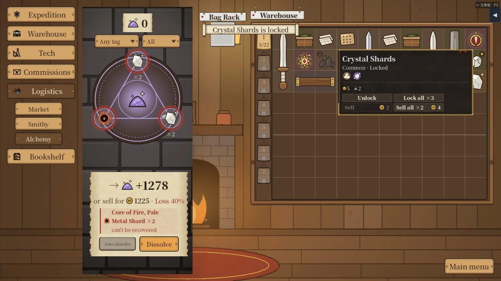
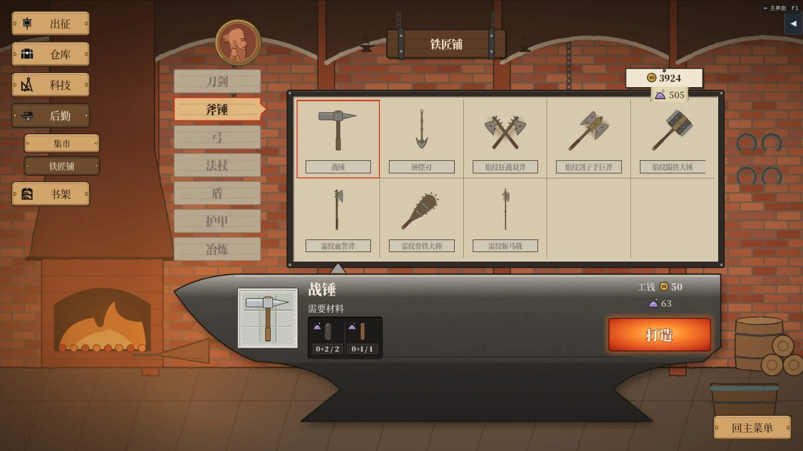

# 复测 v7.01 / v7.02：英文大字炼金页、v8 老档升 v9 用尘补、《照抄》悬停

- 日期：2026-11-21
- 版本：main `bc52a91f`（v7.02，PR #754；含 v7.01 PR #753）
- 结论：**三项都过，没有新问题。**

## 一、全量测试

通过 42332 项断言、349 个套件，用时 778 秒；SCRIPT ERROR 0；静态警告共 0 条。

## 二、英文大字下炼金页不再被截（v7.02）

三档（中文常规、英文大字、中文大字）都走了一遍：打开炼金页、手动勾料、两次点【炼化】、一键炼金。

- 页面排版检查：三档都没有字跑出框。唯一报出的一条是悬停提示浮层，检查脚本把它算进来了，属于误报。
- 英文大字下，筛选下拉「Any tag / All」和两颗键都落在左栏里，【Dissolve】完整可见。过长的名字在警告带里折成两行（「Core of Fire, Pale / Metal Shard ×2」）。
- v6.99 时右边被截的问题已经修好。

## 三、v8 老档升 v9，图鉴亮过的配方能直接用尘补（v7.02）

把 `tests/fixtures/meta_v8.json` 放成 1 号档，从主菜单点「继续」读进来，三档结果一样：

- 读进来后存档升到 version 9。打造过的配方从原来的 `[皮甲]` 变成 `[皮甲, 战锤]`，因为图鉴里战锤亮着。尘还是 5，没被动过。
- 测试辅助做了三件事：一是把教程章记成过了（这份样本档没过教程，委托簿不会露出来）；二是把开放单、协会剧情和《万物可分》记成办完；三是尘加 500。
- 进铁匠铺点战锤，仓库里一件料都没有。两个料格（铁矿石 24 尘一件、橡木 15 尘一件）都可以点；真点两下后，「用尘」显示 2+1，合计 63 尘，【打造】亮起。真点【打造】后，仓库多一把战锤，尘从 505 降到 442，正好扣 63。
- 对照组：图鉴里没亮的制式短剑仍然算没打造过，不能用尘补。

## 四、《照抄》悬停文字（v7.01）

没选配方时【接下】是灰的，悬停显示：中文「先选一张学会的配方」，英文「Pick a recipe you have learned first」。选好配方后【接下】亮起，真点后接单成功。三档都对。

## 证据

[evidence/2026-11-21-v702-alchemy-fit-v9-save/](evidence/2026-11-21-v702-alchemy-fit-v9-save/)：走查脚本 `alch702.gd`（新档走查用 `new`，老档读档用 `v8`）、`copy682.gd`、串跑脚本 `chain702.sh`，以及三档走查日志。
