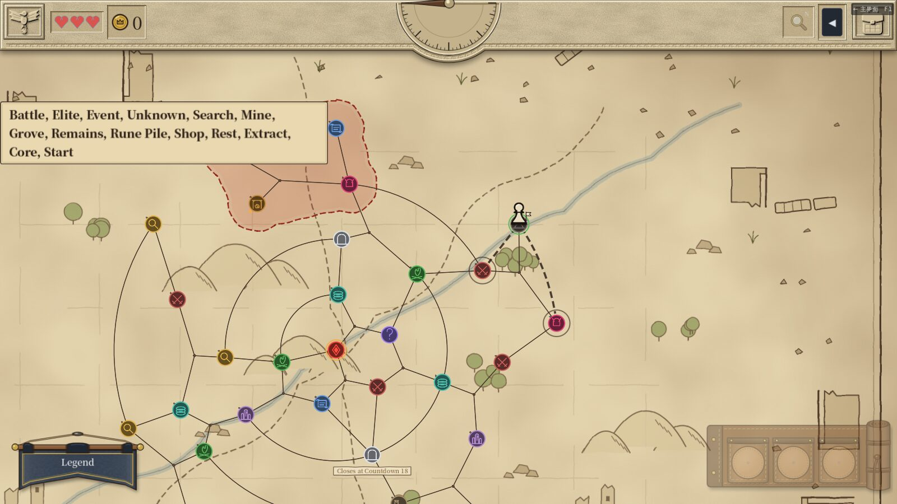
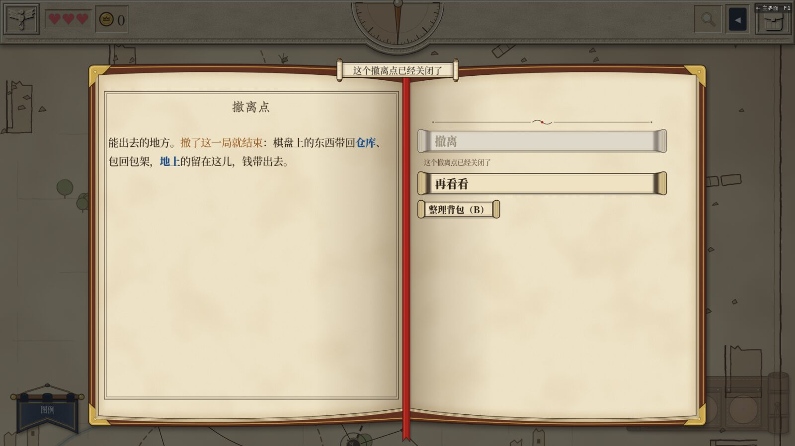
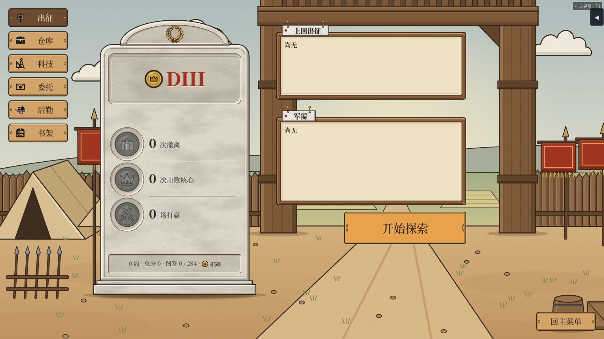
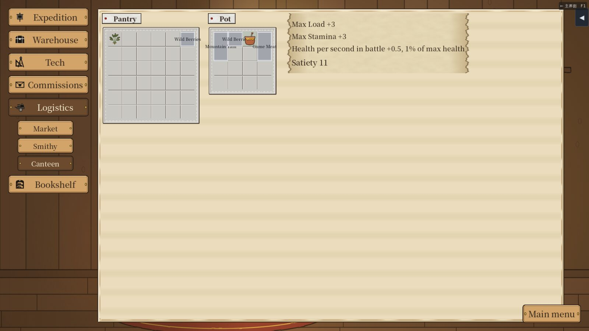

# 复测 v7.14–v7.30：地图图例、撤离点、出征背景、魔晶石退出配方、尘封顶、食堂、难度掉落

- 日期：2026-11-21
- 版本：main `513cf0c2`（v7.30，PR #780）。这一轮测的是 v7.14、v7.17、v7.18、v7.19（报告 368）、v7.23、v7.24、v7.27、v7.28（报告 371）和 v7.30（报告 360 第一批）。v7.31 及之后的合并放到下一轮。
- 结论：**发现 1 处问题，已在 v7.24 修好并复查通过；另有 1 处测试问题，已在 v7.23 修好并验证。其余都通过。另有 3 处观察。**

## 一、全量测试

- 结果：通过 42884 项断言、351 个套件，用时 756 秒；SCRIPT ERROR 0；静态警告共 0 条。
- 场景检查：「合法 100 份，有问题 8 份」，和 v6.99 以来每一轮一样，不是新问题。
- 验证 v7.23 的测试修复：跑全量之前，故意在 `user://test_158/head_stamp` 放了旧戳 `aaa111`。这正是修复前「没记过：要扫」那一项失败的条件。这次 class_cache 套件全过。

## 二、地图图例卷轴（v7.14、v7.24）

三档字号都走了一遍，用的是 `legend714.gd`：

- 进地图时图例默认放下，挂杆下第一行写「图例」（英文「Legend」）。
- 真点「图例」后图例卷起，只剩挂杆和「图例」这一行，宽度不变（中文常规 180、英文大字 276），高度从 660 变成 132。设置文件里的 `legend_open` 写成了 false。
- 卷起后，悬停提示会列出图上有哪些节点。
- 设置文件不清、重新启动再开一局：图例还是卷着的。再真点一次就放下来，「产物」那段也一起回来。
- **问题（已修）**：v7.14 卷起后的悬停提示是白字配浅色羊皮纸底，几乎看不清。v7.24 改成了墨色字，三档复查都正常。
- 0.2 秒的卷起动画没有量准：开了动效后，点完第 5 帧露出的高度已经是 0。无头环境下每帧的间隔不稳定，所以这一项算没验证，需要在真机上看一眼。
- 排版检查在卷起状态下报了「出框」。这些行被卷轴裁掉、看不见，属于检查脚本的误报。

## 三、撤离点（v7.17）

测试辅助直接站到会被倒计时关闭的免费撤离点上，之后的操作都是真点：

- 没关时选项是【撤离】【再看看】【托付】。选「再看看」回到地图，放大镜亮着，真点放大镜能再打开。
- 测试辅助把倒计时拨过一半后，这个点关闭：放大镜变灰，按 N 时提示「这个撤离点已经关闭了」。
- 当作走开又回来再触发事件：【撤离】变灰，下面写「这个撤离点已经关闭了」，【托付】不见了。真点灰着的【撤离】没有反应，这一局也没结束，不会再出现「钱不够」。
- 付费撤离点（费用 50），钱清零后真点【撤离】：结果页写「付不起这个撤离点的费用（50）」，回地图后放大镜亮着。测试辅助给 50 枚后，真点放大镜再真点【撤离】，这一局正常结束。

## 四、出征页背景（v7.18）

新背景显示正常：石碑没有台阶，左右的旗、帐篷和栅栏都完整，没有挡住任何按钮或文字。

## 五、魔晶石退出配方（v7.19，报告 368）和尘封顶（v7.27）

数据核对用的是 `g368.gd`：

- 14 张元素金武和秘银附魔长剑都改成了「晶石素材格」加「腺体」。全部 35 张铁匠配方和所有拼合配方里，没有一张还在用魔晶石。
- 9 种魔晶石都放不进晶石素材格。
- 三张拼合配方分别改用火焰腺、霜腺和电囊。
- 焰狼、霜蟾、电鳗各带一件对应的腺体。货物摊到 3 级才卖三种腺体，各 30 枚；1、2 级不卖。
- 协会鉴定委托自 v6.74 以后没有改动过。

铁匠铺走查用的是 `smith368.gd`，三档字号都测了焰纹陨铁大锤、秘银附魔长剑和雷纹破城矛：

- 往仓库里放进魔晶石后，这三张配方的晶石素材格仍然认作 0 件。
- 没打造过时不能用尘补，用真料能打成。
- 打造过一次后，晶石素材格和金属格都能用尘补。在 v7.27 上腺体也能补了（30 尘一件）。焰纹陨铁大锤全用尘补扣了 270 尘，和应扣的一致。

炼金核对表（`tools/alchemy_arbitrage.gd`，v7.27）：整张配方和单格都没有倒挂。打造再炼有 16 张多得一点尘，但每多一点尘要花 9 到 50 枚工钱，比「买来就炼」的每尘 1.33 到 1.67 枚贵得多。把成品按五成价卖掉也算进去，每一张也都是亏的，所以**没有能刷的循环**。

## 六、灰灯食堂第一批（v7.28，报告 371）

三档字号都走了一遍，用的是 `canteen371.gd`：

- 灰灯到受托后，后勤出现「食堂」键。没办《开伙》时点进去是说明板。委托页真点《开伙》【办理】后提示「食堂开放了」。原来放在主仓库的薄荷叶束搬进了食材仓库（6×6），锅是 4×4。
- 往食材仓库塞铁矿石会被拒。
- 真拖山薯、野莓、蜂蜜罐、兽肉下锅。纸条显示：负重上限 +3、耐力上限 +3、战斗中每秒回血 +0.5 和生命上限的 1%、饱腹 11。
- 食材悬浮窗那一行正确，例如「下锅：负重上限 +3 · 饱腹 +11」。
- 拿着食材不放就点「出征」：东西回到原处，一件没少。
- 出征开局后锅清空，饱腹 11，负重 +3，顶栏显示「饱腹 11」。按这一局的玩家数据算，每秒回血 0.95（0.5 + 45 × 1%）。走到一个新节点后饱腹变成 10，顶栏同步。

## 七、难度 A0–A10 的掉落与搜索（v7.30，报告 360 第一批）

`d360.gd` 对每一档真开 6 局（同一组种子，测试辅助先解锁该档），遍历图上的普通战和精英战，用游戏自己的秒杀路径收尾，走正式的掉落。「能随机掉的持有物」按游戏的算法计数（包、红武、劣化版、券、信物不算）。

| 档 | 持有物下限 | 普通战（47 场）实际掉的比例 | 不够下限的场 | 精英战每场最好那件 | 常规搜索下限 |
|---|---|---|---|---|---|
| A0 | 20% | 61% | 0 | 优良及以上（稀 12、优 8、史 3、传 1） | [1, 0] |
| A1 | 25% | 61% | 0 | 同上 | [1, 1, 0] |
| A2 | 30% | 63% | 0 | 同上 | [2, 1, 1] |
| A3 | 35% | 65% | 0 | 同上 | [2, 2, 1] |
| A4 | 40% | 64% | 0 | 稀有及以上（稀 20、史 3、传 1） | [3, 2, 1] |
| A5 | 50% | 65% | 0 | 同上 | [3, 2, 1] |
| A6 | 60% | 72% | 0 | 同上 | [3, 2, 1] |
| A7 | 70% | 84% | 0 | 同上 | [3, 2, 1] |
| A8 | 80% | 93% | 0 | 史诗及以上（史 23、传 1） | [3, 3, 1] |
| A9 | 80% | 93% | 0 | 同上 | [3, 3, 2] |
| A10 | 80% | 93% | 0 | 同上 | [3, 3, 2] |

每一档、每一场普通战都够下限。精英额外那件的稀有度按 A0 优良、A4 稀有、A8 史诗变化。自由模式这张图上只有常规搜索点，所以进阶搜索下限没有实测，只有单元测试覆盖。

## 八、观察（不算问题）

1. 图例卷起动画在无头环境下量不准（见第二节），需要在真机上看一眼。
2. 食堂的食材都还是占位图，名字直接写在格子上，在两格的锅里会挤出格子（见上图）。等正式图标来了自然就好。右边纸条的字贴着撕边的左缘。
3. 撤离点关闭后，【托付】选项不见了。如果这是有意的设计就没问题。

## 证据

[evidence/2026-11-21-v714-v730-legend-exits-canteen-difficulty/](evidence/2026-11-21-v714-v730-legend-exits-canteen-difficulty/)：

- 走查脚本：`legend714.gd`（图例和撤离点）、`smith368.gd`、`canteen371.gd`
- 数据脚本：`d360.gd`、`g368.gd`
- 串跑脚本：`chain714.sh`
- 日志：三档走查日志、难度和配方数据日志
- 炼金核对表输出：`alchemy_arbitrage.md`
