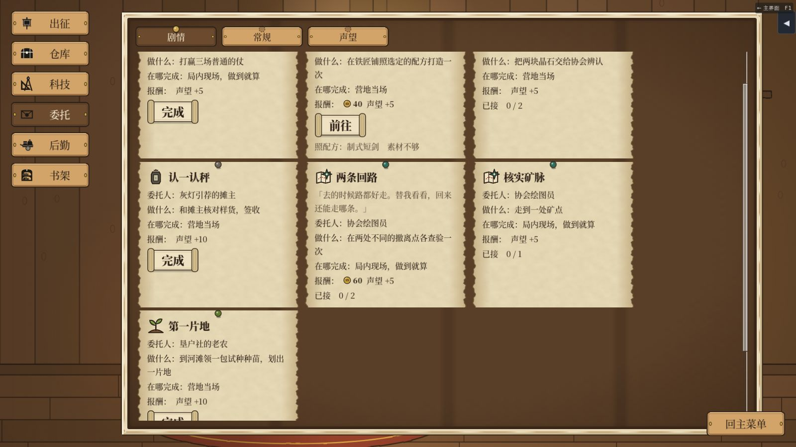
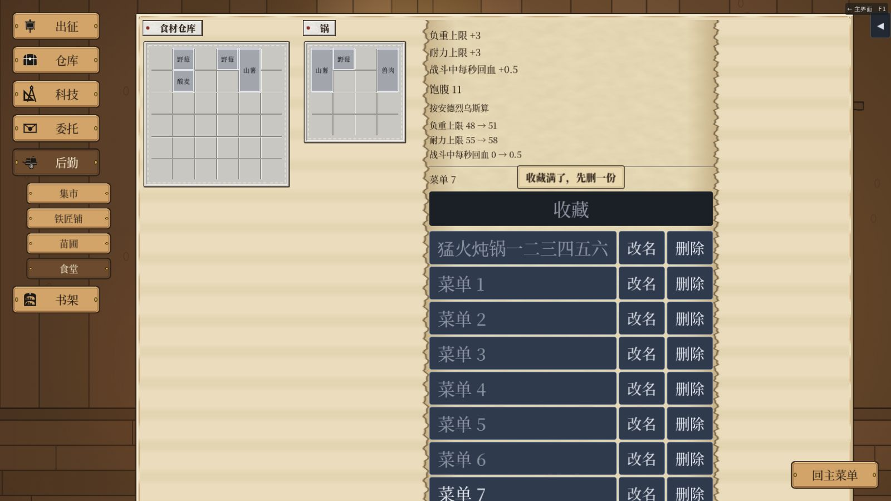
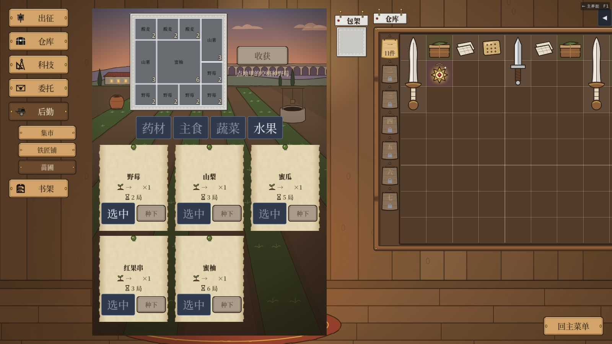
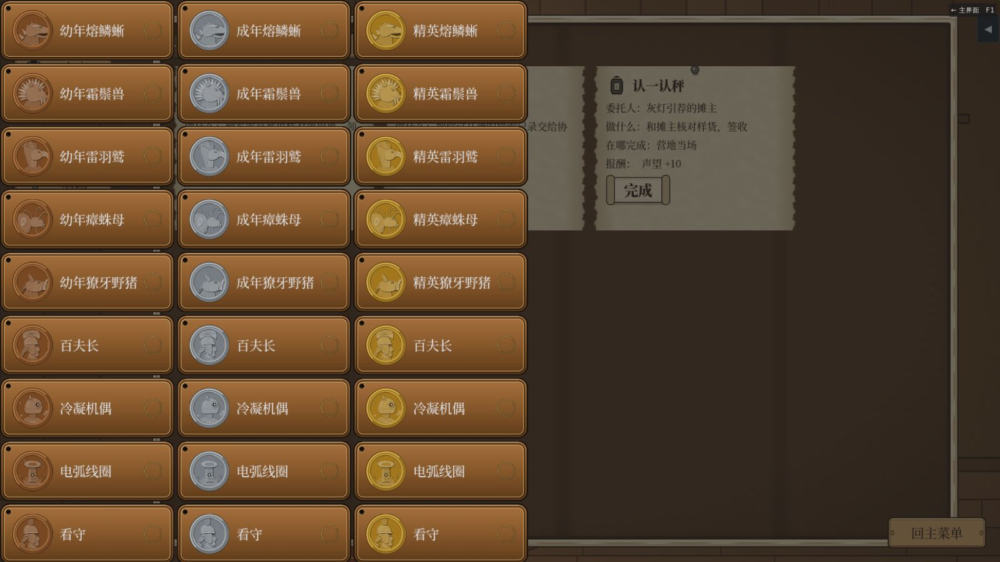
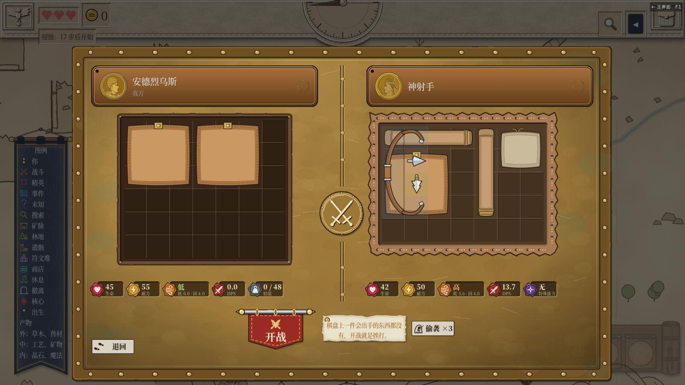

# 复测 v7.31–v7.54：委托【完成】、食堂收藏、苗圃棋盘、新装备与食材、难度第二批与进阶十一、新敌人与头像

- 日期：2026-11-21
- 版本：
  - 全量测试先在 main `501b31c` 上跑了一遍，又在 `a238d27`（v7.54，PR #807）上重跑。
  - 实机走查在 `a869c41`、`b90f479`、`a238d27` 三个版本上分轮跑，最后一轮是 `a238d27`。
- 范围：
  - v7.31（#784 史诗武器）、v7.33（#786 食堂第二批，报告 373）、v7.35（#788 委托流程）、v7.36（#789 护甲与盾）、v7.38（#791 32 种食材，报告 374）、v7.41（#794 难度第二批）
  - v7.42（#795 苗圃食物作物、炼金读食材仓库）、v7.43（#796 原型假人重建）、v7.45（#799 进阶十一）
  - v7.48（#802 护甲图）、v7.49（#798 新敌人第一批、看守、兽名前缀、头像铜银金）、v7.50（#803 零件图）、v7.51（#805 苗圃改棋盘，报告 376）、v7.52（#804 对手肖像镜像）、v7.53（#806 属性素材）、v7.54（#807 深层兽带新素材）
- 结论：**全量测试全过。发现 2 处问题、1 处排版问题、1 处和作者规则不符；原型假人从 v7.49 起又过时了（41 / 60）。其余都通过。另有 3 处观察。**

## 一、全量测试与场景检查

- `501b31c`：通过 44257 项断言、354 个套件，EXIT 0。上一轮报的「319 · 换货不动包和金银那一格」已经通过。
- 场景检查：`check_balance_scenarios --allow-dropped` 退出码 0，结果是「合法 105 份，有问题 3 份（其中挡住的 0 份）」。v7.43 用同一批种子重建的 60 个原型假人和表完全对得上。上一轮报的「原型假人过时」已解决。
- `a238d27`（v7.54）：通过 45344 项断言、355 个套件，用时 827 秒，SCRIPT ERROR 0，EXIT 0。
- **但场景检查在 `a238d27` 上退出码 2**：「合法 105 份，有问题 3 份（挡住 0 份）」没变，但「60 份里 41 份重造出来不一样」。
  - 二分：#800（`7b25345`）、#802（`bc59816`）都是 0；#798（`a869c41`）起就是 2。所以是 **v7.49 新敌人第一批**（新零件、新武器进了道具池）让原型假人又过时了。之后 #803–#807 也一样是 2。
  - 处理：按 v7.43 的做法，用同一批种子重跑 `tools/build_archetypes.gd`。这件事要落实线程来做，测试线程没有改。

## 二、委托流程（v7.35，#788）

用 `comm788.gd` 和 `fb.gd` 真点委托页上的键：

- 营地当场的委托，点【完成】当场结案，然后跳到对应页面：
  - 《领炉牌》跳到铁匠铺；
  - 《把路画回来》跳到出征页；
  - 《第一片地》跳到苗圃。这一张卡要先把它滚进视野再点，见 `fb.gd`。
- 【前往】：《试种》跳到苗圃，《照抄》跳到铁匠铺。
- 【交货】：
  - 仓库里只有 1 件合格的，交了之后委托不结案，进度记 1。
  - 补够之后再点【交货】，委托直接结案，声望到账，卡从页上消失。
- 局里的目标办成后，卡上只剩【完成】，没有【放弃】，这时声望还没到账。真点【完成】后才发声望。
- 告示栏：接一张纸条，办成后托盘还占着。点【完成】后托盘腾出来。
- 排版检查没有发现溢出。

## 三、食堂收藏（v7.33，#786）

用 `canteen786.gd` 和 `fb2.gd` 走查。

**通过：**

- 【收藏】：存下一份，名字默认是「菜单 1」。
- 【改名】：输入 11 个字，被截成 10 个字（上限是 10）。
- 锅倒空后真点菜单牌：摆回来的和原来一模一样。
- 缺料：扔掉蜂蜜罐后再点菜单牌，有的照摆，缺的那一格标红，写「缺 1 样」。
- 收满 8 份后【收藏】键变灰。第 9 次点没有反应。删掉一份后又能存。
- 开局屏第 4 页：列出了全部收藏。真点「清淡」后锅里换成野莓 ×2 加山薯。进地图后饱腹 11，每秒回血 1.0。

**问题 1：营地里刚开的设施，后勤页上没有它的键。**

- 现象：
  - 真点《开伙》【完成】后，委托结案，`facility_open(canteen)` 为 true。但页面跳到了**出征页**，没有跳到食堂。
  - 后勤页的小键仍然只有「集市」「铁匠铺」。
  - 回主菜单再点「继续」后，「苗圃」「食堂」两个键才出现。
- 重现：`fb2.gd` 两次重现了同样的结果。
- 不只食堂这样：
  - 在营地里办成《灰灯会牌》后，食堂已经算开放，但同样没有键。
  - 苗圃（第一片地）和炼金也都要回一次主菜单，键才出来。
- 原因：`meta_screen.gd` 只在建页面时按当时开放的设施生成 `_sub_btns` 和各设施页面。后来开的设施不在 `_sub_btns` 里，`show_page("canteen")` 找不到，就落到了 `expedition`。
- 影响：玩家在营地里办成开设施的委托后，看不到新设施的入口，【完成】也跳错了页。
- 建议：设施开放（或委托结案）时重建后勤小键和对应页面；或者在 `show_page` 遇到刚开的设施时补建。

**排版：收满 8 份时**

- 收藏夹列表超出屏幕下沿，第 8 行被截掉一半。
- 「收藏满了，先删一份」这句话超出了 MealNote 框。
- 菜单键是深色默认样式。这部分还是占位，等 UI 样张。

## 四、苗圃棋盘（v7.42 #795、v7.51 #805）

用 `nurs805.gd` 走查（`a238d27`）。

**通过：**

- 只开苗圃、没开食堂时，只有「药材」一栏（苦叶草、绳麻），没有栏键。食堂开了以后，出现「药材 / 主食 / 蔬菜 / 水果」四栏。
- 种下：
  - 真点【种下】，作物按形状摆进 4×4 的地：酸麦 1 格、山薯 2 格、蜜柚 4 格。
  - 种 6 株后占了 11 格。
- 野莓：先【选中】，再点空格，种在了所点的格子上。一直种到 16 格占满，再种时返回「room」（放不下）。
- 推进 2 局后：酸麦、野莓变熟，画成金边；山薯还差 1 局，蜜柚还差 4 局，都画成暗色并标出局数。各作物熟的时间各不相同，和报告 376 一致。
- 地的片数随垦户社声望增加：
  - 声望 50（信赖）时 2 片；
  - 声望 100 并签约代言后，回主菜单再继续，是 3 片。
- 排版：种满时检查了 35 处，没有溢出。

**问题 2（轻）：苗圃页在营地里不跟着刷新。**

- 测试辅助直接推进了 2 局，又发了 `meta.changed`，再切到苗圃页：地上已经画出熟了的金边，但【收获】还是灰的，悬停提示写「还没熟」。
- 手动调用 `NurseryPanel.refresh()` 后，【收获】就亮了。
- `meta_screen` 没有听 `meta.changed`，苗圃页只在自己发 `changed` 或别的页刷新时才重建。
- 正常玩法里，作物只在一局结束时成熟，回营地会重新进页面，所以多半碰不到这个问题。但它和问题 1 是同一类：营地里数据变了，页面不跟着变。

**没测成（脚本的问题）：**

- 回主菜单再继续后，脚本点「苗圃」，结果停在食堂页上，所以片键（`Plot_N`）没看到，第三片也没种成。
- 老档那一步：把 meta.json 改写成旧的 `plots` 格式后，读回来仍然是新格式，可能是游戏先存了盘。所以老档迁移这一项要靠单元测试 `adopt_legacy`，实机没验证。
- 炼金筛「食材」：因为【收获】是灰的，食材仓库是空的，所以筛选里按设计不出「食材」这一项。

## 五、新装备、食材、材料（#784、#789、#791、#802、#803、#806、#807）

用 `i784.gd`（无头）和 `w784.gd`（仓库悬停）检查：

- 18 把史诗武器和全部新护甲、新盾都有图（含 @2x），说明都是空的。符合「道具说明留空」的规则。
- **和作者规则不符：** 「每件护甲都要放得进 3×3 的包」（作者 17:29），但皮甲 `leather_armor` 和它的三种祝福变体（earth / nature / sun）都是 6 格、4×2，放不进 3×3。
- 冷凝管、电弧线圈芯：v7.50 换上了正式图（含 @2x）。
- 蝰蛇毒腺：已改成「稀有」（v7.53）。
- 11 种属性素材（v7.53）：
  - 数据都在，标签对：魔兽素材、试剂，并标了元素。
  - **图都还是占位**（观察，等美术线程）。
- 深层兽（v7.54）：熔鳞蜥、霜鬃兽、雷羽鹫、瘴蛛母、穴熊的敌人数据里已经带上新素材。
  - 157 场敌人里，A0 出现熔火鳞 9、雷纹羽 16、不熄余烬 1，A4 出现熔火鳞 10、雷纹羽 18、不熄余烬 2。
  - 观察：传说的极寒之泪、不熄余烬在 A0 就会出现。如果它们应该只在高难度出现，要再看一下。
- 食材：
  - 32 种食材数据都在，还各有一个「自然祝福」变体（共 64 个 id）。这是观察，不清楚是不是有意的。
  - 食摊额外进货的 5 种是酸麦、黑豆、禽翅、野葱、野莓。
  - 大部分食材图还是占位。
- 观察：原来的 5 种兽带肉作为 loot_filler，新的 5 种兽没有肉，只带属性素材。

## 六、难度（v7.41 #794、v7.45 #799）

`d794.gd` 无头检查 A0–A11，结果和规格一致：

- A1：敌人装备变好。
- A4：出现带真实伤害的武器，精英带的东西变多。
- A5：休息点减半；撤离点只剩 1 个会关闭的，没有付费撤离点。
- A6：首领生命 ×1.25、速度 ×1.25。
- A8：被追猎失败扣 2 点活力；敌人武器 100% 带品质。
- A10：首领 core_guardian 改名「誓约守卫」。

`a11.gd` 实机走查进阶十一：

- 开局屏：真点【+】在 xvfb 下没加上去，改用 `step_difficulty`（脚本问题，不是游戏问题），升到 Ⅺ。挑战写「远处敌情不明」。
- 进地图：可视距离 2。
  - 1 步外的屠夫看得清：悬浮窗写出生命和 5 件装备，并画出棋盘。
  - 4 步外的核心：悬浮窗只写「敌情不明」，不画棋盘，预览也写「敌情不明」。
- 存档退出再继续：`intel_seen` 还是 6 个，看得清的点和存档前一样。
- **旧档**：把局存档里的 `intel_seen` 删掉再继续，能正常读档，`intel_seen` 按当前位置重新算出 6 个，近处、远处显示和之前一样。
- 没测到：出生点相邻两个点都是战斗，脚本没走出第一步，所以「走近看过的点，走远后仍然看得清」没有实机验证。这一项由单元测试覆盖。

## 七、新敌人、名牌、对手肖像（v7.49 #798、v7.52 #804）

`e798.gd`：

- 名牌墙：10 种敌人 × 铜银金三档，用游戏自己的 `Nameplate` 和 `enemy_layers` 画出。
  - 兽类按档加前缀：熔鳞蜥、霜鬃兽、雷羽鹫、瘴蛛母、獠牙野猪、穴熊在铜档叫「幼年」、银档叫「成年」、金档叫「精英」。
  - 冷凝机偶、电弧线圈（机关）、百夫长、看守没有前缀。
  - 硬币底和外框都跟着金属档变。
  - warden 显示成「看守」。
- 真开局到 A4，走到相邻的普通战，战前屏右边的神射手是**金**底、金框，肖像面朝左（镜像）。左边我方肖像没有镜像。

## 八、要作者或其他线程看的

1. **原型假人又过时**（v7.49 #798 起，41 / 60 份对不上）：请落实线程用同一批种子重造。
2. **问题 1**：营地里新开的设施没有后勤键，《开伙》【完成】跳到了出征页。需要回主菜单再继续才出现。建议交小修或落实线程。
3. **问题 2（轻）**：苗圃页在营地里不跟着 `meta.changed` 刷新，熟了以后【收获】仍灰。
4. **排版**：食堂收满 8 份时列表超出屏幕；「收藏满了，先删一份」超出框。
5. **规则**：皮甲和它的 3 个祝福变体是 4×2，放不进 3×3 的包。
6. 观察：
   - 11 种属性素材的图都是占位；
   - 传说素材在 A0 就会出现；
   - 新兽没有肉。

## 九、走查脚本

都在 [evidence/2026-11-21-v731-v754/](evidence/2026-11-21-v731-v754/)：

- `_head.gdh`：公共部分。各 `.gd` 是用 `_head.gdh` 替换 `##HEAD##` 拼出来的。
- `chain741.sh`：跑一轮。
- 实机走查：`comm788.gd`、`fb.gd`、`fb2.gd`、`canteen786.gd`、`nurs805.gd`、`a11.gd`、`e798.gd`、`w784.gd`。
- 无头检查：`i784.gd`、`d794.gd`。
- 日志：`*.log`。
