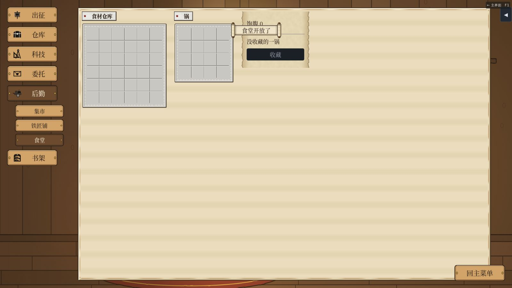
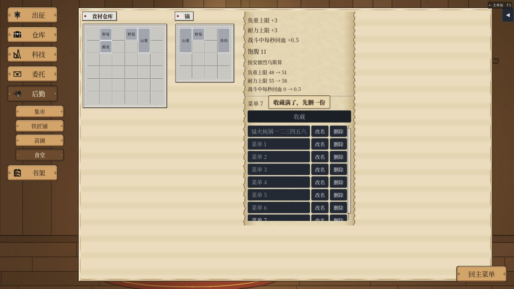
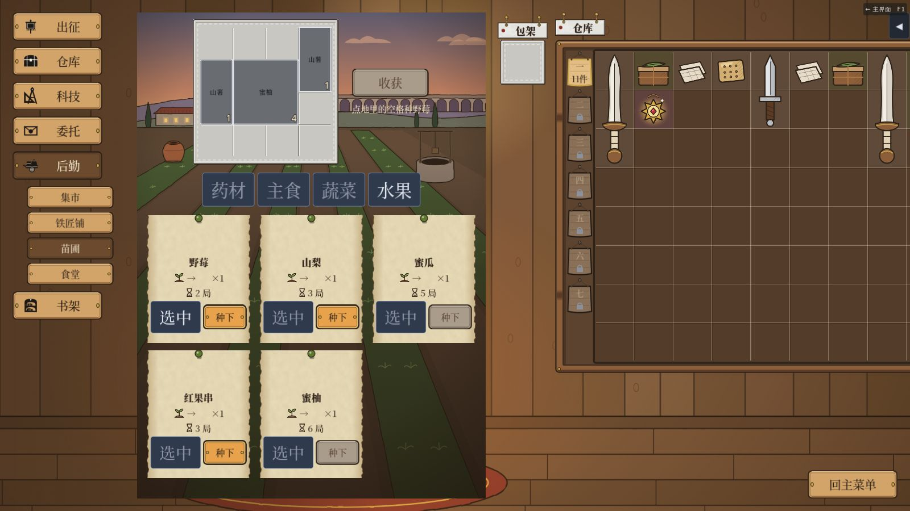

# 复测 v7.63–v7.64：v7.55 四处问题的修复、皮甲 3×2 后重造木桩

- 日期：2026-11-21
- 版本：
  - 修复的复测和全量测试在 main `119d475`（v7.63，PR #816）上跑；
  - 场景检查在 `3acb77a`（v7.64，PR #817）上复核。
- 结论：**v7.55 报的四处都修好了，复测通过。** v7.63 把皮甲改成 3×2 后，场景检查短暂退出码 2，已由 v7.64 修好。

## 一、全量测试与场景检查

- `119d475`：通过 45372 项断言、355 个套件，用时 876 秒；SCRIPT ERROR 0，EXIT 0。
- 场景检查：
  - `119d475` 上退出码 2：「合法 100 份，有问题 8 份（其中挡住的 7 份）」。
    - 挡住的 7 份都是 illegal_layout（armor/1/1、armor/2/1、armor/3/2、blade/3/2、blade+drill/3/2、blade+sun/3/2、shield/2/2）。
    - 另外 10 份按原种子重造后和表对不上。
    - 原因：皮甲从 4×2 改成 3×2 后，表里存的摆位不再合法。
  - `3acb77a`（v7.64 重造木桩）上退出码 0：60 份重造和表一致；「合法 107 份，有问题 1 份（挡住 0 份）」。
- v7.64 只改了 `archetypes.json`。重跑了读这份表的三个套件（test_balance_242、test_balance_statistics、test_assumptions_245），都通过。

## 二、v7.55 四处问题的复测

1. **营地里新开的设施没有后勤键**：已修好。
   - 在营地里办成《灰灯会牌》后，后勤小键当场多出「食堂」。
   - 真点《开伙》【完成】后直接跳到食堂页，告示写「食堂开放了」。
2. **苗圃页不刷新**：已修好。
   - 测试辅助推进 2 局后，切到苗圃页，【收获】是亮的，悬停写「熟了 8 株」。
   - 真点【收获】后，熟了的 8 株收进食材仓库：酸麦 3、野莓 5，另外多出金穗麦 1（主食的额外收成）。没熟的 3 株（山薯 ×2、蜜柚）留在地里。
3. **食堂收满 8 份**：收藏列表装进了带滚动条的框，不再超出屏幕。
   - 「收藏满了，先删一份」是【收藏】键上的悬浮提示，不是页面上的文字。上一轮的排版检查把它当成了出框，属于**走查脚本误报**。
4. **皮甲**：`leather_armor` 和三种祝福版都放得进 3×3 的包（`i784.gd` 的「放不进 3×3 的护甲」列表为空）。

## 三、上一轮没测成、这次补上的

- **苗圃片键**：垦户社声望 100 并签约代言后，苗圃页顶上有「第 1 片 / 第 2 片 / 第 3 片」三个键。点第 3 片，种下长葱（1×3），占 3 格。
- **炼金筛「食材」**：食材仓库有 9 件时，筛选里多出「食材」一项。一键炼金的范围是 9 件，计划全勾、跳过 0。
  - 【一键炼金】和【炼化】的键这次没点到：脚本切页的时机不对，键还不在页上。这一步算没验证，下一轮修脚本再测。

## 四、走查脚本的问题（不是游戏问题）

- 上一轮报「片键没出现」和「收获后没收走」，都是脚本造成的：
  - 片键：脚本在同一帧里先切后勤页签、再点「苗圃」，页签会把页面切回上次停留的子页（食堂）。分两帧点就正常。
  - 收获：脚本手动 `refresh()` 后，点的还是被换掉的旧按钮。
- 老档（旧 `plots` 格式）迁移：脚本改写 meta.json 后，游戏又按新格式存了盘，所以没有读到旧格式。这一项仍没有实机验证，由单元测试 `adopt_legacy` 覆盖。

## 五、日志

在 [evidence/2026-11-21-v763-v764/](evidence/2026-11-21-v763-v764/)。`nurs805.gd` 是这次修过的版本，其余脚本见 [evidence/2026-11-21-v731-v754/](evidence/2026-11-21-v731-v754/)。
